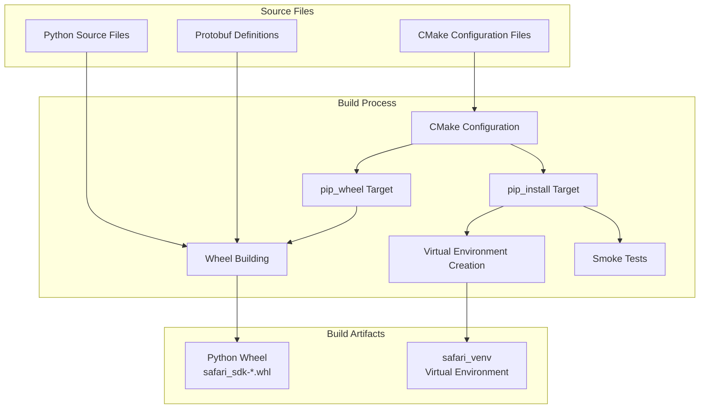
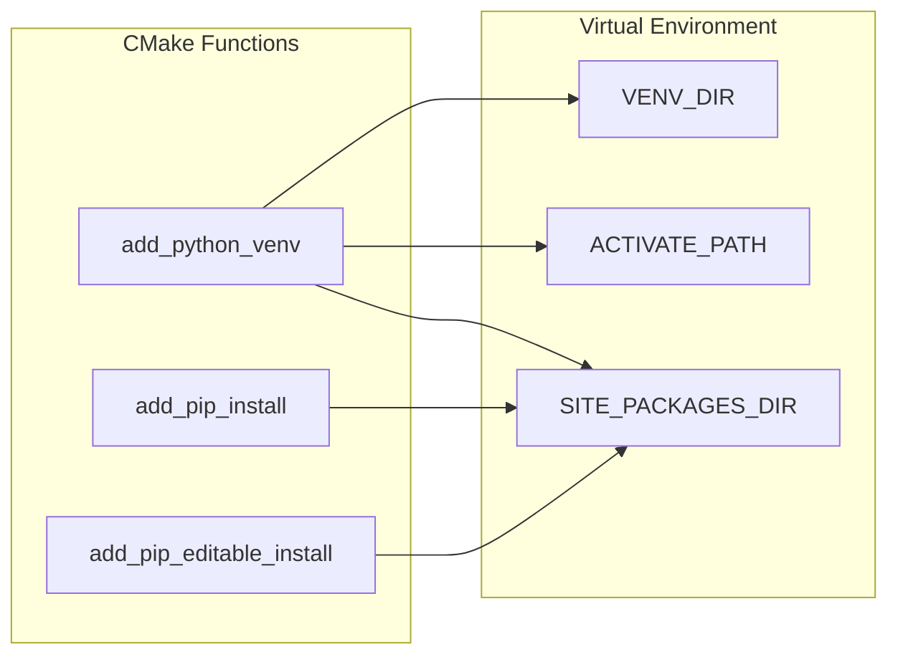

<!-- source: DeepWiki mcp.deepwiki.com · repo google-deepmind/gemini-robotics-sdk · page 8.2 Development Setup · fetched 2026-10-26 -->

# Development Setup

<details>
<summary>Relevant source files</summary>

The following files were used as context for generating this wiki page:

- [cmake/python-packaging.cmake](cmake/python-packaging.cmake)
- [scripts/build_wheel.sh](scripts/build_wheel.sh)

</details>


This document provides instructions for setting up a development environment for the Gemini Robotics SDK, building the package from source, and running tests. For information about the overall build system architecture, see [CMake Configuration](#8.1).

## Overview

The Gemini Robotics SDK uses a CMake-based build system that handles Python packaging, protobuf generation, and dependency management. This document covers:

1. Setting up the development environment
2. Building the SDK from source
3. Creating and using virtual environments
4. Running tests and smoke tests

Sources: [scripts/build_wheel.sh:16-41]()

## Environment Setup

### Prerequisites

To develop the Gemini Robotics SDK, you need:

- Python 3.10 or higher
- CMake 3.10 or higher
- Bash shell environment
- Git

### Setting Up the Development Environment

1. Clone the repository:
   ```bash
   git clone https://github.com/google-deepmind/gemini-robotics-sdk.git
   cd gemini-robotics-sdk
   ```

2. Set the `SAFARI_DIR` environment variable to point to the repository root:
   ```bash
   export SAFARI_DIR=$(pwd)
   ```

Sources: [scripts/build_wheel.sh:19-21]()

## Building the SDK

The SDK can be built using the provided build script or manually with CMake commands.

### Using the Build Script

The repository includes a build script that automates the build process:

```bash
./scripts/build_wheel.sh
```

This script:
1. Creates a build directory
2. Runs CMake configuration
3. Builds the Python wheel
4. Installs the package in a virtual environment
5. Runs smoke tests to verify the installation

Sources: [scripts/build_wheel.sh:16-41]()

### Manual Build Process

If you prefer to build manually, follow these steps:

1. Create and navigate to the build directory:
   ```bash
   mkdir -p build
   cd build
   ```

2. Configure the build with CMake:
   ```bash
   cmake ..
   ```

3. Build the Python wheel:
   ```bash
   make pip_wheel
   ```

4. Install the package in a virtual environment:
   ```bash
   make pip_install
   ```

The built wheel file will be available in the `dist/` directory.

Sources: [scripts/build_wheel.sh:19-23]()

## Build System Architecture

The build system uses CMake with custom functions for Python packaging and virtual environment management.



Sources: [cmake/python-packaging.cmake:15-36](), [scripts/build_wheel.sh:22-23]()

## Virtual Environments

The build system creates and manages Python virtual environments for development and testing.

### Default Virtual Environment

When you build the SDK using the provided targets, a virtual environment named `safari_venv` is automatically created in the build directory. This environment contains the installed SDK and its dependencies.

To activate this environment:

```bash
source build/safari_venv/bin/activate
```

Sources: [cmake/python-packaging.cmake:324-357](), [scripts/build_wheel.sh:27]()

### Creating Custom Virtual Environments

The CMake build system provides functions to create and manage custom virtual environments:



The main CMake functions for virtual environment management are:

- `add_python_venv`: Creates a Python virtual environment
- `add_pip_install`: Installs a package into a virtual environment
- `add_pip_editable_install`: Installs a package in editable mode

Sources: [cmake/python-packaging.cmake:324-357](), [cmake/python-packaging.cmake:506-562](), [cmake/python-packaging.cmake:576-608]()

## Testing

### Smoke Tests

The build script includes basic smoke tests to verify that the SDK is correctly installed and importable:

```bash
python3 -c "from safari_sdk.logging.python import stream_logger"
python3 -c "from safari_sdk.model import saved_model_policy"
python3 -c "from safari_sdk.logging.python import mcap_episodic_logger"
flywheel-cli help
```

These tests check that key modules can be imported and that the command-line interface works.

Sources: [scripts/build_wheel.sh:26-35]()

### Running Tests Manually

To run tests manually, activate the virtual environment and run the test commands:

```bash
source build/safari_venv/bin/activate
python -c "from safari_sdk.logging.python import stream_logger"
flywheel-cli help
deactivate
```

## Development Workflow

A typical development workflow involves:

1. Making changes to the source code
2. Building the package with `make pip_wheel`
3. Installing the package with `make pip_install` or in editable mode
4. Testing the changes
5. Repeating as necessary

### Editable Installs

For faster development iterations, you can install the package in editable mode, which allows changes to the source code to be immediately reflected without reinstalling:

```bash
cd build
make pip_editable_install  # If this target is available
```

Alternatively, you can use pip directly:

```bash
pip install -e .
```

Sources: [cmake/python-packaging.cmake:576-608]()

## Package Structure

The built wheel package follows this structure:

```
safari_sdk-*.whl
├── safari_sdk/
│   ├── __init__.py
│   ├── logging/
│   │   ├── __init__.py
│   │   └── python/
│   │       ├── stream_logger.py
│   │       └── mcap_episodic_logger.py
│   ├── model/
│   │   ├── __init__.py
│   │   └── saved_model_policy.py
│   └── flywheel/
│       └── __init__.py
└── flywheel-cli
```

Sources: [scripts/build_wheel.sh:29-33]()

## Troubleshooting

### Common Issues

1. **CMake not finding Python**:
   - Ensure Python 3.10+ is installed and in your PATH
   - Set `CMAKE_PYTHON_VERSION` to specify a different Python version

2. **Build failures**:
   - Check that all dependencies are installed
   - Ensure the `SAFARI_DIR` environment variable is set correctly

3. **Import errors after installation**:
   - Verify that the virtual environment is activated
   - Check that the package was installed correctly with `pip list`

Sources: [cmake/python-packaging.cmake:32-47]()

## Conclusion

This document covered the development setup for the Gemini Robotics SDK, including building from source, managing virtual environments, and testing. For more information about the CMake build system configuration, see [CMake Configuration](#8.1).

---

