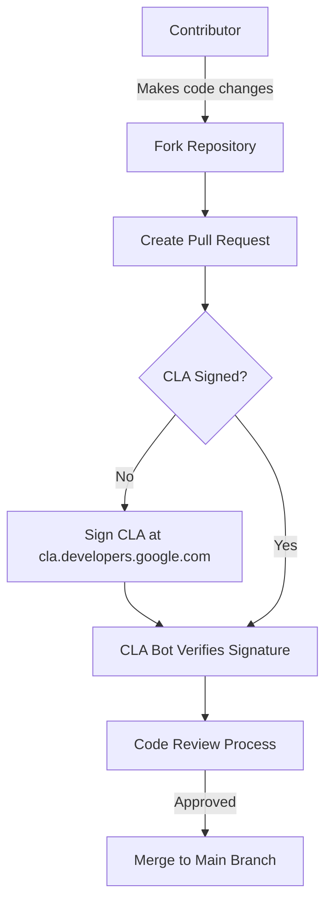
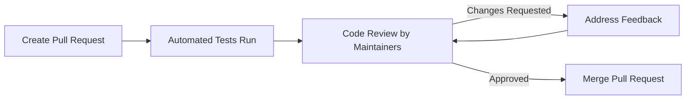
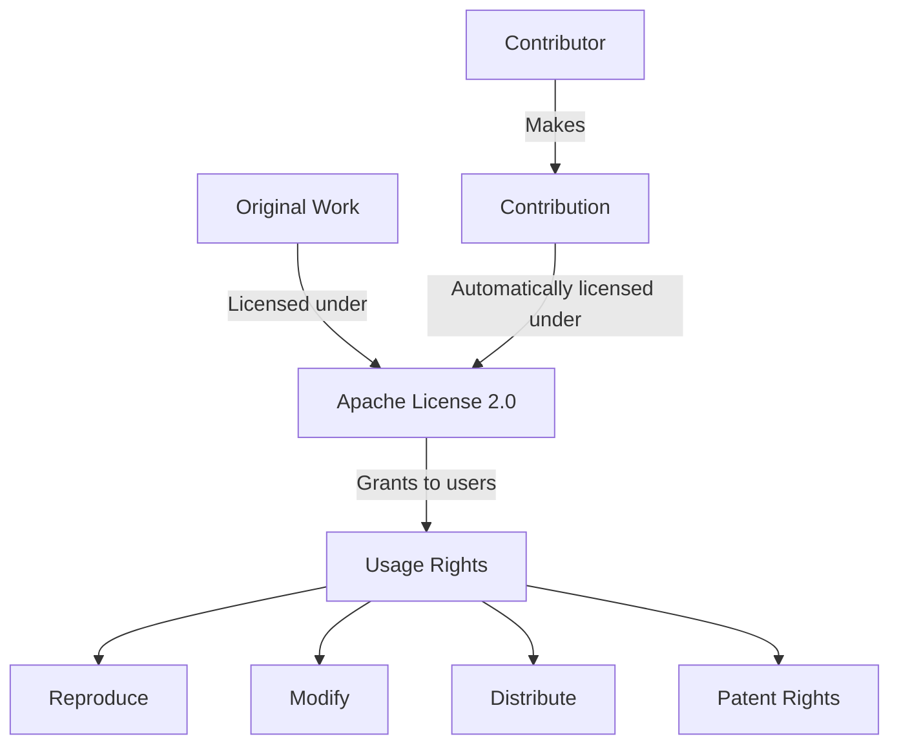
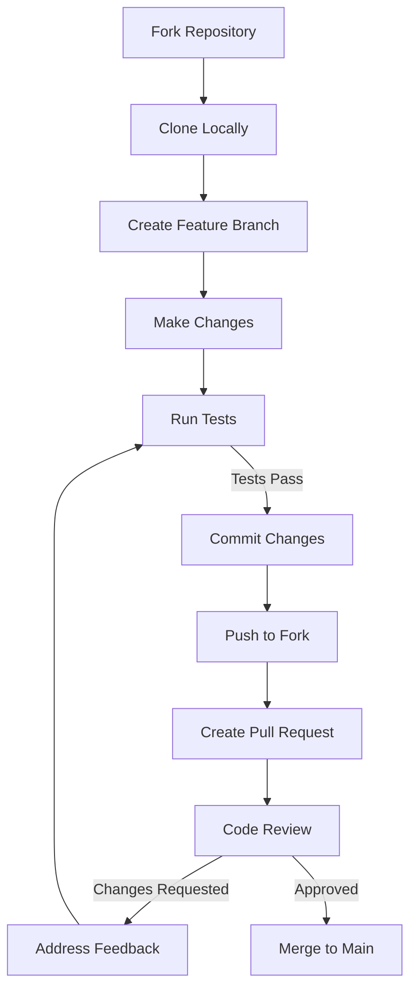

<!-- source: DeepWiki mcp.deepwiki.com · repo google-deepmind/gemini-robotics-sdk · page 9 Contributing · fetched 2026-10-26 -->

# Contributing

Relevant source files

The following files were used as context for generating this wiki page:

- [CONTRIBUTING.md](CONTRIBUTING.md)
- [LICENSE](LICENSE)

This document outlines the process for contributing to the Gemini Robotics SDK. It covers the necessary legal agreements, code review process, and community guidelines that contributors must follow.

For information about setting up a development environment, see [Development Setup](#8.2).

## Contributor License Agreement

All contributions to the Gemini Robotics SDK must be accompanied by a Contributor License Agreement (CLA). This agreement ensures that Google has the necessary permissions to use and redistribute your contributions as part of the project.

Key points about the CLA:

- You (or your employer) retain the copyright to your contribution
- The CLA gives Google permission to use and redistribute your contributions
- You can sign the CLA at https://cla.developers.google.com/
- If you've already submitted a CLA for another Google project, you likely don't need to submit a new one

Sources: [CONTRIBUTING.md:3-13]()

## Code Review Process

All submissions to the Gemini Robotics SDK, including those from project members, require code review before they can be merged.

The project welcomes pull requests from external contributors. The review process helps ensure code quality, consistency, and adherence to project standards.

Sources: [CONTRIBUTING.md:15-18]()

## Community Guidelines

The Gemini Robotics SDK follows [Google's Open Source Community Guidelines](https://opensource.google/conduct/). These guidelines establish expectations for behavior within the project community, promoting a respectful and inclusive environment for all contributors.

Key principles include:

- Be respectful and inclusive
- Be collaborative
- Be pragmatic
- Support others in the community

Sources: [CONTRIBUTING.md:20-23]()

## License Information

The Gemini Robotics SDK is licensed under the Apache License, Version 2.0. This is an open-source license that allows for free use, modification, and distribution of the software, subject to certain conditions.

### Key License Terms

| Permissions | Limitations | Conditions |
|-------------|-------------|------------|
| Commercial use | Trademark use | License and copyright notice |
| Modification | Liability | State changes |
| Distribution | Warranty | |
| Patent use | | |
| Private use | | |

### Contribution Licensing

Unless explicitly stated otherwise, any contribution intentionally submitted for inclusion in the Gemini Robotics SDK will be under the terms of the Apache License 2.0, without any additional terms or conditions.

Sources: [LICENSE:1-202](), [CONTRIBUTING.md:3-13]()

## Contribution Workflow

The following diagram illustrates the typical workflow for contributing to the Gemini Robotics SDK:

Sources: [CONTRIBUTING.md:15-18]()

## Best Practices for Contributors

When contributing to the Gemini Robotics SDK, consider the following best practices:

1. **Follow the existing code style**: Maintain consistency with the project's coding conventions
2. **Write clear commit messages**: Describe what changes were made and why
3. **Include tests**: Add appropriate tests for new features or bug fixes
4. **Update documentation**: Ensure documentation reflects your changes
5. **Keep pull requests focused**: Address a single concern per pull request
6. **Be responsive**: Respond to feedback and questions in a timely manner

Sources: [CONTRIBUTING.md:15-18]()

## Reporting Issues

If you encounter bugs or have feature requests, please report them through the GitHub issue tracker. When reporting issues:

1. Check if the issue already exists
2. Use a clear and descriptive title
3. Provide detailed steps to reproduce the issue
4. Include relevant information about your environment
5. Attach screenshots or logs if applicable

Sources: [CONTRIBUTING.md:20-23]()

---

