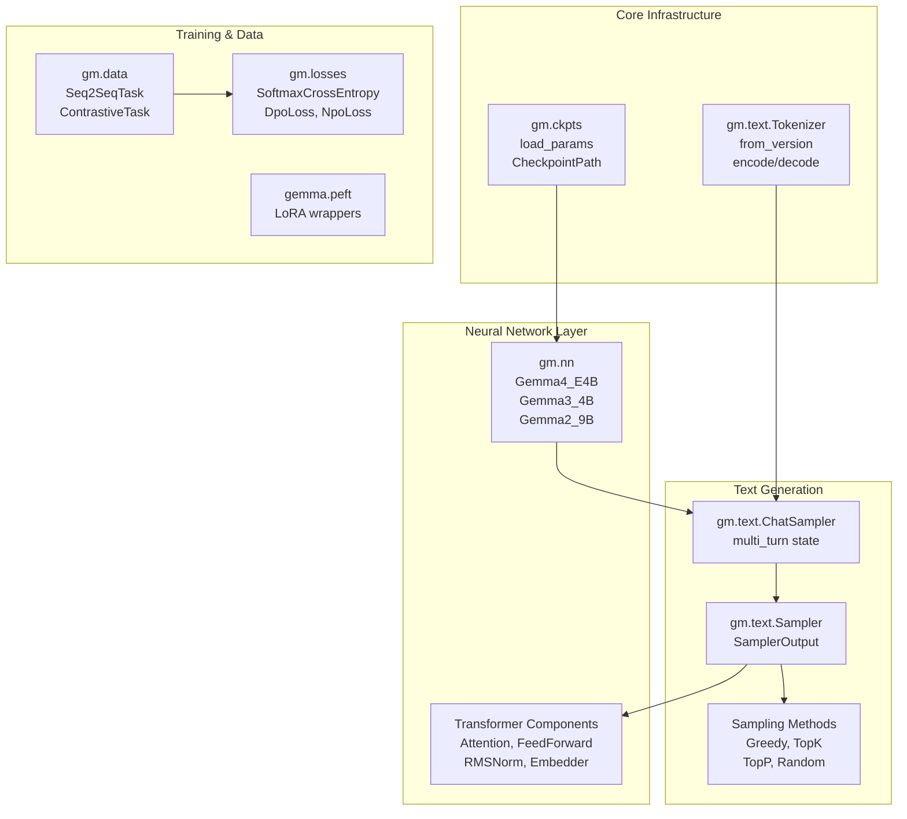

<!-- source: DeepWiki mcp.deepwiki.com · repo google-deepmind/gemma · page 1 Overview · fetched 2026-10-26 -->

# Overview

<details>
<summary>Relevant source files</summary>

The following files were used as context for generating this wiki page:

- [CHANGELOG.md](CHANGELOG.md)
- [README.md](README.md)
- [docs/checkpoints.md](docs/checkpoints.md)
- [docs/images/favicon.png](docs/images/favicon.png)
- [docs/overview.md](docs/overview.md)
- [gemma/__init__.py](gemma/__init__.py)
- [pyproject.toml](pyproject.toml)

</details>


## Purpose and Scope

The Gemma repository provides a JAX-based library for the Gemma family of open-weights Large Language Models (LLMs) developed by Google DeepMind, based on Gemini research and technology [README.md:7-13](). The library supports text generation, multi-modal conversations (including image and audio inputs), parameter-efficient fine-tuning (LoRA, DPO/NPO), evaluation workflows, and diffusion-based text generation [README.md:31-68](), [CHANGELOG.md:26-28]().

The library is built on [JAX](https://github.com/jax-ml/jax) and [Flax](https://github.com/google/flax) for model definitions and integrates with the [Kauldron](https://github.com/google-research/kauldron) framework for training [pyproject.toml:42-46](). Core functionality is exposed through the `gemma.gm` namespace, which aggregates submodules for checkpoints, data, neural networks, and text processing [gemma/__init__.py:22-27]().

This overview covers repository architecture, installation, and basic usage patterns. For detailed subsystem documentation, see:
- [Package Structure](#1.1) — Organization of the `gemma.gm` package and its submodules.
- [Installation and Setup](#1.2) — Hardware configuration, JAX setup, and checkpoint downloading.

Sources: [README.md:7-13](), [README.md:31-68](), [pyproject.toml:42-46](), [gemma/__init__.py:22-27](), [CHANGELOG.md:26-28]()

## Repository Architecture

The Gemma repository implements a layered architecture where high-level samplers orchestrate lower-level neural network components, tokenizers, and checkpoint loaders.

### System Architecture Overview



Sources: [README.md:35-58](), [pyproject.toml:34-58]()

## Inference Pipeline: User Input to Generated Text

The library provides multiple levels of abstraction for text generation, supporting the transition from natural language and multimodal inputs to JAX code execution.

### Inference Flow: Natural Language to Code Entities

```mermaid
graph LR
    User["User Input:<br/>Text + Images + Audio"] --> Chat["ChatSampler.chat()<br/>gm.text.ChatSampler"]
    
    Chat --> Smp["Sampler.sample()<br/>gm.text.Sampler"]
    
    Smp --> Tok["Tokenizer.encode()<br/>gm.text.Tokenizer"]
    
    Tok --> Loop["SamplerLoop<br/>jax.lax.while_loop"]
    
    Loop --> MDL["Model.apply()<br/>gm.nn.Gemma4_E4B"]
    
    MDL --> SM["SamplingMethod<br/>gm.text.Greedy"]
    
    SM --> DTok["Tokenizer.decode()"]
    
    DTok --> Out["Generated Text"]
```



**Abstraction Levels:**

| Level | API | Use Case |
|-------|-----|----------|
| **High** | `ChatSampler` | Conversational interfaces with automatic multi-turn state management and multimodal dispatch [README.md:43-47](). |
| **Mid** | `Sampler` | Mid-level API for manual state control, batch handling, and custom sampling configuration. |
| **Low** | `model.apply()` | Direct access to model parameters and KV cache for research or custom loops. |

Sources: [README.md:35-58](), [README.md:43-47]()

## Installation and Setup

### System Requirements
Gemma can run on CPU, GPU, and TPU. For GPU, 8GB+ RAM is recommended for 2B models, and 24GB+ for 7B+ models [README.md:90-94]().

### Quick Start
1.  **Install JAX**: Follow platform-specific instructions for CPU/GPU/TPU [README.md:22-23]().
2.  **Install Gemma**:
    ```sh
    pip install gemma
    ```
3.  **Download Weights**: Models are available via KaggleHub [docs/checkpoints.md:3-10]().
    ```python
    import kagglehub
    # Login required for some models
    kagglehub.login()
    # Download specific version
    weights_dir = kagglehub.model_download('google/gemma-3/flax/gemma3-4b-it')
    ```

For a detailed guide, see [Installation and Setup](#1.2).

Sources: [README.md:20-29](), [README.md:90-94](), [docs/checkpoints.md:3-33]()

## Basic Usage Patterns

### Multi-turn, Multi-modal Conversation
The `ChatSampler` provides a high-level API for interacting with Gemma models, supporting images and conversation history [README.md:35-58]().

```python
from gemma import gm

# Initialize Model and Parameters
model = gm.nn.Gemma4_E4B()
params = gm.ckpts.load_params(gm.ckpts.CheckpointPath.GEMMA4_E4B_IT)

# Setup Stateful Sampler
sampler = gm.text.ChatSampler(
    model=model,
    params=params,
    multi_turn=True,
)

# Multimodal interaction
prompt = "Which of the 2 images do you prefer? Image 1: <|image|> Image 2: <|image|>"
out = sampler.chat(prompt, images=[image1, image2])
```

Sources: [README.md:35-58]()

## Development and Testing

The repository uses `pytest` for unit testing and `pyink` for formatting to follow the Google style guide [pyproject.toml:72-78]().

- **Unittests**: Automated via GitHub Actions using `pytest-xdist` for parallel execution [README.md:3-4](), [pyproject.toml:72-78]().
- **Versioning**: A new PyPI release is triggered whenever `__version__` in `gemma/__init__.py` is increased [gemma/__init__.py:17-19]().
- **Import Convention**: The library enforces `from gemma import gm` and will raise an `AttributeError` if `import gemma as gm` is attempted to ensure correct namespace usage [gemma/__init__.py:22-27]().

For detailed contributor information, see [Development](#8).

Sources: [README.md:3-4](), [gemma/__init__.py:17-27](), [pyproject.toml:72-78]()

---

