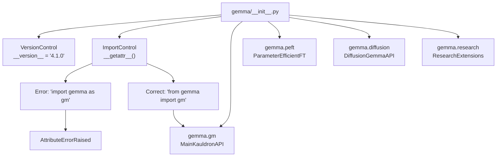
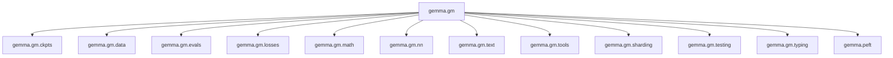

<!-- source: DeepWiki mcp.deepwiki.com · repo google-deepmind/gemma · page 1.1 Package Structure · fetched 2026-10-26 -->

# Package Structure

Relevant source files

The following files were used as context for generating this wiki page:

- [CHANGELOG.md](CHANGELOG.md)
- [gemma/__init__.py](gemma/__init__.py)
- [gemma/gm/__init__.py](gemma/gm/__init__.py)
- [gemma/gm/ckpts/__init__.py](gemma/gm/ckpts/__init__.py)
- [gemma/gm/math/__init__.py](gemma/gm/math/__init__.py)
- [gemma/gm/math/_misc_test.py](gemma/gm/math/_misc_test.py)

This document details the organization of the Gemma library's package structure, focusing on the `gemma.gm` Kauldron API, its submodules (`ckpts`, `nn`, `text`, `data`, etc.), the import conventions enforced by `__init__.py`, the `gm` namespace structure, and the top-level `gemma.diffusion`, `gemma.peft`, and `gemma.research` packages.

## Overview and Top-Level Package Organization

The Gemma library is organized around a strictly controlled root namespace that guides users toward correct import patterns and exposes specialized top-level packages alongside the main Kauldron-based API.

**Natural Language Space to Code Entity Space: Import Control and Top-Level Packages**

The root package `gemma` implements a guarded `__getattr__` method in `gemma/__init__.py` to intercept incorrect top-level imports:
- **Incorrect**: `import gemma as gm` → Triggers `__getattr__` and raises an `AttributeError` pointing to the correct pattern [gemma/__init__.py:22-27]().
- **Correct**: `from gemma import gm` → Exposes the Kauldron-compatible submodule ecosystem [gemma/gm/__init__.py:21-34]().

The top-level package exports the package version (`__version__ = '4.1.0'`) which is synchronized with automated PyPI releases and `CHANGELOG.md` entries [gemma/__init__.py:17-19](), [CHANGELOG.md:26-29]().

Sources: [gemma/__init__.py:1-27](), [CHANGELOG.md:24-46]()

## Kauldron API Structure (`gemma.gm`)

The `gemma.gm` package provides the core JAX/Kauldron framework interface for building, loading, and training Gemma models. It relies on lazy loading via `etils.epy.lazy_api_imports` to avoid premature instantiation of heavy submodules [gemma/gm/__init__.py:17-34]().

**Natural Language Space to Code Entity Space: Kauldron API & Submodules**

The lazy import mechanism defers submodule evaluation until accessed, ensuring fast startup times and minimal memory consumption.

Sources: [gemma/gm/__init__.py:15-34]()

## Submodule Organization

The `gemma.gm` namespace and auxiliary top-level packages are organized into core, specialized, and research modules.

### Core Modules

| Module | Purpose | Key Components |
|--------|---------|----------------|
| `nn` | Neural network building blocks | Transformer architectures, attention mechanisms, embeddings [gemma/gm/__init__.py:28-28]() |
| `text` | Text processing and generation | `Tokenizer`, `Sampler`, `ChatSampler` [gemma/gm/__init__.py:29-29]() |
| `ckpts` | Model checkpoint management | `load_params`, `save_params`, `LoadCheckpoint`, `SkipLoRA` [gemma/gm/ckpts/__init__.py:19-24]() |
| `data` | Data pipeline utilities | `Seq2SeqTask`, `ContrastiveTask`, Parquet loaders [gemma/gm/__init__.py:24-24]() |

Sources: [gemma/gm/__init__.py:23-30](), [gemma/gm/ckpts/__init__.py:15-24]()

### Specialized and Auxiliary Modules

| Module | Purpose | Key Components |
|--------|---------|----------------|
| `evals` | Model evaluation | `SamplerEvaluator` [gemma/gm/__init__.py:25-25]() |
| `losses` | Training loss functions | Cross-entropy, DPO, and NPO losses [gemma/gm/__init__.py:26-26]() |
| `tools` | External tool integration | `ToolSampler`, `McpToolHandler` [gemma/gm/__init__.py:30-30]() |
| `sharding` | Model parallelism | FSDP and mesh sharding utilities [gemma/gm/__init__.py:31-31]() |
| `math` | Mathematical operations | `apply_rope`, `count_consecutive` [gemma/gm/math/__init__.py:15-21]() |
| `testing` | Development utilities | Test fixtures and mock routines [gemma/gm/__init__.py:32-32]() |
| `typing` | Type definitions | Shared type annotations [gemma/gm/__init__.py:33-33]() |

Sources: [gemma/gm/__init__.py:25-33](), [gemma/gm/math/__init__.py:15-21]()

### Top-Level Extension Packages

Beyond `gemma.gm`, the codebase exposes specialized top-level packages:
- `gemma.diffusion`: Implements diffusion-based (non-autoregressive) text generation models, sampling processes, and the Hackable Diffusion fine-tuning adapter.
- `gemma.peft`: Provides parameter-efficient fine-tuning primitives (such as LoRA and quantization-aware wrappers) exposed both at the top-level and via `gm.peft` [gemma/gm/__init__.py:34-34]().
- `gemma.research`: Houses experimental architectures and research extensions like T5Gemma (an encoder-decoder model based on Gemma 2).

Sources: [gemma/gm/__init__.py:34-34](), [CHANGELOG.md:28-28]()

---

