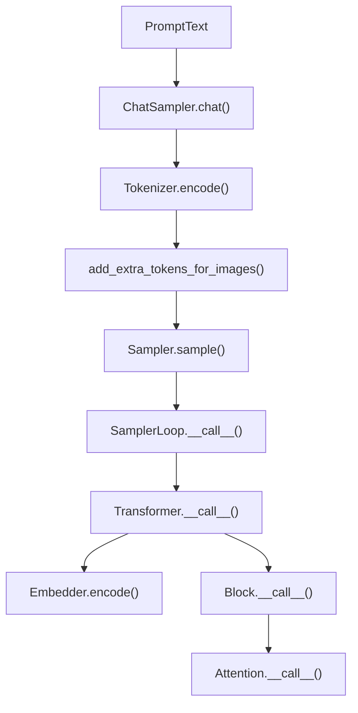
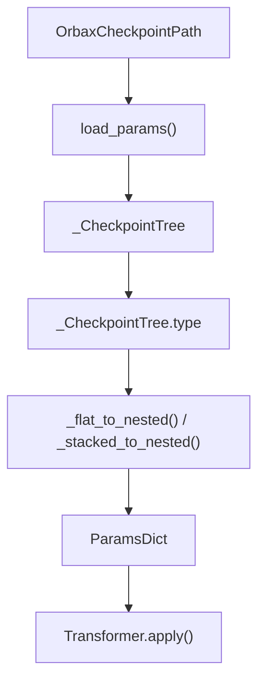
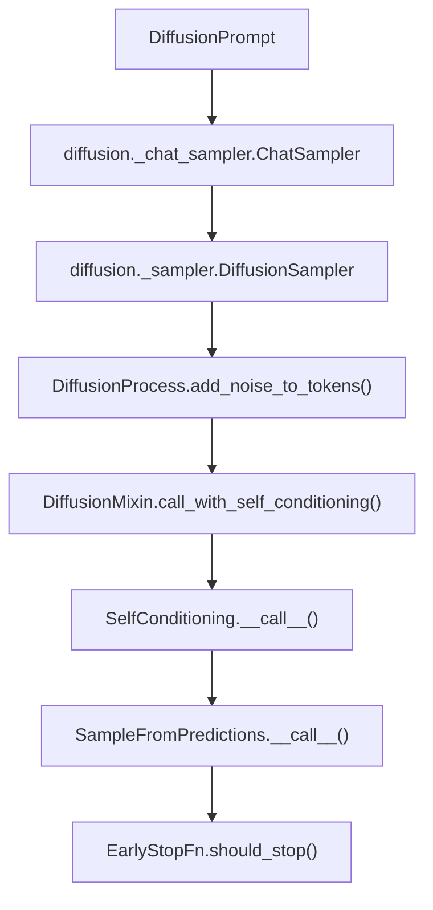

<!-- source: DeepWiki mcp.deepwiki.com · repo google-deepmind/gemma · page 10 Glossary · fetched 2026-10-26 -->

# Glossary

Relevant source files

The following files were used as context for generating this wiki page:

- [gemma/diffusion/_chat_sampler.py](gemma/diffusion/_chat_sampler.py)
- [gemma/diffusion/_early_stopping.py](gemma/diffusion/_early_stopping.py)
- [gemma/diffusion/_sampler.py](gemma/diffusion/_sampler.py)
- [gemma/diffusion/_transformer.py](gemma/diffusion/_transformer.py)
- [gemma/diffusion/hackable_diffusion_adapter/checkpointed_evaluator.py](gemma/diffusion/hackable_diffusion_adapter/checkpointed_evaluator.py)
- [gemma/diffusion/hackable_diffusion_adapter/eval_main.py](gemma/diffusion/hackable_diffusion_adapter/eval_main.py)
- [gemma/gm/ckpts/_checkpoint.py](gemma/gm/ckpts/_checkpoint.py)
- [gemma/gm/ckpts/_lora.py](gemma/gm/ckpts/_lora.py)
- [gemma/gm/nn/__init__.py](gemma/gm/nn/__init__.py)
- [gemma/gm/nn/_gemma.py](gemma/gm/nn/_gemma.py)
- [gemma/gm/nn/_transformer.py](gemma/gm/nn/_transformer.py)
- [gemma/gm/nn/config.py](gemma/gm/nn/config.py)
- [gemma/gm/text/_chat_sampler.py](gemma/gm/text/_chat_sampler.py)
- [gemma/gm/text/_sampler.py](gemma/gm/text/_sampler.py)

This page defines codebase-specific terms, jargon, abbreviations, and domain concepts used throughout the Gemma library. It serves as a technical reference for onboarding engineers to understand the implementation details, architecture, and data flow of the system.

## Core Architectural Terms

### Transformer
The base neural network class implemented using Flax Linen. It manages the lifecycle of the model, including embedding, transformer blocks, and final normalization. It adheres to the `TransformerLike` protocol for consistency across generations.
*   **Implementation:** `Transformer` class in [gemma/gm/nn/_transformer.py:87-152]().
*   **Model Variants:** Specific configurations like `Gemma2_9B` [gemma/gm/nn/_gemma.py:78-105]() or `Gemma3_4B` inherit from this base.
*   **Output:** The model returns an `Output` dataclass containing `logits`, the updated `cache`, and optionally `hidden_states` [gemma/gm/nn/_transformer.py:54-68]().

Sources: [gemma/gm/nn/_transformer.py:54-152](), [gemma/gm/nn/_gemma.py:78-105]()

### KV Cache (Key-Value Cache)
A mechanism to store previous keys and values during autoregressive generation to avoid redundant computations.
*   **Data Structure:** `LayerCache` is a dictionary containing arrays for keys, values, positions, and end index.
*   **Configuration:** Managed via `Cache` in [gemma/gm/nn/_transformer.py:66-66]() and [gemma/gm/nn/__init__.py:72-72]().
*   **Sharing:** Advanced models support vertical KV cache sharing across layers to reduce memory footprint.

Sources: [gemma/gm/nn/_transformer.py:66-66](), [gemma/gm/nn/__init__.py:72-72]()

### Attention Types
Gemma supports different attention mechanisms depending on the model configuration:
*   **GLOBAL:** Standard all-to-all attention.
*   **LOCAL_SLIDING:** Attention restricted to a fixed-size window of previous tokens, implemented using a sliding mask.
*   **Implementation:** Configured via `AttentionType` [gemma/gm/nn/__init__.py:69-69]().

Sources: [gemma/gm/nn/__init__.py:69-69]()

### SelfConditioning and DiffusionMixin
Specialized components for non-autoregressive (diffusion-based) text generation in `DiffusionGemma`.
*   **SelfConditioning:** A feed-forward block that conditions current token embeddings on signals from previous denoising steps [gemma/diffusion/_transformer.py:53-78]().
*   **DiffusionMixin:** A mixin providing `call_with_self_conditioning` to inject self-conditioning signals into the transformer forward pass [gemma/diffusion/_transformer.py:81-190]().

Sources: [gemma/diffusion/_transformer.py:53-190]()

---

## Tokenization & Multimodal Terms

### Special Tokens
Constants representing non-textual markers in the vocabulary, such as turn boundaries or multimodal placeholders.
*   **BOS / EOS:** Beginning and End of Sequence markers.
*   **START_OF_TURN / END_OF_TURN:** Markers for conversational turn boundaries.
*   **IMAGE_PLACEHOLDER:** A specific token used to indicate where an image should be inserted.

Sources: [gemma/gm/text/_tokenizer.py:88-128]()

### Soft Token Placeholder
Internal integer constants used to mark expanded positions where vision or audio embeddings are injected into the text sequence.
*   **Expansion Logic:** `add_extra_tokens_for_images` replaces placeholder tokens with internal representation IDs before embedding lookup.

Sources: [gemma/gm/vision/_token_utils.py:47-97]()

---

## Checkpoint & Parameter Terms

### Checkpoint Layouts
The library handles several formats for parameter storage defined in `_CheckpointType`:
*   `NESTED`: Matches the Flax `model.init()` structure (nested dictionaries) [gemma/gm/ckpts/_checkpoint.py:89-93]().
*   `FLAT`: Official release format where parameters are stored as flat strings [gemma/gm/ckpts/_checkpoint.py:78-81]().
*   `STACKED`: Parameters with identical attention patterns are stacked into single arrays [gemma/gm/ckpts/_checkpoint.py:82-84]().
*   `KAULDRON`: Kauldron `kd.train.Trainer` checkpoint containing optimizer states, steps, and parameters [gemma/gm/ckpts/_checkpoint.py:85-87]().

Sources: [gemma/gm/ckpts/_checkpoint.py:72-93]()

### Specialized Loaders
*   **LoadCheckpoint:** A Kauldron initialization transform that loads weights from a Gemma checkpoint into a trainer state [gemma/gm/ckpts/_checkpoint.py:48-70]().
*   **SkipLoRA:** A wrapper around initialization transforms that strips LoRA weights during base checkpoint restoration and merges them back afterward [gemma/gm/ckpts/_lora.py:37-53]().

Sources: [gemma/gm/ckpts/_checkpoint.py:48-70](), [gemma/gm/ckpts/_lora.py:37-53]()

---

## Generation & Sampling Terms

### Sampler and ChatSampler
*   **Sampler:** Low-level, stateless API managing token generation loops, vocabulary lookups, and cache boundaries [gemma/gm/text/_sampler.py:86-140]().
*   **ChatSampler:** High-level, stateful conversational interface handling multi-turn conversation history, template formatting, and multimodal dispatch [gemma/gm/text/_chat_sampler.py:42-145]().
*   **Diffusion ChatSampler / Sampler:** Diffusion-specific extensions handling block-wise denoising, noise schedules, and temperature shaper integration [gemma/diffusion/_chat_sampler.py:28-176]().

Sources: [gemma/gm/text/_sampler.py:86-140](), [gemma/gm/text/_chat_sampler.py:42-145](), [gemma/diffusion/_chat_sampler.py:28-176]()

### Early Stopping Strategies
Protocols and implementations used in diffusion sampling to terminate denoising iterations early when criteria are met:
*   **EarlyStopFn:** Protocol defining `should_stop` [gemma/diffusion/_early_stopping.py:26-44]().
*   **TokenStabilityEarlyStop:** Stops when most-likely tokens stabilize across consecutive steps [gemma/diffusion/_early_stopping.py:65-88]().
*   **EntropyEarlyStop:** Stops when logit entropy falls below a specified threshold [gemma/diffusion/_early_stopping.py:90-122]().
*   **ChainedEarlyStop:** Combines multiple stopping criteria using logical conjunction [gemma/diffusion/_early_stopping.py:124-161]().

Sources: [gemma/diffusion/_early_stopping.py:26-161]()

---

## Data Flow Diagrams

### Prompt Processing and Inference Flow (Natural Language to Code Entity)
This diagram maps high-level conversational inputs to exact code classes and functions executing inference.

**Inference Execution Pipeline**

Sources: [gemma/gm/text/_chat_sampler.py:42-145](), [gemma/gm/text/_sampler.py:86-140](), [gemma/gm/nn/_transformer.py:185-210]()

### Checkpoint Transformation Pipeline
This diagram illustrates how raw checkpoint layouts are normalized into nested dictionary structures for model application.

**Checkpoint Loading Flow**

Sources: [gemma/gm/ckpts/_checkpoint.py:48-176]()

### Diffusion Sampling and Self-Conditioning Flow
This diagram maps diffusion-based sampling steps to code entities in the diffusion package.

**Diffusion Generation Flow**

Sources: [gemma/diffusion/_chat_sampler.py:28-176](), [gemma/diffusion/_transformer.py:53-190](), [gemma/diffusion/_early_stopping.py:26-44]()