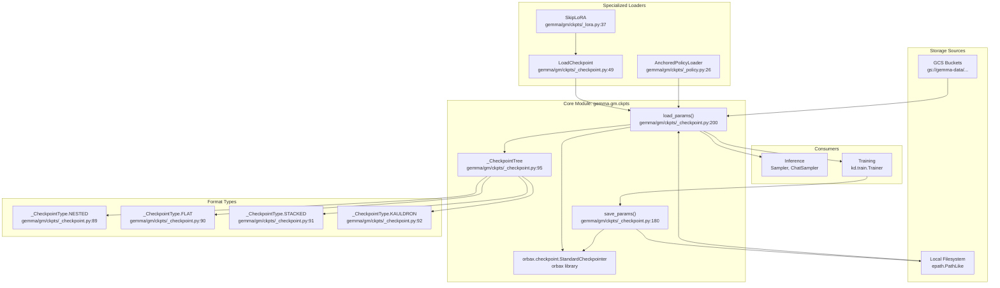
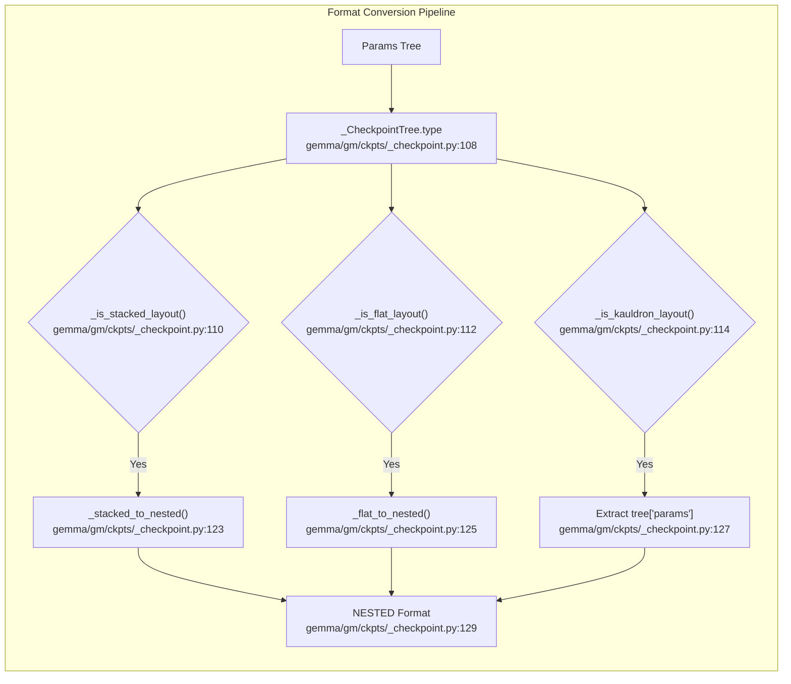

<!-- source: DeepWiki mcp.deepwiki.com · repo google-deepmind/gemma · page 2 Checkpoint Management · fetched 2026-10-26 -->

# Checkpoint Management

Relevant source files

The following files were used as context for generating this wiki page:

- [gemma/gm/ckpts/__init__.py](gemma/gm/ckpts/__init__.py)
- [gemma/gm/ckpts/_checkpoint.py](gemma/gm/ckpts/_checkpoint.py)
- [gemma/gm/ckpts/_lora.py](gemma/gm/ckpts/_lora.py)

## Purpose and Scope

The checkpoint management system provides the bridge between stored model weights and the running Gemma models. It handles loading pre-trained weights from multiple sources, saving fine-tuned models, and converting between different checkpoint formats. This system serves as a foundational infrastructure component in the Gemma repository.

As a parent page, this section offers a high-level overview of the checkpoint ecosystem. Detailed documentation for specific sub-topics is delegated to the following child pages:
- **Loading Parameters**: Documenting `load_params` function, checkpoint paths, format conversion (`NESTED`, `FLAT`, `STACKED`, `KAULDRON`), and multimodal parameter handling [Loading Parameters](#2.1).
- **Saving Parameters**: Documenting `save_params` function and Orbax integration for checkpoint serialization, including `wait_until_finished` and `release_memory` [Saving Parameters](#2.2).
- **Special Loaders**: Documenting `LoadCheckpoint`, `SkipLoRA`, and `AnchoredPolicyLoader` for specialized restoration scenarios [Special Loaders](#2.3).

Sources: [gemma/gm/ckpts/_checkpoint.py:1-309](), [gemma/gm/ckpts/_paths.py:1-76]()

## System Architecture

**Diagram: Checkpoint Management System Architecture**

The architecture diagram maps natural language operations to their corresponding code entities in `gemma.gm.ckpts`. Storage backends feed into `load_params()` and `save_params()`, while format detection and conversion are mediated by `_CheckpointTree`.

Sources: [gemma/gm/ckpts/_checkpoint.py:48-170](), [gemma/gm/ckpts/_paths.py:20-76](), [gemma/gm/ckpts/_lora.py:37-53](), [gemma/gm/ckpts/_policy.py:26-37]()

## Checkpoint Formats

The checkpoint system supports four distinct layout structures managed through the `_CheckpointType` enumeration [gemma/gm/ckpts/_checkpoint.py:72-92](). Automatic format detection inspects key naming conventions to translate internal or legacy formats into the standard Flax `NESTED` structure required by model initialization.

| Format | Description | Structure / Key Pattern | Use Case |
|--------|-------------|-------------------------|----------|
| **NESTED** | Standard Flax structure | `{'layer_0': {'attn': ...}}` | Model initialization and inference [gemma/gm/ckpts/_checkpoint.py:76-77]() |
| **FLAT** | Legacy flat dictionary | `{'transformer/layer_0/attn/...': ...}` | Official Gemma release checkpoints [gemma/gm/ckpts/_checkpoint.py:78-81]() |
| **STACKED** | Attention-pattern stacking | `{'transformer/stacked_layers/...': ...}` | Internal optimization [gemma/gm/ckpts/_checkpoint.py:82-84]() |
| **KAULDRON** | Full training state | `{'params': ..., 'opt_state': ..., 'step': ...}` | Training checkpoints [gemma/gm/ckpts/_checkpoint.py:85-87]() |

**Diagram: Checkpoint Format Detection and Conversion Flow**

The conversion pipeline identifies layout types using `_CheckpointTree` properties and applies the appropriate transformation function to yield a standard `NESTED` structure.

Sources: [gemma/gm/ckpts/_checkpoint.py:72-131](), [gemma/gm/ckpts/_checkpoint.py:315-331](), [gemma/gm/ckpts/_checkpoint.py:407-423]()

For comprehensive details on format conversion rules and path resolution, see [Loading Parameters](#2.1).

## Core Operations Overview

Checkpoint management revolves around two primary operations: loading parameters via `load_params()` [gemma/gm/ckpts/_checkpoint.py:200-208]() and saving them via `save_params()` [gemma/gm/ckpts/_checkpoint.py:180-185](). 

- **Loading**: `load_params()` handles path resolution, tree structuring, format conversion, memory donation (`donate=True`), optional quantization mapping (`quantize=True`), and multimodal filtering (`text_only=True`).
- **Saving**: `save_params()` serializes parameter trees to disk using Orbax's `StandardCheckpointer`, supporting asynchronous completion flags (`wait_until_finished`).

For technical specifics on loading pipelines, see [Loading Parameters](#2.1). For serialization behavior and memory management (`release_memory`), see [Saving Parameters](#2.2).

Sources: [gemma/gm/ckpts/_checkpoint.py:180-208]()

## Specialized Loaders and Integrations

To support advanced workflows such as training with Kauldron or fine-tuning with PEFT/LoRA, the system provides specialized loader classes that implement `kd.ckpts.InitTransform`:

- **LoadCheckpoint**: Integrates Gemma parameter loading into Kauldron training states (`TrainState`) [gemma/gm/ckpts/_checkpoint.py:48-70]().
- **SkipLoRA**: Preserves active LoRA adapter weights while restoring base model parameters from a checkpoint [gemma/gm/ckpts/_lora.py:37-53]().
- **AnchoredPolicyLoader**: Manages decoupled restoration of policy and anchor weights for preference optimization tasks [gemma/gm/ckpts/_policy.py:26-71]().

For detailed implementations and configuration examples, see [Special Loaders](#2.3).

Sources: [gemma/gm/ckpts/_checkpoint.py:48-70](), [gemma/gm/ckpts/_lora.py:37-53](), [gemma/gm/ckpts/_policy.py:26-71]()

## Public API Summary

The public checkpoint API is exposed through `gemma.gm.ckpts` [gemma/gm/ckpts/__init__.py:19-24]():

| Symbol | Type | Code Reference | Purpose |
|--------|------|----------------|---------|
| `load_params` | Function | [gemma/gm/ckpts/_checkpoint.py:200]() | Primary entry point for loading model weights |
| `save_params` | Function | [gemma/gm/ckpts/_checkpoint.py:180]() | Primary entry point for saving model weights |
| `LoadCheckpoint` | Class | [gemma/gm/ckpts/_checkpoint.py:49]() | Kauldron-integrated checkpoint loader transform |
| `SkipLoRA` | Class | [gemma/gm/ckpts/_lora.py:37]() | LoRA-aware parameter restoration wrapper |
| `AnchoredPolicyLoader` | Class | [gemma/gm/ckpts/_policy.py:26]() | Specialized loader for DPO/NPO policy models |
| `CheckpointPath` | Enum | [gemma/gm/ckpts/_paths.py:20]() | Predefined paths for official Gemma checkpoints |

Sources: [gemma/gm/ckpts/__init__.py:19-24](), [gemma/gm/ckpts/_paths.py:20-76]()

---

