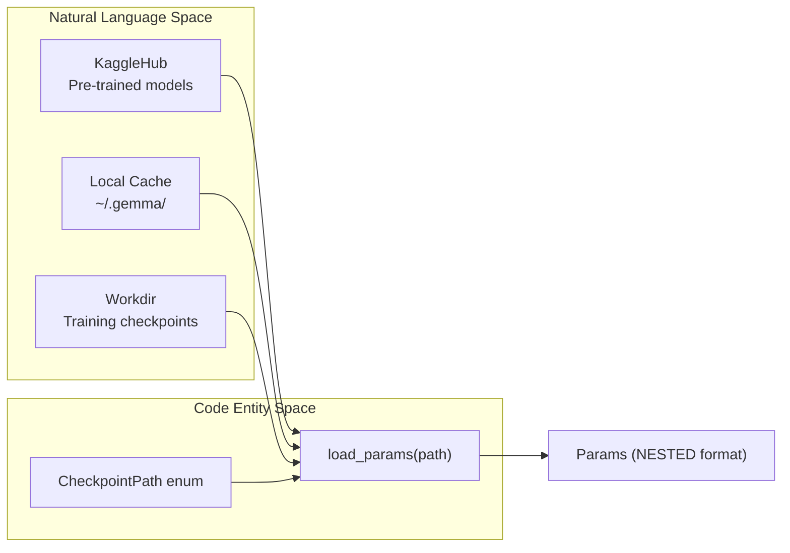
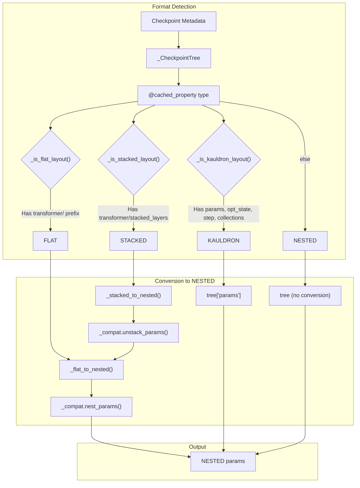
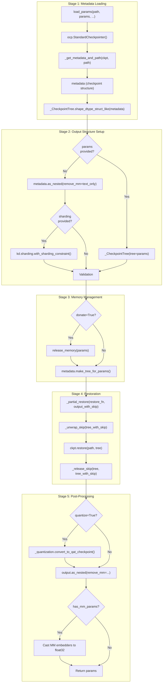
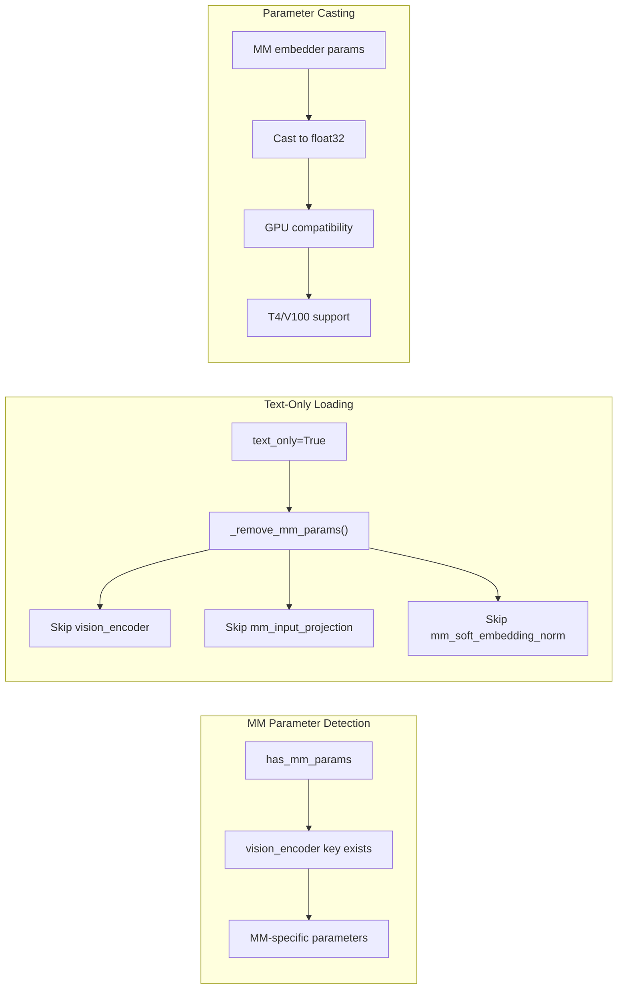

<!-- source: DeepWiki mcp.deepwiki.com · repo google-deepmind/gemma · page 2.1 Loading Parameters · fetched 2026-10-26 -->

# Loading Parameters

<details>
<summary>Relevant source files</summary>

The following files were used as context for generating this wiki page:

- [examples/classification.py](examples/classification.py)
- [gemma/gm/ckpts/_checkpoint.py](gemma/gm/ckpts/_checkpoint.py)
- [gemma/gm/ckpts/_compat.py](gemma/gm/ckpts/_compat.py)
- [gemma/gm/ckpts/_lora.py](gemma/gm/ckpts/_lora.py)
- [gemma/gm/ckpts/_paths.py](gemma/gm/ckpts/_paths.py)
- [gemma/gm/ckpts/_quantization.py](gemma/gm/ckpts/_quantization.py)
- [gemma/gm/typing/__init__.py](gemma/gm/typing/__init__.py)
- [gemma/gm/typing/_common.py](gemma/gm/typing/_common.py)

</details>


This document covers parameter loading in Gemma, focusing on the `load_params` function, checkpoint format handling, and multimodal parameter support. For parameter saving, see section 2.2. For specialized loaders like `LoadCheckpoint` and `SkipLoRA`, see section 2.3.

## Overview

The `load_params` function is the primary entry point for loading model parameters from checkpoints. It is exposed through the public API at [gemma/gm/ckpts/__init__.py:19]() and implemented in [gemma/gm/ckpts/_checkpoint.py:200-309]().

The function handles:
- Multiple checkpoint format types (NESTED, FLAT, STACKED, KAULDRON)
- Automatic format detection and conversion
- Multimodal parameter filtering with `text_only` option
- Distributed loading with sharding specifications
- Memory management with the `donate` parameter
- Quantization-aware training format conversion

**Sources:** [gemma/gm/ckpts/__init__.py:19](), [gemma/gm/ckpts/_checkpoint.py:200-309]()

## Function Signature and Parameters

The `load_params` function provides extensive configuration for parameter restoration:

| Parameter | Type | Default | Description |
|-----------|------|---------|-------------|
| `path` | `epath.PathLike` | Required | Path to the Orbax checkpoint directory |
| `params` | `Params \| None` | `None` | Target parameter structure defining output sharding and shape |
| `donate` | `bool` | `True` | If True, releases memory from input `params` via `jax.Array.delete()` |
| `text_only` | `bool` | `False` | If True, skips loading multimodal parameters (vision_encoder, etc.) |
| `sharding` | `kd.sharding.ShardingTree \| None` | `None` | Explicit sharding specification (mutually exclusive with `params`) |
| `quantize` | `bool` | `False` | If True, converts params to quantization-aware training format |

The function returns a `Params` dictionary matching the NESTED format (Flax `model.init()` structure).

**Sources:** [gemma/gm/ckpts/_checkpoint.py:200-226]()

## Checkpoint Storage Locations

Checkpoints can be loaded from three primary sources:

**Natural Language to Code Entity Space: Checkpoint Sources**



Gemma also provides a `CheckpointPath` enum containing hardcoded Google Cloud Storage paths for standard models across Gemma 2, 3, 3n, and 4.

**Sources:** [gemma/gm/ckpts/_checkpoint.py:200-226](), [gemma/gm/ckpts/_paths.py:20-76]()

## Checkpoint Format Types

The system supports four distinct checkpoint formats through the `_CheckpointType` enum defined in [gemma/gm/ckpts/_checkpoint.py:72-92]():

### Format Type Descriptions

| Format | Structure | Example Keys | Use Case |
|--------|-----------|--------------|----------|
| `NESTED` | Nested dictionary matching Flax `model.init()` | `{'layer_0': {'attn': {...}}}` | Final output format, user-facing |
| `FLAT` | Flat dictionary with path-like keys | `{'transformer/layer_0/attn/_key_norm': ...}` | Legacy official Gemma checkpoints |
| `STACKED` | Flat dictionary with stacked layer parameters | `{'transformer/stacked_layers/...': ...}` | Intermediate format for layer patterns |
| `KAULDRON` | Training state with params, optimizer, step | `{'params': ..., 'opt_state': ..., 'step': ...}` | Kauldron training checkpoints |

**Sources:** [gemma/gm/ckpts/_checkpoint.py:72-92]()

### Format Detection and Conversion Flow

The `_CheckpointTree` class handles format detection and conversion:



**Sources:** [gemma/gm/ckpts/_checkpoint.py:107-131](), [gemma/gm/ckpts/_checkpoint.py:315-374](), [gemma/gm/ckpts/_compat.py:54-63](), [gemma/gm/ckpts/_compat.py:112-157]()

## Loading Pipeline

The `load_params` function executes a multi-stage pipeline:

**Natural Language to Code Entity Space: Restoration Pipeline**



**Sources:** [gemma/gm/ckpts/_checkpoint.py:200-309]()

### Pipeline Stage Details

The pipeline stages correspond to specific code sections:

| Stage | Lines | Key Operations |
|-------|-------|----------------|
| Metadata Loading | [gemma/gm/ckpts/_checkpoint.py:230-234]() | Checkpoint metadata extraction, format detection |
| Output Structure Setup | [gemma/gm/ckpts/_checkpoint.py:241-262]() | Create target structure, validate format, apply sharding |
| Memory Management | [gemma/gm/ckpts/_checkpoint.py:236-238]() | Optional memory release with `donate` parameter |
| Restoration | [gemma/gm/ckpts/_checkpoint.py:270-275]() | Orbax restore with format conversion |
| Post-Processing | [gemma/gm/ckpts/_checkpoint.py:277-309]() | Quantization conversion, MM parameter casting |

**Sources:** [gemma/gm/ckpts/_checkpoint.py:200-309]()

## Format Conversion Implementation

The format conversion system uses the `_CheckpointTree` class and helper functions:

### NESTED Format (Target Output)

All checkpoints are converted to NESTED format, which matches the Flax `model.init()` structure:

```python
{
  'embedder': {...},
  'layer_0': {
    'attn': {...},
    'mlp': {...}
  },
  'layer_1': {...},
  'final_norm': {...}
}
```

### Conversion Functions

| Source Format | Conversion Function | Implementation |
|---------------|---------------------|----------------|
| FLAT → NESTED | `_flat_to_nested()` | [gemma/gm/ckpts/_checkpoint.py:322-340]() |
| STACKED → NESTED | `_stacked_to_nested()` | [gemma/gm/ckpts/_checkpoint.py:315-319]() |
| NESTED → FLAT | `_nested_to_flat()` | [gemma/gm/ckpts/_checkpoint.py:350-361]() |
| NESTED → STACKED | `_nested_to_stacked()` | [gemma/gm/ckpts/_checkpoint.py:343-347]() |

The conversion process uses compatibility utilities in `_compat` module:
- `_compat.nest_params()`: Convert flat dict to nested structure [gemma/gm/ckpts/_compat.py:54-63]().
- `_compat.flatten_and_remap_params()`: Convert nested to flat with key remapping [gemma/gm/ckpts/_compat.py:66-98]().
- `_compat.unstack_params()`: Unstack layer parameters [gemma/gm/ckpts/_compat.py:112-157]().
- `_compat.stack_params()`: Stack layer parameters [gemma/gm/ckpts/_compat.py:160-216]().

**Sources:** [gemma/gm/ckpts/_checkpoint.py:315-374](), [gemma/gm/ckpts/_compat.py:15-216]()

## Multimodal Parameter Handling

The checkpoint system provides specialized handling for multimodal models, particularly for Gemma 4 variants that include vision and audio encoders.



The system automatically handles:
- Detection of multimodal parameters through the `vision_encoder` key [gemma/gm/ckpts/_checkpoint.py:171-173]().
- Selective loading with `text_only` parameter [gemma/gm/ckpts/_checkpoint.py:205](). This is also reflected in model classes like `_Gemma4Base` which can exclude media encoders [gemma/gm/nn/gemma4/_gemma4.py:44-59]().
- Automatic casting of multimodal embedder parameters to float32 for GPU compatibility [gemma/gm/ckpts/_checkpoint.py:299-307]().
- Detection of audio input embeddings in the embedder module [gemma/gm/ckpts/_checkpoint.py:175-177]().

**Sources:** [gemma/gm/ckpts/_checkpoint.py:171-177](), [gemma/gm/ckpts/_checkpoint.py:205-307](), [gemma/gm/nn/gemma4/_gemma4.py:44-59]()

## Quantization Support

If the `quantize` flag is set to `True` in `load_params`, the parameters are passed through `_quantization.convert_to_qat_checkpoint`. This function maps regular parameters to a format compatible with Quantization-Aware Training (QAT).

- It identifies leaf nodes using `is_leaf` [gemma/gm/ckpts/_quantization.py:30-37]().
- It wraps kernel weights (typically under key 'w') into `_SimulateQuantizedEinsum` structures [gemma/gm/ckpts/_quantization.py:39-47]().
- It specifically handles `FeedForward` layers that use `gating_einsum` and `linear` names [gemma/gm/ckpts/_quantization.py:58-61]().

**Sources:** [gemma/gm/ckpts/_checkpoint.py:277-280](), [gemma/gm/ckpts/_quantization.py:25-64]()

---

