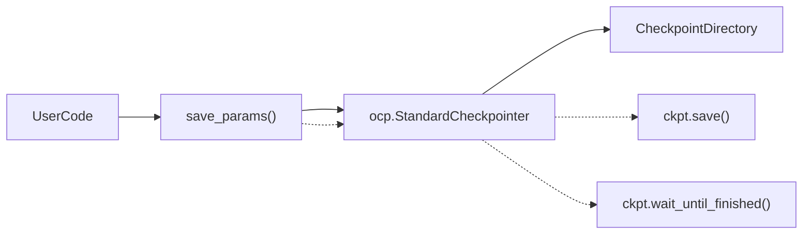
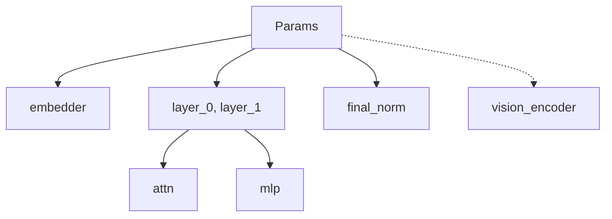
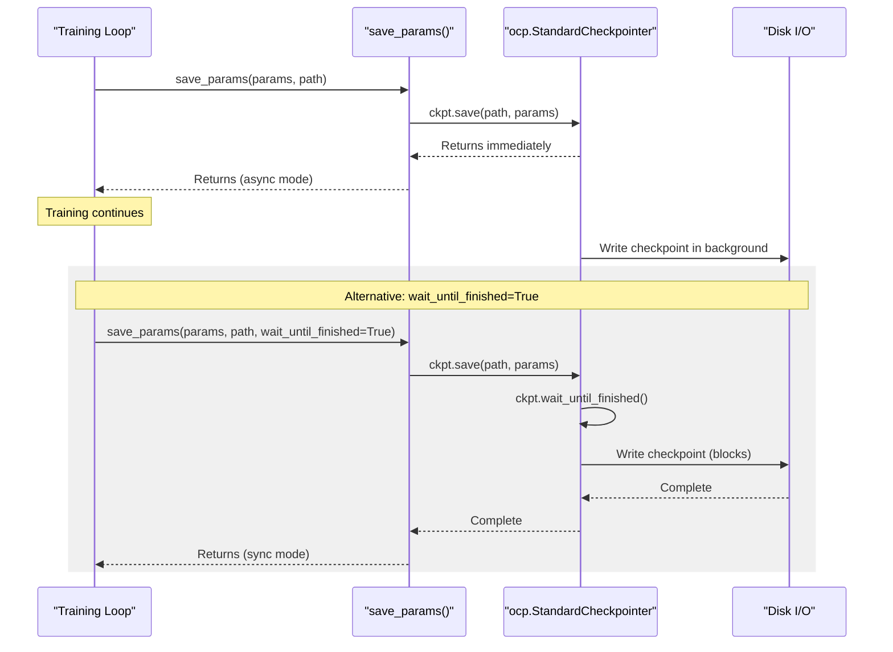

<!-- source: DeepWiki mcp.deepwiki.com · repo google-deepmind/gemma · page 2.2 Saving Parameters · fetched 2026-10-26 -->

# Saving Parameters

<details>
<summary>Relevant source files</summary>

The following files were used as context for generating this wiki page:

- [gemma/gm/ckpts/_checkpoint.py](gemma/gm/ckpts/_checkpoint.py)
- [gemma/gm/ckpts/_lora.py](gemma/gm/ckpts/_lora.py)

</details>


## Purpose and Scope

This page documents the parameter saving functionality in the Gemma checkpoint management system. It covers the `save_params` function, which serializes model parameters to disk using the Orbax checkpoint backend. This function is the complement to parameter loading (see [Loading Parameters](2.1)) and is primarily used during training to persist fine-tuned weights or to export model checkpoints for later inference.

For specialized checkpoint loading strategies that work with saved checkpoints, see [Special Loaders](2.3).

Sources: [gemma/gm/ckpts/_checkpoint.py:180-198]()

---

## The save_params Function

The `save_params` function provides a simple interface for saving model parameters to disk. It accepts three arguments:

| Parameter | Type | Required | Description |
|-----------|------|----------|-------------|
| `params` | `Params` | Yes | The parameter dictionary to save, matching the NESTED structure from `model.init()['params']` |
| `path` | `epath.PathLike` | Yes | Directory path where the checkpoint will be written |
| `wait_until_finished` | `bool` | No (default: `False`) | Whether to block until the save operation completes |

The function signature is defined at [gemma/gm/ckpts/_checkpoint.py:180-185]():

```python
def save_params(
    params: Params,
    path: epath.PathLike,
    *,
    wait_until_finished: bool = False,
) -> None:
```

### Basic Usage

```python
from gemma import gm

# Assume 'params' contains your model parameters
output_path = '/path/to/checkpoint'

# Save asynchronously (non-blocking)
gm.ckpts.save_params(params, output_path)

# Or wait for completion
gm.ckpts.save_params(params, output_path, wait_until_finished=True)
```

Sources: [gemma/gm/ckpts/_checkpoint.py:180-198](), [gemma/gm/ckpts/__init__.py:19-21]()

---

## Orbax Integration

The `save_params` function is implemented as a thin wrapper around Orbax's `StandardCheckpointer` class, which handles the low-level checkpoint serialization.

### Implementation Flow



**Diagram: Orbax Integration Architecture**

The implementation at [gemma/gm/ckpts/_checkpoint.py:194-197]() shows this integration:

1. Creates an `ocp.StandardCheckpointer` instance [gemma/gm/ckpts/_checkpoint.py:194]().
2. Calls `ckpt.save(path, params)` to initiate the save [gemma/gm/ckpts/_checkpoint.py:195]().
3. Optionally calls `ckpt.wait_until_finished()` if synchronous behavior is requested [gemma/gm/ckpts/_checkpoint.py:196-197]().

This design delegates all serialization logic to Orbax, ensuring compatibility with the standard Orbax checkpoint format used throughout the JAX ecosystem.

Sources: [gemma/gm/ckpts/_checkpoint.py:194-197]()

---

## Parameter Structure Requirements

The `params` argument must follow the **NESTED** checkpoint structure, which is the standard format returned by Flax's `model.init()['params']` call. This structure organizes parameters as a nested dictionary hierarchy matching the model's layer structure.

### Code Entity Space: NESTED Structure



**Diagram: Parameter Hierarchy Association**

### Checkpoint Format Types

While `save_params` always saves in the NESTED format, the Gemma checkpoint system recognizes four different checkpoint formats defined by the `_CheckpointType` enum at [gemma/gm/ckpts/_checkpoint.py:72-92]():

| Format | Description | Use Case |
|--------|-------------|----------|
| `NESTED` | Hierarchical dict matching Flax `model.init()` structure | Standard format for saving |
| `FLAT` | Flattened dict with keys like `'transformer/layer_0/attn/_key_norm'` | Legacy Gemma releases |
| `STACKED` | Params with same attention pattern stacked together | Internal optimization format |
| `KAULDRON` | Full training state including `params`, `opt_state`, `step` | Training checkpoints |

When loading checkpoints, the `_CheckpointTree` class (defined at [gemma/gm/ckpts/_checkpoint.py:96-100]()) automatically detects and converts between these formats using properties like `type` [gemma/gm/ckpts/_checkpoint.py:107-117]() and `nested_tree` [gemma/gm/ckpts/_checkpoint.py:119-131](). However, `save_params` is strictly for the `NESTED` format.

Sources: [gemma/gm/ckpts/_checkpoint.py:72-92](), [gemma/gm/ckpts/_checkpoint.py:180-198](), [gemma/gm/ckpts/_checkpoint.py:96-131]()

---

## Asynchronous Saving and Memory Management

By default, `save_params` performs **asynchronous checkpoint saving**, meaning it returns immediately without blocking program execution. This is crucial for training workflows where checkpoint saving should not pause the training loop.

### Asynchronous vs Synchronous Flow



**Diagram: Asynchronous vs Synchronous Saving**

### Memory Management

The library provides memory management utilities to help manage memory when handling large parameter sets. This is particularly useful in complex loading scenarios, such as in `AnchoredPolicyLoader`, where one set of parameters might be discarded in favor of another [gemma/gm/ckpts/_policy.py:53](). 

For the loading counterpart, the `load_params` function supports a `donate` parameter [gemma/gm/ckpts/_checkpoint.py:204]() to allow JAX to reuse memory buffers during the restoration process, though `save_params` focuses on the serialization of existing buffers.

### When to Use Synchronous Saving

Set `wait_until_finished=True` at [gemma/gm/ckpts/_checkpoint.py:191-192]() in the following scenarios:

- **End of training:** Ensure the final checkpoint is fully written before program termination.
- **Critical checkpoints:** When checkpoint corruption would be catastrophic.
- **Testing/debugging:** To simplify reasoning about checkpoint state.

Sources: [gemma/gm/ckpts/_checkpoint.py:194-197](), [gemma/gm/ckpts/_checkpoint.py:200-208](), [gemma/gm/ckpts/_policy.py:53]()

---

## Relationship to Kauldron Checkpoints

The library distinguishes between pure parameter checkpoints and Kauldron `kd.train.Trainer` checkpoints. 

- `save_params` saves only the model parameters (`Params`).
- Kauldron checkpoints (detected via `_CheckpointType.KAULDRON` at [gemma/gm/ckpts/_checkpoint.py:92]()) contain the optimizer state, step, and other training metadata.

When loading, the `LoadCheckpoint` class [gemma/gm/ckpts/_checkpoint.py:48-63]() specifically handles weights from a Gemma checkpoint but notes that it does not contain optimizer state [gemma/gm/ckpts/_checkpoint.py:52-54]().

### Checkpoint Structure Association

| Code Entity | Checkpoint Type | Contents |
|-------------|-----------------|----------|
| `save_params` | `NESTED` | `Params` (Weights only) |
| `kd.train.Trainer` | `KAULDRON` | `params`, `opt_state`, `step` |

Sources: [gemma/gm/ckpts/_checkpoint.py:48-63](), [gemma/gm/ckpts/_checkpoint.py:72-92]()

---

## Summary

The `save_params` function provides a straightforward interface for persisting Gemma model parameters to disk:

| Feature | Description |
|---------|-------------|
| **Backend** | Orbax `StandardCheckpointer` [gemma/gm/ckpts/_checkpoint.py:194]() |
| **Output Format** | `NESTED` (Flax-style hierarchy) |
| **Default Behavior** | Asynchronous (non-blocking) |
| **Primary Use Cases** | Training checkpoints, fine-tuned model export |
| **Integration** | Compatible with `load_params` and `LoadCheckpoint` |

Sources: [gemma/gm/ckpts/_checkpoint.py:180-198](), [gemma/gm/ckpts/__init__.py:19-21]()

---

