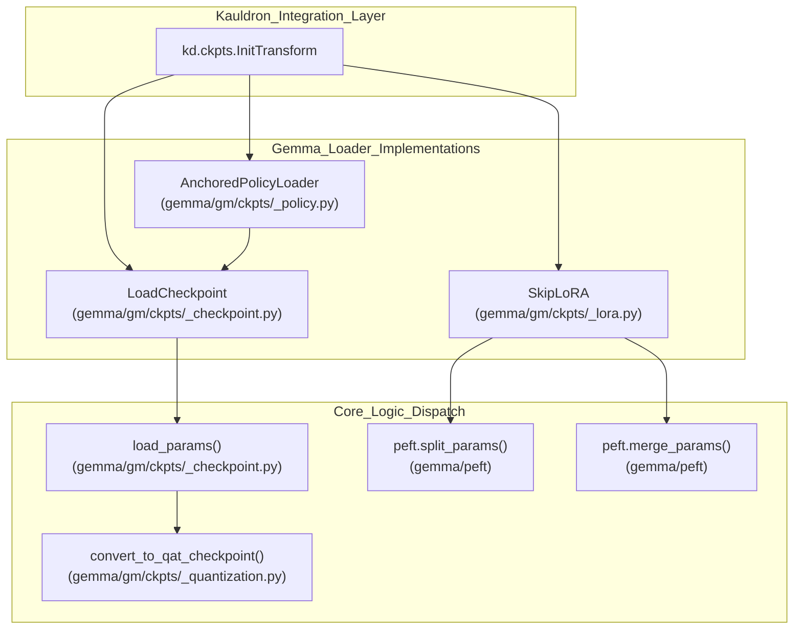
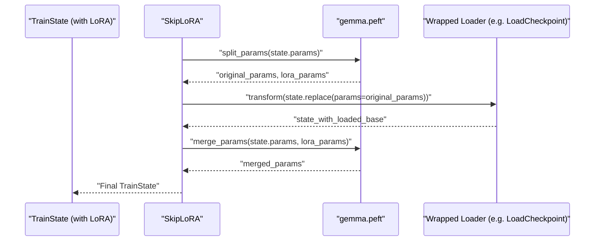

<!-- source: DeepWiki mcp.deepwiki.com · repo google-deepmind/gemma · page 2.3 Special Loaders · fetched 2026-10-26 -->

# Special Loaders

<details>
<summary>Relevant source files</summary>

The following files were used as context for generating this wiki page:

- [gemma/gm/ckpts/_checkpoint.py](gemma/gm/ckpts/_checkpoint.py)
- [gemma/gm/ckpts/_lora.py](gemma/gm/ckpts/_lora.py)
- [gemma/gm/ckpts/_policy.py](gemma/gm/ckpts/_policy.py)
- [gemma/gm/nn/_policy.py](gemma/gm/nn/_policy.py)

</details>


## Purpose and Scope

This page documents the specialized checkpoint loaders that integrate with the Kauldron training framework. These loaders extend `kd.ckpts.InitTransform` to provide flexible checkpoint initialization strategies for different training scenarios, such as fine-tuning with LoRA or preference optimization (DPO/NPO).

For information about the basic checkpoint loading function (`load_params`) and checkpoint formats, see [Loading Parameters](). For saving checkpoints, see [Saving Parameters]().

Sources: `[gemma/gm/ckpts/__init__.py:15-24]()`, `[gemma/gm/ckpts/_checkpoint.py:48-70]()`, `[gemma/gm/ckpts/_lora.py:36-53]`, `[gemma/gm/ckpts/_policy.py:25-34]()`

---

## Overview

Special loaders are dataclasses that implement the `kd.ckpts.InitTransform` interface, allowing them to be used in Kauldron training configurations to control how model parameters are initialized from checkpoints. Unlike the standalone `load_params` function, these loaders operate on entire `TrainState` objects and can selectively load or skip specific parameter subsets.

### System Mapping: Natural Language to Code Entities

The following diagram maps high-level loading concepts to the specific classes and methods implemented in the Gemma codebase.



Sources: `[gemma/gm/ckpts/_checkpoint.py:48-70]()`, `[gemma/gm/ckpts/_lora.py:36-53]()`, `[gemma/gm/ckpts/_policy.py:25-71]()`, `[gemma/gm/ckpts/_quantization.py:25-64]()`

---

## LoadCheckpoint

The `LoadCheckpoint` loader is the primary mechanism for initializing model parameters from a Gemma checkpoint during training. It specifically loads the transformer weights and does not restore optimizer state or step counters, which distinguishes it from `kd.ckpts.PartialKauldronLoader`.

### Class Definition

```python
@dataclasses.dataclass(frozen=True)
class LoadCheckpoint(kd.ckpts.InitTransform):
  path: epath.PathLike
  quantize: bool = False
```

Location: `[gemma/gm/ckpts/_checkpoint.py:48-64]()`

### Attributes

| Attribute | Type | Default | Description |
|-----------|------|---------|-------------|
| `path` | `epath.PathLike` | Required | Path to the Orbax checkpoint directory. |
| `quantize` | `bool` | `False` | If `True`, converts parameters to enable quantization aware training (QAT). |

### Behavior

The `transform` method performs the following operations:

1. Calls `load_params(self.path, params=state.params, quantize=self.quantize)` `[gemma/gm/ckpts/_checkpoint.py:66-68]()` to restore parameters into the current state's layout.
2. Returns a new `TrainState` using `dataclasses.replace(state, params=new_params)` `[gemma/gm/ckpts/_checkpoint.py:69]()`, preserving existing optimizer state and step counter from the input `state`.

Sources: `[gemma/gm/ckpts/_checkpoint.py:48-70]()`

---

## SkipLoRA

The `SkipLoRA` loader is a wrapper that prevents LoRA (Low-Rank Adaptation) weights from being overwritten during checkpoint loading. This is essential for workflows where you load base model weights while preserving initialized LoRA parameters in the training state.

### Class Definition

```python
@dataclasses.dataclass(frozen=True)
class SkipLoRA(kd.ckpts.InitTransform):
  wrapped: kd.ckpts.InitTransform
```

Location: `[gemma/gm/ckpts/_lora.py:36-40]()`

### Behavior

The `transform` method implements the following data flow:



1. **Split**: Separates LoRA weights from base model weights using `peft.split_params` `[gemma/gm/ckpts/_lora.py:44]()`.
2. **Load**: Applies the `wrapped` loader to load checkpoint weights into the base parameters while the LoRA weights are held aside `[gemma/gm/ckpts/_lora.py:48]()`.
3. **Merge**: Restores the original LoRA weights into the new state using `peft.merge_params` `[gemma/gm/ckpts/_lora.py:51]()`.

Sources: `[gemma/gm/ckpts/_lora.py:36-53]()`

---

## AnchoredPolicyLoader

The `AnchoredPolicyLoader` is designed for Direct Preference Optimization (DPO) and other policy-based training methods using the `gm.nn.AnchoredPolicy` wrapper.

### Class Definition

```python
@dataclasses.dataclass(frozen=True, kw_only=True)
class AnchoredPolicyLoader(kd.ckpts.InitTransform):
  policy: kd.ckpts.InitTransform
  anchor: kd.ckpts.InitTransform | None = None
```

Location: `[gemma/gm/ckpts/_policy.py:25-37]()`

### Purpose and Logic

It manages the dual-parameter structure of an `AnchoredPolicy` model, which contains `policy` (the model being trained) and `anchor` (the frozen reference model) keys.

1. **Policy Loading**: Extracts `state.params['policy']`, applies the `policy` sub-transform, and updates that branch of the parameter tree `[gemma/gm/ckpts/_policy.py:47-48]()`.
2. **Anchor Loading**:
    - **Explicit Anchor**: If an `anchor` loader is provided, it applies it to `state.params['anchor']` `[gemma/gm/ckpts/_policy.py:60-61]()`.
    - **Implicit Anchor**: If no `anchor` loader is provided, it creates a copy of the loaded `policy` parameters. It calls `_checkpoint.release_memory` on the existing anchor parameters to save memory before performing a `jax.tree.map(jnp.copy, ...)` of the policy parameters `[gemma/gm/ckpts/_policy.py:52-58]()`.
3. **Merge**: Recombines the two parameter sets into the final `TrainState` `[gemma/gm/ckpts/_policy.py:64-71]()`.

Sources: `[gemma/gm/ckpts/_policy.py:25-71]()`

---

## Internal Reformatting Utilities

The loaders rely on several internal utilities to handle various checkpoint layouts (FLAT, STACKED) vs the NESTED structure expected by Flax models.

### Checkpoint Structure Detection

The `_CheckpointTree` class `[gemma/gm/ckpts/_checkpoint.py:96]()` determines the format of a loaded checkpoint via the `type` property:

| Type | Description | Detection Logic |
|------|-------------|-----------------|
| `STACKED` | Params with same attention pattern are stored as stacked arrays. | `_is_stacked_layout` `[gemma/gm/ckpts/_checkpoint.py:110-111]()` |
| `FLAT` | Params stored as a flat dict with `/` path separators. | `_is_flat_layout` `[gemma/gm/ckpts/_checkpoint.py:112-113]()` |
| `KAULDRON` | Full `kd.train.Trainer` checkpoint containing optimizer state and step. | `_is_kauldron_layout` `[gemma/gm/ckpts/_checkpoint.py:114-115]()` |
| `NESTED` | Final structure matching Flax `model.init()` nested dictionaries. | Default fallback `[gemma/gm/ckpts/_checkpoint.py:116-117]()` |

### Conversion Logic

- **NESTED Target**: The `nested_tree` property converts any of the above formats into the standard Flax nested dictionary structure `[gemma/gm/ckpts/_checkpoint.py:120-131]()`.
- **QAT Conversion**: When `quantize=True` is passed to `LoadCheckpoint`, it utilizes `convert_to_qat_checkpoint` `[gemma/gm/ckpts/_quantization.py:25-64]()` to map standard parameters to the simulated quantization structure required by modules like `SimulateQuantizedDense`. This involves remapping kernel keys (e.g., `w` to `_SimulateQuantizedEinsum_0`) `[gemma/gm/ckpts/_quantization.py:44-46]()`.

Sources: `[gemma/gm/ckpts/_checkpoint.py:72-132]()`, `[gemma/gm/ckpts/_quantization.py:25-64]()`

---

