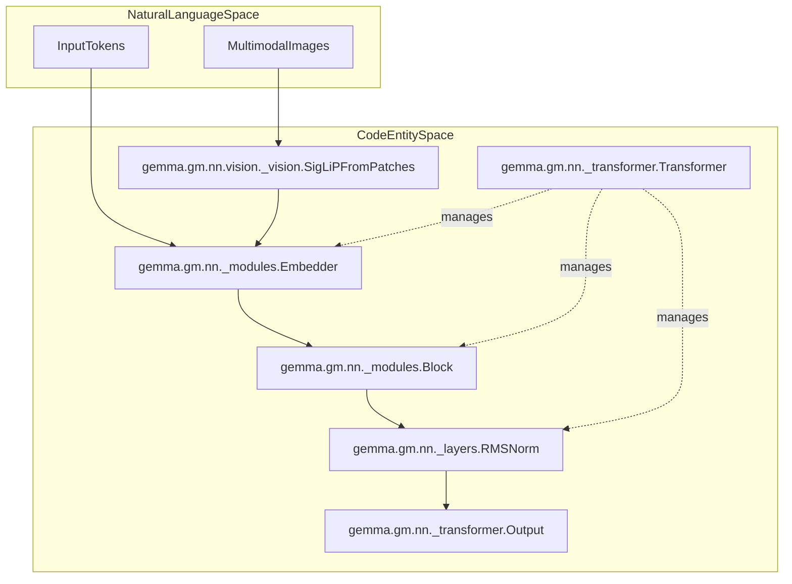

<!-- source: DeepWiki mcp.deepwiki.com · repo google-deepmind/gemma · page 3 Model Architecture · fetched 2026-10-26 -->

# Model Architecture

Relevant source files

The following files were used as context for generating this wiki page:

- [gemma/gm/nn/__init__.py](gemma/gm/nn/__init__.py)
- [gemma/gm/nn/_gemma.py](gemma/gm/nn/_gemma.py)
- [gemma/gm/nn/_modules.py](gemma/gm/nn/_modules.py)
- [gemma/gm/nn/_modules_test.py](gemma/gm/nn/_modules_test.py)
- [gemma/gm/nn/_transformer.py](gemma/gm/nn/_transformer.py)
- [gemma/gm/nn/config.py](gemma/gm/nn/config.py)

This document provides an overview of the Transformer architecture and neural network components across all Gemma generations within the JAX-based framework. The architecture centers around the `Transformer` base class [gemma/gm/nn/_transformer.py:87-94]() and conforms to the `TransformerLike` protocol [gemma/gm/nn/_transformer_like.py]() (see child page [TransformerLike Protocol](#3.1)). All Gemma models use stacked transformer blocks built from reusable sub-modules like `Embedder`, `Attention`, `FeedForward`, and `RMSNorm` [gemma/gm/nn/_modules.py]() (see child page [Building Blocks](#3.3)).

For in-depth technical specifications, see the child pages:
- [TransformerLike Protocol](#3.1) — Standardized model interface and metadata containers.
- [Model Variants](#3.2) — Configurations and differences across Gemma2, Gemma3, Gemma3n, and Gemma4.
- [Building Blocks](#3.3) — Core neural components (Embedder, Attention, FeedForward, Block, RMSNorm, KV cache).
- [Configuration System](#3.4) — `TransformerConfig` options and dtype utilities.
- [Gemma3n Advanced Features](#3.5) — AltUp, Laurel, and advanced efficiency features.
- [Gemma4 Architecture](#3.6) — Mixture-of-Experts, audio encoders, and multimodal extensions.
- [Vision Encoder](#3.7) — SigLiP-based vision integration and patch processing.

---

## Architecture Overview

The Gemma model architecture bridges natural language and multimodal inputs to predicted logits via a structured execution pipeline. The following diagram maps natural language space concepts and system layers to their exact code entities within `gemma.gm.nn`.

**Sources:** [gemma/gm/nn/_transformer.py:87-155](), [gemma/gm/nn/_modules.py:60-120]()

### Component Hierarchy

The following class hierarchy diagram illustrates how the base `Transformer` class and the various generation models relate through inheritance and protocol implementation.

```mermaid
graph TD
    Protocol["TransformerLike Protocol<br/>(gemma.gm.nn._transformer_like.TransformerLike)"]
    BaseTransformer["Transformer<br/>(gemma.gm.nn._transformer.Transformer)"]
    
    Gemma2_2B["Gemma2_2B<br/>(gemma.gm.nn._gemma.Gemma2_2B)"]
    Gemma2_9B["Gemma2_9B<br/>(gemma.gm.nn._gemma.Gemma2_9B)"]
    Gemma2_27B["Gemma2_27B<br/>(gemma.gm.nn._gemma.Gemma2_27B)"]
    
    Gemma3_270M["Gemma3_270M<br/>(gemma.gm.nn._gemma.Gemma3_270M)"]
    Gemma3_1B["Gemma3_1B<br/>(gemma.gm.nn._gemma.Gemma3_1B)"]
    Gemma3Base["_Gemma3Base<br/>(gemma.gm.nn._gemma._Gemma3Base)"]
    Gemma3_4B["Gemma3_4B<br/>(gemma.gm.nn._gemma.Gemma3_4B)"]
    Gemma3_12B["Gemma3_12B<br/>(gemma.gm.nn._gemma.Gemma3_12B)"]
    Gemma3_27B["Gemma3_27B<br/>(gemma.gm.nn._gemma.Gemma3_27B)"]
    
    Gemma3n_E2B["Gemma3n_E2B<br/>(gemma.gm.nn.gemma3n._gemma3n.Gemma3n_E2B)"]
    Gemma3n_E4B["Gemma3n_E4B<br/>(gemma.gm.nn.gemma3n._gemma3n.Gemma3n_E4B)"]

    Gemma4_E2B["Gemma4_E2B<br/>(gemma.gm.nn.gemma4._gemma4.Gemma4_E2B)"]
    Gemma4_E4B["Gemma4_E4B<br/>(gemma.gm.nn.gemma4._gemma4.Gemma4_E4B)"]
    Gemma4_31B["Gemma4_31B<br/>(gemma.gm.nn.gemma4._gemma4.Gemma4_31B)"]
    Gemma4_26B_A4B["Gemma4_26B_A4B<br/>(gemma.gm.nn.gemma4._gemma4.Gemma4_26B_A4B)"]
    
    Protocol -.defines.-> BaseTransformer
    BaseTransformer --> Gemma2_2B
    BaseTransformer --> Gemma2_9B
    BaseTransformer --> Gemma2_27B
    
    BaseTransformer --> Gemma3_270M
    BaseTransformer --> Gemma3_1B
    BaseTransformer --> Gemma3Base
    Gemma3Base --> Gemma3_4B
    Gemma3Base --> Gemma3_12B
    Gemma3Base --> Gemma3_27B
    
    BaseTransformer --> Gemma3n_E2B
    BaseTransformer --> Gemma3n_E4B

    BaseTransformer --> Gemma4_E2B
    BaseTransformer --> Gemma4_E4B
    BaseTransformer --> Gemma4_31B
    BaseTransformer --> Gemma4_26B_A4B
```

**Sources:** [gemma/gm/nn/_transformer.py:87-111](), [gemma/gm/nn/_gemma.py:49-315](), [gemma/gm/nn/__init__.py:27-56]()

---

## Sub-Topics and Child Pages

### 3.1. TransformerLike Protocol
The `TransformerLike` protocol establishes a standardized interface for parameter initialization, forward execution via `__call__`, variable application via `apply`, and KV cache setup via `init_cache`. It governs classes like `Transformer` and wraps metadata using `ModelInfo` and `Output` dataclasses [gemma/gm/nn/_transformer.py:43-68,87-111].
For details, see [TransformerLike Protocol](#3.1).

**Sources:** [gemma/gm/nn/_transformer.py:43-111]()

### 3.2. Model Variants
Gemma provides diverse model configurations spanning Gemma2, Gemma3, Gemma3n, and Gemma4 generations. These variants differ in parameter counts, layer depths, attention patterns (e.g., alternating local sliding and global attention), and multimodal encoder integrations [gemma/gm/nn/_gemma.py:39-135].
For details, see [Model Variants](#3.2).

**Sources:** [gemma/gm/nn/_gemma.py:39-135]()

### 3.3. Building Blocks
The neural network primitives include `Embedder`, `Attention`, `FeedForward`, `Block`, and `RMSNorm`. These components implement Grouped Query Attention (GQA), Rotary Positional Embeddings (RoPE), sliding window attention masks, and key-value cache management structures [gemma/gm/nn/_modules.py:38-206].
For details, see [Building Blocks](#3.3).

**Sources:** [gemma/gm/nn/_modules.py:38-206]()

### 3.4. Configuration System
Model configurations are managed via `TransformerConfig`, which defines hyperparameters such as embedding dimensions, head counts, sliding window sizes, query pre-attention normalisation strategies, and KV cache sharing patterns [gemma/gm/nn/config.py:15-28].
For details, see [Configuration System](#3.4).

**Sources:** [gemma/gm/nn/config.py:15-27]()

### 3.5. Gemma3n Advanced Features
Gemma3n models introduce specialized on-device efficiency mechanisms including `AltUp`, `Laurel`, per-layer input routing, and optimized KV cache sharing configurations [gemma/gm/nn/__init__.py:37-38].
For details, see [Gemma3n Advanced Features](#3.5).

**Sources:** [gemma/gm/nn/__init__.py:37-38]()

### 3.6. Gemma4 Architecture
Gemma4 extends the architecture with Mixture-of-Experts (MoE) layers, an audio encoder (Conformer), enhanced vision encoders, flexible KV cache sharing, and the `text_only` execution flag [gemma/gm/nn/_gemma.py:201-218], [gemma/gm/nn/__init__.py:43-46].
For details, see [Gemma4 Architecture](#3.6).

**Sources:** [gemma/gm/nn/_gemma.py:201-218](), [gemma/gm/nn/__init__.py:43-46]()

### 3.7. Vision Encoder
Vision capabilities are powered by SigLiP-based image encoders that handle preprocessing, patchification, soft token projections, and embedding merging into the main text sequence (including variable-aspect-ratio support in Gemma4) [gemma/gm/nn/_modules.py:60-119], [gemma/gm/nn/_transformer.py:115-155].
For details, see [Vision Encoder](#3.7).

**Sources:** [gemma/gm/nn/_transformer.py:115-155](), [gemma/gm/nn/_modules.py:60-119]()

---

