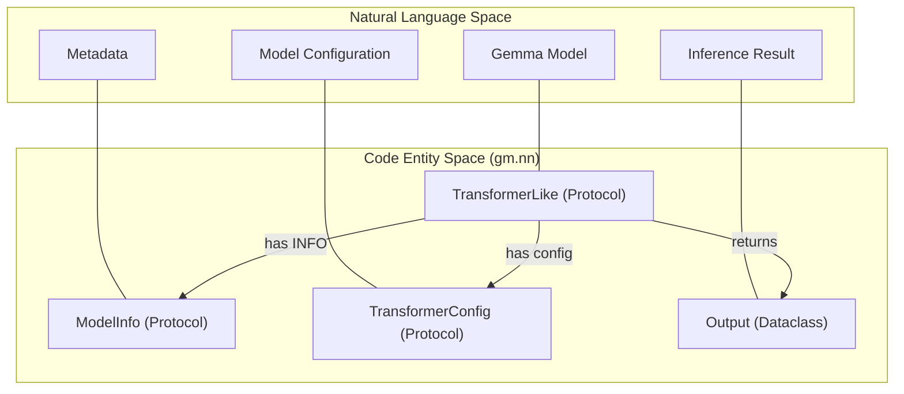
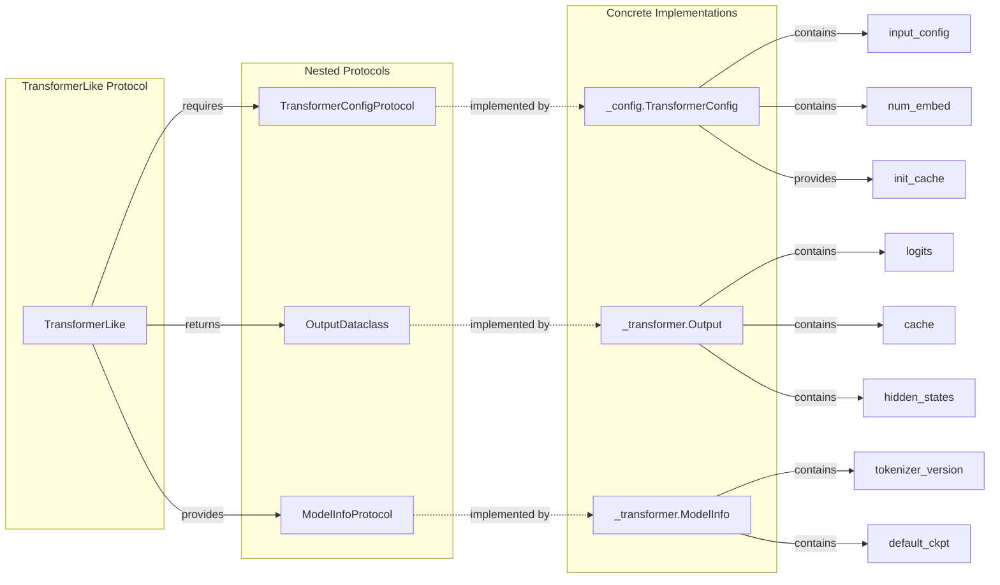

<!-- source: DeepWiki mcp.deepwiki.com · repo google-deepmind/gemma · page 3.1 TransformerLike Protocol · fetched 2026-10-26 -->

# TransformerLike Protocol

<details>
<summary>Relevant source files</summary>

The following files were used as context for generating this wiki page:

- [gemma/gm/nn/_transformer_like.py](gemma/gm/nn/_transformer_like.py)
- [gemma/gm/nn/_transformer_like_test.py](gemma/gm/nn/_transformer_like_test.py)
- [gemma/gm/text/_sampler_loop.py](gemma/gm/text/_sampler_loop.py)
- [gemma/gm/text/_turn_utils.py](gemma/gm/text/_turn_utils.py)

</details>


## Purpose and Scope

The `TransformerLike` protocol defines the standardized interface that all Gemma models must implement to be compatible with the text generation system, particularly the `Sampler` and `ChatSampler` classes. This protocol ensures that all model variants—including `Gemma2`, `Gemma3`, `Gemma3n`, `Gemma4`, and custom user implementations—expose a consistent API for initialization, forward passes, and cache management.

Sources: `[gemma/gm/nn/_transformer_like.py:15-16]()`, `[gemma/gm/nn/_transformer_like.py:79-83]()`

---

## Protocol Overview

The `TransformerLike` protocol is defined as a Python `Protocol` class in `gemma/gm/nn/_transformer_like.py`, enabling structural subtyping. Any class that implements the required attributes and methods can be used as a transformer model, regardless of inheritance relationships.

### System to Code Entity Mapping

The following diagram bridges the abstract concept of a Gemma model with the concrete entities defined in the codebase.

**Gemma Model Interface Map**


Sources: `[gemma/gm/nn/_transformer_like.py:31-86]()`, `[gemma/gm/nn/_transformer.py:44-70]()`

---

## Required Attributes

### config: TransformerConfig

Every model must expose a `config` attribute conforming to the `TransformerConfig` protocol. This configuration object provides:

- `input_config`: Configuration for processing model inputs `[gemma/gm/nn/_transformer_like.py:39]()`
- `num_embed`: Vocabulary size `[gemma/gm/nn/_transformer_like.py:40]()`
- `init_cache()`: Method to initialize KV cache `[gemma/gm/nn/_transformer_like.py:42-50]()`

The `TransformerConfig` protocol is defined in `[gemma/gm/nn/_transformer_like.py:31-51]()` and implemented by the concrete `_config.TransformerConfig` class.

### INFO: ClassVar[ModelInfo]

A class-level `ModelInfo` object that specifies:

- `tokenizer_version`: Version identifier for the tokenizer (e.g., `2` for Gemma2, `3` for Gemma3) `[gemma/gm/nn/_transformer_like.py:75]()`
- `default_ckpt`: Optional path to default checkpoint on KaggleHub `[gemma/gm/nn/_transformer_like.py:76]()`

This information enables automatic loading of the correct tokenizer and checkpoint for each model variant.

Sources: `[gemma/gm/nn/_transformer_like.py:31-77]()`, `[gemma/gm/nn/_transformer.py:43-51]()`

---

## Required Methods

### init()

```python
def init(
    self,
    rngs: PRNGKey | RNGSequences,
    *args,
    method: Callable[..., Any] | str | None = None,
    mutable: CollectionFilter = DenyList('intermediates'),
    capture_intermediates: bool | Callable[[flax.linen.Module, str], bool] = False,
    **kwargs,
) -> FrozenVariableDict | dict[str, Any]
```

Initializes model parameters. This follows the standard Flax `linen.Module.init()` signature, accepting a PRNG key and returning a dictionary of initialized variables (parameters).

Sources: `[gemma/gm/nn/_transformer_like.py:88-115]()`

---

### __call__()

```python
def __call__(
    self,
    tokens: Int['*B L'],
    *,
    images: UInt8['*B N H W C'] | UInt8['*B H W C'] | None = None,
    positions: Int['*B L_with_mm'] | None = None,
    cache: _config.Cache | None = None,
    attention_mask: Bool['*B L_with_mm cache_length'] | None = None,
    return_last_only: bool | None = None,
    return_hidden_states: bool | None = None,
) -> Output
```

Performs the forward pass through the model. This is the core computation method.

#### Parameters

| Parameter | Type | Description |
|-----------|------|-------------|
| `tokens` | `Int['*B L']` | Input token IDs with arbitrary batch shape |
| `images` | `UInt8['*B N H W C']` (optional) | Images for multimodal models |
| `positions` | `Int['*B L_with_mm']` (optional) | Absolute position indices, including multimodal tokens |
| `cache` | `Cache` (optional) | KV cache from previous generation steps |
| `attention_mask` | `Bool['*B L_with_mm cache_length']` (optional) | Attention mask |
| `return_last_only` | `bool` (optional) | If `True`, return logits only for the last token |
| `return_hidden_states` | `bool` (optional) | If `True`, include hidden states in output |

#### Returns

An `Output` dataclass containing:
- `logits`: Predicted logits (`*B L V` or `*B V` if `return_last_only=True`)
- `cache`: Updated cache (or `None` if no cache was provided)
- `hidden_states`: Model hidden states (or `None` if not requested)

Sources: `[gemma/gm/nn/_transformer_like.py:117-130]()`, `[gemma/gm/nn/_transformer.py:184-201]()`

---

### apply()

```python
def apply(
    self,
    variables: VariableDict,
    tokens: Int['*B L'],
    *,
    images: UInt8['*B N H W C'] | UInt8['*B H W C'] | None = None,
    cache: _config.Cache | None = None,
    positions: Int['*B L_with_mm'] | None = None,
    attention_mask: Bool['*B L_with_mm cache_length'] | None = None,
) -> Any | tuple[Any, FrozenVariableDict | dict[str, Any]]
```

Applies the model to a set of variables (parameters) without modifying the module state. This is the standard Flax pattern for stateless computation. The `Sampler` uses this method to perform inference with loaded checkpoints.

Sources: `[gemma/gm/nn/_transformer_like.py:133-145]()`

---

### init_cache()

```python
def init_cache(
    self,
    *,
    batch_size: int,
    dtype: jnp.dtype[Any],
    cache_length: int,
    sharding: kd.sharding.ShardingTree | None = None,
) -> _config.Cache
```

Initializes an empty KV cache for autoregressive generation. The cache is a nested structure that stores key and value tensors for each transformer layer.

#### Parameters

| Parameter | Type | Description |
|-----------|------|-------------|
| `batch_size` | `int` | Number of sequences to generate in parallel |
| `dtype` | `jnp.dtype` | Data type for cache tensors (typically `jnp.bfloat16`) |
| `cache_length` | `int` | Maximum sequence length to cache |
| `sharding` | `ShardingTree` (optional) | Sharding specification for distributed inference |

#### Returns

A `Cache` object containing layer-specific KV states.

Sources: `[gemma/gm/nn/_transformer_like.py:148-158]()`, `[gemma/gm/nn/_transformer_like_test.py:52-64]()`

---

## Protocol Components

**Structural Implementation of TransformerLike**


### TransformerConfig Protocol

Defined in `[gemma/gm/nn/_transformer_like.py:31-51]()`, this protocol specifies the configuration interface. The concrete implementation is `_config.TransformerConfig`, which includes architecture parameters and methods for initializing the KV cache.

### Output Protocol

Defined in `[gemma/gm/nn/_transformer_like.py:53-67]`, this protocol specifies the return type of `__call__()` and `apply()`. The concrete implementation is a Flax `struct.dataclass` at `[gemma/gm/nn/_transformer.py:54-68]()`.

### ModelInfo Protocol

Defined in `[gemma/gm/nn/_transformer_like.py:69-77]()`, this protocol provides metadata for model loading. The concrete implementation is at `[gemma/gm/nn/_transformer.py:43-51]()`.

Sources: `[gemma/gm/nn/_transformer_like.py:31-77]()`, `[gemma/gm/nn/_transformer.py:43-68]()`

---

## Implementation Example

The base `Transformer` class in `[gemma/gm/nn/_transformer.py]()` implements the `TransformerLike` protocol.

### Custom Model Implementation

Users can implement the protocol without inheriting from `Transformer`. Example from test suite `[gemma/gm/nn/_transformer_like_test.py:26-65]()`:

```python
class MockTransformer(nn.Module):
    config: gm.nn.config.TransformerConfig
    INFO: ClassVar[_transformer.ModelInfo] = _transformer.ModelInfo(
        tokenizer_version=4,
    )
    
    def setup(self):
        self.dense = nn.Dense(10)

    def __call__(self, tokens, *, images=None, positions=None, cache=None, 
                 attention_mask=None, return_last_only=None, 
                 return_hidden_states=None) -> gm.nn.Output:
        logits = self.dense(tokens)
        return gm.nn.Output(logits=logits, cache=None, hidden_states=None)
    
    def init_cache(self, *, batch_size, dtype, cache_length) -> gm.nn.Cache:
        return self.config.init_cache(
            batch_size=batch_size,
            dtype=dtype,
            cache_length=cache_length,
        )
```

As long as the class satisfies the protocol interface, it can be used with all Gemma infrastructure (samplers, evaluators, etc.).

Sources: `[gemma/gm/nn/_transformer.py:87-155]()`, `[gemma/gm/nn/_transformer_like_test.py:26-65]()`

---

## Usage with Samplers

The primary purpose of the `TransformerLike` protocol is to enable interchangeable use of different models with the text generation system. The `Sampler` class and the internal `SamplerLoop` accept any `TransformerLike` instance.

The sampler relies on these protocol methods:

| Sampler Operation | Protocol Method Used |
|------------------|---------------------|
| Load tokenizer | `model.INFO.tokenizer_version` |
| Initialize cache | `model.init_cache()` |
| Prefill prompt | `model.apply(..., return_last_only=False)` |
| Generate tokens | `model.apply(..., cache=..., return_last_only=True)` |
| Configuration | `model.config` |

For complete details on how samplers use this interface, see `[Sampler](#4.3)` and `[Autoregressive Loop](#4.5)`.

Sources: `[gemma/gm/nn/_transformer_like.py:15-16]()`, `[gemma/gm/text/_sampler_loop.py:114-118]()`

---

## Type Safety and Protocol Checking

The protocol uses `@typechecked` decorators from Kauldron to enforce type annotations at runtime during development. This catches interface mismatches early:

```python
@typechecked
@abc.abstractmethod
def __call__(
    self,
    tokens: Int['*B L'],  # Type checked: must be integer array
    *,
    images: UInt8['*B N H W C'] | UInt8['*B H W C'] | None = None,
    ...
) -> Output:
    ...
```

The array shape annotations (e.g., `Int['*B L']`) document expected dimensions and are validated when `typechecked` is active. The `*B` notation indicates arbitrary batch dimensions that are preserved through processing via the `_jax_utils.flatten_unflatten_batch_dim()` decorator used in the base `Transformer` class.

Sources: `[gemma/gm/nn/_transformer_like.py:117-130]()`, `[gemma/gm/nn/_transformer.py:183-185]()`

---

## Summary

The `TransformerLike` protocol provides:

1. **Interoperability**: Any model implementing the protocol works with samplers, evaluators, and other tools.
2. **Type Safety**: Runtime type checking prevents interface mismatches.
3. **Metadata**: `INFO` and `config` attributes enable automatic tokenizer and checkpoint loading.
4. **Flexibility**: Users can implement custom models without inheriting from base classes.
5. **Consistency**: All Gemma model variants expose the same interface.

Sources: `[gemma/gm/nn/_transformer_like.py:1-158]()`, `[gemma/gm/nn/_transformer.py:49-221]()`

---

