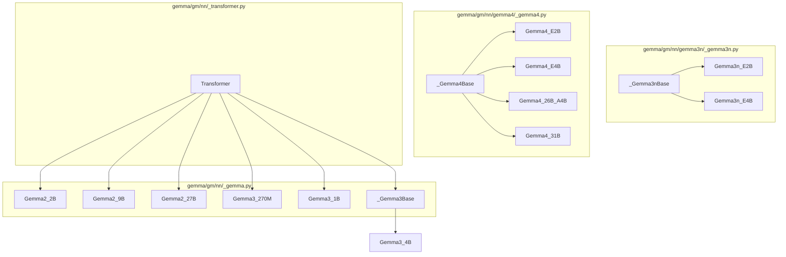
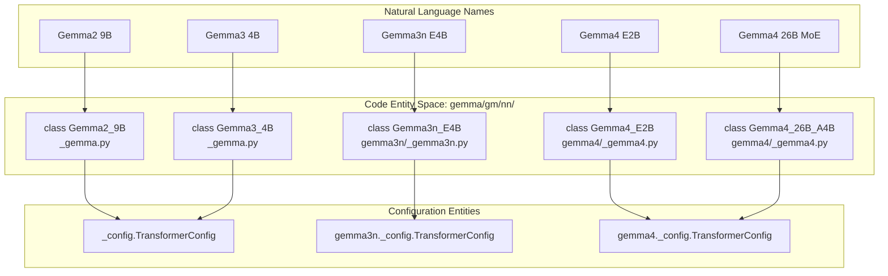
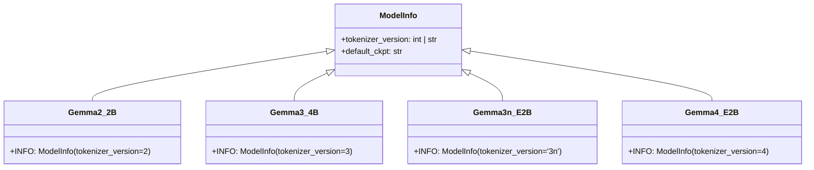

<!-- source: DeepWiki mcp.deepwiki.com · repo google-deepmind/gemma · page 3.2 Model Variants · fetched 2026-10-26 -->

# Model Variants

<details>
<summary>Relevant source files</summary>

The following files were used as context for generating this wiki page:

- [gemma/gm/nn/__init__.py](gemma/gm/nn/__init__.py)
- [gemma/gm/nn/_gemma.py](gemma/gm/nn/_gemma.py)
- [gemma/gm/nn/_transformer.py](gemma/gm/nn/_transformer.py)
- [gemma/gm/nn/config.py](gemma/gm/nn/config.py)
- [gemma/gm/nn/gemma3n/_gemma3n.py](gemma/gm/nn/gemma3n/_gemma3n.py)
- [gemma/gm/nn/gemma3n/_transformer_test.py](gemma/gm/nn/gemma3n/_transformer_test.py)
- [gemma/gm/nn/vision/_image.py](gemma/gm/nn/vision/_image.py)

</details>


This document describes the different Gemma model variants available in the codebase, including their architectural configurations, parameter counts, and specific characteristics. It covers the official Gemma2, Gemma3, Gemma3n, and Gemma4 model families.

For information about the base transformer architecture, see [TransformerLike Protocol](#3.1). For configuration details, see [Configuration System](#3.4).

Sources: [gemma/gm/nn/_gemma.py:49-135](), [gemma/gm/nn/gemma3n/_gemma3n.py:61-134](), [gemma/gm/nn/gemma4/_gemma4.py:122-261]()

## Model Families

The Gemma repository implements four main model generations, each with distinct architectural characteristics across standard dense configurations, efficiency-optimized variants, and multimodal/MoE configurations.

Title: Model Family Inheritance Hierarchy


Sources: [gemma/gm/nn/_gemma.py:27-36](), [gemma/gm/nn/gemma3n/_gemma3n.py:26-30](), [gemma/gm/nn/gemma4/_gemma4.py:28-31]()

## Gemma2 Models

The Gemma2 family implements the second generation of Gemma models with alternating attention patterns and specific architectural optimizations like logit soft-capping and post-attention/FFW normalization.

### Gemma2 Configurations

| Feature | Gemma2_2B | Gemma2_9B | Gemma2_27B |
| :--- | :--- | :--- | :--- |
| **Layers** | 26 | 42 | 46 |
| **Embed Dim** | 2,304 | 3,584 | 4,608 |
| **Hidden Dim** | 9,216 | 14,336 | 36,864 |
| **Heads (Q/KV)** | 8 / 4 | 16 / 8 | 32 / 16 |
| **Head Dim** | 256 | 256 | 128 |
| **Sliding Window** | 4,096 | 4,096 | 4,096 |
| **Logit Softcap** | 30.0 | 30.0 | 30.0 |

All Gemma2 models use an alternating attention pattern of `LOCAL_SLIDING` and `GLOBAL` attention types [gemma/gm/nn/_gemma.py:60-64]().

Sources: [gemma/gm/nn/_gemma.py:49-135]()

## Gemma3 Models

Gemma3 introduces multimodal capabilities and a repeating 6-layer attention pattern consisting of 5 local sliding layers and 1 global layer [gemma/gm/nn/_gemma.py:39-46]().

### Gemma3 Configurations

| Feature | 270M | 1B | 4B | 12B | 27B |
| :--- | :--- | :--- | :--- | :--- | :--- |
| **Layers** | 18 | 26 | 34 | 48 | 62 |
| **Embed Dim** | 640 | 1,152 | 2,560 | 3,840 | 5,376 |
| **KV Heads** | 1 | 1 | 4 | 8 | 16 |
| **Sliding Window**| 512 | 512 | 1,024 | 1,024 | 1,024 |
| **Vision Encoder**| None | None | SigLiP | SigLiP | SigLiP |

Gemma3 models (4B+) support a `text_only` flag in `_Gemma3Base` to skip vision encoder initialization to save memory [gemma/gm/nn/_gemma.py:201-219]().

Sources: [gemma/gm/nn/_gemma.py:138-283]()

## Gemma3n (Efficiency) Models

Gemma3n is optimized for on-device efficiency, featuring **AltUp** (Alternative Up-sampling), **Laurel** (Low-rank Linear layers), and **KV Cache Sharing** [gemma/gm/nn/gemma3n/_gemma3n.py:94-105]().

### Gemma3n Architectural Differences
- **AltUp**: Uses `altup_projection` and `altup_unembed_projection` in the `setup` phase to manage high-dimensional states [gemma/gm/nn/gemma3n/_transformer.py:181-193]().
- **KV Cache Sharing**: Implements sharing patterns across layers (configured via `KVCacheSharingConfig`) to reduce memory footprint [gemma/gm/nn/gemma3n/_transformer.py:128-132]().
- **Per-Layer Inputs**: The `_Inputs` dataclass accepts auxiliary `per_layer_inputs` for enhanced context processing [gemma/gm/nn/gemma3n/_transformer.py:88]().

Sources: [gemma/gm/nn/gemma3n/_gemma3n.py:61-134](), [gemma/gm/nn/gemma3n/_transformer.py:117-178]()

## Gemma4 Models

Gemma4 introduces advanced multimodal integration (Vision and Audio) and Mixture-of-Experts (MoE) in specific variants. It uses `Conformer` for audio encoding [gemma/gm/nn/gemma4/_gemma4.py:150]().

### Gemma4 Configurations

| Feature | Gemma4_E2B | Gemma4_E4B | Gemma4_26B_A4B | Gemma4_31B |
| :--- | :--- | :--- | :--- | :--- |
| **Layers** | 35 | 42 | 30 | 60 |
| **Embed Dim** | 1,536 | 2,560 | 4,096 | 5,376 |
| **Audio Encoder** | Conformer | Conformer | None | None |
| **KV Sharing** | Yes (20/35) | Yes (18/42) | No | No |
| **MoE** | No | No | Yes (128 experts) | No |

Gemma4 models default to `text_only=True` to exclude media encoders unless explicitly requested [gemma/gm/nn/gemma4/_gemma4.py:44-60](). The `Gemma4_26B_A4B` variant is a Mixture-of-Experts (MoE) model with 128 experts, activating `top_k_experts=8` per token [gemma/gm/nn/gemma4/_gemma4.py:225-241]().

Sources: [gemma/gm/nn/gemma4/_gemma4.py:122-261]()

## Code Entity Mapping

The following diagrams bridge the natural language model names to the specific `flax.linen` classes and configuration objects used in the codebase.

Title: Model Variant to Code Entity Mapping


Sources: [gemma/gm/nn/_gemma.py:78-81](), [gemma/gm/nn/gemma3n/_gemma3n.py:111-114](), [gemma/gm/nn/gemma4/_gemma4.py:122-124](), [gemma/gm/nn/gemma4/_gemma4.py:225-227]()

Title: Checkpoint Metadata Mapping


Sources: [gemma/gm/nn/_transformer.py:44-52](), [gemma/gm/nn/_gemma.py:72-75](), [gemma/gm/nn/gemma3n/_gemma3n.py:132-134](), [gemma/gm/nn/gemma4/_gemma4.py:153-155]()

## Custom Model Creation

For research, users can define custom variants by inheriting from `gm.nn.Transformer` and providing a custom `TransformerConfig` [gemma/gm/nn/config.py:22-27]().

```python
from gemma import gm

class MyTinyTransformer(gm.nn.Transformer):
  config: gm.nn.config.TransformerConfig = gm.nn.config.TransformerConfig(
      num_layers=12,
      num_embed=262144,
      embed_dim=896,
      hidden_dim=3584,
      num_heads=8,
      head_dim=128,
      num_kv_heads=1,
      final_logit_softcap=30.0,
      attention_types=(gm.nn.config.AttentionType.GLOBAL,) * 12,
      use_post_attn_norm=True,
      use_post_ffw_norm=True,
  )
  INFO = gm.nn.config.ModelInfo(tokenizer_version=3)
```

Sources: [gemma/gm/nn/_transformer.py:87-112](), [gemma/gm/nn/config.py:22-27]()

---

