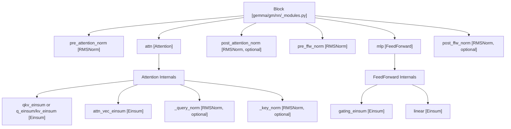
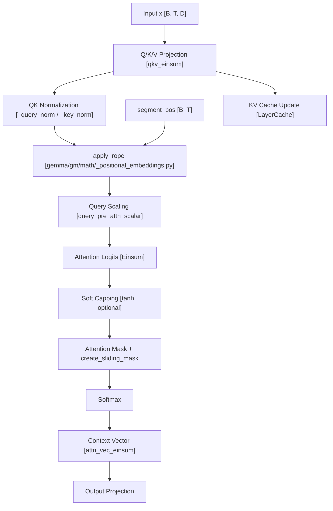
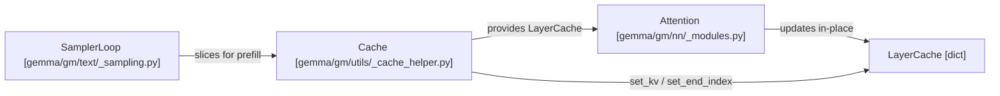

<!-- source: DeepWiki mcp.deepwiki.com · repo google-deepmind/gemma · page 3.3 Building Blocks · fetched 2026-10-26 -->

# Building Blocks

Relevant source files

The following files were used as context for generating this wiki page:

- [gemma/gm/math/_positional_embeddings.py](gemma/gm/math/_positional_embeddings.py)
- [gemma/gm/math/_positional_embeddings_test.py](gemma/gm/math/_positional_embeddings_test.py)
- [gemma/gm/nn/_layers.py](gemma/gm/nn/_layers.py)
- [gemma/gm/nn/_layers_test.py](gemma/gm/nn/_layers_test.py)
- [gemma/gm/nn/_modules.py](gemma/gm/nn/_modules.py)
- [gemma/gm/nn/_modules_test.py](gemma/gm/nn/_modules_test.py)
- [gemma/gm/utils/_cache_helper.py](gemma/gm/utils/_cache_helper.py)
- [gemma/gm/utils/_cache_helper_test.py](gemma/gm/utils/_cache_helper_test.py)

## Purpose and Scope

This page documents the core neural network modules that compose Gemma transformer models. These reusable building blocks are defined in `[gemma/gm/nn/_modules.py]()` and `[gemma/gm/nn/_layers.py]()`, implementing fundamental operations of the transformer architecture including attention mechanisms, feed-forward networks, embeddings, normalization layers, and KV cache infrastructure.

For information about how these blocks are configured and assembled into complete models, see [Configuration System](). For generation-specific cache handling, see [Prefill and KV Cache]().

Sources: `[gemma/gm/nn/_modules.py:1-493]()`, `[gemma/gm/nn/_layers.py:1-58]()`

## Component Overview

The transformer architecture is composed of five primary building blocks:

| Component | Purpose | Key Classes |
|-----------|---------|-------------|
| **Embedder** | Token encoding/decoding and vision projection | `gm.nn.Embedder` `[gemma/gm/nn/_modules.py:60]()` |
| **Attention** | Multi-head attention (MHA/GQA) with RoPE | `gm.nn.Attention` `[gemma/gm/nn/_modules.py:121]()` |
| **FeedForward** | Position-wise gated feed-forward network | `gm.nn.FeedForward` `[gemma/gm/nn/_modules.py:336]()` |
| **Block** | Complete transformer layer with residuals | `gm.nn.Block` `[gemma/gm/nn/_modules.py:390]()` |
| **RMSNorm** | Root Mean Square normalization | `gm.nn.RMSNorm` `[gemma/gm/nn/_layers.py:41]()` |

Sources: `[gemma/gm/nn/_modules.py:60-489]()`, `[gemma/gm/nn/_layers.py:41-58]()`

## Component Hierarchy

The following diagram bridges the natural language concepts of a transformer layer to specific code entities within the Gemma codebase, linking high-level architectural components to their implementing classes and methods.

**Diagram: Building Block Composition**

Sources: `[gemma/gm/nn/_modules.py:390-489]()`, `[gemma/gm/nn/_layers.py:22-58]()`

## Embedder

The `Embedder` module handles conversion between discrete token IDs and continuous embeddings, as well as projecting multimodal features.

### Core Functionality

- **Token Encoding** `[gemma/gm/nn/_modules.py:87-100]()`:
  - Input: Token IDs of shape `[seq_len]` or `[batch_size, seq_len]`.
  - Logic: Indexes `input_embedding_table` and scales by `sqrt(embed_dim)` `[gemma/gm/nn/_modules.py:98-99]()`.
  - Output: Embeddings of shape `[..., embed_dim]`.

- **Token Decoding** `[gemma/gm/nn/_modules.py:102-112]()`:
  - Input: Hidden states of shape `[..., embed_dim]`.
  - Logic: Computes a dot product with the transpose of the `input_embedding_table` `[gemma/gm/nn/_modules.py:112]()` (weight tying).

### Multimodal Support

For multimodal models where `vision_proj_dim` is specified:
- `mm_soft_embedding_norm`: An `RMSNorm` layer for incoming vision features `[gemma/gm/nn/_modules.py:82]()`.
- `mm_input_projection`: An `Einsum` layer projecting vision encoder outputs (e.g., SigLIP) into the text embedding space `[gemma/gm/nn/_modules.py:83-85]()`.
- `encode_vision()`: A method that applies both the norm and projection to input vision arrays `[gemma/gm/nn/_modules.py:114-118]()`.

Sources: `[gemma/gm/nn/_modules.py:60-119]()`

## Attention

The `Attention` module implements multi-head attention with support for Grouped Query Attention (GQA) and Rotary Positional Embeddings (RoPE).

### Architecture Variants

The variant is determined by the relationship between `num_heads` and `num_kv_heads`:
- **Multi-Head Attention (MHA)**: `num_kv_heads == num_heads`. Uses a combined `qkv_einsum` `[gemma/gm/nn/_modules.py:149-152]()`.
- **Grouped Query Attention (GQA)**: `num_kv_heads < num_heads` and `num_kv_heads > 1`. Uses separate `q_einsum` and `kv_einsum` `[gemma/gm/nn/_modules.py:154-159]()`.
- **Multi-Query Attention (MQA)**: `num_kv_heads == 1`.

### Forward Pass Logic

**Diagram: Attention Data Flow and Code Entities**

Sources: `[gemma/gm/nn/_modules.py:166-311]()`, `[gemma/gm/math/_positional_embeddings.py:23-75]()`

### Key Features

- **Rotary Position Embeddings (RoPE)** `[gemma/gm/nn/_modules.py:196-209]()`:
  - Applied to both Query and Key projections via `apply_rope` `[gemma/gm/math/_positional_embeddings.py:23]()`.
  - Configurable via `rope_base_frequency` and `rope_scale_factor` `[gemma/gm/nn/_modules.py:130-131]()`.

- **Local Sliding Window Attention** `[gemma/gm/nn/_modules.py:258-269]()`:
  - Enabled when `attn_type` is `LOCAL_SLIDING`.
  - Uses `create_sliding_mask` to restrict attention to a window of size `sliding_window_size` `[gemma/gm/nn/_modules.py:38-52]()`.

- **Attention Logit Soft Capping** `[gemma/gm/nn/_modules.py:254-256]()`:
  - If `attn_logits_soft_cap` is set, logits are capped using `tanh` to prevent instability `[gemma/gm/nn/_modules.py:256]()`.

Sources: `[gemma/gm/nn/_modules.py:121-333]()`, `[gemma/gm/math/_positional_embeddings.py:23-75]()`

## FeedForward

The `FeedForward` module implements a gated linear unit (GLU) variant, specifically SwiGLU.

### Implementation Details

- **Gating**: Uses `gating_einsum` to project input into two parallel branches `[gemma/gm/nn/_modules.py:355-366]()`.
- **Activation**: The first branch is activated via GELU `[gemma/gm/nn/_modules.py:374]()`.
- **Multiplication**: The activated branch is element-wise multiplied by the second (gating) branch `[gemma/gm/nn/_modules.py:375]()`.
- **Projection**: The result is projected back to the embedding dimension via `linear` `[gemma/gm/nn/_modules.py:387]()`.

The module supports `transpose_gating_einsum` to handle different checkpoint weight layouts `[gemma/gm/nn/_modules.py:353]()`.

Sources: `[gemma/gm/nn/_modules.py:336-388]()`

## Block

The `Block` module encapsulates one full transformer layer, managing the residual stream and normalization order.

### Normalization and Residuals

Gemma supports flexible normalization placement:
- **Pre-Normalization**: `pre_attention_norm` and `pre_ffw_norm` are always applied before their respective sub-modules `[gemma/gm/nn/_modules.py:455, 473]()`.
- **Post-Normalization**: Optional `post_attention_norm` and `post_ffw_norm` can be enabled via config `[gemma/gm/nn/_modules.py:426, 438]()`.

### Forward Pass Logic

1. Apply `pre_attention_norm` `[gemma/gm/nn/_modules.py:455]()`.
2. Compute `attn` and update KV cache `[gemma/gm/nn/_modules.py:456-461]()`.
3. Apply `post_attention_norm` (if enabled) and add residual `[gemma/gm/nn/_modules.py:465-471]()`.
4. Apply `pre_ffw_norm` `[gemma/gm/nn/_modules.py:473]()`.
5. Compute `mlp` `[gemma/gm/nn/_modules.py:474-479]()`.
6. Apply `post_ffw_norm` (if enabled) and add residual `[gemma/gm/nn/_modules.py:483-488]()`.

Sources: `[gemma/gm/nn/_modules.py:390-489]()`

## KV Cache Infrastructure

The KV cache is represented as a `LayerCache` dictionary per layer `[gemma/gm/nn/_modules.py:35]()`.

### Cache Structure

| Key | Shape | Description |
|-----|-------|-------------|
| `'k'` | `[B, cache_size, heads, dim]` | Key states |
| `'v'` | `[B, cache_size, heads, dim]` | Value states |
| `'positions'` | `[B, cache_size]` | Absolute positions of cached tokens |
| `'end_index'` | `[B]` | Current insertion index for the circular buffer |

### Cache Management Utilities

The `Cache` wrapper in `[gemma/gm/utils/_cache_helper.py]()` provides high-level management for the raw `LayerCache` dictionary.

**Diagram: KV Cache Interaction and Code Flow**

- **Initialization**: `Attention.init_cache` creates zero-initialized arrays for a specific layer `[gemma/gm/nn/_modules.py:313]()`.
- **Slicing**: The `Cache` helper allows slicing the cache across all layers simultaneously via `__getitem__`, which is essential during the prefill phase to match prompt length `[gemma/gm/utils/_cache_helper.py:49-64]()`.
- **Updating**: `Cache.at[].set_kv()` provides a functional interface for updating cache contents using JAX's `.at[].set()` semantics `[gemma/gm/utils/_cache_helper.py:113-119]()`.
- **Index Tracking**: The `end_index` tracks the current position in the cache, enabling it to function as a circular buffer `[gemma/gm/nn/_modules.py:214-216]()`.

Sources: `[gemma/gm/nn/_modules.py:30-35, 313-333]()`, `[gemma/gm/utils/_cache_helper.py:32-162]()`

## RMSNorm

The `RMSNorm` layer implements Root Mean Square Layer Normalization `[gemma/gm/nn/_layers.py:41]()`.

- **Calculation**: Computes the mean of squared inputs across the last axis `[gemma/gm/nn/_layers.py:47]()`.
- **Normalization**: Multiplies the input by the reciprocal square root of the variance plus an epsilon (1e-6) using `jax.lax.rsqrt` `[gemma/gm/nn/_layers.py:51]()`.
- **Scaling**: Applies a learnable `scale` parameter initialized to zero. The final multiplier is `(1 + scale)` to ensure the layer defaults to an identity transformation `[gemma/gm/nn/_layers.py:57-58]()`.

Sources: `[gemma/gm/nn/_layers.py:41-58]()`

---

