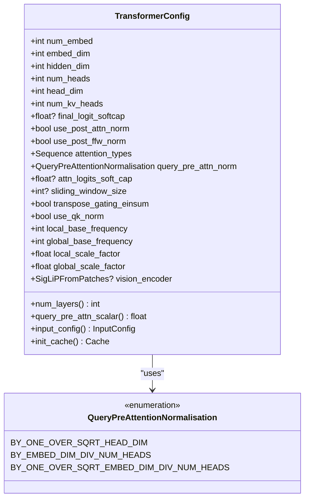
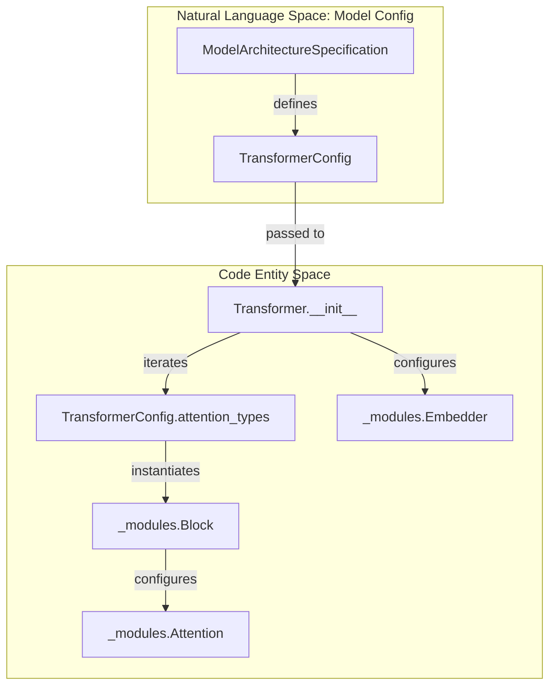
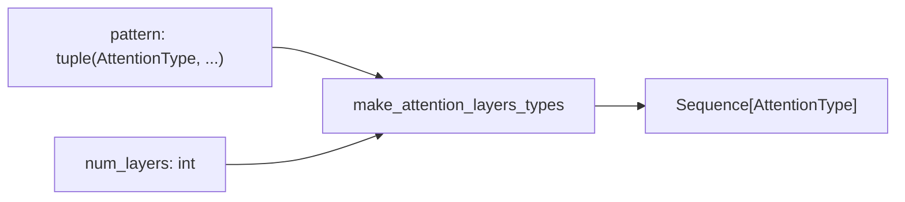
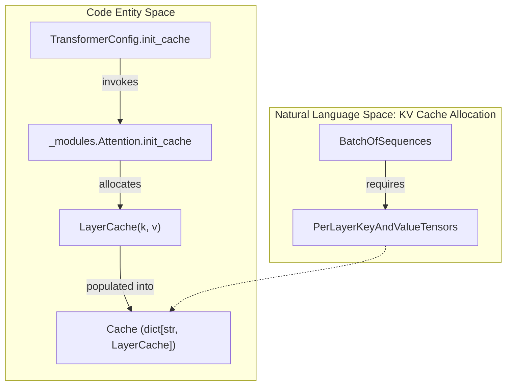
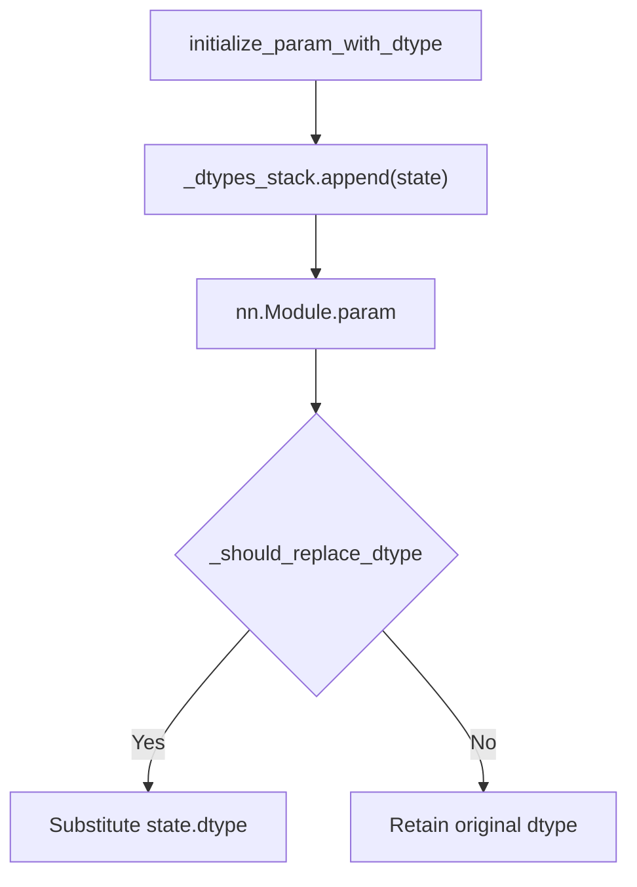

<!-- source: DeepWiki mcp.deepwiki.com · repo google-deepmind/gemma · page 3.4 Configuration System · fetched 2026-10-26 -->

# Configuration System

Relevant source files

The following files were used as context for generating this wiki page:

- [gemma/gm/nn/_config.py](gemma/gm/nn/_config.py)
- [gemma/gm/nn/gemma4/audio/_model_test.py](gemma/gm/nn/gemma4/audio/_model_test.py)
- [gemma/gm/nn/gemma4/vision/_transformer.py](gemma/gm/nn/gemma4/vision/_transformer.py)
- [gemma/gm/tests/sampler_e2e_test.py](gemma/gm/tests/sampler_e2e_test.py)
- [gemma/gm/utils/_attention_mask.py](gemma/gm/utils/_attention_mask.py)
- [gemma/gm/utils/_dtype_params.py](gemma/gm/utils/_dtype_params.py)
- [gemma/gm/utils/_jax_utils.py](gemma/gm/utils/_jax_utils.py)
- [gemma/gm/utils/_types.py](gemma/gm/utils/_types.py)

This document covers the configuration system used to define transformer architecture parameters, attention mechanisms, and data type management utilities. The configuration system provides the foundational data structures that control model behavior, layer composition, and hardware-specific optimizations.

The system centers around `TransformerConfig` [gemma/gm/nn/_config.py:59]() for architecture specification and includes specialized utilities like `initialize_param_with_dtype` [gemma/gm/utils/_dtype_params.py:39]() for precise control over parameter initialization dtypes.

## Core Configuration Classes

### TransformerConfig Class Structure

The configuration system is built around `TransformerConfig` [gemma/gm/nn/_config.py:59]() as the primary architecture specification class. It defines the structural hyperparameters and architectural features for all Gemma model variants, including support for vision encoders in multimodal models.

Title: TransformerConfig and Normalization Enum

Sources: [gemma/gm/nn/_config.py:59-142](), [gemma/gm/nn/_config.py:45-56]()

### Configuration Usage in Model Classes

All Gemma model variants define their architecture by assigning a `TransformerConfig` instance to the configuration interface. The transformer modules use this config during initialization to construct embedding, block, and normalization layers.

Title: Architecture Instantiation Flow bridging natural language configurations to code entities

Sources: [gemma/gm/nn/_config.py:59-88]()

### TransformerConfig Parameters

| Parameter | Type | Purpose | Example Values |
|-----------|------|---------|----------------|
| `num_embed` | `int` | Vocabulary size | 256128, 262144 [gemma/gm/nn/_config.py:62]() |
| `embed_dim` | `int` | Model embedding dimension | 2304, 3584, 4608 [gemma/gm/nn/_config.py:63]() |
| `num_kv_heads` | `int` | Number of key-value heads for GQA | 4, 8, 16 [gemma/gm/nn/_config.py:67]() |
| `attention_types` | `Sequence` | Per-layer attention type specification | `AttentionType.GLOBAL` or `LOCAL_SLIDING` [gemma/gm/nn/_config.py:72]() |
| `use_qk_norm` | `bool` | Whether to normalize queries and keys | `True`, `False` [gemma/gm/nn/_config.py:79]() |
| `transpose_gating_einsum` | `bool` | Optimization for gating computation | `True`, `False` [gemma/gm/nn/_config.py:78]() |
| `vision_encoder` | `SigLiPFromPatches` | Optional vision encoder module | `None`, `SigLiPFromPatches` [gemma/gm/nn/_config.py:84]() |

Sources: [gemma/gm/nn/_config.py:59-84]()

## Attention Configuration

### Attention Layer Type Patterns

The `make_attention_layers_types()` function generates the full sequence of attention types for a model based on a repeating pattern [gemma/gm/nn/_config.py:31-42](). This is used across models where patterns of local sliding window and global attention layers alternate.

Title: Attention Pattern Generation

Sources: [gemma/gm/nn/_config.py:31-42]()

### Query Pre-Attention Normalization

The `QueryPreAttentionNormalisation` enum determines how the query vector is scaled prior to dot-product attention [gemma/gm/nn/_config.py:45-56](). The `TransformerConfig.query_pre_attn_scalar()` method computes the scaling factor based on `embed_dim`, `num_heads`, and `head_dim` [gemma/gm/nn/_config.py:90-98]().

| Strategy | Formula | Usage |
|----------|---------|-------|
| `BY_ONE_OVER_SQRT_HEAD_DIM` | $1 / \sqrt{head\_dim}$ [gemma/gm/nn/_config.py:49]() | Default / Gemma 2/3 [gemma/gm/nn/_config.py:73-75]() |
| `BY_EMBED_DIM_DIV_NUM_HEADS` | $embed\_dim // num\_heads$ [gemma/gm/nn/_config.py:51]() | Custom / Research |
| `BY_ONE_OVER_SQRT_EMBED_DIM_DIV_NUM_HEADS` | $(embed\_dim // num\_heads)^{-0.5}$ [gemma/gm/nn/_config.py:54]() | Gemma 2 27B |

Sources: [gemma/gm/nn/_config.py:45-56](), [gemma/gm/nn/_config.py:90-98]()

## KV Cache Configuration

The KV cache system is initialized via `TransformerConfig.init_cache()` [gemma/gm/nn/_config.py:120-142](). It returns a dictionary mapping layer identifiers (e.g., `layer_0`) to `LayerCache` instances containing key and value tensors allocated using `num_kv_heads` and `head_dim` [gemma/gm/nn/_config.py:128-142]().

Title: KV Cache Initialization Mapping bridging natural language sequence requests to code structures

Sources: [gemma/gm/nn/_config.py:120-142](), [gemma/gm/nn/_config.py:28]()

## DType Management Utility

Gemma provides a specialized context manager `initialize_param_with_dtype` to manage parameter `dtype` during model initialization [gemma/gm/utils/_dtype_params.py:39-63]().

### initialize_param_with_dtype

This utility intercepts parameter creation calls to override data types:

*   **Mechanism**: Uses an internal `ContextStack` (`_dtypes_stack`) to track target `_DTypeState` configurations including explicit module exclusions [gemma/gm/utils/_dtype_params.py:31-36]().
*   **DType Replacement Logic**: `_should_replace_dtype` evaluates whether the module is actively initializing and whether its scope path matches any exclusion rules [gemma/gm/utils/_dtype_params.py:89-111]().
*   **Implementation**: Overrides `nn.Module.param` via `_mock_flax_module_param` to substitute the requested `dtype` [gemma/gm/utils/_dtype_params.py:65-87]().

Title: Parameter DType Injection Logic

Sources: [gemma/gm/utils/_dtype_params.py:30-114]()

---

