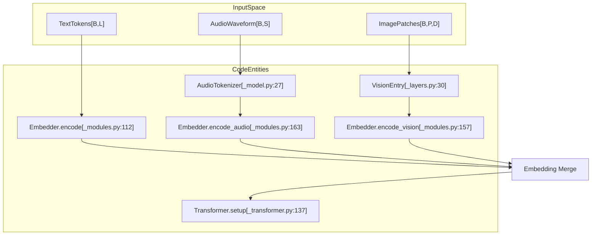
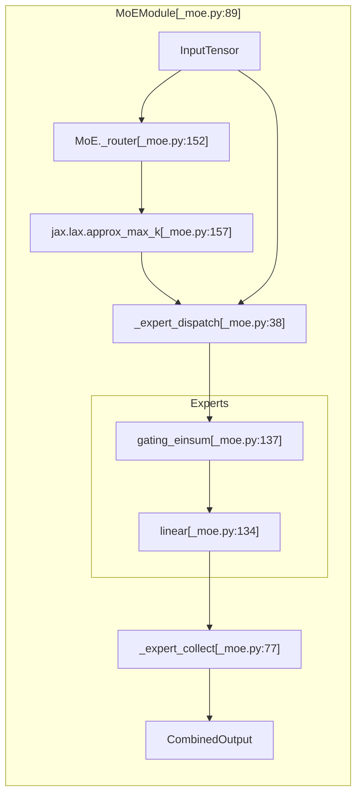

<!-- source: DeepWiki mcp.deepwiki.com · repo google-deepmind/gemma · page 3.6 Gemma4 Architecture · fetched 2026-10-26 -->

# Gemma4 Architecture

Relevant source files

The following files were used as context for generating this wiki page:

- [gemma/gm/nn/gemma3n/_transformer.py](gemma/gm/nn/gemma3n/_transformer.py)
- [gemma/gm/nn/gemma4/README.md](gemma/gm/nn/gemma4/README.md)
- [gemma/gm/nn/gemma4/_config.py](gemma/gm/nn/gemma4/_config.py)
- [gemma/gm/nn/gemma4/_gemma4.py](gemma/gm/nn/gemma4/_gemma4.py)
- [gemma/gm/nn/gemma4/_layers.py](gemma/gm/nn/gemma4/_layers.py)
- [gemma/gm/nn/gemma4/_modules.py](gemma/gm/nn/gemma4/_modules.py)
- [gemma/gm/nn/gemma4/_moe.py](gemma/gm/nn/gemma4/_moe.py)
- [gemma/gm/nn/gemma4/_transformer.py](gemma/gm/nn/gemma4/_transformer.py)
- [gemma/gm/nn/gemma4/_transformer_test.py](gemma/gm/nn/gemma4/_transformer_test.py)
- [gemma/gm/nn/gemma4/audio/_model.py](gemma/gm/nn/gemma4/audio/_model.py)
- [gemma/gm/nn/gemma4/audio/_modules.py](gemma/gm/nn/gemma4/audio/_modules.py)
- [gemma/gm/nn/gemma4/vision/_layers.py](gemma/gm/nn/gemma4/vision/_layers.py)
- [gemma/peft/_lora.py](gemma/peft/_lora.py)

## Purpose and Scope
This document details the architecture of Gemma4 models within the `gemma/gm/nn/gemma4/` package. It covers model configurations and variants, the `text_only` flag, the sparse Mixture-of-Experts (MoE) implementation, multimodal encoders (Conformer-based audio encoder and SigLiP-based vision encoder), and KV cache sharing mechanisms.

**Sources:** `[gemma/gm/nn/gemma4/_transformer.py:1-150]()`, `[gemma/gm/nn/gemma4/_gemma4.py:15-120]()`

---

## Model Variants and the `text_only` Flag

Gemma4 introduces native multimodal capabilities and sparse Mixture-of-Experts (MoE) options across multiple scale variants. All models inherit from `_Gemma4Base` and share a tokenizer version 4 with a vocabulary size of 262,144 `[gemma/gm/nn/gemma4/_gemma4.py:36-48]`, `[gemma/gm/nn/gemma4/_gemma4.py:91]`.

| Variant | Parameters | Layers | Embed Dim | Attention Pattern | Features |
| :--- | :--- | :--- | :--- | :--- | :--- |
| **Gemma4_E2B** | ~2B | 35 | 1536 | 4 Local / 1 Global `[gemma/gm/nn/gemma4/_gemma4.py:125-131]` | KV Sharing, Multimodal `[gemma/gm/nn/gemma4/_gemma4.py:136-151]` |
| **Gemma4_E4B** | ~4B | 42 | 2560 | 5 Local / 1 Global `[gemma/gm/nn/gemma4/_gemma4.py:161-168]` | KV Sharing, Multimodal `[gemma/gm/nn/gemma4/_gemma4.py:173-188]` |
| **Gemma4_31B** | ~31B | 60 | 5376 | 5 Local / 1 Global `[gemma/gm/nn/gemma4/_gemma4.py:198-205]` | No KV Sharing, Multimodal `[gemma/gm/nn/gemma4/_gemma4.py:209-215]` |

### The `text_only` Flag
The base class `_Gemma4Base` defines the `text_only` boolean attribute (defaulting to `True`) `[gemma/gm/nn/gemma4/_gemma4.py:36-44]`. During initialization in `__post_init__`, if `text_only` is true and a vision or audio encoder is configured, `vision_encoder` and `audio_encoder` are set to `None` to reduce memory consumption and compute overhead `[gemma/gm/nn/gemma4/_gemma4.py:50-60]`.

**Sources:** `[gemma/gm/nn/gemma4/_gemma4.py:28-258]`, `[gemma/gm/nn/gemma4/_config.py:91]`

---

## Mixture-of-Experts (MoE) Implementation

The MoE architecture provides sparse conditional computation via top-k routing. It is implemented in the `MoE` module `[gemma/gm/nn/gemma4/_moe.py:89]`.

### Routing and Dispatch Logic
1.  **Router**: `MoE._router` computes routing logits over tokens and applies `jax.nn.softmax` `[gemma/gm/nn/gemma4/_moe.py:152-156]`.
2.  **Top-k Selection**: `jax.lax.approx_max_k` selects the top-scoring experts per token `[gemma/gm/nn/gemma4/_moe.py:157-160]`.
3.  **Renormalization**: Routing weights are normalized using `_renormalization_factor` to maintain stable scaling `[gemma/gm/nn/gemma4/_moe.py:23-35]`, `[gemma/gm/nn/gemma4/_moe.py:161]`.
4.  **Expert Dispatch**: `_expert_dispatch` sorts and batches tokens to their target experts `[gemma/gm/nn/gemma4/_moe.py:38-74]`.
5.  **Expert Processing & Collection**: Selected experts process assigned tokens through gated linear activations, after which `_expert_collect` restores original token ordering `[gemma/gm/nn/gemma4/_moe.py:77-86]`, `[gemma/gm/nn/gemma4/_moe.py:183-186]`.

When `enable_moe` is active in `TransformerConfig`, the standard feed-forward block is substituted by the `MoE` module inside `Transformer.setup` `[gemma/gm/nn/gemma4/_transformer.py:189-193]`, `[gemma/gm/nn/gemma4/_config.py:121]`.

**Sources:** `[gemma/gm/nn/gemma4/_moe.py:15-204]`, `[gemma/gm/nn/gemma4/_config.py:121-125]`, `[gemma/gm/nn/gemma4/_transformer.py:189-193]`

---

## Multimodal Encoders

Gemma4 integrates external audio and vision encoders by projecting their intermediate representations directly into the text embedding space via `Embedder` `[gemma/gm/nn/gemma4/_modules.py:60]`.

### Audio Encoder (Conformer)
The audio pathway uses `AudioTokenizer` built on a `ConformerConfig` `[gemma/gm/nn/gemma4/audio/_model.py:27]`, `[gemma/gm/nn/gemma4/audio/_modules.py:33-48]`.
1.  **Mel Filterbank Conversion**: Waveforms are processed by `GemaxMelFilterbank` `[gemma/gm/nn/gemma4/audio/_model.py:119]`.
2.  **Subsampling**: `SubSamplingBlock` applies convolutional downsampling and sequence masking `[gemma/gm/nn/gemma4/audio/_model.py:123-125]`.
3.  **Conformer Stack**: A series of `ConformerLayer` blocks execute depthwise convolutions and self-attention `[gemma/gm/nn/gemma4/audio/_model.py:128-133]`.
4.  **Projection**: `Embedder.encode_audio` maps audio features to the text `embed_dim` `[gemma/gm/nn/gemma4/_modules.py:163-167]`.

### Vision Encoder
The vision pathway processes raw patches and positions via `VisionEntry` and spatial pooling via `VisionExit` `[gemma/gm/nn/gemma4/vision/_layers.py:30]`, `[gemma/gm/nn/gemma4/vision/_layers.py:90]`. `Embedder.encode_vision` normalizes and projects vision patch embeddings into the text embedding space `[gemma/gm/nn/gemma4/_modules.py:157-161]`.

**Sources:** `[gemma/gm/nn/gemma4/audio/_model.py:27-148]`, `[gemma/gm/nn/gemma4/vision/_layers.py:30-205]`, `[gemma/gm/nn/gemma4/_modules.py:157-167]`

---

## KV Cache Sharing

To optimize inference memory usage, Gemma4 supports KV cache sharing across layers, governed by `KVCacheSharingConfig` `[gemma/gm/nn/gemma4/_config.py:33]`.

### Configuration and Mapping
*   `frac_shared_layers`: Fraction of total layers configured to share key-value states `[gemma/gm/nn/gemma4/_config.py:36]`.
*   `share_global`: Enables cache sharing for global attention layers `[gemma/gm/nn/gemma4/_config.py:37]`.
*   `share_local`: Enables cache sharing for local sliding window attention layers `[gemma/gm/nn/gemma4/_config.py:38]`.

`create_kv_cache_sharing_patterns` builds a list mapping physical cache indices to logical layers, pointing shared layers back to earlier unshared reference layer slots `[gemma/gm/nn/gemma4/_config.py:55-84]`, `[gemma/gm/nn/gemma4/_transformer.py:151-155]`.

**Sources:** `[gemma/gm/nn/gemma4/_config.py:33-84]`, `[gemma/gm/nn/gemma4/_transformer.py:151-155]`

---

## Architectural Diagrams

### Data Flow: Multimodal Inputs to Transformer Backbone
This diagram illustrates the code path from raw inputs through encoders to the `Embedder` and `Transformer` blocks.

**Sources:** `[gemma/gm/nn/gemma4/_modules.py:60-167]`, `[gemma/gm/nn/gemma4/audio/_model.py:27]`, `[gemma/gm/nn/gemma4/_transformer.py:137]`

### Sparse MoE Routing and Dispatch Flow
This diagram details the tensor operations inside the `MoE` module.

**Sources:** `[gemma/gm/nn/gemma4/_moe.py:38-185]`

---

