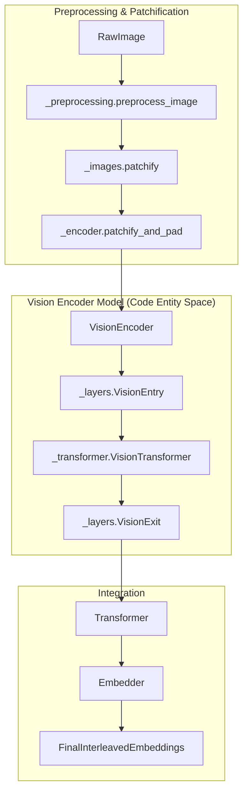
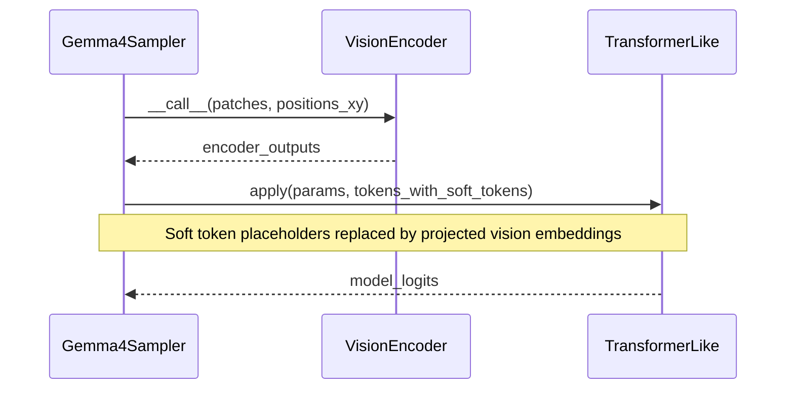

<!-- source: DeepWiki mcp.deepwiki.com · repo google-deepmind/gemma · page 3.7 Vision Encoder · fetched 2026-10-26 -->

# Vision Encoder

Relevant source files

The following files were used as context for generating this wiki page:

- [gemma/gm/losses/_npo.py](gemma/gm/losses/_npo.py)
- [gemma/gm/math/_misc.py](gemma/gm/math/_misc.py)
- [gemma/gm/nn/gemma4/vision/_encoder.py](gemma/gm/nn/gemma4/vision/_encoder.py)
- [gemma/gm/nn/gemma4/vision/_images.py](gemma/gm/nn/gemma4/vision/_images.py)
- [gemma/gm/nn/gemma4/vision/_preprocessing.py](gemma/gm/nn/gemma4/vision/_preprocessing.py)
- [gemma/gm/nn/gemma4/vision/_utils.py](gemma/gm/nn/gemma4/vision/_utils.py)
- [gemma/gm/nn/vision/_vision.py](gemma/gm/nn/vision/_vision.py)
- [gemma/gm/text/_gemma4_sampler.py](gemma/gm/text/_gemma4_sampler.py)
- [gemma/gm/vision/_preprocess.py](gemma/gm/vision/_preprocess.py)
- [gemma/gm/vision/_token_utils.py](gemma/gm/vision/_token_utils.py)

The vision encoder in Gemma models (starting from Gemma 3) is based on the **SigLiP** (Sigmoid Loss for Language-Image Pre-training) architecture. It processes visual information by converting images into a sequence of "soft tokens" (embeddings) that are interleaved with text tokens in the transformer's input sequence.

## Overview and Data Flow

The vision pipeline follows a multi-stage process: preprocessing (resizing and normalization), patchification (breaking the image into small squares), encoding through a ViT-based transformer, and projection/pooling to match the LLM's embedding space.

### Code-to-System Mapping: Vision Pipeline

The following diagram maps high-level concepts to the specific classes and functions in the codebase.

Sources: [gemma/gm/nn/gemma4/vision/_encoder.py:36-69](), [gemma/gm/nn/gemma4/vision/_preprocessing.py:125-157](), [gemma/gm/nn/gemma4/vision/_images.py:83-101]()

---

## Image Preprocessing and Patchification

Gemma supports both fixed-grid images (Gemma 3) and variable-aspect-ratio images (Gemma 4).

### Preprocessing Logic
1. **Normalization**: Pixels are normalized to zero mean and unit variance or scaled to the `[0, 1]` range depending on the specific model variant [gemma/gm/vision/_preprocess.py:100-116](), [gemma/gm/nn/gemma4/vision/_preprocessing.py:146-157]().
2. **Resizing**: Images are resized using bicubic or bilinear interpolation. For Gemma 4, dimensions are calculated by `get_target_dimensions` to be multiples of `pooling_kernel_size * patch_size` while preserving aspect ratio and staying within `max_patches` limits [gemma/gm/nn/gemma4/vision/_preprocessing.py:29-68](), [gemma/gm/nn/gemma4/vision/_preprocessing.py:104-108]().
3. **Patchification**: The image is divided into patches of size $P \times P$ using functions such as `patchify_images` or `_images.patchify` [gemma/gm/vision/_preprocess.py:60-96](), [gemma/gm/nn/gemma4/vision/_images.py:83-101]().

### Variable Aspect Ratio (Gemma 4)
Gemma 4 introduces `patchify_and_pad`, which handles batches of images with different shapes. It calculates the number of real patches per image and pads the sequence to a `max_patches` length using `POSITIONS_PAD_VALUE` (-1) to allow batch processing [gemma/gm/nn/gemma4/vision/_encoder.py:128-188](). Factorized position embeddings are computed via `factorized_posemb` using `positions_xy` coordinates [gemma/gm/nn/gemma4/vision/_images.py:60-80]().

Sources: [gemma/gm/vision/_preprocess.py:27-96](), [gemma/gm/nn/gemma4/vision/_preprocessing.py:29-158](), [gemma/gm/nn/gemma4/vision/_images.py:60-101](), [gemma/gm/nn/gemma4/vision/_encoder.py:128-188]()

---

## Model Architecture

The `VisionEncoder` consists of three primary stages: `VisionEntry`, `VisionTransformer`, and `VisionExit`.

### 1. VisionEntry
This layer performs the initial linear projection of flattened patches and adds position embeddings. It supports factorized 2D position embeddings based on $(x, y)$ coordinates to handle variable aspect ratios [gemma/gm/nn/gemma4/vision/_encoder.py:51-55]().

### 2. VisionTransformer
A standard ViT (Vision Transformer) composed of encoder blocks. It handles attention computation across the patch sequence, utilizing input masks derived from `positions_xy` [gemma/gm/nn/gemma4/vision/_encoder.py:100-110]().

### 3. VisionExit
The exit layer prepares the vision embeddings for the text transformer. It includes spatial pooling (e.g., `avg_pool_by_positions`) to reduce the sequence length to a fixed or variable `output_length` [gemma/gm/nn/gemma4/vision/_utils.py:23-57](). In Gemma 4, `extract_soft_tokens` strips padding tokens from the encoder output using the provided mask [gemma/gm/nn/gemma4/vision/_encoder.py:190-213]().

| Attribute | Description | Source |
| :--- | :--- | :--- |
| `d_model` | Embedding dimension of the vision encoder. | [gemma/gm/nn/gemma4/vision/_encoder.py:39-39]() |
| `patch_size` | Pixel size of image patches. | [gemma/gm/nn/gemma4/vision/_encoder.py:43-43]() |
| `output_length` | Number of soft tokens produced per image after pooling. | [gemma/gm/nn/gemma4/vision/_encoder.py:44-44]() |

Sources: [gemma/gm/nn/gemma4/vision/_encoder.py:36-69](), [gemma/gm/nn/gemma4/vision/_utils.py:23-57]()

---

## Integration with Text Sequence

The integration of vision data into the LLM happens by replacing placeholder tokens with vision embeddings.

### Token Placeholder Expansion
The text prompt uses special placeholders such as `SOFT_TOKEN_PLACEHOLDER` (-2) to mark where images should be inserted [gemma/gm/vision/_token_utils.py:31-31](). The function `add_extra_tokens_for_images` (or `initialize_vision_tokens`) expands these markers into a buffer [gemma/gm/vision/_token_utils.py:47-98](), [gemma/gm/nn/vision/_vision.py:120-199]().

### Code Entity Space Integration: Multimodal Dispatch
The interaction between the sampler, vision encoder, and transformer is orchestrated as shown below.

Sources: [gemma/gm/text/_gemma4_sampler.py:98-182](), [gemma/gm/nn/gemma4/vision/_encoder.py:95-125]()

---

## Configuration

The vision encoder is configured via parameters such as `d_model`, `num_layers`, `patch_size`, and `output_length` [gemma/gm/nn/gemma4/vision/_encoder.py:36-49](). It supports optional features like `standardize_embeddings` and `use_clipped_linears` for specific architectural variants [gemma/gm/nn/gemma4/vision/_encoder.py:47-48]().

Sources: [gemma/gm/nn/gemma4/vision/_encoder.py:36-49]()

---

