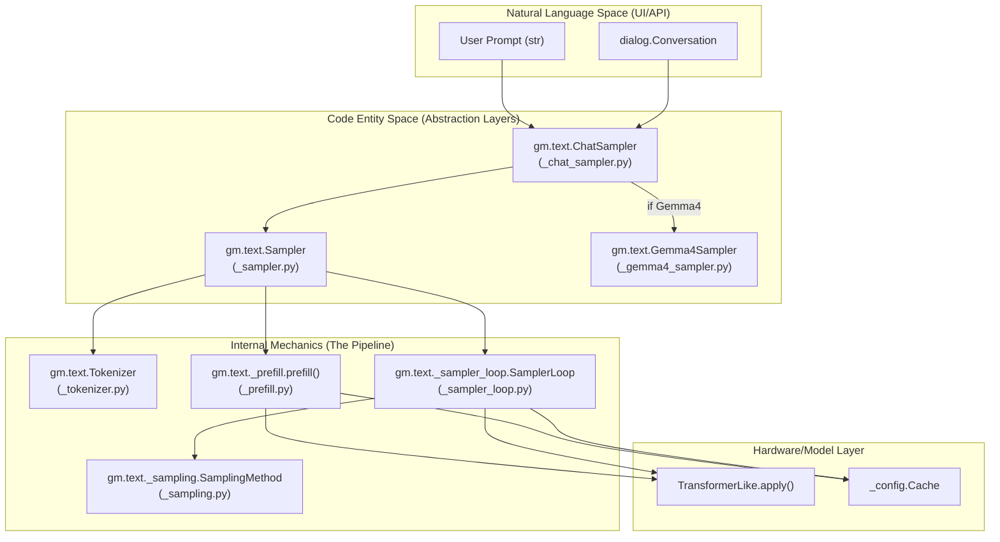
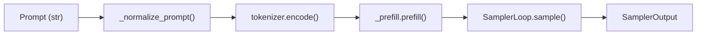

<!-- source: DeepWiki mcp.deepwiki.com · repo google-deepmind/gemma · page 4 Text Generation · fetched 2026-10-26 -->

# Text Generation

Relevant source files

The following files were used as context for generating this wiki page:

- [gemma/gm/text/__init__.py](gemma/gm/text/__init__.py)
- [gemma/gm/text/_chat_sampler.py](gemma/gm/text/_chat_sampler.py)
- [gemma/gm/text/_sampler.py](gemma/gm/text/_sampler.py)
- [gemma/gm/text/_sampling.py](gemma/gm/text/_sampling.py)
- [gemma/gm/text/_sampling_test.py](gemma/gm/text/_sampling_test.py)

## Purpose and Scope

This document covers the text generation system in Gemma, which provides APIs for autoregressive text sampling from trained transformer models. The system offers a three-tier abstraction model: `ChatSampler` for conversational interfaces, `Sampler` for low-level control, and direct `model.apply()` for maximum flexibility. It handles the full generation lifecycle including input normalization, tokenization, prefill, autoregressive sampling loops, and decoding.

For information about the underlying transformer models, see [Model Architecture](#3). For tokenization details, see [Tokenization](#5). For training-related text generation evaluation, see [Evaluation](#6.5).

Sources: [gemma/gm/text/__init__.py:15-45]()

## Architecture Overview

The text generation system is organized into distinct layers with clear separation of concerns, linking the Natural Language Space (prompts/text) to the Code Entity Space (JAX arrays/Model logic).

### System Component Diagram
This diagram maps high-level generation concepts to specific code entities and files.

**Abstraction Levels:**

| Level | Class | Use Case | State Management | Prompt Formatting |
|-------|-------|----------|------------------|-------------------|
| High | `ChatSampler` | Multi-turn conversations | Automatic | Automatic |
| Mid | `Sampler` | Custom sampling workflows | Manual | Manual |
| Low | `model.apply()` | Research/debugging | Manual | Manual |

Sources: [gemma/gm/text/_sampler.py:86-125](), [gemma/gm/text/_chat_sampler.py:42-111](), [gemma/gm/text/__init__.py:23-45]()

## ChatSampler: High-Level Conversational API

`ChatSampler` is the primary entry point for conversational applications. It automatically detects the model version (2, 3, 3n, 4) via the `_is_gemma4` property and `_inner_sampler` factory to select the correct underlying sampler and prompt template. For details, see [ChatSampler](#4.2).

### Key Features
- **Automatic State Management**: Maintains `last_state` (of type `SamplingState`) across turns [gemma/gm/text/_chat_sampler.py:141-143]().
- **Template Integration**: Automatically formats the prompt with turn tags and adds the BOS (beginning of sequence) token [gemma/gm/text/_chat_sampler.py:78-80]().
- **Multimodal Support**: For Gemma 4, it dispatches to `Gemma4Sampler` to handle variable-aspect-ratio images and audio via `images` and `audio` arguments [gemma/gm/text/_chat_sampler.py:167-184]().

Sources: [gemma/gm/text/_chat_sampler.py:42-111](), [gemma/gm/text/_chat_sampler.py:159-184]()

## Sampler: Mid-Level API

The `Sampler` class provides a stateless interface for text generation. It requires the user to manually handle prompt formatting and state propagation. For details, see [Sampler](#4.3).

### Sampler Lifecycle
The `sample()` method coordinates the transition from text to JAX arrays.

**Key Attributes:**
- `cache_length`: Maximum tokens for the conversation [gemma/gm/text/_sampler.py:137]().
- `pad_length`: Buckets (e.g., `(256, 512, 1024)`) used to minimize JIT recompilation [gemma/gm/text/_sampler.py:139]().
- `SamplerOutput`: Contains the sampled `text` and the final `state` (including predicted tokens and cache) [gemma/gm/text/_sampler.py:58-67]().

Sources: [gemma/gm/text/_sampler.py:86-140](), [gemma/gm/text/_sampler.py:58-84]()

## Sampling Methods

Sampling methods define how the next token ID is selected from the model's output logits. All strategies inherit from the `SamplingMethod` base class [gemma/gm/text/_sampling.py:26-41](). For details, see [Sampling Methods](#4.4).

| Method | Code Class | Logic |
|--------|------------|-------|
| Greedy | `Greedy` | `jnp.argmax(logits)` [gemma/gm/text/_sampling.py:44-50]() |
| Random | `RandomSampling` | `jax.random.categorical` with `temperature` [gemma/gm/text/_sampling.py:54-61]() |
| Top-K | `TopkSampling` | Samples from the `k` highest logits [gemma/gm/text/_sampling.py:65-82]() |
| Top-P | `TopPSampling` | Nucleus sampling (cumulative probability mass `p`) [gemma/gm/text/_sampling.py:86-117]() |

Sources: [gemma/gm/text/_sampling.py:26-117]()

## Autoregressive Loop (SamplerLoop)

The `SamplerLoop` manages the token-by-token generation process using `jax.lax.while_loop` for efficiency on accelerators. For details, see [Autoregressive Loop](#4.5).

- **SamplingState**: A `flax.struct.dataclass` containing the current step, cache, and predicted tokens.
- **Termination**: The loop continues until all sequences in a batch hit an end token or `max_new_tokens` is reached.

Sources: [gemma/gm/text/_sampler.py:138]()

## Prefill and KV Cache

The prefill phase processes the initial prompt in parallel to populate the Key-Value (KV) cache before the sequential sampling loop begins. For details, see [Prefill and KV Cache](#4.6).

- **KV Cache**: Managed activations stored per layer to avoid redundant computation.
- **Gemma 4 Handling**: `Gemma4Sampler` performs complex pre-processing for multimodal inputs, including variable-aspect-ratio image expansion and audio soft-token injection.

Sources: [gemma/gm/text/__init__.py:34]()

## Tool Use

Gemma supports agentic workflows where the model can interact with external tools. The `ToolSampler` manages the loop between model generation and tool execution. For details, see [Tool Use](#4.7).

- **ToolSampler**: Extends standard sampling to detect tool calls and inject tool responses back into the conversation.
- **MCP Integration**: Supports the Model Context Protocol for standardized tool definitions via `McpToolHandler`.

Sources: [gemma/gm/text/__init__.py:35](), [gemma/gm/text/_chat_sampler.py:186-187]()

---

