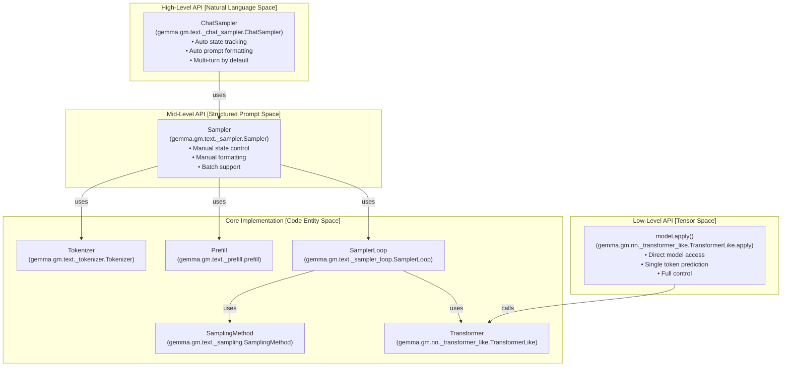
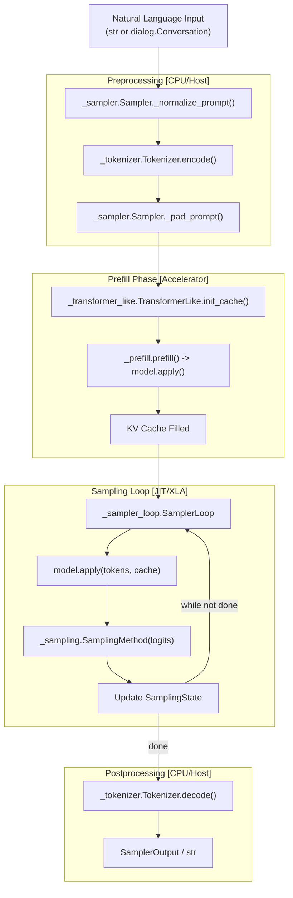

<!-- source: DeepWiki mcp.deepwiki.com · repo google-deepmind/gemma · page 4.1 Generation Overview · fetched 2026-10-26 -->

# Generation Overview

Relevant source files

The following files were used as context for generating this wiki page:

- [docs/dialog.md](docs/dialog.md)
- [gemma/gm/text/_chat_sampler.py](gemma/gm/text/_chat_sampler.py)
- [gemma/gm/text/_sampler.py](gemma/gm/text/_sampler.py)
- [gemma/gm/text/_template.py](gemma/gm/text/_template.py)

## Purpose and Scope

This document explains the text generation system in Gemma, which provides three levels of abstraction for producing text from language models. The generation system handles the complete pipeline from user prompts to generated text, including tokenization, cache management, autoregressive sampling, and output decoding.

For detailed information on specific components:
- Multi-turn conversational interface: see [ChatSampler](#4.2)
- Manual state control and batching: see [Sampler](#4.3)
- Token selection strategies: see [Sampling Methods](#4.4)
- Autoregressive generation mechanics: see [Autoregressive Loop](#4.5)
- Prompt processing and caching: see [Prefill and KV Cache](#4.6)
- Text encoding/decoding: see [Tokenization](#5)

## Three-Tier Abstraction Model

The Gemma library provides three levels of API for text generation, each offering different trade-offs between ease of use and control:

| Abstraction Level | Class/Method | State Management | Formatting | Use Case |
|------------------|--------------|------------------|------------|----------|
| **High-Level** | `ChatSampler` | Automatic | Automatic | Multi-turn conversations, chat applications |
| **Mid-Level** | `Sampler` | Manual | Manual | Batch inference, custom workflows |
| **Low-Level** | `model.apply()` | Manual | Manual | Token-level control, research, debugging |

### Entity Mapping: Natural Language to Code Space

The following diagram maps high-level generation concepts to specific code entities within the `gemma.gm.text` and `gemma.gm.nn` modules.

**Sources:** [gemma/gm/text/_sampler.py:86-125](), [gemma/gm/text/_chat_sampler.py:42-111](), [gemma/gm/nn/_transformer_like.py:27-31]()

### High-Level: ChatSampler
The `ChatSampler` class [gemma/gm/text/_chat_sampler.py:42-111]() provides the simplest interface for conversational AI applications. It automatically manages conversation state, formats prompts with required control tokens (e.g., `<start_of_turn>`, `<end_of_turn>`), and handles multi-turn context. It acts as a unified dispatcher, selecting the correct underlying sampler (e.g., `Gemma4Sampler` or standard `Sampler`) based on the model's metadata [gemma/gm/text/_chat_sampler.py:167-187]().

**Key characteristics:**
- **Stateful**: Automatically maintains conversation history in `self.turns` [gemma/gm/text/_chat_sampler.py:144-144]() and KV cache in `self.last_state` [gemma/gm/text/_chat_sampler.py:141-143]().
- **Automatic formatting**: Adds BOS token and turn markers via internal templates [gemma/gm/text/_chat_sampler.py:78-80]().
- **Multi-turn support**: Built-in context preservation across exchanges when `multi_turn=True` [gemma/gm/text/_chat_sampler.py:117-117]().
- **Multimodal Support**: For Gemma 4 models, handles per-turn images and audio via `Gemma4Sampler` integration [gemma/gm/text/_chat_sampler.py:81-83](), [gemma/gm/text/_chat_sampler.py:169-187]().

**Sources:** [gemma/gm/text/_chat_sampler.py:42-111](), [gemma/gm/text/_chat_sampler.py:141-153]()

### Mid-Level: Sampler
The `Sampler` class [gemma/gm/text/_sampler.py:86-125]() provides more control while still handling complex operations like KV caching and efficient prefilling. Users must manually manage state between turns and format prompts correctly.

**Key characteristics:**
- **Stateless**: State has to be manually forwarded between calls [gemma/gm/text/_sampler.py:104-104]().
- **Manual formatting**: User responsible for formatting using `<start_of_turn>`, etc.; BOS is automatically added [gemma/gm/text/_sampler.py:105-107]().
- **Batch support**: Overloaded `sample` method handles sequences of strings or conversations [gemma/gm/text/_sampler.py:185-199]().
- **Flexible caching**: Configurable `cache_length` and `pad_length` to avoid JIT recompilation [gemma/gm/text/_sampler.py:117-125]().

**Sources:** [gemma/gm/text/_sampler.py:86-140]()

### Low-Level: model.apply()
Direct model invocation provides maximum control. Users handle tokenization, position encoding, and cache management manually. The model predicts logits for a single forward pass via the `TransformerLike` protocol [gemma/gm/nn/_transformer_like.py:27-27]().

**Sources:** [gemma/gm/nn/_transformer_like.py:27-31]()

## Complete Generation Pipeline

The generation lifecycle follows a structured path from natural language to tensor operations and back.

**Sources:** [gemma/gm/text/_sampler.py:228-458](), [gemma/gm/text/_prefill.py:28-28](), [gemma/gm/text/_sampler_loop.py:29-29]()

## Key Generation Components

### Input Normalization and Tokenization
The sampler first normalizes prompts into a standard format. The `Tokenizer` converts text to token IDs [gemma/gm/text/_tokenizer.py:46-46](). For multi-turn chats, `ChatSampler` uses templates to inject markers like `<start_of_turn>` [gemma/gm/text/_chat_sampler.py:78-80](). Whitespace management is critical as leading spaces change token IDs.

### Prefill Phase
Before generating new tokens, the model processes the existing prompt tokens to populate the KV cache. The `prefill` function [gemma/gm/text/_prefill.py:50-50]() handles this by calling `model.apply` on the prompt sequence. This is optimized to handle varying prompt lengths without triggering recompilation via `pad_length` buckets [gemma/gm/text/_sampler.py:139-139]().

### Autoregressive Loop
The `SamplerLoop` [gemma/gm/text/_sampler_loop.py:57-57]() manages the `jax.lax.while_loop` that generates tokens one-by-one. It maintains a `SamplingState` [gemma/gm/text/_sampler_loop.py:33-33]() which tracks:
- `predicted_tokens`: The growing sequence of generated IDs.
- `cache`: The mutable KV cache.
- `done`: A boolean mask indicating which sequences in a batch have hit a stop condition.

### Sampling and Decoding
At each step, the `SamplingMethod` (e.g., `Greedy`, `TopkSampling`) selects the next token from the logits [gemma/gm/text/_sampling.py:35-35](). Finally, the `SamplerOutput` [gemma/gm/text/_sampler.py:58-68]() holds the results, which are decoded back into text using `tokenizer.decode()` [gemma/gm/text/_sampler.py:424-424]().

## State Management Patterns

### Automatic (ChatSampler)
The `ChatSampler` maintains an internal `last_state` [gemma/gm/text/_chat_sampler.py:141-143](). Every call to `chat()` updates this state, allowing for seamless multi-turn interaction.

### Manual (Sampler)
The `Sampler.sample()` method accepts a `last_state` argument [gemma/gm/text/_sampler.py:179-179](). To continue a conversation, the user must capture the `state` from `SamplerOutput` and provide it to the next call.

**Sources:** [gemma/gm/text/_chat_sampler.py:141-153](), [gemma/gm/text/_sampler.py:58-68](), [gemma/gm/text/_sampler.py:168-206]()

## Configuration Parameters

| Parameter | Type | Description |
| :--- | :--- | :--- |
| `cache_length` | `int` | Max total tokens in the KV cache [gemma/gm/text/_sampler.py:137-137](). |
| `max_out_length` | `int` | Max tokens generated in a single call [gemma/gm/text/_sampler.py:138-138](). |
| `pad_length` | `int \| tuple` | Buckets for prompt padding to minimize JIT [gemma/gm/text/_sampler.py:139-139](). |
| `sampling` | `SamplingMethod` | Strategy for token selection (default: `Greedy`) [gemma/gm/text/_sampler.py:131-133](). |
| `stop_tokens` | `Sequence` | Tokens that trigger generation termination [gemma/gm/text/_sampler.py:135-135](). |

**Sources:** [gemma/gm/text/_sampler.py:128-140](), [gemma/gm/text/_chat_sampler.py:115-136]()

---

