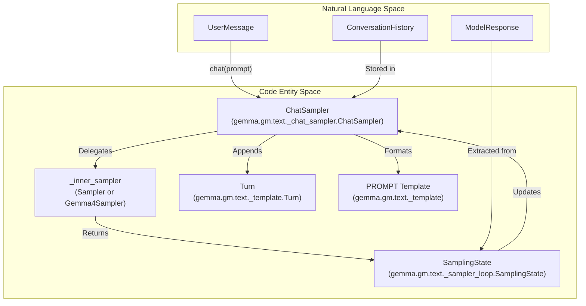
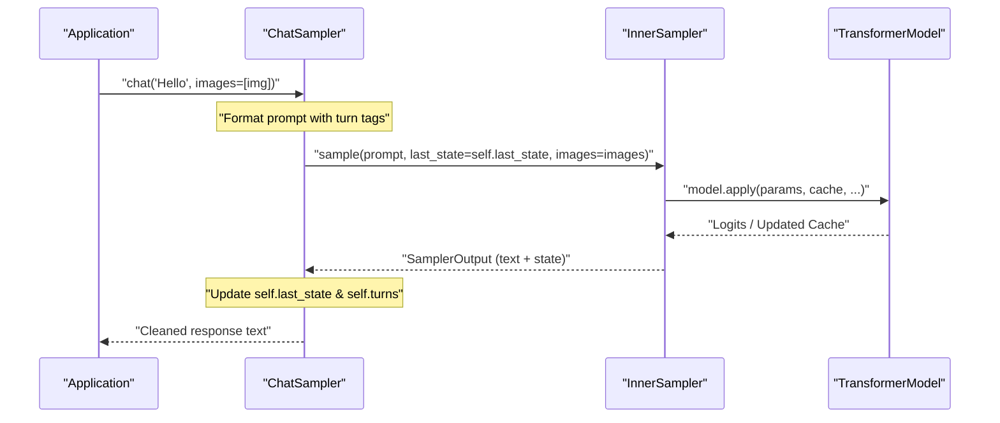

<!-- source: DeepWiki mcp.deepwiki.com · repo google-deepmind/gemma · page 4.2 ChatSampler · fetched 2026-10-26 -->

# ChatSampler

Relevant source files

The following files were used as context for generating this wiki page:

- [gemma/gm/nn/gemma4/vision/_encoder.py](gemma/gm/nn/gemma4/vision/_encoder.py)
- [gemma/gm/nn/gemma4/vision/_images.py](gemma/gm/nn/gemma4/vision/_images.py)
- [gemma/gm/nn/gemma4/vision/_utils.py](gemma/gm/nn/gemma4/vision/_utils.py)
- [gemma/gm/text/_chat_sampler.py](gemma/gm/text/_chat_sampler.py)
- [gemma/gm/text/_gemma4_sampler.py](gemma/gm/text/_gemma4_sampler.py)
- [gemma/gm/text/_sampler.py](gemma/gm/text/_sampler.py)

## Purpose and Scope

`ChatSampler` is the highest-level interface for text generation within the Gemma library, providing automatic conversation state management and prompt formatting. It is designed for interactive chat applications where the model maintains context across multiple conversation turns. It serves as a unified entry point for all Gemma generations (2, 3, 3n, 4) and handles multimodal dispatch (images and audio) for supported models like Gemma 4.

Sources: [gemma/gm/text/_chat_sampler.py:15-77](), [gemma/gm/text/_chat_sampler.py:42-59]()

## Overview

`ChatSampler` abstracts away the complexities of prompt templates, tokenization, and KV-cache management. It automatically selects the correct underlying sampler implementation—either `Gemma4Sampler` for multimodal Gemma 4 models or the standard `Sampler` for others—based on the model's `INFO.tokenizer_version` metadata.

Key features include:
- **Automatic Multi-turn Logic**: KV cache is preserved and reused across conversation turns when `multi_turn=True` [gemma/gm/text/_chat_sampler.py:50-59]().
- **Template Management**: Automatically injects turn tags (e.g., `<start_of_turn>user`) and filters end-of-turn markers from output [gemma/gm/text/_chat_sampler.py:78-80]().
- **Multimodal Dispatch**: Supports per-turn images (with variable aspect ratio) and audio for Gemma 4 via specialized preprocessing [gemma/gm/text/_chat_sampler.py:81-83]().
- **Streaming**: Supports real-time token printing via `print_stream` [gemma/gm/text/_chat_sampler.py:88]().

### System-to-Code Mapping

The following diagram maps high-level conversational concepts to the specific code entities used in the implementation, bridging natural language interactions to the underlying JAX/Flax code structures.

Title: Conversational Mapping to Code Entities

Sources: [gemma/gm/text/_chat_sampler.py:42-111](), [gemma/gm/text/_chat_sampler.py:167-187]()

## Architecture and Data Flow

`ChatSampler` acts as a stateful wrapper around stateless sampler implementations. It maintains the `last_state` (containing the KV cache) and a list of `turns`.

### Component Interaction

Title: ChatSampler Generation Lifecycle

Sources: [gemma/gm/text/_chat_sampler.py:167-187](), [gemma/gm/text/_chat_sampler.py:202-220](), [gemma/gm/text/_sampler.py:86-125]()

### Key Functions and Properties

| Entity | Location | Description |
| :--- | :--- | :--- |
| `_inner_sampler` | [gemma/gm/text/_chat_sampler.py:167-187]() | A cached property that instantiates `Gemma4Sampler` if `INFO.tokenizer_version == 4`, otherwise `Sampler`. |
| `chat()` | [gemma/gm/text/_chat_sampler.py:130-220]() | The main entry point. Formats the prompt, manages state resets if `multi_turn=False`, and updates history. |
| `last_state` | [gemma/gm/text/_chat_sampler.py:141-143]() | Stores the `SamplingState` (KV cache, token positions) from the previous turn. |
| `turns` | [gemma/gm/text/_chat_sampler.py:144]() | A list of `Turn` objects representing the conversation history. |

Sources: [gemma/gm/text/_chat_sampler.py:130-220]()

## Multi-turn State Management

When `multi_turn=True`, the `ChatSampler` preserves the KV cache within `last_state`. This allows subsequent calls to `chat()` to perform incremental prefill (processing only new tokens) rather than re-processing the entire conversation history from scratch.

### Logic Flow for Turn Updates

1.  **Prompt Normalization**: The input string is wrapped in model-specific turn tags using `_template.PROMPT.format(prompt)` [gemma/gm/text/_chat_sampler.py:187]().
2.  **State Reset**: If `multi_turn=False` or if the user explicitly requests a reset via `reset=True`, `last_state` and `turns` are cleared before sampling [gemma/gm/text/_chat_sampler.py:189-194]().
3.  **Sampling**: The `_inner_sampler.sample()` method is called with `return_state=True` and the `last_state` [gemma/gm/text/_chat_sampler.py:196-205]().
4.  **History Tracking**: The raw prompt and cleaned model response are appended to `self.turns` [gemma/gm/text/_chat_sampler.py:217-218]().
5.  **Cache Preservation**: The new `out.state` is saved back to `self.last_state` for the next turn [gemma/gm/text/_chat_sampler.py:220]().

Sources: [gemma/gm/text/_chat_sampler.py:178-220]()

## Configuration and Parameters

| Parameter | Type | Default | Description |
| :--- | :--- | :--- | :--- |
| `model` | `TransformerLike` | Required | The Gemma transformer instance [gemma/gm/text/_chat_sampler.py:115](). |
| `params` | `Params` | Required | JAX parameters for the model [gemma/gm/text/_chat_sampler.py:116](). |
| `multi_turn` | `bool` | `False` | Whether to maintain context across calls [gemma/gm/text/_chat_sampler.py:117](). |
| `sampling` | `SamplingMethod` | `Greedy()` | The strategy for selecting tokens [gemma/gm/text/_chat_sampler.py:120-122](). |
| `cache_length` | `int` | `4096` | Maximum tokens allowed in the session [gemma/gm/text/_chat_sampler.py:127](). |
| `max_out_length`| `int` | `2048` | Maximum tokens generated in a single response [gemma/gm/text/_chat_sampler.py:128](). |
| `print_stream` | `bool` | `False` | If true, prints tokens to stdout as they are generated [gemma/gm/text/_chat_sampler.py:118](). |

Sources: [gemma/gm/text/_chat_sampler.py:115-136]()

## Sampling Methods

The `ChatSampler` (via its inner sampler) supports various `SamplingMethod` implementations defined in `_sampling.py`. These methods determine how the next token is selected from the model's output logits.

- **Greedy**: Selects the token with the highest logit [gemma/gm/text/_sampling.py:44-51]().
- **RandomSampling**: Categorical sampling with temperature scaling [gemma/gm/text/_sampling.py:54-61]().
- **TopkSampling**: Samples from the top `k` most likely tokens [gemma/gm/text/_sampling.py:65-82]().
- **TopPSampling (Nucleus)**: Samples from the smallest set of tokens whose cumulative probability exceeds `p`. It performs temperature scaling and then masks out tokens below the threshold [gemma/gm/text/_sampling.py:86-117]().

Sources: [gemma/gm/text/_sampling.py:26-117]()

---

