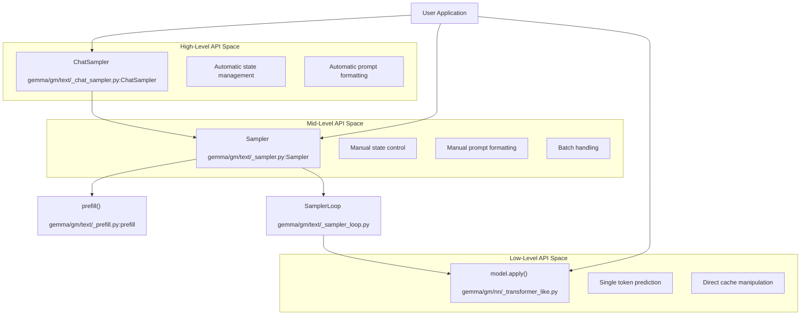
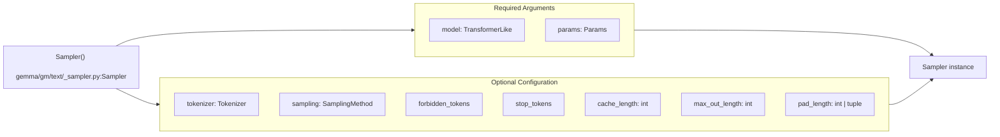
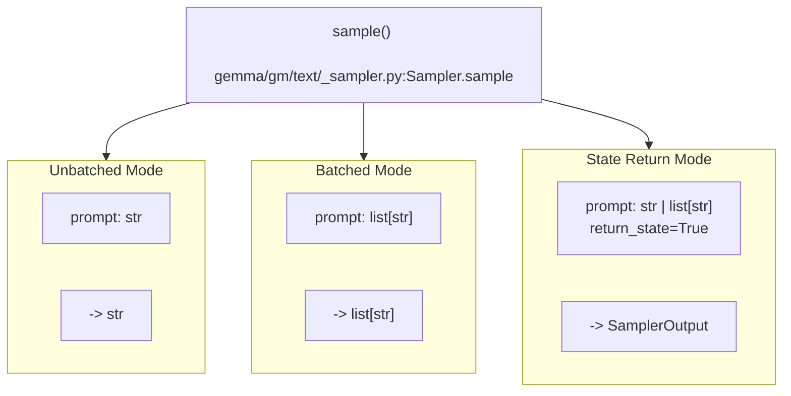
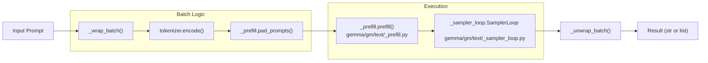

<!-- source: DeepWiki mcp.deepwiki.com · repo google-deepmind/gemma · page 4.3 Sampler · fetched 2026-10-26 -->

# Sampler

Relevant source files

The following files were used as context for generating this wiki page:

- [gemma/gm/text/_chat_sampler.py](gemma/gm/text/_chat_sampler.py)
- [gemma/gm/text/_prefill_test.py](gemma/gm/text/_prefill_test.py)
- [gemma/gm/text/_sampler.py](gemma/gm/text/_sampler.py)
- [gemma/gm/text/_sampler_test.py](gemma/gm/text/_sampler_test.py)

The `Sampler` class provides a mid-level API for text generation with manual state control, batch handling, and custom sampling configuration. It sits between the high-level `ChatSampler` (page 4.2), which handles state and multimodal dispatch automatically, and direct `model.apply` calls which require token-level control.

The Sampler is appropriate when you need:
- Explicit control over multi-turn conversation state.
- Batch processing of multiple prompts.
- Custom sampling configurations per request.
- Access to generation metadata (tokens, state).
- Multi-host synchronization for distributed sampling.

For automatic state management and prompt formatting, use `ChatSampler` [gemma/gm/text/_chat_sampler.py:42-111](). For internal loop mechanics, see `SamplerLoop` (page 4.5). For prefill and cache initialization, see page 4.6.

Sources: [gemma/gm/text/_sampler.py:86-125](), [gemma/gm/text/_chat_sampler.py:42-111]()

## Position in Generation Hierarchy

The Gemma library provides three levels of abstraction for text generation:

**Generation API Architecture Mapping**

Sources: [gemma/gm/text/_sampler.py:86-125](), [gemma/gm/text/_chat_sampler.py:42-111]()

### When to Use Sampler

| Use Case | Recommended API |
|----------|----------------|
| Multi-turn chat with automatic state | `ChatSampler` (page 4.2) |
| Batch generation with manual state | `Sampler` (this page) |
| Custom sampling per request | `Sampler` (this page) |
| State inspection and debugging | `Sampler` with `return_state=True` |
| Single token prediction | `model.apply()` |

Sources: [gemma/gm/text/_sampler.py:88-107]()

## Sampler Class

The `Sampler` class is initialized with a model, parameters, and optional configuration for sampling behavior. It is stateless by design; conversation history must be manually forwarded via the `SamplingState` [gemma/gm/text/_sampler.py:104]().

**Sampler Component Architecture**

Sources: [gemma/gm/text/_sampler.py:86-140]()

### Initialization Parameters

| Parameter | Type | Default | Description |
|-----------|------|---------|-------------|
| `model` | `TransformerLike` | Required | Gemma transformer model (Gemma2, Gemma3, etc.) [gemma/gm/text/_sampler.py:128]() |
| `params` | `Params` | Required | Model parameters [gemma/gm/text/_sampler.py:129]() |
| `tokenizer` | `Tokenizer` | Auto-detected | Tokenizer instance; auto-selected based on model version if not provided [gemma/gm/text/_sampler.py:130-154]() |
| `sampling` | `SamplingMethod` | `Greedy()` | Default sampling strategy (see page 4.4) [gemma/gm/text/_sampler.py:131-133]() |
| `forbidden_tokens` | `Sequence[str \| int]` | `None` | Tokens that cannot be generated [gemma/gm/text/_sampler.py:134]() |
| `stop_tokens` | `Sequence[str \| int]` | `None` | Tokens that terminate generation early [gemma/gm/text/_sampler.py:135]() |
| `cache_length` | `int` | `4096` | Maximum conversation length (all turns combined) [gemma/gm/text/_sampler.py:137]() |
| `max_out_length` | `int` | `2048` | Maximum tokens per single generation call [gemma/gm/text/_sampler.py:138]() |
| `pad_length` | `int \| tuple[int, ...]` | `(256, 512, 1024)` | Padding buckets to avoid recompilation [gemma/gm/text/_sampler.py:139]() |

Sources: [gemma/gm/text/_sampler.py:128-154]()

## Sample Method

The `sample()` method is the primary interface for text generation, with multiple signatures for different use cases.

**Method Signatures**

Sources: [gemma/gm/text/_sampler.py:168-227]()

### Common Parameters

| Parameter | Type | Default | Description |
|-----------|------|---------|-------------|
| `prompt` | `str \| Sequence[str]` | Required | Input text(s); must include `<start_of_turn>` tokens for instruction-tuned models [gemma/gm/text/_sampler.py:105](). |
| `images` | `UInt8[...]` | `None` | Images for multimodal models [gemma/gm/text/_sampler.py:173](). |
| `max_new_tokens` | `int` | `max_out_length` | Maximum tokens to generate (≤ `max_out_length`) [gemma/gm/text/_sampler.py:174](). |
| `stream` | `bool` | `False` | If `True`, yields tokens incrementally [gemma/gm/text/_sampler.py:175](). |
| `sampling` | `SamplingMethod` | From init | Override default sampling method for this call [gemma/gm/text/_sampler.py:176](). |
| `rng` | `PRNGKeyLike` | Random | Random seed for sampling [gemma/gm/text/_sampler.py:177](). |
| `return_state` | `bool` | `False` | If `True`, returns `SamplerOutput` with state [gemma/gm/text/_sampler.py:178](). |
| `last_state` | `SamplingState` | `None` | Previous state for multi-turn continuation [gemma/gm/text/_sampler.py:179](). |
| `sharding` | `ShardingTree` | `None` | Device sharding specification [gemma/gm/text/_sampler.py:180](). |

Sources: [gemma/gm/text/_sampler.py:168-227]()

### Prompt Formatting Requirements

The Sampler requires manual prompt formatting with control tokens for instruction-tuned models [gemma/gm/text/_sampler.py:105](). The BOS (beginning of sequence) token is automatically added for the first turn [gemma/gm/text/_sampler.py:106](). For subsequent turns with `last_state`, BOS is not added to prevent redundant tokens.

Sources: [gemma/gm/text/_sampler.py:105-107]()

## Batch Handling

The Sampler automatically handles both single and batched inputs. Internally, single prompts are wrapped into a batch of size 1 and then unwrapped before returning [gemma/gm/text/_sampler.py:79-82]().

**Batch Processing Flow**

Sources: [gemma/gm/text/_sampler.py:373-516](), [gemma/gm/text/_prefill.py]()

## Multi-Host Synchronization

In multi-host environments (e.g., TPU pods), the Sampler ensures all hosts stay synchronized during the autoregressive loop using collective operations.

When one host finishes generation (e.g., hits a stop token), other hosts might still be generating. To prevent desynchronization, the sampler uses collective operations to synchronize the "done" state across hosts. This is managed by the internal `_sampler_loop` logic which ensures that if any host is still active, the loop continues globally across the entire accelerator mesh.

Sources: [gemma/gm/text/_sampler_loop.py:146-258]()

## Manual State Control

When `return_state=True`, the Sampler returns a `SamplerOutput` object containing both the generated text and internal `SamplingState`.

**SamplerOutput structure**

| Attribute | Type | Description |
|-----------|------|-------------|
| `text` | `str \| list[str]` | The decoded sampled text [gemma/gm/text/_sampler.py:66](). |
| `state` | `SamplingState` | The full state of the generator, including KV cache [gemma/gm/text/_sampler.py:67](). |
| `tokens` | `Property` | Returns the predicted token IDs from the state [gemma/gm/text/_sampler.py:69-72](). |

Sources: [gemma/gm/text/_sampler.py:58-73]()

### Multi-Turn Conversations

Manual state management enables multi-turn conversations by passing the `state` from one call as `last_state` to the next [gemma/gm/text/_sampler.py:179](). This allows the model to continue from the existing KV cache without re-processing the entire conversation history.

Sources: [gemma/gm/text/_sampler.py:179]()

## Performance Considerations

- **Static Shapes**: `pad_length` buckets (e.g., `(256, 512, 1024)`) ensure that prompt shapes are rounded up to fixed sizes, significantly reducing JIT recompilation overhead when prompts vary in length [gemma/gm/text/_sampler.py:139]().
- **KV Cache**: The `cache_length` parameter pre-allocates the KV cache. This is a static value used to avoid re-compilation between turns [gemma/gm/text/_sampler.py:117-119]().
- **Loop JIT**: The sampling loop uses `jax.lax.while_loop` internally, allowing the entire autoregressive process to be compiled into a single XLA executable.

Sources: [gemma/gm/text/_sampler.py:117-139]()

---

