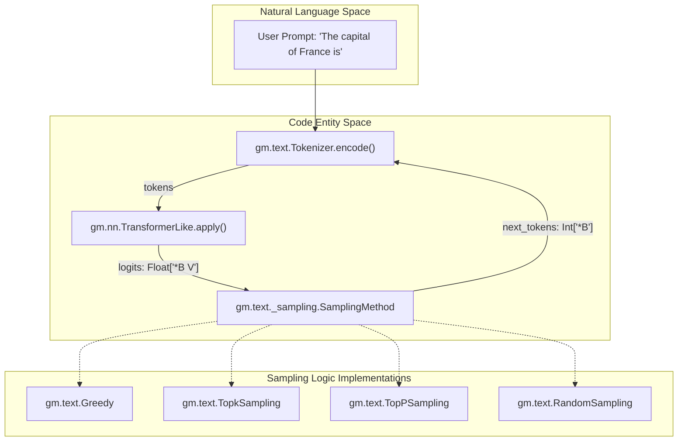
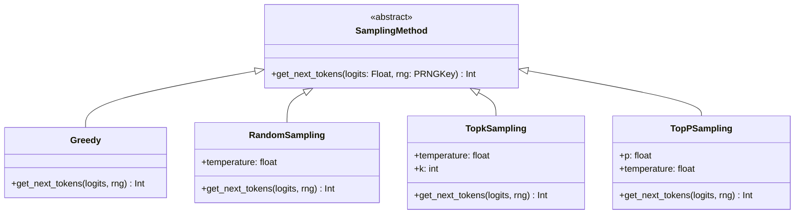

<!-- source: DeepWiki mcp.deepwiki.com · repo google-deepmind/gemma · page 4.4 Sampling Methods · fetched 2026-10-26 -->

# Sampling Methods

<details>
<summary>Relevant source files</summary>

The following files were used as context for generating this wiki page:

- [gemma/gm/text/__init__.py](gemma/gm/text/__init__.py)
- [gemma/gm/text/_sampling.py](gemma/gm/text/_sampling.py)
- [gemma/gm/text/_sampling_test.py](gemma/gm/text/_sampling_test.py)

</details>


This page documents the sampling methods available in the Gemma repository for text generation. Sampling methods determine how the next token is selected during the text generation process based on the probability distribution (logits) provided by the model.

## Overview

Sampling methods control the decision-making process when a language model generates text. At each step of the generation process, the model outputs a probability distribution over the entire vocabulary, and a sampling method must determine which token to select next.

The choice of sampling method significantly affects the quality and characteristics of generated text:

- **Deterministic methods** (like greedy sampling) always produce the same output for a given input.
- **Stochastic methods** produce varied outputs by incorporating randomness.
- **Nucleus/Top-k methods** limit selection to a subset of possible tokens to prevent low-probability "hallucinations."

### Data Flow: From Logits to Tokens

The following diagram bridges the natural language space with the code entities responsible for transforming model outputs into concrete token selections.



Sources: [gemma/gm/text/_sampling.py:15-25](), [gemma/gm/text/__init__.py:39-43](), [gemma/gm/text/_sampling.py:30-40]()

## Available Sampling Methods

All sampling methods in Gemma inherit from the abstract base class `SamplingMethod` [gemma/gm/text/_sampling.py:26-41](), which defines the core interface through the `get_next_tokens` method.

### SamplingMethod Interface

The `SamplingMethod` interface ensures that different strategies can be swapped interchangeably within the generation loop.



The `get_next_tokens` method takes logits (pre-softmax model outputs) with shape `[*B, V]` where `*B` represents batch dimensions and `V` is vocabulary size, plus a JAX random key, and returns selected token indices with shape `[*B]` [gemma/gm/text/_sampling.py:30-40]().

Sources: [gemma/gm/text/_sampling.py:26-117](), [gemma/gm/text/__init__.py:39-43]()

### Greedy Sampling

Greedy sampling selects the token with the highest logit value at each step. This is deterministic and produces the most likely sequence according to the model.

- **Implementation**: Uses `jnp.argmax(logits, axis=-1)` to find highest-scoring tokens [gemma/gm/text/_sampling.py:50-50]().
- **Randomness**: Ignores the random key since selection is deterministic [gemma/gm/text/_sampling.py:49-49]().

Sources: [gemma/gm/text/_sampling.py:43-51](), [gemma/gm/text/_sampling_test.py:20-28]()

### Random Sampling with Temperature

Random sampling selects tokens based on their probability distribution, modified by a temperature parameter that controls randomness.

- **Temperature Scaling**: Logits are divided by `temperature` before the categorical draw [gemma/gm/text/_sampling.py:61-61]().
- **Behaviors**:
    - `temperature = 1.0`: Use original logit distribution.
    - `temperature > 1.0`: Smoother distribution (higher randomness).
    - `temperature < 1.0`: Sharper distribution (lower randomness).
- **Implementation**: Uses `jax.random.categorical` for probabilistic token selection [gemma/gm/text/_sampling.py:61-61]().

Sources: [gemma/gm/text/_sampling.py:53-61](), [gemma/gm/text/_sampling_test.py:30-38]()

### Top-k Sampling

Top-k sampling restricts token selection to the `k` most probable tokens, then samples from this reduced set.

- **Algorithm**:
    1. Uses `jax.lax.top_k(logits, self.k)` to extract the top values and indices [gemma/gm/text/_sampling.py:76-76]().
    2. Applies `jax.random.categorical` to the top-k values scaled by temperature [gemma/gm/text/_sampling.py:77-79]().
    3. Maps the sampled top-k index back to the original vocabulary index [gemma/gm/text/_sampling.py:81-81]().
- **Utility**: Prevents the model from choosing extremely low-probability tokens that might appear in the long tail of the distribution.

Sources: [gemma/gm/text/_sampling.py:64-83](), [gemma/gm/text/_sampling_test.py:40-48]()

### Top-p (Nucleus) Sampling

Top-p sampling dynamically selects from the smallest set of tokens whose cumulative probability exceeds threshold `p`. This adapts the vocabulary size based on the model's prediction confidence.

- **Algorithm Implementation**:
    1. Scale logits by temperature [gemma/gm/text/_sampling.py:95-95]().
    2. Sort logits in descending order and compute cumulative softmax probabilities [gemma/gm/text/_sampling.py:98-102]().
    3. Find the `cutoff_index` where the cumulative probability reaches `p` [gemma/gm/text/_sampling.py:105-105]().
    4. Set logits for all tokens with values less than the `cutoff_logit` to the minimum possible value (`-inf`) [gemma/gm/text/_sampling.py:108-115]().
    5. Sample from the masked distribution using `jax.random.categorical` [gemma/gm/text/_sampling.py:117-117]().

Sources: [gemma/gm/text/_sampling.py:85-117](), [gemma/gm/text/_sampling_test.py:50-70]()

## Integration with Generation APIs

Sampling methods are integrated into the high-level and mid-level generation APIs.

### Sampler Configuration

In the `Sampler` and `Gemma4Sampler` classes, the sampling method is a configurable attribute, defaulting to `Greedy` [gemma/gm/text/_gemma4_sampler.py:71-73]().

| API Class | Default Sampling Method | Configuration Parameter |
| :--- | :--- | :--- |
| `ChatSampler` | `Greedy` | `sampling` |
| `Sampler` | `Greedy` | `sampling` |
| `Gemma4Sampler` | `Greedy` | `sampling` |

### Generation Loop Interaction

The following sequence diagram illustrates how the `SamplerLoop` utilizes the `SamplingMethod` during autoregressive generation.

```mermaid
sequenceDiagram
    participant Loop as gm.text._sampler_loop.SamplerLoop
    participant Model as gm.nn.TransformerLike.apply
    participant Method as gm.text._sampling.SamplingMethod

    Loop->>Model: Run forward pass with current KV cache
    Model-->>Loop: Return logits Float['*B V']
    Loop->>Method: get_next_tokens(logits, rng)
    Note over Method: Implementation-specific logic<br/>(e.g. Top-P cutoff)
    Method-->>Loop: Return next_tokens Int['*B']
    Loop->>Loop: Update SamplingState with new tokens
```

Sources: [gemma/gm/text/_gemma4_sampler.py:106-111](), [gemma/gm/text/_sampling.py:26-41](), [gemma/gm/text/_sampler_loop.py:29-30]()

## Usage Examples

### Configuring Stochastic Sampling

To use Nucleus sampling in a conversational context:

```python
from gemma import gm

# Configure a ChatSampler with Top-P sampling
sampler = gm.text.ChatSampler(
    model=model,
    params=params,
    sampling=gm.text.TopPSampling(p=0.9, temperature=0.7)
)

# Every turn in the chat will now use the specified TopPSampling parameters
response = sampler.chat("Explain the concept of entropy.")
```

Sources: [gemma/gm/text/__init__.py:39-43](), [gemma/gm/text/_sampling.py:86-90]()

### Explicit Greedy Override

While `Greedy` is often the default, it can be passed explicitly to any `sample` call:

```python
# Overriding the default sampler behavior for a specific call
output = sampler.sample(
    "The capital of Japan is",
    sampling=gm.text.Greedy()
)
```

Sources: [gemma/gm/text/_sampling.py:43-51](), [gemma/gm/text/_gemma4_sampler.py:106-106]()

---

