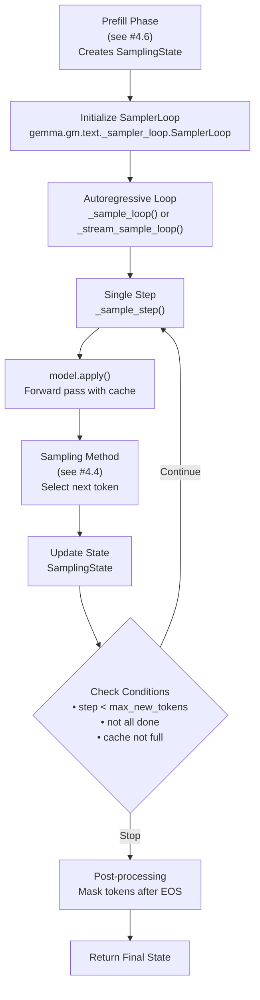
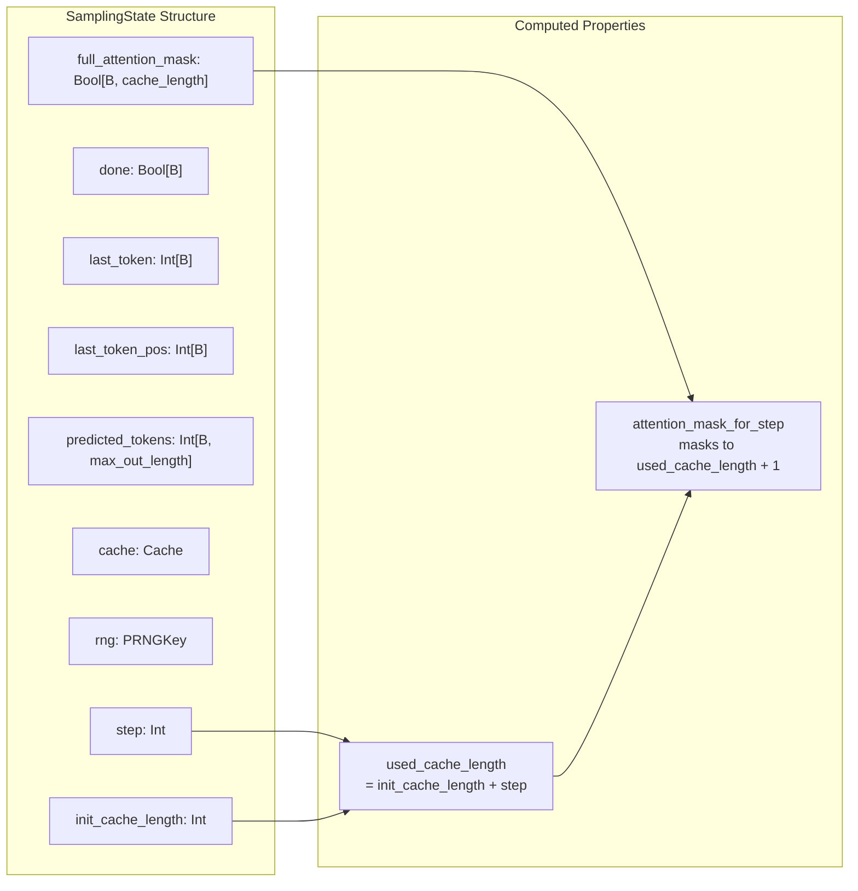
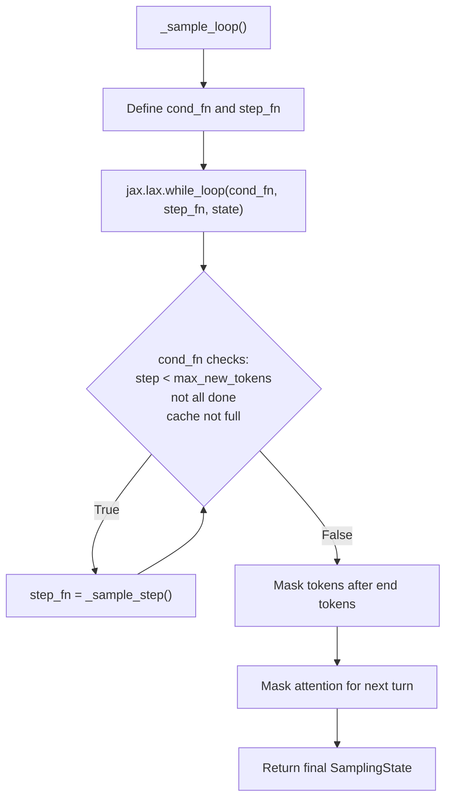
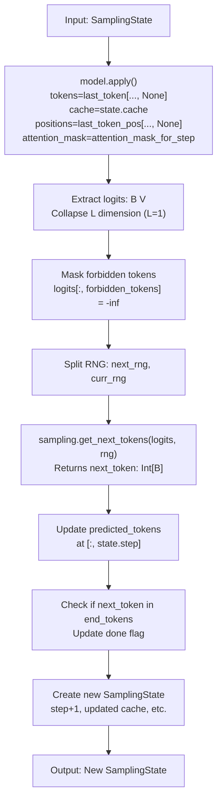
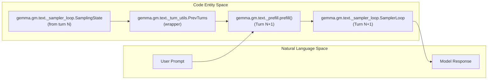

<!-- source: DeepWiki mcp.deepwiki.com · repo google-deepmind/gemma · page 4.5 Autoregressive Loop · fetched 2026-10-26 -->

# Autoregressive Loop

<details>
<summary>Relevant source files</summary>

The following files were used as context for generating this wiki page:

- [gemma/gm/nn/_transformer_like.py](gemma/gm/nn/_transformer_like.py)
- [gemma/gm/text/_sampler_loop.py](gemma/gm/text/_sampler_loop.py)
- [gemma/gm/text/_turn_utils.py](gemma/gm/text/_turn_utils.py)
- [gemma/gm/utils/_attention_mask.py](gemma/gm/utils/_attention_mask.py)
- [gemma/gm/utils/_jax_utils.py](gemma/gm/utils/_jax_utils.py)
- [gemma/gm/utils/_types.py](gemma/gm/utils/_types.py)

</details>


## Purpose and Scope

This document describes the autoregressive loop implementation used for token-by-token text generation in Gemma. The autoregressive loop takes an initialized state (from the prefill phase) and iteratively generates tokens by repeatedly calling the transformer model, sampling the next token, and updating the state until stopping conditions are met.

The loop is designed to handle single-turn generation, multi-turn conversational history via KV cache reuse, and streaming outputs. It leverages `jax.lax.while_loop` for performance in standard mode and standard Python loops for streaming.

---

## Overview

The autoregressive loop is implemented in the `SamplerLoop` class [gemma/gm/text/_sampler_loop.py:107-120](), which manages the iterative generation process. The loop maintains a `SamplingState` object [gemma/gm/text/_sampler_loop.py:37-76]() that tracks all necessary information across steps, including the KV cache, predicted tokens, and current position.

### High-Level Flow and Code Entities



Sources: [gemma/gm/text/_sampler_loop.py:141-194](), [gemma/gm/text/_prefill_test.py:53-63]()

---

## SamplingState

The `SamplingState` class is a `flax.struct.dataclass` that holds all information needed during autoregressive generation [gemma/gm/text/_sampler_loop.py:37-76](). It is passed between sampling steps and updated after each token is generated.

### State Structure

| Field | Type | Description |
|-------|------|-------------|
| `step` | `Int['']` | Current step number (0 to `max_new_tokens`) [gemma/gm/text/_sampler_loop.py:57-57]() |
| `done` | `Bool['B']` | Per-batch flag indicating if sequence has hit an end token [gemma/gm/text/_sampler_loop.py:58-58]() |
| `last_token` | `Int['B']` | Token IDs to feed into the model for the next step [gemma/gm/text/_sampler_loop.py:59-59]() |
| `last_token_pos` | `Int['B']` | RoPE position of the last token (accounts for MM tokens) [gemma/gm/text/_sampler_loop.py:60-60]() |
| `predicted_tokens` | `Int['B max_out_length']` | Fixed-size buffer accumulating output tokens [gemma/gm/text/_sampler_loop.py:61-61]() |
| `cache` | `Cache` | Attention KV cache (updated after each step) [gemma/gm/text/_sampler_loop.py:67-67]() |
| `rng` | `PRNGKey` | Random number generator state for sampling [gemma/gm/text/_sampler_loop.py:68-68]() |
| `init_cache_length` | `Int['']` | Cache length after prefill (static array to avoid re-compilation) [gemma/gm/text/_sampler_loop.py:74-74]() |
| `full_attention_mask` | `Bool['B cache_length']` | Pre-computed attention mask for the full sequence [gemma/gm/text/_sampler_loop.py:75-75]() |

### Derived Properties

The state provides computed properties for mask generation:

- **`used_cache_length`**: Current cache usage calculated as `init_cache_length + step` [gemma/gm/text/_sampler_loop.py:78-81]().
- **`attention_mask_for_step`**: Attention mask for the current step, computed by masking the `full_attention_mask` up to `used_cache_length + 1` [gemma/gm/text/_sampler_loop.py:83-96]().



Sources: [gemma/gm/text/_sampler_loop.py:37-101]()

---

## SamplerLoop

The `SamplerLoop` class encapsulates the loop logic and configuration. It is a frozen dataclass with only static, hashable attributes so it can be passed to `jax.jit` [gemma/gm/text/_sampler_loop.py:107-112]().

### Configuration Attributes

| Attribute | Type | Description |
|-----------|------|-------------|
| `model` | `TransformerLike` | The transformer model to call [gemma/gm/text/_sampler_loop.py:114-114]() |
| `end_tokens` | `tuple[int, ...]` | Token IDs that stop generation (EOS, END_OF_TURN) [gemma/gm/text/_sampler_loop.py:115-115]() |
| `forbidden_tokens` | `tuple[int, ...] \| None` | Token IDs that cannot be generated [gemma/gm/text/_sampler_loop.py:116-116]() |
| `sampling` | `SamplingMethod` | Token selection strategy [gemma/gm/text/_sampler_loop.py:117-117]() |
| `cache_length` | `int` | Maximum cache length [gemma/gm/text/_sampler_loop.py:118-118]() |
| `special_tokens` | `type[SpecialTokens]` | Special token definitions [gemma/gm/text/_sampler_loop.py:119-119]() |

Sources: [gemma/gm/text/_sampler_loop.py:107-120]()

---

## Loop Execution Modes

The `SamplerLoop.sample()` method supports two execution modes: standard (non-streaming) and streaming [gemma/gm/text/_sampler_loop.py:137-144]().

### Standard Mode: `_sample_loop()`

In standard mode, the entire generation completes before returning. This uses `jax.lax.while_loop` for efficient JIT compilation [gemma/gm/text/_sampler_loop.py:173-173]().



The condition function checks three criteria [gemma/gm/text/_sampler_loop.py:160-171]():
1. Current step is less than `max_new_tokens`.
2. Not all sequences in the batch have yielded an end token.
3. The KV cache is not full (checked via `state.cache_info.is_full`).

Sources: [gemma/gm/text/_sampler_loop.py:147-198]()

### Streaming Mode: `_stream_sample_loop()`

In streaming mode, the function yields the state after each token is generated. This allows the caller to process tokens as they are produced [gemma/gm/text/_sampler_loop.py:200-215]().

```python
def _stream_sample_loop(self, *, params, state, max_new_tokens):
    for _ in range(max_new_tokens):
        if jnp.all(state.done) or state.cache_info.is_full:
            break
        state = self._sample_step(params=params, state=state)
        yield state
```

Sources: [gemma/gm/text/_sampler_loop.py:200-215]()

---

## Single Sampling Step

The `_sample_step()` method implements one iteration of token generation [gemma/gm/text/_sampler_loop.py:217-266]().

### Step-by-Step Process



### Forbidden Tokens
If `forbidden_tokens` are provided, their logits are set to `-inf` before sampling to prevent the model from generating them [gemma/gm/text/_sampler_loop.py:241-244]().

### State Update
A new `SamplingState` is created with updated values [gemma/gm/text/_sampler_loop.py:255-265]():
- `step`: Incremented by 1.
- `done`: Updated using `jnp.isin` against `self.end_tokens`.
- `last_token`: Set to the newly sampled `next_token`.
- `last_token_pos`: Incremented for sequences that are not yet done.
- `predicted_tokens`: Updated using `jax.lax.dynamic_update_slice`.

Sources: [gemma/gm/text/_sampler_loop.py:217-266]()

---

## Post-Processing

After the loop completes, two post-processing steps are applied in standard mode:

### 1. Mask Tokens After End Tokens
The `_mask_tokens_after_end_tokens()` function ensures that any tokens generated after an end token (due to batching synchronization) are zeroed out [gemma/gm/text/_sampler_loop.py:269-277]().

### 2. Mask Attention for Next Turn
The `_mask_full_attention_mask_prefix_for_next_turn()` function updates the attention mask to cover only the prompt and valid predicted tokens [gemma/gm/text/_sampler_loop.py:280-294](). This is critical for multi-turn conversations where this mask is reused in the next prefill phase [gemma/gm/text/_turn_utils.py:92-98]().

Sources: [gemma/gm/text/_sampler_loop.py:179-197](), [gemma/gm/text/_sampler_test.py:24-38]()

---

## Multi-Turn Support

Multi-turn conversations rely on the `PrevTurns` helper class [gemma/gm/text/_turn_utils.py:26-100]() to manage the transition between sampling steps.



`PrevTurns` extracts the previous turn's cache [gemma/gm/text/_turn_utils.py:32-34]() and computes the `last_token_pos` offset [gemma/gm/text/_turn_utils.py:37-43](). It also facilitates the construction of the prefill attention mask by concatenating the previous turn's mask with the current turn's prompt mask [gemma/gm/text/_turn_utils.py:52-89]().

Sources: [gemma/gm/text/_turn_utils.py:26-100](), [gemma/gm/text/_prefill_test.py:108-160]()

---

