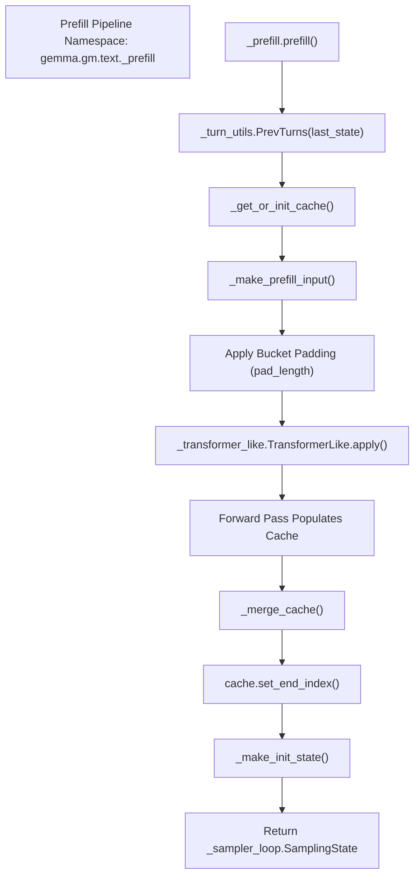
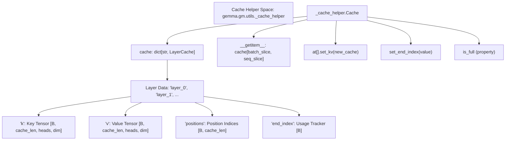

<!-- source: DeepWiki mcp.deepwiki.com · repo google-deepmind/gemma · page 4.6 Prefill and KV Cache · fetched 2026-10-26 -->

# Prefill and KV Cache

<details>
<summary>Relevant source files</summary>

The following files were used as context for generating this wiki page:

- [gemma/gm/text/_prefill.py](gemma/gm/text/_prefill.py)
- [gemma/gm/text/_prefill_test.py](gemma/gm/text/_prefill_test.py)
- [gemma/gm/text/_sampler_test.py](gemma/gm/text/_sampler_test.py)
- [gemma/gm/text/_tokenizer.py](gemma/gm/text/_tokenizer.py)
- [gemma/gm/utils/_cache_helper.py](gemma/gm/utils/_cache_helper.py)
- [gemma/gm/utils/_cache_helper_test.py](gemma/gm/utils/_cache_helper_test.py)

</details>


The prefill phase and KV cache are critical components of efficient transformer inference. During prefill, the entire prompt is processed in parallel to populate the KV (key-value) cache, which stores attention states. This cache is then reused during autoregressive token generation, avoiding redundant computation of attention for previously seen tokens.

This document covers the prefill mechanism, bucket padding, the `Cache` helper, the `LayerCache` structure, and the transition from prefill to sampling. For the sampling loop that uses the prefilled state, see page 4.5. For the high-level sampler API, see pages 4.2 and 4.3.

Sources: [gemma/gm/text/_prefill.py:50-89](), [gemma/gm/utils/_cache_helper.py:31-91]()

## Overview

The text generation pipeline separates into two distinct phases managed by `_prefill.prefill` and the sampling loop:

1.  **Prefill Phase**: Process the entire prompt in a single forward pass via `model.apply`, computing attention for all tokens simultaneously and populating the KV cache.
2.  **Decode Phase**: Generate tokens one at a time autoregressively, reusing cached attention states from the prefill and previous decode steps.

### Generation Lifecycle and Code Entities

```mermaid
graph LR
    A["Prompt Input\n(_types.Input)"] --> B["Prefill Execution\n(_prefill.prefill)"]
    B --> C["Parallel Forward Pass\n(_transformer_like.TransformerLike.apply)"]
    C --> D["KV Cache Container\n(_cache_helper.Cache)"]
    D --> E["Sampling State\n(_sampler_loop.SamplingState)"]
    E --> F["Autoregressive Loop\n(_sampler_loop.SamplerLoop)"]
    F --> G["Token-by-Token Generation"]
    G --> H["Cache Updated In-Place"]
```

Sources: [gemma/gm/text/_prefill.py:50-146](), [gemma/gm/utils/_cache_helper.py:31-91]()

**Performance Benefits:**
- Prefill processes prompt tokens in parallel, much faster than sequential processing.
- KV cache eliminates redundant attention computation during generation.
- Multi-turn conversations reuse cache from previous turns via `_turn_utils.PrevTurns`.

Sources: [gemma/gm/text/_prefill.py:50-89](), [gemma/gm/text/_turn_utils.py:26-30]()

## Prefill Phase and Bucket Padding

The `_prefill.prefill()` function processes prompt tokens in parallel and initializes the sampling state with a populated KV cache. It manages bucket padding to ensure optimal compilation shapes across batches.

### Prefill Function Signature

```python
def prefill(
    *,
    model: _transformer_like.TransformerLike,
    params: _common.Params,
    input: _types.Input,
    last_state: _sampler_loop.SamplingState | None,
    cache_length: int,
    max_out_length: int,
    pad_length: None | int | tuple[int, ...] = None,
    rng: PRNGKey,
    sharding: kd.sharding.ShardingTree | None,
    vision_input=None,
    audio=None,
    audio_lengths=None,
    audio_soft_token_counts=None,
) -> _sampler_loop.SamplingState:
```
Sources: [gemma/gm/text/_prefill.py:50-66]()

### Prefill Execution Flow

Sources: [gemma/gm/text/_prefill.py:50-223](), [gemma/gm/text/_turn_utils.py:26-30]()

### PrefillInput Structure

The `PrefillInput` dataclass packages all inputs needed for the model forward pass during the prefill stage:

| Field | Type | Description |
|-------|------|-------------|
| `tokens` | `Int['B L']` | Tokenized and padded prompt tokens [gemma/gm/text/_prefill.py:43](). |
| `images` | `UInt8['B N H W C']` | Optional multimodal image data [gemma/gm/text/_prefill.py:44](). |
| `positions` | `Int['B L']` | Token positions used for RoPE embeddings [gemma/gm/text/_prefill.py:45](). |
| `attention_mask` | `Bool['B L cache_length']` | Causal attention mask for prefill tokens [gemma/gm/text/_prefill.py:46](). |
| `cache` | `_cache_helper.Cache` | The KV cache slice used for the prefill pass [gemma/gm/text/_prefill.py:47](). |

Sources: [gemma/gm/text/_prefill.py:39-48]()

## KV Cache Structure and Cache Helper

The KV cache stores key and value tensors from attention layers. In Gemma, individual layer states are maintained as a `LayerCache` dictionary, wrapped by the `Cache` helper class in `_cache_helper.py`.

### Cache Architecture Mapping

Sources: [gemma/gm/utils/_cache_helper.py:31-91]()

### Cache Helper Operations

| Operation | Description |
|-----------|-------------|
| `cache[batch, :length]` | Slices the cache. Used in prefill where cache size must match prompt length [gemma/gm/utils/_cache_helper.py:49-64](). |
| `cache.at[].set_kv()` | Updates KV values in a specific slice using JAX's `.at[].set()` logic [gemma/gm/utils/_cache_helper.py:113-119](). |
| `set_end_index()` | Updates the `end_index` for all layers to reflect newly added tokens [gemma/gm/utils/_cache_helper.py:79-83](). |
| `is_full` | Boolean property indicating if the cache has reached its maximum capacity [gemma/gm/utils/_cache_helper.py:86-89](). |

Sources: [gemma/gm/utils/_cache_helper.py:32-162]()

## Transition from Prefill to Sampling

After `prefill()` completes execution, it returns a `SamplingState` containing the populated cache and the `last_token` to initialize the autoregressive loop (`SamplerLoop`).

- **Step Tracking**: `new_used_cache_length` tracks total tokens processed, enabling the sampling loop to begin at the correct index [gemma/gm/text/_prefill.py:220-223]().
- **Restart Point**: The sampling loop restarts from the last prompt token. Consequently, `new_used_cache_length` accounts for prompt re-entry during the first decode step [gemma/gm/text/_prefill.py:69-70]().
- **Attention Mask for Step**: The `attention_mask_for_step` is extracted to format attention constraints for the initial autoregressive token generation step [gemma/gm/text/_prefill.py:227-230]().

Sources: [gemma/gm/text/_prefill.py:220-254](), [gemma/gm/text/_sampler_loop.py:36-63]()

---

