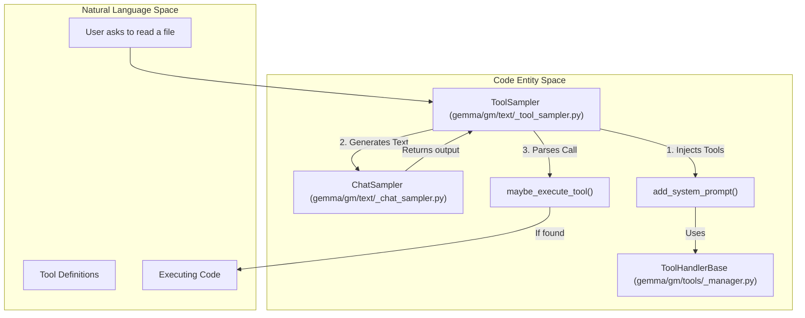
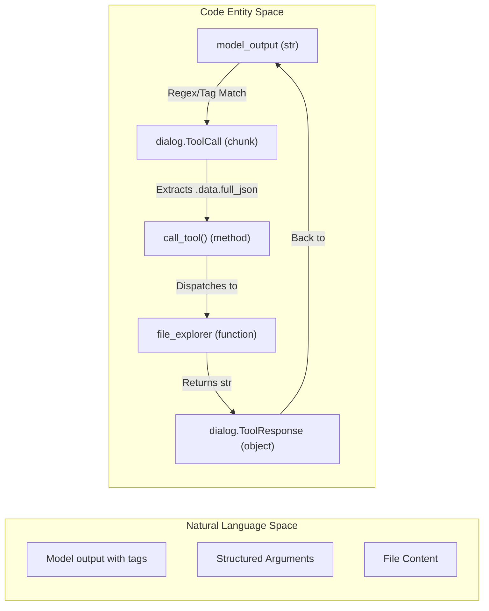

<!-- source: DeepWiki mcp.deepwiki.com · repo google-deepmind/gemma · page 4.7 Tool Use · fetched 2026-10-26 -->

# Tool Use

Relevant source files

The following files were used as context for generating this wiki page:

- [gemma/gm/text/_tool_sampler.py](gemma/gm/text/_tool_sampler.py)
- [gemma/gm/tools/__init__.py](gemma/gm/tools/__init__.py)
- [gemma/gm/tools/_file_explorer.py](gemma/gm/tools/_file_explorer.py)
- [gemma/gm/tools/_manager.py](gemma/gm/tools/_manager.py)
- [gemma/gm/tools/_mcp_manager.py](gemma/gm/tools/_mcp_manager.py)

The Gemma library provides a specialized interface for agentic workflows through the `ToolSampler` and a set of tool management classes. This system allows Gemma models to interact with external environments by emitting tool calls, executing them via a handler, and feeding the results back into the conversation loop.

## Overview of Tool Execution

Tool use in Gemma is orchestrated by the `ToolSampler` class, which extends the standard `ChatSampler` to include a recursive execution loop [gemma/gm/text/_tool_sampler.py:33-33](). When a model generates a turn that ends with a tool call tag, the sampler intercepts the output, executes the requested tool, and automatically triggers a subsequent model turn with the tool's response.

### System Prompt Injection
Before the first turn of a conversation, the `ToolHandlerBase` automatically injects a system prompt that describes the available tools to the model [gemma/gm/tools/_manager.py:46-56](). This ensures the model is aware of the schemas and capabilities of the tools it can invoke.

### The Execution Loop
The `ToolSampler.chat` method implements the following logic:
1. **Tool Activation**: Enters the context of the `tool_handler` [gemma/gm/text/_tool_sampler.py:104-104]().
2. **System Prompt**: If it is the first turn (no existing conversation or `multi_turn` is false), it adds tool descriptions to the system prompt via `tool_handler.add_system_prompt` [gemma/gm/text/_tool_sampler.py:107-109]().
3. **Generation**: Calls the parent `ChatSampler.chat` to get the model's response [gemma/gm/text/_tool_sampler.py:111-120]().
4. **Tool Detection**: Uses `tool_handler.maybe_execute_tool` to check if the model output contains a tool call [gemma/gm/text/_tool_sampler.py:123-123]().
5. **Recursion**: If a tool was executed (`tool_answer` is not empty), it wraps the result in a `dialog.Model` turn and calls itself recursively to continue the conversation with the tool data [gemma/gm/text/_tool_sampler.py:127-153]().

Sources:
- [gemma/gm/text/_tool_sampler.py:33-155]()
- [gemma/gm/tools/_manager.py:46-56]()

## Architecture and Code Entities

The following diagram bridges the natural language concepts of tool execution to the specific classes and methods implemented in the codebase.

### Entity Mapping: Tool Execution Flow
Title: "Tool Execution Flow Mapping"

Sources:
- [gemma/gm/text/_tool_sampler.py:33-155]()
- [gemma/gm/tools/_manager.py:36-84]()

## Tool Handlers and MCP Integration

The library uses the **Model Context Protocol (MCP)** as the primary standard for tool definitions and communication [gemma/gm/tools/_mcp_manager.py:15-15]().

### ToolHandlerBase
This is the abstract base class for all tool orchestrators [gemma/gm/tools/_manager.py:36-37](). It manages:
- **Parsing**: Detecting `<|tool_call|>` tags and extracting JSON arguments [gemma/gm/tools/_manager.py:58-84](). It specifically handles the closing of `TOOL_CALL` tags or the opening of `TOOL_RESPONSE` tags to trigger execution [gemma/gm/tools/_manager.py:63-69]().
- **Context Management**: Activating and deactivating tool environments via `_activate()` [gemma/gm/tools/_manager.py:106-123]().
- **Normalization**: Converting various tool return types into a standard `mcp.types.CallToolResult` via `_normalize_response` [gemma/gm/tools/_manager.py:125-142]().

### McpToolHandler
The `McpToolHandler` implements the protocol using the `fastmcp` client [gemma/gm/tools/_mcp_manager.py:38-41](). It allows Gemma to connect to any MCP-compliant server (e.g., local scripts or remote services).

| Feature | Description | Implementation |
| :--- | :--- | :--- |
| **Tool Discovery** | Lists available tools from the MCP server | `_tools()` [gemma/gm/tools/_mcp_manager.py:43-45]() |
| **Async Bridge** | Runs asynchronous MCP calls within the synchronous sampler loop | `_run()` using `asyncio` [gemma/gm/tools/_mcp_manager.py:75-81]() |
| **Client Management** | Lazy-initializes and manages the lifecycle of the `fastmcp.Client` | `client` property [gemma/gm/tools/_mcp_manager.py:54-60]() |

### FileExplorer Tool
A built-in utility tool for filesystem operations. It supports `cat` (read text), `ls` (list directory), and `exists` (check existence) methods [gemma/gm/tools/_file_explorer.py:26-54](). It utilizes `etils.epath` to support remote filesystems like Google Cloud Storage (`gs://`) [gemma/gm/tools/_file_explorer.py:32-42]().

Sources:
- [gemma/gm/tools/_manager.py:36-142]()
- [gemma/gm/tools/_mcp_manager.py:38-81]()
- [gemma/gm/tools/_file_explorer.py:26-54]()

## Data Flow: Model to Tool

The following diagram illustrates the data transformation from a model's textual output to a structured tool execution.

### Entity Mapping: Tool Call Parsing
Title: "Tool Call Parsing and Execution"

Sources:
- [gemma/gm/tools/_manager.py:58-84]()
- [gemma/gm/tools/_file_explorer.py:42-54]()

## Implementation Details

### Handling Legacy Tool Answers
Gemma Nano models (2B and 4B) occasionally emit a standard `<eos>` token instead of the specific `<|tool_response|>` tag after a tool call [gemma/gm/text/_tool_sampler.py:128-135](). The `ToolSampler` includes logic to detect this "legacy" behavior and manually correct the conversation state by removing the trailing `<eos>` and ensuring the correct tags are provided to the next turn via the `is_legacy_tool_answer` flag [gemma/gm/text/_tool_sampler.py:132-153]().

### Tool Normalization
The `_normalize_response` function ensures that tool outputs are consistently structured. If a tool returns raw text, it is wrapped into a JSON object with a `result` or `error` key (if `isError` is true) before being returned to the model [gemma/gm/tools/_manager.py:125-142]().

Sources:
- [gemma/gm/text/_tool_sampler.py:122-153]()
- [gemma/gm/tools/_manager.py:125-142]()

---

