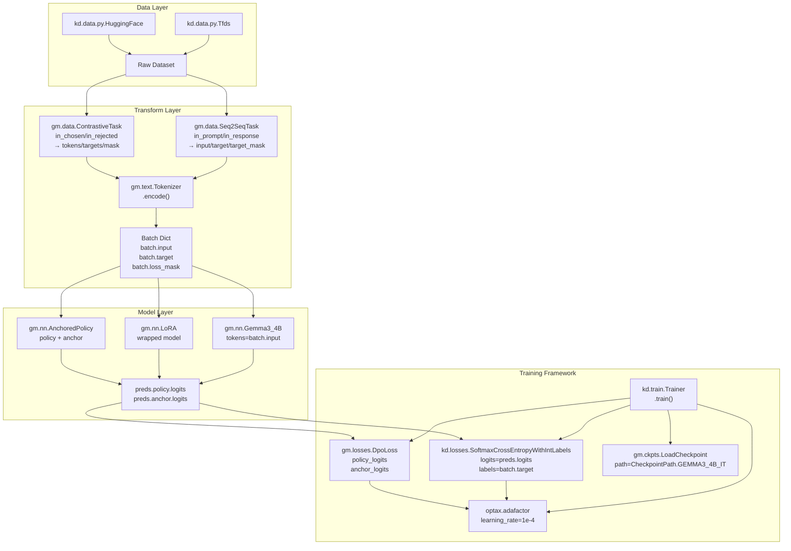

<!-- source: DeepWiki mcp.deepwiki.com · repo google-deepmind/gemma · page 6 Training and Fine-tuning · fetched 2026-10-26 -->

# Training and Fine-tuning

Relevant source files

The following files were used as context for generating this wiki page:

- [colabs/finetuning.ipynb](colabs/finetuning.ipynb)
- [colabs/lora_finetuning.ipynb](colabs/lora_finetuning.ipynb)
- [colabs/lora_sampling.ipynb](colabs/lora_sampling.ipynb)
- [colabs/sampling.ipynb](colabs/sampling.ipynb)
- [examples/dpo.py](examples/dpo.py)
- [gemma/gm/data/_tasks.py](gemma/gm/data/_tasks.py)

The Gemma training system provides a flexible, JAX-based framework for both training models from scratch and adapting pre-trained checkpoints to downstream tasks. Built on top of the [Kauldron](https://kauldron.readthedocs.io) training framework (`kd.train.Trainer`) [examples/dpo.py:51-86](), it supports standard supervised fine-tuning, parameter-efficient adaptation strategies like LoRA [colabs/lora_finetuning.ipynb:90-104](), preference optimization techniques such as DPO and NPO [examples/dpo.py:56-74](), and quantization-aware training.

As a parent overview, this page introduces the core subsystems of the training pipeline. For comprehensive technical guides, see the designated child pages:
- [Data Processing](#6.1)
- [Training with Kauldron](#6.2)
- [LoRA Fine-tuning](#6.3)
- [Preference Optimization](#6.4)
- [Evaluation](#6.5)
- [Quantization](#6.6)

## Training System Architecture

The training pipeline orchestrates data loading, model forward passes, loss calculation, and optimization through declarative Kauldron configurations [examples/dpo.py:51-86](). 

**Training Pipeline Architecture**

Sources: [gemma/gm/data/_tasks.py:62-210](), [examples/dpo.py:51-86](), [examples/lora.py:49-116]()

## 6.1 Data Processing

Data pipelines ingest raw records from text files, TFDS, or HuggingFace datasets and prepare them for tokenization and model ingestion. The core pipeline elements are implemented using PyGrain and Kauldron data transforms [examples/dpo.py:96-122]().

- **`Seq2SeqTask`**: Formats prompt and response fields using tokenizer-aware dialog tags (`<start_of_turn>` / `<end_of_turn>` or Gemma4 equivalent tags) [gemma/gm/data/_tasks.py:37-59](), tokenizes them, and constructs shifted sequence inputs and loss masks [gemma/gm/data/_tasks.py:62-184]().
- **`ContrastiveTask`**: Prepares triplet examples (`prompt`, `chosen`, `rejected`) required for preference optimization losses like DPO [gemma/gm/data/_tasks.py:188-210]().
- **Parquet & Functional Loaders**: Supports custom dataset ingestion through standard format parsers and sequence padding utilities [gemma/gm/data/_tasks.py:169-173]().

For detailed configuration parameters, custom transforms, and functional utilities, see [Data Processing](#6.1).

Sources: [gemma/gm/data/_tasks.py:37-210](), [examples/dpo.py:96-122]()

## 6.2 Training with Kauldron

Training workflows are centralized around `kd.train.Trainer` [examples/dpo.py:51-86](). Kauldron manages checkpoint restoration, step execution, and distributed sharding strategies.

- **Trainer Integration**: Declaratively links datasets, models, loss functions, optimizers (such as `optax.adafactor`), and checkpoints [examples/dpo.py:51-86]().
- **Sharding**: Leverages `kd.sharding.FSDPSharding` to split large models across multiple TPU/GPU devices efficiently.
- **Example Patterns**: Reference configurations in `examples/seq2seq.py` and `examples/sharding.py` demonstrate multi-device synchronization and full supervised fine-tuning pipelines.

For complete code examples and sharding patterns, see [Training with Kauldron](#6.2).

Sources: [examples/dpo.py:51-86](), [colabs/finetuning.ipynb:181-198]()

## 6.3 LoRA Fine-tuning

Parameter-efficient fine-tuning is supported through the `gm.nn.LoRA` wrapper and the internal `gemma/peft/` module surgery library [colabs/lora_finetuning.ipynb:90-114]().

- **`gm.nn.LoRA`**: Automatically replaces linear layers with low-rank adaptation equivalents [colabs/lora_finetuning.ipynb:101-104]().
- **`SkipLoRA` Checkpoint Loading**: Ensures pretrained base weights are restored while newly introduced LoRA parameters remain randomly initialized [colabs/lora_finetuning.ipynb:137-142]().
- **Partial Parameter Updates**: Uses `kd.optim.partial_updates` combined with `kd.optim.select("lora")` to freeze the backbone model and update exclusively adapter weights [colabs/lora_finetuning.ipynb:172-177]().

For detailed surgery mechanisms and inference merging, see [LoRA Fine-tuning](#6.3).

Sources: [colabs/lora_finetuning.ipynb:90-177](), [colabs/lora_sampling.ipynb:160-168]()

## 6.4 Preference Optimization

Preference alignment techniques align model outputs with human feedback using contrastive objectives [examples/dpo.py:17-19]().

- **Direct Preference Optimization (DPO)**: Uses `gm.losses.DpoLoss` in conjunction with `gm.data.ContrastiveTask` to increase the log-likelihood of preferred responses over rejected ones [examples/dpo.py:68-74]().
- **Anchored Policies**: Employs `gm.nn.AnchoredPolicy` to wrap the trainable policy alongside a frozen reference model, managed via `gm.ckpts.AnchoredPolicyLoader` [examples/dpo.py:56-64]().
- **Negative Preference Optimization (NPO)**: Supported via `NpoLoss` configurations as demonstrated in `examples/npo.py`.

For configuration specifics and loss math, see [Preference Optimization](#6.4).

Sources: [examples/dpo.py:49-86](), [gemma/gm/losses/_dpo.py:29-90]()

## 6.5 Evaluation

During training, qualitative and quantitative assessment can be scheduled at regular intervals.

- **`SamplerEvaluator`**: Runs text generation inference on validation data splits during training loops using the internal `Sampler` abstraction.
- **Kauldron Integration**: Integrates directly with Kauldron's evaluation framework to record metrics and generated outputs to disk or monitoring dashboards.

For setup guides and evaluator hooks, see [Evaluation](#6.5).

Sources: [gemma/gm/evals/_sample.py:35-183]()

## 6.6 Quantization

To mitigate memory pressure during training and deployment, Gemma provides built-in quantization tools.

- **Quantization-Aware Training (QAT)**: Utilizes `SimulateQuantizedDense` and `SimulateQuantizedEinsum` layers to simulate low-precision arithmetic during forward and backward passes.
- **Checkpoint Quantization**: Applies `peft.quantize_checkpoint` for INT4 compression methods.
- **Inference Integration**: Enables execution of quantized weights without full dequantization overhead.

For quantization scripts and layer configurations, see [Quantization](#6.6).

Sources: [colabs/finetuning.ipynb:1-15]()

---

