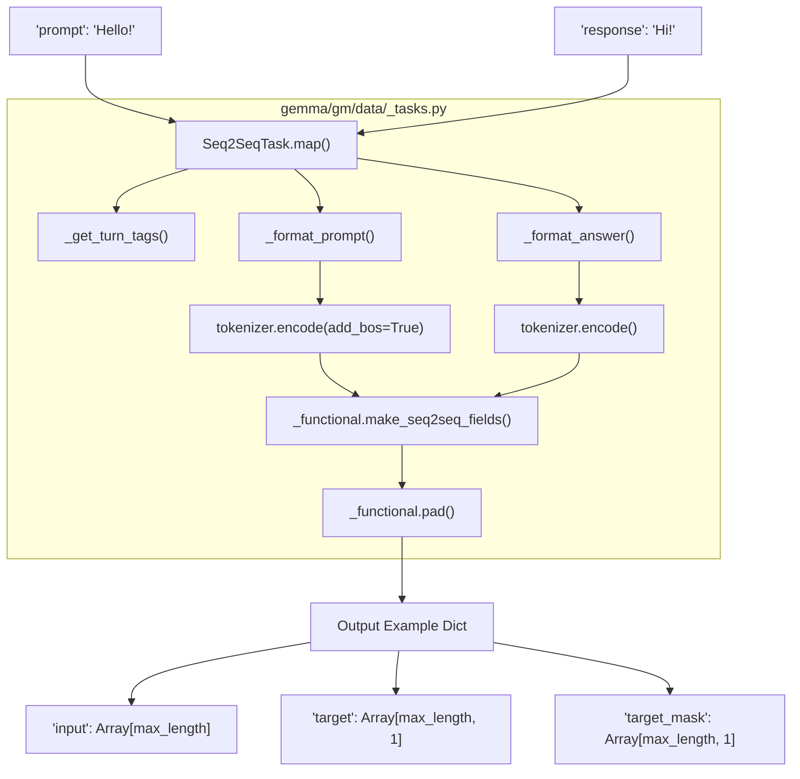
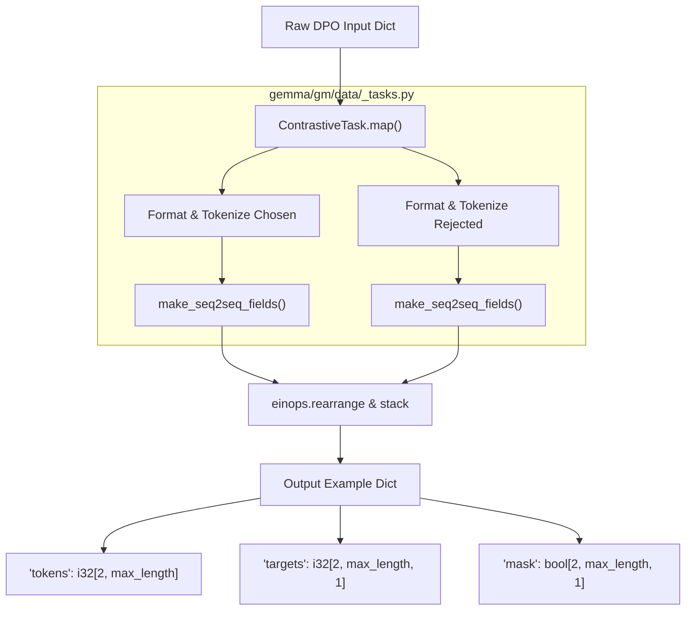
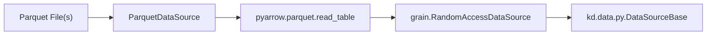
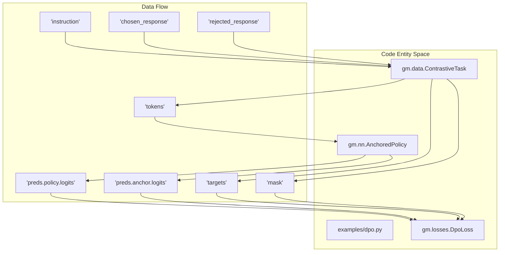

<!-- source: DeepWiki mcp.deepwiki.com · repo google-deepmind/gemma · page 6.1 Data Processing · fetched 2026-10-26 -->

# Data Processing

<details>
<summary>Relevant source files</summary>

The following files were used as context for generating this wiki page:

- [examples/dpo.py](examples/dpo.py)
- [gemma/gm/data/__init__.py](gemma/gm/data/__init__.py)
- [gemma/gm/data/_functional.py](gemma/gm/data/_functional.py)
- [gemma/gm/data/_functional_test.py](gemma/gm/data/_functional_test.py)
- [gemma/gm/data/_parquet.py](gemma/gm/data/_parquet.py)
- [gemma/gm/data/_tasks.py](gemma/gm/data/_tasks.py)
- [gemma/gm/data/_transforms.py](gemma/gm/data/_transforms.py)
- [gemma/gm/data/_transforms_test.py](gemma/gm/data/_transforms_test.py)
- [gemma/gm/losses/_dpo.py](gemma/gm/losses/_dpo.py)
- [gemma/gm/testing/_fixtures.py](gemma/gm/testing/_fixtures.py)

</details>


This document covers the data processing utilities in the Gemma library, focusing on transforming raw text datasets into the structured, tokenized format required for model training. The system provides specialized tasks for sequence-to-sequence fine-tuning and contrastive preference learning, alongside functional utilities and a Parquet data loader.

## Overview

The data processing system transforms raw text conversations into training-ready tensor formats. It handles dialog template formatting, tokenization, sequence creation, loss masking, and padding/truncation operations. The core functionality is built around `grain` transforms that can be chained together in data processing pipelines [gemma/gm/data/_tasks.py:15-15]().

## Core Data Tasks

### Seq2SeqTask

The `Seq2SeqTask` class handles standard sequence-to-sequence fine-tuning by converting prompt-response pairs into training sequences. It automates the formatting of inputs using the Gemma dialog template defined in `_tasks.py` [gemma/gm/data/_tasks.py:37-126]().

**Natural Language to Code Entity Mapping: Seq2Seq Processing**



**Data Flow Example:**

| Stage | Prompt | Response |
|-------|--------|----------|
| Raw Input | `"Hello!"` | `"Hi there!"` |
| Template Format | `"<start_of_turn>user\nHello!<end_of_turn>\n"` | `"<start_of_turn>model\nHi there!<end_of_turn>\n"` |
| Tokenized | `[2, 10, 11]` | `[20, 21, 1]` |
| Model Input | `[2, 10, 11, 20, 21]` | - |
| Target | `[10, 11, 20, 21, 1]` | - |
| Loss Mask | `[0, 0, 0, 1, 1]` | - |

The input and target are the same sequence shifted by one token, with the loss mask set to 0 for prompt tokens and 1 for response tokens [gemma/gm/data/_functional.py:125-128](). If the `sampling` attribute is set to `True`, the task yields original text for use in evaluators like `gm.evals.SamplerEvaluator` [gemma/gm/data/_tasks.py:124-127]().

**Sources:** [gemma/gm/data/_tasks.py:33-156](), [gemma/gm/data/_functional.py:103-151]()

### ContrastiveTask

The `ContrastiveTask` class prepares data for DPO-style (Direct Preference Optimization) learning by processing a prompt alongside "chosen" and "rejected" response pairs [gemma/gm/data/_tasks.py:187-195]().



The output stacks chosen and rejected responses in the first dimension, enabling efficient batch processing for `DpoLoss` [gemma/gm/losses/_dpo.py:29-59](). The task handles `bytes` decoding automatically for datasets [gemma/gm/data/_tasks.py:143-146]().

**Sources:** [gemma/gm/data/_tasks.py:187-305](), [examples/dpo.py:108-122]()

## Functional Utilities

The `_functional.py` module provides low-level, stateless utilities used by the task classes [gemma/gm/data/_functional.py:15-15](). These utilities use `etils.enp` to support both NumPy and JAX arrays [gemma/gm/data/_functional.py:71-72]().

| Function | Purpose | Input | Output |
|----------|---------|-------|--------|
| `pad()` | Multi-array padding/truncation | `PyTree[Array]` | `PyTree[Array]` |
| `make_seq2seq_fields()` | Shifted sequence generation | prompt, response tokens | `Seq2SeqFields` |
| `_pad()` | Inner implementation using `enp` | sequence, max_length | padded array |

### Seq2SeqFields Structure

The output of `make_seq2seq_fields` is a `flax.struct.dataclass` containing the necessary tensors for next-token prediction training [gemma/gm/data/_functional.py:91-98]().

```python
@flax.struct.dataclass
class Seq2SeqFields:
  input: Int["*b l"]        # Model input tokens (truncated last)
  target: Int["*b l"]       # Target tokens (input shifted by 1)
  target_mask: Bool["*b l"] # Loss mask (0=prompt, 1=response)
```

**Sources:** [gemma/gm/data/_functional.py:25-151](), [gemma/gm/data/_functional_test.py:20-65]()

## Transform Library

The system includes several atomic `kd.data.ElementWiseTransform` classes for modular data pipelines, located in `_transforms.py` [gemma/gm/data/_transforms.py:15-15]():

| Transform | Purpose | Key Attributes |
|-----------|---------|----------------|
| `DecodeBytes` | Converts `bytes` (e.g. from TFDS) to `str`. | `encoding` [gemma/gm/data/_transforms.py:30-37]() |
| `FormatText` | Applies a template string with `{text}` placeholder. | `template` [gemma/gm/data/_transforms.py:40-60]() |
| `Tokenize` | Encodes text using a `Tokenizer`. | `tokenizer`, `add_bos`, `add_eos` [gemma/gm/data/_transforms.py:63-83]() |
| `Pad` | Wraps `_functional.pad` for single elements. | `max_length`, `truncate` [gemma/gm/data/_transforms.py:86-106]() |
| `AddSeq2SeqFields` | Wraps `make_seq2seq_fields` for dict inputs. | `in_prompt`, `in_response` [gemma/gm/data/_transforms.py:122-184]() |
| `MapInts` | Replace integer labels with new values. | `old_to_new` [gemma/gm/data/_transforms.py:109-119]() |

**Sources:** [gemma/gm/data/_transforms.py:29-184]()

## Parquet Data Loader

For custom datasets stored in Parquet format, Gemma provides a `Parquet` data source that integrates with the `Kauldron` training framework [gemma/gm/data/_parquet.py:64-71]().



The `ParquetDataSource` class uses `pyarrow` to read the tables [gemma/gm/data/_parquet.py:30-31](). It caches the table property for performance and supports random access via `__getitem__`, returning records as Python dictionaries [gemma/gm/data/_parquet.py:43-61]().

**Sources:** [gemma/gm/data/_parquet.py:37-71]()

## Integration Example: DPO Training

The following diagram illustrates how `ContrastiveTask` bridges the gap between raw text in a training script and the `DpoLoss` computation in the training loop.



In this pipeline, `ContrastiveTask` prepares the `batch` dictionary which is then consumed by the model (`AnchoredPolicy`) and the loss function (`DpoLoss`) during the training step [examples/dpo.py:51-122]().

**Sources:** [examples/dpo.py:51-122](), [gemma/gm/losses/_dpo.py:29-89]()

---

