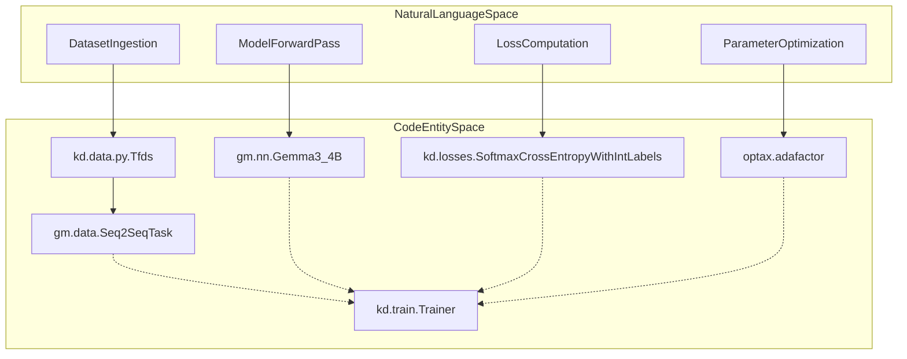
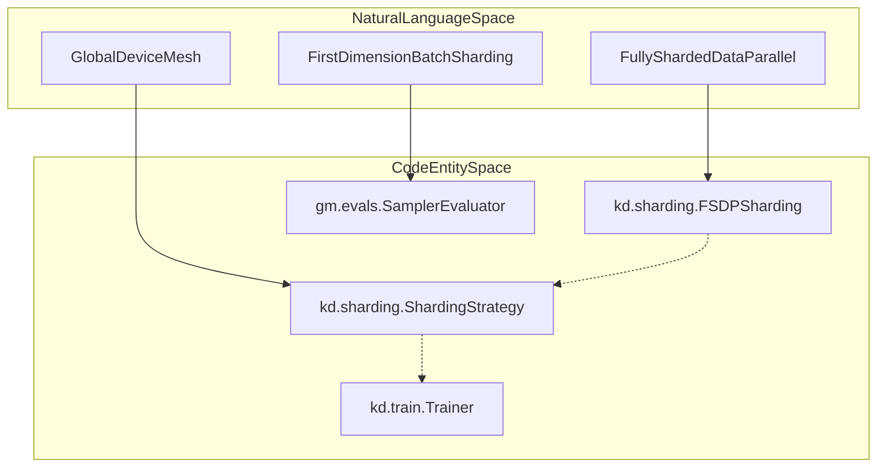

<!-- source: DeepWiki mcp.deepwiki.com · repo google-deepmind/gemma · page 6.2 Training with Kauldron · fetched 2026-10-26 -->

# Training with Kauldron

<details>
<summary>Relevant source files</summary>

The following files were used as context for generating this wiki page:

- [colabs/finetuning.ipynb](colabs/finetuning.ipynb)
- [colabs/lora_finetuning.ipynb](colabs/lora_finetuning.ipynb)
- [colabs/lora_sampling.ipynb](colabs/lora_sampling.ipynb)
- [colabs/sampling.ipynb](colabs/sampling.ipynb)
- [examples/lora.py](examples/lora.py)
- [examples/multimodal.py](examples/multimodal.py)
- [examples/seq2seq.py](examples/seq2seq.py)
- [examples/sharding.py](examples/sharding.py)
- [gemma/gm/evals/_sample.py](gemma/gm/evals/_sample.py)

</details>


This page documents the integration between Gemma and the Kauldron training framework, covering trainer orchestration, loss functions, optimizer configurations, sharding strategies, and concrete configuration patterns from `examples/seq2seq.py` and `examples/sharding.py`.

---

## 1. Kauldron Trainer Integration

Kauldron provides a declarative JAX-based training framework that abstracts away training loops, checkpoint management, metric logging, evaluation scheduling, and sharding [colabs/finetuning.ipynb:15](). The core orchestration is handled by the `kd.train.Trainer` class, which binds datasets, models, optimization schemes, and sharding policies into an execution graph [examples/seq2seq.py:61-109]().

### The Key-Based Context System
Kauldron relies on string-keyed dictionaries for component wiring. Data flows through a shared context where components reference attributes via dot-notation:
* `batch`: Data produced by the dataset pipeline (e.g., `batch.input`, `batch.target`, `batch.loss_mask`) [examples/seq2seq.py:80-85]().
* `preds`: Outputs produced by the model forward pass (e.g., `preds.logits`) [examples/seq2seq.py:80-83]().
* `params`: Model weight tensors maintained by the training state.

Title: Trainer Orchestration and Component Wiring (`TrainerIntegration`)

Sources: [colabs/finetuning.ipynb:15-16](), [examples/seq2seq.py:61-109]()

---

## 2. Loss Functions

Gemma training pipelines primarily utilize standard token-level cross-entropy over discrete token IDs. 

### `SoftmaxCrossEntropyWithIntLabels`
Configured via `kd.losses.SoftmaxCrossEntropyWithIntLabels`, this loss function maps model predictions to target labels while masking padded or unprompted positions:
* `logits`: References `"preds.logits"` [examples/seq2seq.py:83]().
* `labels`: References `"batch.target"` [examples/seq2seq.py:84]().
* `mask`: References `"batch.loss_mask"` [examples/seq2seq.py:85]().

Sources: [examples/seq2seq.py:79-86]()

---

## 3. Optimizer Configuration

Parameter optimization is delegated to Optax via Kauldron. 

### Standard Fine-Tuning
For full fine-tuning or instruction tuning, memory-efficient optimizers like `optax.adafactor` are used directly within the trainer definition [examples/seq2seq.py:86]() with a configured learning rate (e.g., `1e-3`).

### Parameter-Efficient Updates (LoRA)
When applying LoRA wrappers (`gm.nn.LoRA`), the optimizer must be wrapped with `kd.optim.partial_updates` using a selection mask to freeze base weights and update only adapter parameters [examples/lora.py:89-93]():
```python
optimizer=kd.optim.partial_updates(
    optax.adafactor(learning_rate=0.005),
    mask=kd.optim.select("lora"),
)
```

Sources: [examples/seq2seq.py:86](), [examples/lora.py:89-93]()

---

## 4. Sharding Strategies (`FSDPSharding`)

For large models (e.g., Gemma 3 27B), single-device memory limits require distributed sharding. Kauldron integrates Fully Sharded Data Parallel (FSDP) via `kd.sharding.ShardingStrategy` [examples/sharding.py:56-58]().

Title: Distributed Training Sharding Flow (`ShardedTrainingFlow`)

Sources: [examples/sharding.py:56-58](), [gemma/gm/evals/_sample.py:91-99]()

---

## 5. Reference Configuration Patterns

The Gemma codebase provides explicit end-to-end training configurations in the `examples/` directory.

### Seq2Seq Pattern (`examples/seq2seq.py`)
The `seq2seq.py` script configures a standard sequence-to-sequence prompt-response task [examples/seq2seq.py:15-35](). It leverages `gm.data.Seq2SeqTask` to inject `<start_of_turn>` and `<end_of_turn>` tokens and construct alignment masks [examples/seq2seq.py:130-145]().

```python
return kd.train.Trainer(
    seed=42,
    train_ds=_make_dataset(training=True, batch_size=32, max_length=512),
    model=gm.nn.Gemma3_4B(tokens="batch.input"),
    init_transform=gm.ckpts.LoadCheckpoint(path=gm.ckpts.CheckpointPath.GEMMA3_4B_IT),
    num_train_steps=10_000,
    train_losses={
        "xentropy": kd.losses.SoftmaxCrossEntropyWithIntLabels(
            logits="preds.logits", labels="batch.target", mask="batch.loss_mask"
        ),
    },
    optimizer=optax.adafactor(learning_rate=1e-3),
    checkpointer=kd.ckpts.Checkpointer(save_interval_steps=500),
    evals={
        "test": kd.evals.Evaluator(run=kd.evals.EveryNSteps(1000), ...),
        "sampling": gm.evals.SamplerEvaluator(run=kd.evals.EveryNSteps(1000), ...),
    },
)
```
Sources: [examples/seq2seq.py:57-109](), [examples/seq2seq.py:112-147]()

### Sharding Pattern (`examples/sharding.py`)
The `sharding.py` configuration forks the `seq2seq.py` pipeline, introducing FSDP sharding for distributed multi-device execution [examples/sharding.py:15-18]() via `kd.sharding.ShardingStrategy` [examples/sharding.py:56-58]().

```python
model=gm.nn.Gemma3_4B(tokens="batch.input"),
sharding=kd.sharding.ShardingStrategy(
    params=kd.sharding.FSDPSharding(),
),
init_transform=gm.ckpts.LoadCheckpoint(path=gm.ckpts.CheckpointPath.GEMMA3_4B_IT),
```
Sources: [examples/sharding.py:52-62]()

---

