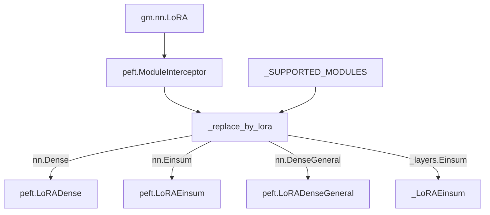
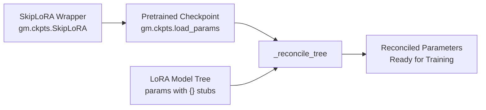

<!-- source: DeepWiki mcp.deepwiki.com · repo google-deepmind/gemma · page 6.3 LoRA Fine-tuning · fetched 2026-10-26 -->

# LoRA Fine-tuning

<details>
<summary>Relevant source files</summary>

The following files were used as context for generating this wiki page:

- [docs/lora_finetuning.md](docs/lora_finetuning.md)
- [docs/lora_sampling.md](docs/lora_sampling.md)
- [gemma/gm/nn/_lora.py](gemma/gm/nn/_lora.py)
- [gemma/gm/nn/_lora_test.py](gemma/gm/nn/_lora_test.py)
- [gemma/gm/nn/_quantization.py](gemma/gm/nn/_quantization.py)
- [gemma/gm/nn/gemma3n/_transformer.py](gemma/gm/nn/gemma3n/_transformer.py)
- [gemma/gm/nn/gemma4/_modules.py](gemma/gm/nn/gemma4/_modules.py)
- [gemma/gm/nn/gemma4/_transformer.py](gemma/gm/nn/gemma4/_transformer.py)
- [gemma/peft/README.md](gemma/peft/README.md)
- [gemma/peft/__init__.py](gemma/peft/__init__.py)
- [gemma/peft/_lora.py](gemma/peft/_lora.py)
- [gemma/peft/_lora_test.py](gemma/peft/_lora_test.py)

</details>


This page documents Low-Rank Adaptation (LoRA) fine-tuning in the Gemma library, covering `gm.nn.LoRA`, `SkipLoRA` checkpoint loading, partial parameter updates, and the PEFT library (`gemma/peft/`) for module surgery.

---

## 1. Overview and Architecture

LoRA fine-tuning freezes pretrained model weights and injects trainable rank decomposition matrices into linear and einsum layers. Instead of updating a full weight matrix $W \in \mathbb{R}^{d \times k}$, the update is parameterized by low-rank matrices $A \in \mathbb{R}^{r \times k}$ and $B \in \mathbb{R}^{d \times r}$ where rank $r \ll \min(d, k)$, yielding an effective weight of $W + BA$.

The `gm.nn.LoRA` module wraps any Gemma Transformer-like model, automatically replacing compatible linear components with LoRA-enabled variants during model initialization via interception [gemma/gm/nn/_lora.py:46-86]().

Title: LoRA Model Surgery Data Flow


Sources: [gemma/gm/nn/_lora.py:32-143](), [gemma/peft/__init__.py:20-30]()

---

## 2. Module Surgery and Supported Layers

The module surgery mechanism uses `peft.ModuleInterceptor` to intercept instantiation of linen modules and substitute them with LoRA wrappers. The supported layers are defined in `_SUPPORTED_MODULES` [gemma/gm/nn/_lora.py:32-43]():

* `nn.Dense` $\rightarrow$ `peft.LoRADense` [gemma/peft/_lora.py:55]()
* `nn.Einsum` $\rightarrow$ `peft.LoRAEinsum` [gemma/peft/_lora.py:138]()
* `nn.DenseGeneral` $\rightarrow$ `peft.LoRADenseGeneral` [gemma/peft/_lora.py:200]()
* Custom einsum modules (`_layers.Einsum` from `gemma4`, `gemma3n`, etc.) $\rightarrow$ `_LoRAEinsum` [gemma/gm/nn/_lora.py:145]()

### The `gm.nn.LoRA` Wrapper Class

`gm.nn.LoRA` shares scopes with the underlying model so that the parameter tree structure remains transparent [gemma/gm/nn/_lora.py:67-74]():

```python
class LoRA(nn.Module):
  rank: int
  model: nn.Module
  dtype: jnp.dtype = jnp.bfloat16
  verbose: bool = False
  
  def __post_init__(self):
    super().__post_init__()
    if self.scope is not None:
      nn.share_scope(self, self.model)
```

Sources: [gemma/gm/nn/_lora.py:46-102](), [gemma/peft/_lora.py:55-175]()

---

## 3. Checkpoint Management and SkipLoRA

When loading pretrained checkpoints into a LoRA-wrapped model, the checkpoint lacks the newly initialized LoRA weights (`a` and `b` matrices). The `gm.ckpts.SkipLoRA` utility handles this discrepancy by reconciling parameter trees and ignoring missing subtrees or shape mismatches caused by LoRA wrapping.

Title: Parameter Tree Reconciliation Pipeline


### Tree Reconciliation Logic

The checkpoint module detects missing LoRA stubs or empty dictionaries (`{}`) in the parameter tree via `_needs_reconciliation` [gemma/gm/nn/_lora_test.py:112-154]() and strips them or wraps leaves to match the checkpoint expectation using `_reconcile_tree` [gemma/gm/nn/_lora_test.py:157-185]().

Sources: [gemma/gm/nn/_lora_test.py:112-185](), [gemma/peft/_tree_utils.py:1-40]()

---

## 4. Partial Parameter Updates

Training only requires updating the LoRA adapter parameters while keeping the backbone weights frozen. This is achieved using Kauldron's optimizer masking utilities [examples/lora.py:89-93]():

```python
optimizer = kd.optim.partial_updates(
    optax.adafactor(learning_rate=0.005),
    mask=kd.optim.select("lora"),
)
```

The `kd.optim.select("lora")` filter ensures gradients are only routed to parameters whose path contains the string `"lora"`.

Sources: [examples/lora.py:62-93]()

---

## 5. Core PEFT Library Utilities (`gemma/peft/`)

The low-level parameter-efficient fine-tuning library (`gemma/peft/`) provides modular adapters and parameter manipulation tools:

* **`peft.split_params`**: Splits a parameter tree into base model weights and LoRA adapter weights [gemma/peft/_tree_utils.py:1-32]().
* **`peft.merge_params`**: Recombines split parameter trees [gemma/peft/_tree_utils.py:1-32]().
* **`peft.fuse_params`**: Fuses LoRA weights directly into the base weights ($W \leftarrow W + BA$) for zero-overhead deployment [gemma/peft/_tree_utils.py:1-50]().
* **`peft.unfuse_params`**: Re-extracts LoRA weights from fused parameters [gemma/peft/_tree_utils.py:1-50]().

Sources: [gemma/peft/__init__.py:15-43](), [gemma/peft/_tree_utils.py:1-50]()

---

