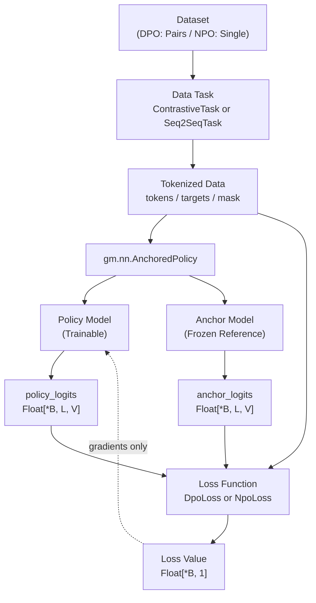
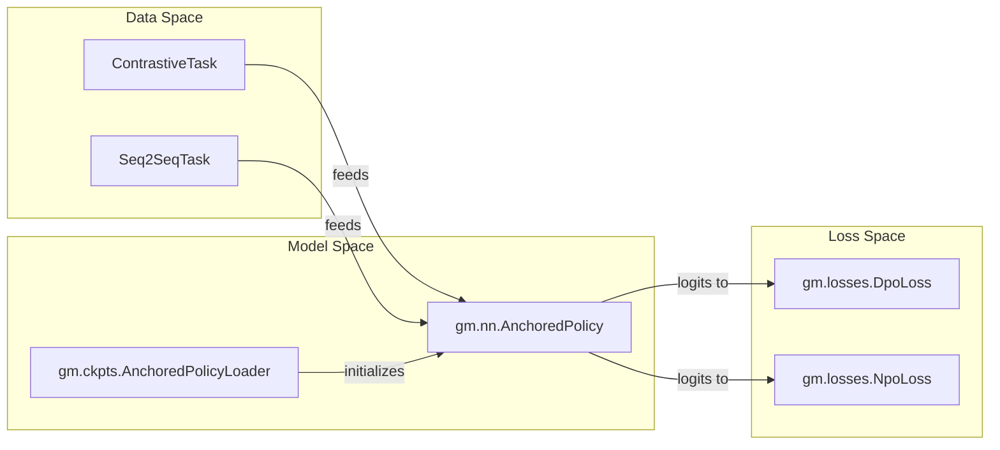

<!-- source: DeepWiki mcp.deepwiki.com · repo google-deepmind/gemma · page 6.4 Preference Optimization · fetched 2026-10-26 -->

# Preference Optimization

Relevant source files

The following files were used as context for generating this wiki page:

- [examples/npo.py](examples/npo.py)
- [gemma/gm/ckpts/_policy.py](gemma/gm/ckpts/_policy.py)
- [gemma/gm/data/_functional.py](gemma/gm/data/_functional.py)
- [gemma/gm/data/_transforms.py](gemma/gm/data/_transforms.py)
- [gemma/gm/losses/__init__.py](gemma/gm/losses/__init__.py)
- [gemma/gm/losses/_dpo.py](gemma/gm/losses/_dpo.py)
- [gemma/gm/losses/_npo.py](gemma/gm/losses/_npo.py)
- [gemma/gm/math/_misc.py](gemma/gm/math/_misc.py)
- [gemma/gm/nn/_policy.py](gemma/gm/nn/_policy.py)
- [gemma/gm/nn/vision/_vision.py](gemma/gm/nn/vision/_vision.py)

## Purpose and Scope

This document describes the preference optimization systems in the Gemma codebase, focusing on Direct Preference Optimization (DPO) and Negative Preference Optimization (NPO). These techniques are used to align language models with human preferences or to perform targeted unlearning.

The system relies on specialized data transformations, model wrappers for dual-model evaluation, and specific loss functions:
1.  **Data Processing**: `ContrastiveTask` for paired preference data and `Seq2SeqTask` for single-sequence unlearning.
2.  **Model Architecture**: `AnchoredPolicy` wrapper for running policy and reference models in parallel [gemma/gm/nn/_policy.py:33-64]().
3.  **Loss Functions**: `DpoLoss` for preference-based gradients [gemma/gm/losses/_dpo.py:28-90]() and `NpoLoss` for unlearning [gemma/gm/losses/_npo.py:27-82]().

For standard supervised fine-tuning, see [LoRA Fine-tuning](6.3). For general training concepts, see [Training with Kauldron](6.2).

---

## Overview

Preference optimization typically optimizes a model relative to a frozen reference (anchor) model. This eliminates the need for a separate reward model (as in PPO) by directly optimizing the log-likelihood ratio.

### Preference Optimization Flow

**Sources**: [examples/dpo.py:15-36](), [examples/npo.py:15-32](), [gemma/gm/losses/_dpo.py:28-60](), [gemma/gm/losses/_npo.py:27-58]()

---

## Direct Preference Optimization (DPO)

DPO works by running two answers (one preferred and one rejected) into both the reference model and the model to fine-tune. The loss increases the likelihood of the preferred answer relative to the reference [examples/dpo.py:17-20]().

### DpoLoss Implementation

The `DpoLoss` computes the preference-based gradient using the log-likelihood ratio between the policy and anchor models [gemma/gm/losses/_dpo.py:28-60]().

-   **Log Probability**: Extracted via `_get_logprobs_for_target` using `jnp.take_along_axis` on logits and targets [gemma/gm/losses/_dpo.py:94-108]().
-   **Tau**: Temperature parameter (default 0.1) [gemma/gm/losses/_dpo.py:41]().
-   **Label Smoothing**: Optional parameter to soften the preference labels [gemma/gm/losses/_dpo.py:42]().
-   **Calculation**: Computes the difference in log probabilities for chosen vs rejected sequences, then applies `jax.nn.log_sigmoid` [gemma/gm/losses/_dpo.py:77-88]().

**Sources**: [gemma/gm/losses/_dpo.py:28-108]()

---

## Negative Preference Optimization (NPO)

NPO is an unlearning algorithm modification of DPO. It focuses on reducing the likelihood of a specific response (e.g., sensitive or "forgotten" data) relative to the reference model [examples/npo.py:17-21]().

### Data Processing for NPO

Unlike DPO, NPO typically uses standard `Seq2SeqTask` formatting because it operates on a single target response rather than a pair [examples/npo.py:118-130]().

-   **Input**: Question/Instruction.
-   **Response**: The answer to be "unlearned".
-   **Output**: Standard `input`, `target`, and `mask` fields [gemma/gm/data/_functional.py:92-150]().

### NpoLoss Implementation

The `NpoLoss` computes: `loss = -log_sigmoid(-po_delta)`, where `po_delta` is the difference in log probabilities between policy and anchor multiplied by `tau` [gemma/gm/losses/_npo.py:75-80]().

-   **Target**: Single sequence unlearning.
-   **Logic**: Penalizes the policy if it assigns higher probability to the target than the reference model does [gemma/gm/losses/_npo.py:50-82]().

**Sources**: [gemma/gm/losses/_npo.py:27-82](), [examples/npo.py:67-73]()

---

## Architecture: AnchoredPolicy

Both DPO and NPO require an `AnchoredPolicy` model wrapper [gemma/gm/nn/_policy.py:33-64](). This wrapper encapsulates the trainable `policy` and a frozen `anchor` (reference) [examples/dpo.py:23-26]().

### AnchoredPolicy Configuration

The model is configured within the `kd.train.Trainer` [examples/dpo.py:51-58]() using `gm.nn.AnchoredPolicy` [gemma/gm/nn/_policy.py:33-64]().

### Checkpoint Loading

Standard loaders cannot handle the nested structure of `AnchoredPolicy`. The `AnchoredPolicyLoader` is required to correctly map checkpoint weights to the internal `policy` and `anchor` sub-modules [gemma/gm/ckpts/_policy.py:26-71]().

**Sources**: [gemma/gm/nn/_policy.py:33-64](), [gemma/gm/ckpts/_policy.py:26-71](), [examples/dpo.py:56-64](), [examples/npo.py:56-64]()

---

## Comparison of Optimization Patterns

The following table maps the "Natural Language Space" of training objectives to the "Code Entity Space" of the Gemma library.

| Objective | Data Task | Model Wrapper | Loss Class | Example Script |
|-----------|-----------|---------------|------------|----------------|
| **Preference Alignment** | `ContrastiveTask` | `AnchoredPolicy` [gemma/gm/nn/_policy.py:33-64]() | `DpoLoss` [gemma/gm/losses/_dpo.py:28-90]() | `examples/dpo.py` |
| **Unlearning** | `Seq2SeqTask` [gemma/gm/data/_functional.py:92-150]() | `AnchoredPolicy` [gemma/gm/nn/_policy.py:33-64]() | `NpoLoss` [gemma/gm/losses/_npo.py:27-82]() | `examples/npo.py` |
| **Supervised FT** | `Seq2SeqTask` [gemma/gm/data/_functional.py:92-150]() | Direct Model | `SoftmaxCrossEntropy` | `examples/seq2seq.py` |

### Code Entity Association Map

**Sources**: [examples/dpo.py:49-86](), [examples/npo.py:45-88](), [gemma/gm/nn/_policy.py:33-64](), [gemma/gm/ckpts/_policy.py:26-71](), [gemma/gm/losses/_dpo.py:28-90](), [gemma/gm/losses/_npo.py:27-82]()

---

## Implementation Details

### Log Probability Stability
In both `DpoLoss` and `NpoLoss`, the function `_get_logprobs_for_target` performs `jax.nn.log_softmax` in **float32** to improve numerical stability, even if the model weights are in bfloat16 [gemma/gm/losses/_dpo.py:93-108](), [gemma/gm/losses/_npo.py:85-100]().

### Sequence Processing
Both tasks utilize internal processing logic for sequence construction:
-   **Masking**: Losses use a `sequence_mask` (provided via the data task) to ensure only response tokens contribute to the loss [gemma/gm/losses/_dpo.py:93-108](), [gemma/gm/losses/_npo.py:85-100]().

**Sources**: [gemma/gm/losses/_dpo.py:93-108](), [gemma/gm/losses/_npo.py:85-100]()

---

