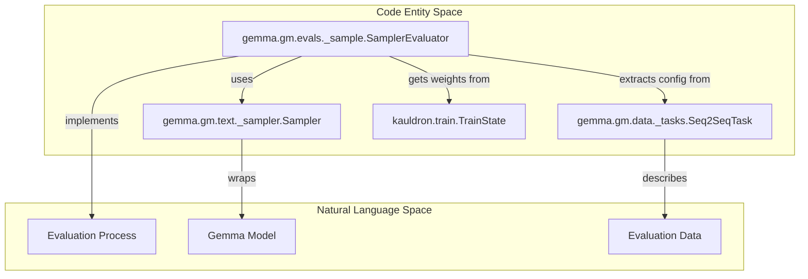
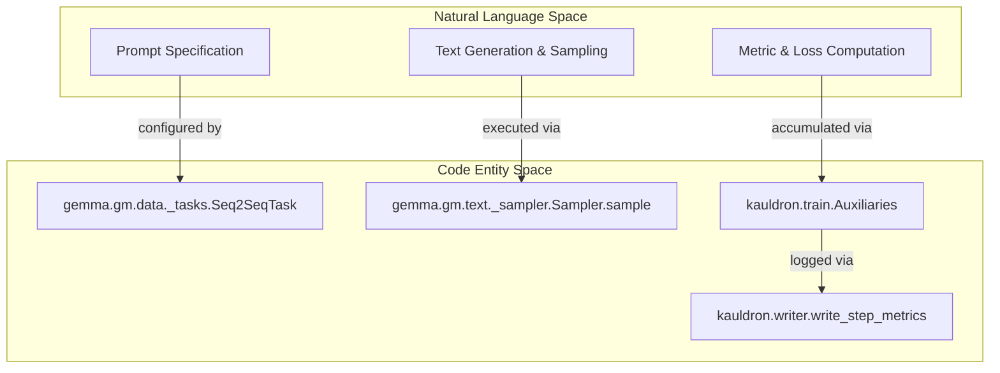
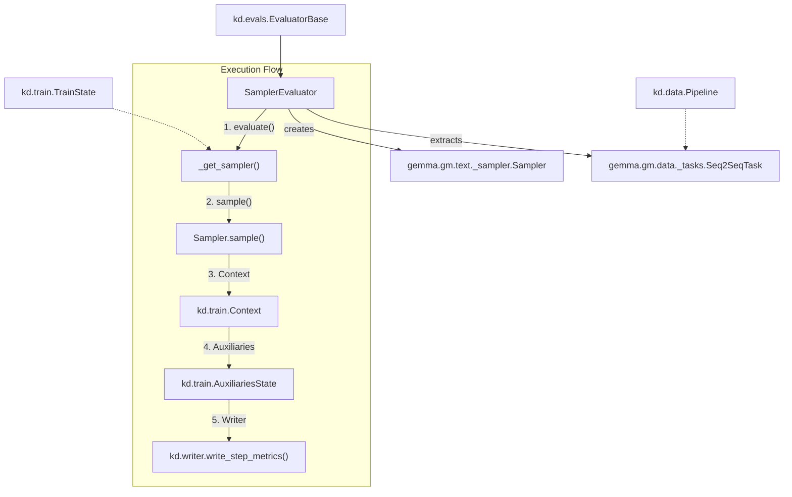
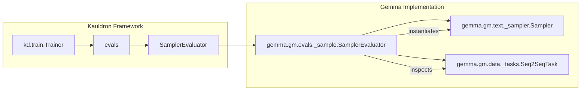
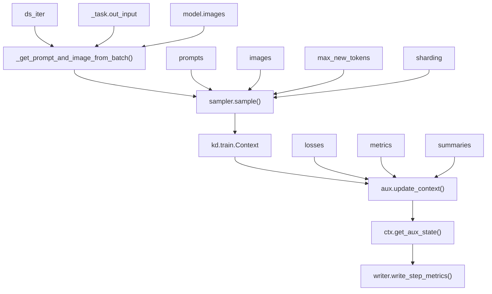

<!-- source: DeepWiki mcp.deepwiki.com · repo google-deepmind/gemma · page 6.5 Evaluation · fetched 2026-10-26 -->

# Evaluation

<details>
<summary>Relevant source files</summary>

The following files were used as context for generating this wiki page:

- [examples/lora.py](examples/lora.py)
- [examples/multimodal.py](examples/multimodal.py)
- [examples/seq2seq.py](examples/seq2seq.py)
- [examples/sharding.py](examples/sharding.py)
- [gemma/gm/evals/_sample.py](gemma/gm/evals/_sample.py)

</details>


The evaluation system provides automated model assessment during training through qualitative and quantitative text generation-based evaluation. The core component is the `SamplerEvaluator` class, which integrates with the Kauldron training framework to periodically generate text samples and compute metrics on evaluation datasets.

For information about the underlying text generation mechanisms, see [Generation Overview](4.1). For training configuration and setup, see [Training with Kauldron](6.2).

Sources: [gemma/gm/evals/_sample.py:15-58]()

## SamplerEvaluator Architecture

The `SamplerEvaluator` extends Kauldron's `kd.evals.EvaluatorBase` [gemma/gm/evals/_sample.py:35]() to provide text generation-based evaluation capabilities. It creates a `Sampler` instance using the current training state and generates text samples on evaluation data.

### Natural Language to Code Entity Mapping: Core Components

The following diagram bridges the high-level evaluation concepts to the specific code entities used in the Gemma library.



Sources: [gemma/gm/evals/_sample.py:35-117](), [gemma/gm/text/_sampler.py:44]()

### Natural Language to Code Entity Mapping: Dataset Processing

This second mapping diagram connects abstract prompt/response generation concepts to the underlying data transforms and execution loops.



Sources: [gemma/gm/evals/_sample.py:101-161](), [gemma/gm/data/_tasks.py:1-50]()

### Execution Flow



Sources: [gemma/gm/evals/_sample.py:85-151](), [gemma/gm/evals/_sample.py:175-183]()

## Configuration Parameters

The `SamplerEvaluator` accepts several key configuration parameters that control both the sampling behavior and evaluation scope:

| Parameter | Type | Default | Purpose |
|-----------|------|---------|---------|
| `cache_length` | `int` | `4096` | Maximum conversation length (avoids recompilation between turns). [gemma/gm/evals/_sample.py:61]() |
| `max_new_tokens` | `int` | Required | Maximum tokens to generate per sample. [gemma/gm/evals/_sample.py:62]() |
| `pad_length` | `int \| None` | `None` | Input padding length for consistent compilation. [gemma/gm/evals/_sample.py:63]() |
| `num_batches` | `int \| None` | `None` | Number of batches to evaluate (None = full dataset). [gemma/gm/evals/_sample.py:66]() |
| `cache` | `bool` | `False` | Whether to cache the dataset iterator. [gemma/gm/evals/_sample.py:67]() |

The evaluator also accepts standard Kauldron evaluation components:
- `losses`: Mapping of loss functions to compute. [gemma/gm/evals/_sample.py:73]()
- `metrics`: Mapping of metrics to compute. [gemma/gm/evals/_sample.py:74-76]()
- `summaries`: Optional summaries to write. [gemma/gm/evals/_sample.py:77-79]()
- `ds`: Dataset pipeline (defaults to `ROOT_CFG_REF.eval_ds`). [gemma/gm/evals/_sample.py:68]()
- `model`: Model reference (defaults to `ROOT_CFG_REF.model`). [gemma/gm/evals/_sample.py:70]()

Sources: [gemma/gm/evals/_sample.py:60-79]()

## Training Pipeline Integration

The evaluator integrates with Kauldron's training loop through the standard evaluator interface. It is typically configured in the `evals` section of the `kd.train.Trainer` configuration.



Sources: [gemma/gm/evals/_sample.py:85-87](), [examples/lora.py:109-115](), [examples/sharding.py:88-94]()

## Evaluation Workflow

The evaluation process follows a structured workflow that transforms dataset examples into generated text and computed metrics:



Sources: [gemma/gm/evals/_sample.py:127-161]()

### Dataset Processing

The evaluator requires datasets with `Seq2SeqTask` transforms. The `_get_prompt_and_image_from_batch()` method extracts prompts and images based on the task configuration:

- Text prompts are extracted from the field defined by `_task.out_input` [gemma/gm/evals/_sample.py:102]().
- Images are extracted from the field defined by `model.images` (if multimodal) [gemma/gm/evals/_sample.py:128]().

Sources: [gemma/gm/evals/_sample.py:127-136]()

### Text Generation

The sampling process uses the configured `Sampler` [gemma/gm/text/_sampler.py:44]() with the current training state parameters. The generation respects sharding configuration and supports both text-only and multimodal inputs:

```python
out_text = sampler.sample(
    prompts,
    images=images,
    max_new_tokens=self.max_new_tokens,
    sharding=sharding,
)
```

Sources: [gemma/gm/evals/_sample.py:131-136]()

### Metric Computation

Generated text is packaged into a `kd.train.Context` [gemma/gm/evals/_sample.py:140]() with the prediction accessible as `preds.text` [gemma/gm/evals/_sample.py:143](). The auxiliaries system processes losses, metrics, and summaries. Losses and metrics can access the prediction text through the key `preds.text`.

Sources: [gemma/gm/evals/_sample.py:53-56](), [gemma/gm/evals/_sample.py:140-151]()

## Default Summaries and Output

The evaluator automatically creates text summaries for qualitative inspection:

| Summary Key | Source | Purpose |
|-------------|--------|---------|
| `prompt` | `batch.{self._task.out_input}` | The input text prompt provided to the model. [gemma/gm/evals/_sample.py:102]() |
| `answer` | `preds.text` | The model's generated response. [gemma/gm/evals/_sample.py:103]() |
| `gt` | `batch.{self._task.out_target}` | Ground truth target (only if `out_target` is defined in the task). [gemma/gm/evals/_sample.py:105-108]() |

These summaries are displayed in TensorBoard and other Kauldron visualization tools.

Sources: [gemma/gm/evals/_sample.py:101-109]()

## Sharding Strategy

The evaluator automatically selects a sharding strategy based on the dataset batch configuration to ensure proper distribution across devices:

- `kd.sharding.REPLICATED`: Selected when `ds.batch_size is None`. [gemma/gm/evals/_sample.py:96]()
- `kd.sharding.FIRST_DIM`: Selected when the dataset has explicit batching. [gemma/gm/evals/_sample.py:98]()

Sources: [gemma/gm/evals/_sample.py:95-98]()

## Usage Examples

### LoRA Fine-tuning Evaluation

In LoRA scenarios, the `SamplerEvaluator` is used to track the quality of generated text throughout the fine-tuning process:

```python
"sampling": gm.evals.SamplerEvaluator(
    run=kd.evals.EveryNSteps(1000),
    max_new_tokens=150,
    num_batches=1,
    ds=_make_dataset(training=False, sampling=True),
),
```

Sources: [examples/lora.py:109-114]()

### Sharded Evaluation

When using FSDP or other sharding strategies, the evaluator handles the distributed sampling:

```python
"sampling": gm.evals.SamplerEvaluator(
    run=kd.evals.EveryNSteps(1000),
    max_new_tokens=50,
    num_batches=1,
    ds=_make_dataset(training=False, sampling=True),
),
```

Sources: [examples/sharding.py:88-93]()

## Implementation Details

### Dataset Requirements

The evaluator validates the dataset via `ds_iter` and interacts with pipeline iterator transforms to process evaluation examples.

Sources: [gemma/gm/evals/_sample.py:163-173]()

### Sampler Creation

The `_get_sampler()` method initializes the mid-level `Sampler` API with:
- `model`: The model defined in the trainer config. [gemma/gm/evals/_sample.py:178]()
- `params`: Current weights from `TrainState`. [gemma/gm/evals/_sample.py:179]()
- `tokenizer`: Extracted from the `Seq2SeqTask`. [gemma/gm/evals/_sample.py:180]()
- `cache_length` and `pad_length`: As configured in the evaluator attributes. [gemma/gm/evals/_sample.py:181-182]()

Sources: [gemma/gm/evals/_sample.py:175-183]()

### Transfer Guard Management

Evaluators are typically run within a `jax.transfer_guard('disallow')` context during the training loop. `SamplerEvaluator` explicitly re-enables transfers using `with jax.transfer_guard('allow'):` [gemma/gm/evals/_sample.py:125]() to permit data movement between the host and devices during sampling.

Sources: [gemma/gm/evals/_sample.py:123-125]()

---

