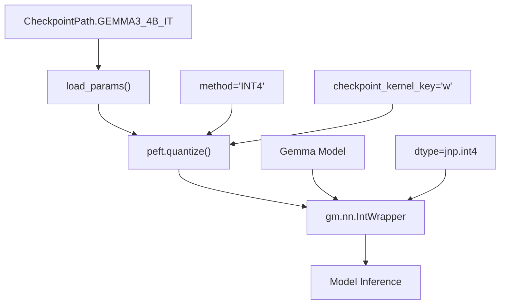
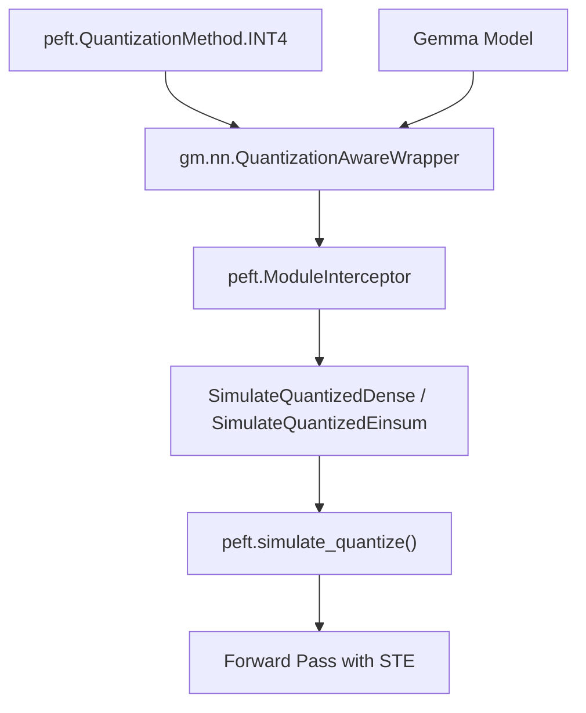
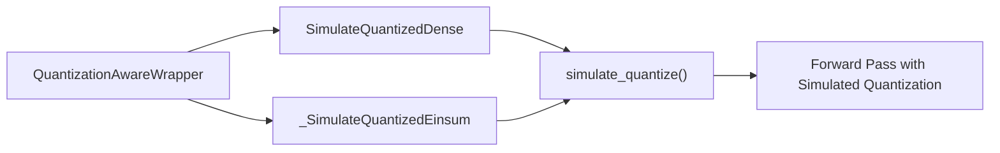
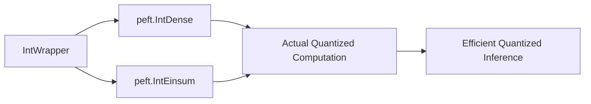
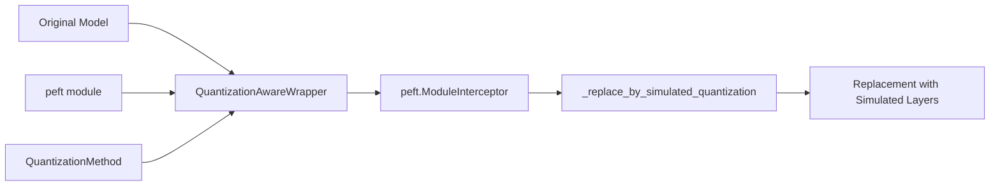

<!-- source: DeepWiki mcp.deepwiki.com · repo google-deepmind/gemma · page 6.6 Quantization · fetched 2026-10-26 -->

# Quantization

Relevant source files

The following files were used as context for generating this wiki page:

- [gemma/gm/ckpts/_compat.py](gemma/gm/ckpts/_compat.py)
- [gemma/gm/ckpts/_quantization.py](gemma/gm/ckpts/_quantization.py)
- [gemma/gm/nn/_lora.py](gemma/gm/nn/_lora.py)
- [gemma/gm/nn/_lora_test.py](gemma/gm/nn/_lora_test.py)
- [gemma/gm/nn/_quantization.py](gemma/gm/nn/_quantization.py)
- [gemma/gm/typing/__init__.py](gemma/gm/typing/__init__.py)
- [gemma/gm/typing/_common.py](gemma/gm/typing/_common.py)
- [gemma/peft/_quantization.py](gemma/peft/_quantization.py)
- [gemma/peft/_quantization_test.py](gemma/peft/_quantization_test.py)
- [gemma/peft/_quantization_utils.py](gemma/peft/_quantization_utils.py)

Quantization in the Gemma repository enables efficient model deployment by reducing the precision of model weights and activations. This system provides both post-training quantization for inference and quantization-aware training (QAT) for improved accuracy during fine-tuning. For LoRA-based model adaptation techniques, see [LoRA Fine-tuning]().

## Quantization Methods

The Gemma quantization system supports multiple quantization schemes through the `peft.QuantizationMethod` enum [gemma/peft/_quantization_utils.py:29-46]():

| Method | Precision | Description | Use Case |
|--------|-----------|-------------|----------|
| `INT8` | 8-bit integer | Per-channel weight quantization | General inference optimization |
| `INT4` | 4 bits per weight | Per-channel weight quantization | Maximum compression |
| `SFP8` | 8-bit switched floating point | Efficient with gemma.cpp | High-performance inference |
| `Q4_0` | ~4.5 bits per weight | Per-block integer quantization | Memory-constrained deployment |
| `Q4_0_TRANSPOSE` | ~4.5 bits per weight | Per-block integer quantization (transposed) | Transposed MLP layers |

Sources: [gemma/peft/_quantization.py:60-92](), [gemma/peft/_quantization_utils.py:29-46]()

## Inference with Quantized Models

### Post-Training Quantization Workflow

The inference pipeline involves loading standard parameters, applying a quantization transformation via `peft.quantize`, and wrapping the model in an integer-compatible container (`gm.nn.IntWrapper`).

Title: Quantized Inference Data Flow

The `gm.nn.IntWrapper` class provides quantized inference capabilities by wrapping the base transformer model [gemma/gm/nn/_quantization.py:81-95](). It leverages `peft.IntDense` and `peft.IntEinsum` internally to handle low-precision arithmetic by intercepting standard Flax modules during the `__call__` method [gemma/gm/nn/_quantization.py:106-110](), [gemma/peft/_quantization_test.py:40-46]().

Parameters are quantized using the `peft.quantize` function, which transforms floating-point weights into integer representations with associated scale factors [gemma/peft/_quantization_utils.py:65-87]().

Sources: [gemma/gm/nn/_quantization.py:81-110](), [gemma/peft/_quantization_utils.py:65-87](), [gemma/peft/_quantization_test.py:40-46]()

### Memory Optimization

Quantized models provide significant memory reduction during inference. The `IntWrapper` automatically handles the dequantization or quantized matrix multiplication during forward passes. For instance, `peft.IntDense` stores the `kernel` as `jnp.int4` alongside a floating-point `scale` [gemma/peft/_quantization_test.py:119-123]().

Sources: [gemma/peft/_quantization_test.py:119-123]()

## Quantization-Aware Training (QAT)

### QAT Architecture

Quantization-aware training uses simulation layers that mimic quantization noise during the forward pass while allowing high-precision gradients to flow during the backward pass using Straight-Through Estimation (STE).

Title: QAT Model Surgery and Simulation

The `gm.nn.QuantizationAwareWrapper` performs model surgery to replace linear layers with quantization-aware equivalents using a `peft.ModuleInterceptor` [gemma/gm/nn/_quantization.py:31-63](). These layers, such as `SimulateQuantizedDense`, use `simulate_quantize()` to clamp and round weights during the forward pass [gemma/peft/_quantization.py:37-124]().

Sources: [gemma/gm/nn/_quantization.py:31-63](), [gemma/peft/_quantization.py:37-124]()

### Training to Inference Pipeline

QAT training produces parameters optimized for quantization. The conversion from training to inference involves transitioning from simulation modules to actual integer arithmetic modules.

#### QAT Training Phase
Title: QAT Training Components

#### Inference Phase
Title: Quantized Inference Components

Sources: [gemma/gm/nn/_quantization.py:128-170](), [gemma/peft/_quantization.py:95-134](), [gemma/peft/_quantization_test.py:27-37]()

## Implementation Details

### Parameter Quantization Process

The quantization system operates on model parameters through the `peft` module. The `peft.quantize` utility processes the parameter tree, identifying kernels to quantize based on provided keys (e.g., `checkpoint_kernel_key='w'`) and generating the necessary `scale` tensors for the quantized layers [gemma/peft/_quantization_utils.py:120-140]().

### Integration with Checkpoint System

Quantization integrates with the checkpoint loading system through `gm.ckpts.load_params` and specialized loaders. For models using LoRA and quantization simultaneously, checkpoint restoration preserves base compatibility while wrapping or adapting weights.

The `gm.ckpts.convert_to_qat_checkpoint` function is specifically designed to map regular checkpoints to QAT-compatible structures by nesting kernels under simulation-specific keys like `_SimulateQuantizedEinsum_0` [gemma/gm/ckpts/_quantization.py:25-47]().

Sources: [gemma/gm/ckpts/_quantization.py:25-64](), [gemma/peft/_quantization_utils.py:65-87]()

### Compatibility with Training Framework

QAT integrates with the Kauldron training framework:
- Standard trainer configurations use `QuantizationAwareWrapper` to wrap the model [gemma/gm/nn/_quantization.py:31-63]().
- Utilities like `peft.split_params` allow granular control over parameter updates and quantization states [gemma/gm/_lora_test.py:66-66]().
- `peft.ModuleInterceptor` ensures transparent substitution of linear and einsum modules during runtime execution [gemma/gm/nn/_quantization.py:62-63]().

Sources: [gemma/gm/_lora_test.py:66-66](), [gemma/gm/nn/_quantization.py:31-63]()

## Model Surgery Architecture

Title: Model Surgery via Interceptor

The quantization system uses the `peft` library to perform model surgery. The `peft.ModuleInterceptor` context manager intercepts the creation of Flax modules and replaces compatible layers (`nn.Dense`, `nn.Einsum`) with their quantization-aware counterparts defined in `gemma/peft/_quantization.py` [gemma/gm/nn/_quantization.py:57-63]().

Sources: [gemma/gm/nn/_quantization.py:57-63](), [gemma/peft/_quantization.py:37-146]()

---

