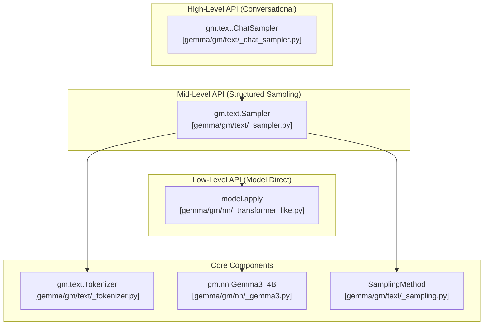
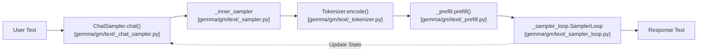

<!-- source: DeepWiki mcp.deepwiki.com · repo google-deepmind/gemma · page 7.1 Basic Inference · fetched 2026-10-26 -->

# Basic Inference

<details>
<summary>Relevant source files</summary>

The following files were used as context for generating this wiki page:

- [colabs/finetuning.ipynb](colabs/finetuning.ipynb)
- [colabs/lora_finetuning.ipynb](colabs/lora_finetuning.ipynb)
- [colabs/lora_sampling.ipynb](colabs/lora_sampling.ipynb)
- [colabs/multimodal.ipynb](colabs/multimodal.ipynb)
- [colabs/quantization_aware_training.ipynb](colabs/quantization_aware_training.ipynb)
- [colabs/quantization_sampling.ipynb](colabs/quantization_sampling.ipynb)
- [colabs/sampling.ipynb](colabs/sampling.ipynb)
- [colabs/sharding.ipynb](colabs/sharding.ipynb)
- [colabs/tokenizer.ipynb](colabs/tokenizer.ipynb)
- [colabs/tool_use.ipynb](colabs/tool_use.ipynb)
- [docs/finetuning.md](docs/finetuning.md)
- [docs/images/icon.svg](docs/images/icon.svg)
- [docs/sampling.md](docs/sampling.md)
- [docs/tokenizer.md](docs/tokenizer.md)

</details>


This page demonstrates how to perform text generation with Gemma models. It covers the three abstraction levels for inference: `ChatSampler` (highest-level, conversational), `Sampler` (mid-level, manual control), and direct `model.apply` (lowest-level, token-by-token). For multimodal inference with images and audio, see [7.2](). For fine-tuning models, see [7.3]().

Sources: [colabs/sampling.ipynb:1-20]()

## Three-Tier Inference Architecture

Gemma provides three levels of abstraction for running inference, each offering different trade-offs between ease of use and control. These tiers bridge the gap between natural language prompts and the underlying JAX-based transformer execution.

**Natural Language Space to Code Entity Space Mapping**


**Abstraction Level Comparison**

| Level | Class | Use Case | State Management | Prompt Formatting |
|-------|-------|----------|------------------|-------------------|
| **High** | `gm.text.ChatSampler` | Multi-turn conversations, chatbots | Automatic (Stateful) | Automatic (Turn tags) |
| **Mid** | `gm.text.Sampler` | Batch processing, custom pipelines | Manual (Stateless) | Manual (User-defined) |
| **Low** | `model.apply` | Research, single-token analysis | None | N/A (Token IDs) |

Sources: [colabs/sampling.ipynb:15-19](), [gemma/gm/text/_chat_sampler.py:42-111](), [gemma/gm/text/_sampler.py:86-125]()

## Common Setup

All inference approaches require loading a model architecture and its associated parameters. The following setup is standard for most applications:

```python
import jax
import jax.numpy as jnp
from gemma import gm

# Load model architecture (e.g., Gemma 3 4B)
model = gm.nn.Gemma3_4B()

# Load pretrained weights using the CheckpointPath enum
params = gm.ckpts.load_params(gm.ckpts.CheckpointPath.GEMMA3_4B_IT)
```

**Optional: JAX GPU Memory Configuration**

By default, JAX does not pre-allocate the full GPU memory. To ensure the model has enough memory on hardware with limited resources, you can configure the memory fraction:

```python
import os
os.environ["XLA_PYTHON_CLIENT_MEM_FRACTION"] = "1.00"
```

Sources: [colabs/sampling.ipynb:75-75](), [colabs/sampling.ipynb:95-97]()

## Using ChatSampler

`gm.text.ChatSampler` [gemma/gm/text/_chat_sampler.py:42-111]() is the recommended interface for building conversational agents. It handles the boilerplate of maintaining conversation history and inserting required control tokens like `<start_of_turn>` and `<end_of_turn>`.

### Basic Chat Example

```python
sampler = gm.text.ChatSampler(
    model=model,
    params=params,
    multi_turn=True,  # Enable persistent conversation memory
    print_stream=True,  # Stream output to stdout during generation
)

# First turn: The sampler formats the prompt automatically
response1 = sampler.chat('Share one metaphor linking "shadow" and "laughter".')

# Second turn: The sampler prepends the previous turn to the prompt
response2 = sampler.chat('Expand it in a haiku.')
```

**Inference Data Flow with ChatSampler**



Sources: [colabs/sampling.ipynb:134-141](), [gemma/gm/text/_chat_sampler.py:167-186](), [gemma/gm/text/_chat_sampler.py:117-118]()

### Multi-Turn Conversation Control

`ChatSampler` is stateful by design. It tracks the conversation in the `turns` attribute [gemma/gm/text/_chat_sampler.py:144-144]() and caches the KV-cache in `last_state` [gemma/gm/text/_chat_sampler.py:141-143]().

*   **Persistent State:** When `multi_turn=True`, the sampler reuses the KV-cache from previous turns to speed up processing of long conversations [gemma/gm/text/_chat_sampler.py:87-87]().
*   **Resetting State:** To start a fresh conversation without recreating the sampler, you can pass `multi_turn=False` to a specific `chat()` call [colabs/sampling.ipynb:114-114]().

Sources: [gemma/gm/text/_chat_sampler.py:87-110](), [colabs/sampling.ipynb:114-114]()

## Using Sampler

`gm.text.Sampler` [gemma/gm/text/_sampler.py:86-125]() provides a mid-level, stateless API. It is ideal for batch processing or scenarios where the developer wants full control over the prompt structure and the KV-cache lifecycle.

### Manual Prompt Formatting

Unlike `ChatSampler`, `Sampler` requires the user to manually include model-specific control tokens if using an Instruction-Tuned (IT) model.

```python
sampler = gm.text.Sampler(
    model=model,
    params=params,
)

# Manual formatting for instruction-tuned models
prompt = """<start_of_turn>user
Give me a list of inspirational quotes.<end_of_turn>
<start_of_turn>model
"""

output = sampler.sample(prompt, max_new_tokens=100)
```

Sources: [colabs/sampling.ipynb:252-264](), [gemma/gm/text/_sampler.py:102-107]()

### Sampling Strategies

The generation behavior is controlled by the `SamplingMethod` interface [gemma/gm/text/_sampling.py:31-31]().

| Method | Class | Logic |
|--------|-------|-------|
| **Greedy** | `gm.text.Greedy()` | Always selects the token with the highest logit [gemma/gm/text/_sampling.py:46-46](). |
| **Random** | `gm.text.RandomSampling()` | Samples from the distribution using a `temperature` parameter [gemma/gm/text/_sampling.py:59-59](). |
| **Top-K** | `gm.text.TopkSampling()` | Limits sampling to the `k` most likely tokens [gemma/gm/text/_sampling.py:82-82](). |
| **Top-P** | `gm.text.TopPSampling()` | Nucleus sampling: limits sampling to the smallest set of tokens whose cumulative probability exceeds `p` [gemma/gm/text/_sampling.py:109-109](). |

Sources: [gemma/gm/text/_sampler.py:131-133](), [gemma/gm/text/_sampling.py:46-109]()

## Using model.apply Directly

Directly calling `model.apply` is the lowest level of interaction. This bypasses the autoregressive loop and returns raw model outputs for a given sequence of tokens.

### Single Token Prediction Example

This approach is used for logit analysis or custom decoding loops. The `apply` method returns a `gm.nn.Output` dataclass containing `logits` and the updated `cache` [gemma/gm/nn/_transformer_like.py:46-51]().

```python
tokenizer = gm.text.Gemma3Tokenizer()
# Encode text into token IDs
prompt_ids = tokenizer.encode('The capital of France is', add_bos=True)
prompt_tensor = jnp.asarray([prompt_ids]) # Add batch dimension

# Call the model directly
out = model.apply(
    {'params': params},
    tokens=prompt_tensor,
    return_last_only=True, # Optimization to only return the last token's logits
)

# Extract logits and decode the most likely next token
next_token_id = jnp.argmax(out.logits, axis=-1)
print(tokenizer.decode(next_token_id[0]))
```

**Critical Requirement:** When manually tokenizing for Gemma models, ensure `add_bos=True` is set. The models are trained with a Beginning-Of-Sequence (BOS) token at the start of every sequence [colabs/sampling.ipynb:374-377](), [colabs/tokenizer.ipynb:278-285]().

Sources: [colabs/sampling.ipynb:356-424](), [gemma/gm/nn/_transformer_like.py:46-51](), [colabs/tokenizer.ipynb:120-120]()

### Logit Visualization

The `Tokenizer` class includes a `plot_logits` utility [colabs/sampling.ipynb:472-473]() to visualize the probability distribution of the next predicted token, which is useful for debugging model behavior and understanding token selection.

Sources: [colabs/sampling.ipynb:472-473]()

---

