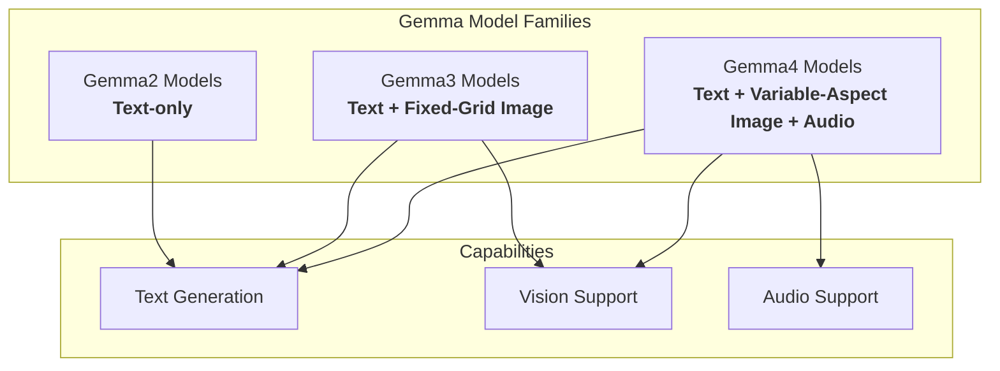
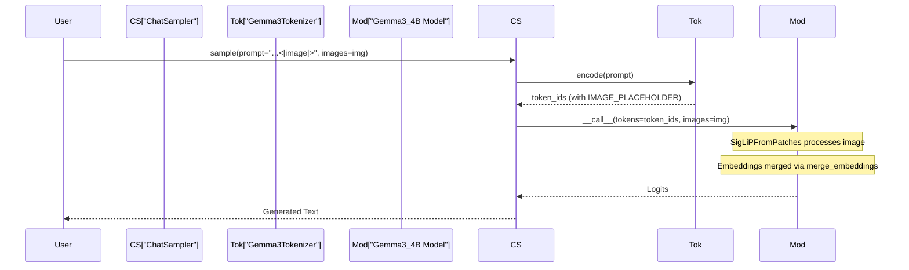

<!-- source: DeepWiki mcp.deepwiki.com · repo google-deepmind/gemma · page 7.2 Multimodal Generation · fetched 2026-10-26 -->

# Multimodal Generation

<details>
<summary>Relevant source files</summary>

The following files were used as context for generating this wiki page:

- [colabs/multimodal.ipynb](colabs/multimodal.ipynb)
- [colabs/quantization_aware_training.ipynb](colabs/quantization_aware_training.ipynb)
- [colabs/quantization_sampling.ipynb](colabs/quantization_sampling.ipynb)
- [colabs/sharding.ipynb](colabs/sharding.ipynb)
- [colabs/tokenizer.ipynb](colabs/tokenizer.ipynb)
- [colabs/tool_use.ipynb](colabs/tool_use.ipynb)
- [examples/lora.py](examples/lora.py)
- [examples/multimodal.py](examples/multimodal.py)
- [examples/seq2seq.py](examples/seq2seq.py)
- [examples/sharding.py](examples/sharding.py)
- [gemma/gm/evals/_sample.py](gemma/gm/evals/_sample.py)
- [gemma/gm/nn/gemma4/vision/_preprocessing.py](gemma/gm/nn/gemma4/vision/_preprocessing.py)

</details>


This document describes how to perform multimodal inference with Gemma models, specifically using images and audio alongside text inputs. Multimodal capabilities allow the model to process and generate text based on textual prompts, visual information, and acoustic signals.

For general text-only inference examples, see [Basic Inference](#7.1). For information on the tokenization system including special tokens, see [Tokenization](#5).

## Overview

Multimodal generation in Gemma enables the model to accept images and audio as part of the input context. This capability evolves across model generations:

*   **Gemma3**: Supports fixed-grid image processing.
*   **Gemma4**: Introduces support for variable-aspect-ratio images and audio inputs via a Conformer-based encoder.

**Key characteristics:**
*   Images and audio are represented using special placeholder tokens (`<|image|>`, `<|audio|>`) that expand into soft embeddings.
*   High-level APIs like `ChatSampler` handle the complexity of token expansion and embedding merging.
*   Checkpoints for multimodal models include vision and audio encoder parameters [examples/multimodal.py:70-73]().

Sources: [examples/multimodal.py:15-44](), [colabs/multimodal.ipynb:9-14]()

## Multimodal Architecture

### Model Support Matrix



**Diagram: Multimodal Support across Generations**

Sources: [examples/multimodal.py:70-73](), [colabs/multimodal.ipynb:40-42]()

### Token Expansion Mechanism

Multimodal inputs use a placeholder-expansion strategy. A single text token in the prompt is expanded into a sequence of "soft tokens" that represent the high-dimensional features from encoders.

| Input Type | Placeholder Token | Expansion Logic |
| :--- | :--- | :--- |
| **Gemma3 Image** | `IMAGE_TOKEN` | Expanded to a fixed grid of soft tokens. |
| **Gemma4 Image** | `<|image|>` | Expanded based on actual image dimensions (variable-aspect-ratio). |
| **Gemma4 Audio** | `<|audio|>` | Expanded based on audio duration and sample rate. |

Sources: [examples/multimodal.py:142-146](), [colabs/multimodal.ipynb:231-233]()

## Multimodal Inference with Gemma3

In Gemma3, images are typically processed at a fixed resolution. The `Gemma3Tokenizer` [examples/multimodal.py:128]() and high-level samplers manage the insertion of image tokens.

### Image Sampling Example

The following logic is used in multimodal notebooks to prepare image data for inference:

```python
# Example from colabs/multimodal.ipynb
# Common imports
import jax.numpy as jnp
from gemma import gm

# Use ChatSampler for high-level interaction
sampler = gm.text.ChatSampler(model=model, params=params)
output = sampler.sample(
    prompt="Describe this image: <|image|>",
    images=[image_data], # image_data as jnp.ndarray
)
```

**Internal Data Flow:**



**Diagram: Multimodal Data Flow in ChatSampler**

1.  **Tokenization**: The string `<|image|>` is identified by the tokenizer [examples/multimodal.py:128-142]().
2.  **Expansion**: The placeholder is replaced by a sequence of soft token placeholders.
3.  **Encoding**: The vision encoder processes the raw pixels into embeddings [examples/multimodal.py:159-162]().
4.  **Merging**: The vision embeddings are merged into the text embedding sequence at the placeholder locations.

Sources: [colabs/multimodal.ipynb:35-42](), [examples/multimodal.py:144-163]()

## Multimodal Inference with Gemma4

Gemma4 models introduce more advanced multimodal capabilities, including variable-aspect-ratio image handling and audio input.

### Variable-Aspect-Ratio Images

Gemma4's vision encoder can handle images of varying aspect ratios. The `preprocess_image` function [gemma/gm/nn/gemma4/vision/_preprocessing.py:125-157]() resizes images while preserving their aspect ratio, ensuring dimensions are multiples of `pooling_kernel_size * patch_size` and the total number of patches does not exceed `max_patches`. This is achieved by `get_target_dimensions` [gemma/gm/nn/gemma4/vision/_preprocessing.py:29-68]() and `aspect_ratio_preserving_resize` [gemma/gm/nn/gemma4/vision/_preprocessing.py:71-108]().

The `predict_soft_token_count` function [gemma/gm/nn/gemma4/vision/_preprocessing.py:170-203]() can be used to estimate the number of soft tokens an image will generate after preprocessing.

```python
# Example of image preprocessing for Gemma4
import jax.numpy as jnp
from gemma.gm.nn.gemma4.vision import _preprocessing as vision_preprocessing
from PIL import Image
import numpy as np

# Load an example image (replace with your image loading)
image_pil = Image.new('RGB', (1200, 800), color = 'red')
image_np = np.array(image_pil)

# Preprocess the image
preprocessed_image = vision_preprocessing.preprocess_image(image_np)
print(f"Preprocessed image shape: {preprocessed_image.shape}")

# Predict soft token count
soft_tokens = vision_preprocessing.predict_soft_token_count(
    height=image_np.shape[0],
    width=image_np.shape[1]
)
print(f"Predicted soft token count: {soft_tokens}")
```

Sources: [gemma/gm/nn/gemma4/vision/_preprocessing.py:15-20]()

### Audio Inputs

Gemma4 also supports audio inputs. Similar to images, audio is represented by a placeholder token (`<|audio|>`) which is expanded into soft tokens by an audio encoder (Conformer). The `ChatSampler` handles the integration of audio data.

```python
# Example from colabs/multimodal.ipynb
# Assuming 'audio_data' is a jnp.ndarray representing audio samples
sampler = gm.text.ChatSampler(model=model, params=params)
output = sampler.sample(
    prompt="Describe this audio: <|audio|>",
    audio=[audio_data], # audio_data as jnp.ndarray
)
```

Sources: [colabs/multimodal.ipynb:40-42]()

### Multimodal Data Flow for Gemma4

```mermaid
graph TD
    A[User Input] --> B{ChatSampler.sample()}
    B --> C[Tokenizer.encode()]
    C --> D{Token IDs with Placeholders}
    D -- Image Placeholder --> E[Vision Encoder]
    D -- Audio Placeholder --> F[Audio Encoder (Conformer)]
    E --> G[Image Embeddings]
    F --> H[Audio Embeddings]
    D -- Text Tokens --> I[Text Embeddings]
    G & H & I --> J[Embedding Merger]
    J --> K[Gemma4 Transformer Model]
    K --> L[Generated Text]
    L --> B
    B --> A
```

**Diagram: Gemma4 Multimodal Data Flow**

This diagram illustrates the unified processing of text, image, and audio inputs within the Gemma4 framework. The `ChatSampler` orchestrates the tokenization, encoding, embedding merging, and model inference.

Sources: [colabs/multimodal.ipynb:40-42]()

## Training and Fine-tuning

Multimodal models can be fine-tuned for tasks like image captioning using the `Seq2SeqTask` with multimodal configurations.

### Multimodal Dataset Pipeline

For training, images must be resized and rearranged to include a "number of images" dimension (usually 1 for single-image tasks). The `gm.data.Seq2SeqTask` [examples/multimodal.py:144]() is used to prepare the data, handling tokenization and input/target mapping.

```python
# Example from examples/multimodal.py
transforms=[
    # Only keep the fields we need.See fields at:
    # https://www.tensorflow.org/datasets/catalog/ai2dcaption
    kd.data.Elements(keep=["image", "caption"]),
    # Create a new constant field
    kd.data.AddConstants({"prompt": "<|image|>"}),
    # Create the model inputs/targets/loss_mask.
    gm.data.Seq2SeqTask(
        # Select which field from the dataset to use.
        in_prompt="prompt",
        in_response="caption",
        # Output batch is {"input": ..., "target": ..., "loss_mask": ...}
        out_input="input",
        out_target="target",
        out_target_mask="loss_mask",
        tokenizer=tokenizer,
        # Padding parameters
        max_length=None if sampling else max_length,
        # In this dataset, ~1% of examples are longer than 512 tokens.
        truncate=True,
        sampling=sampling,
    ),
    kd.data.py.Resize(key="image", size=(800, 800)),
    # TODO(epot): Make the `num_images` dimension optional
    kd.data.Rearrange(key="image", pattern="... h w c -> ... 1 h w c"),
    kd.data.Cast(key="image", dtype=jnp.uint8),
]
```

The `SamplerEvaluator` [gemma/gm/evals/_sample.py:35]() can be used during training to evaluate the model's generation capabilities on multimodal inputs. It takes `images` as an argument to its `sample` method [gemma/gm/evals/_sample.py:133-136]().

Sources: [examples/multimodal.py:121-164](), [gemma/gm/evals/_sample.py:35-79]()

---

