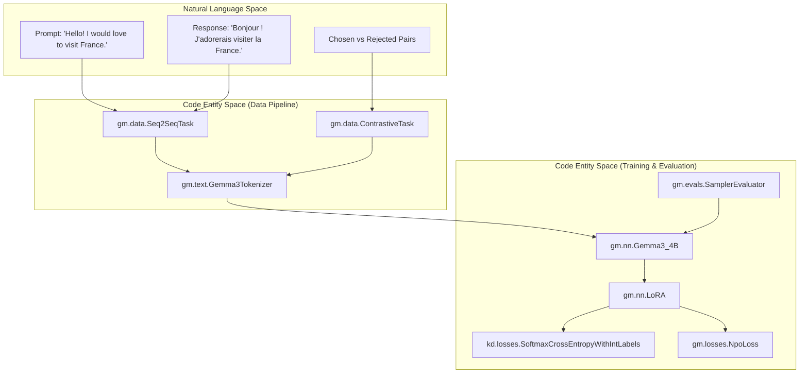
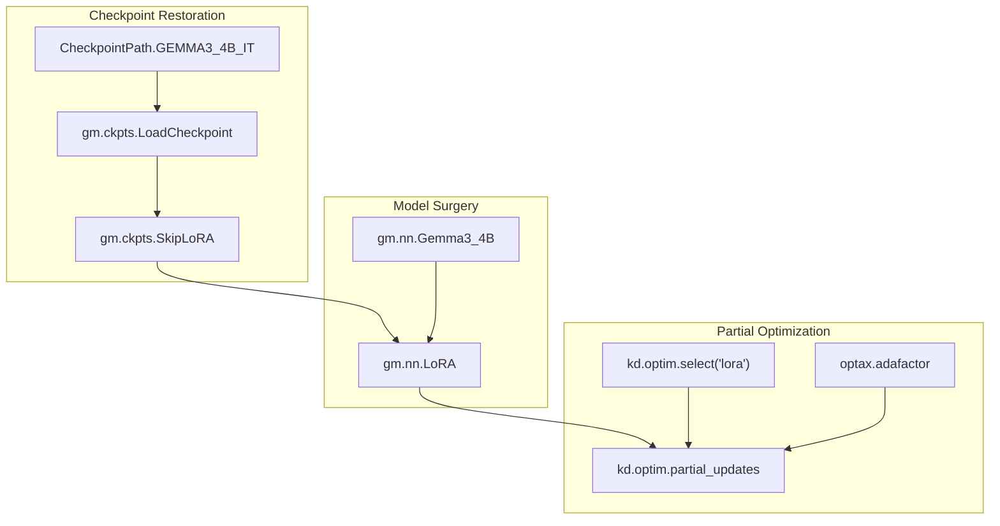
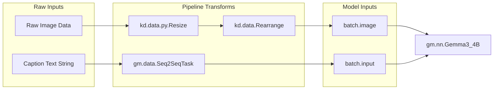

<!-- source: DeepWiki mcp.deepwiki.com · repo google-deepmind/gemma · page 7.3 Fine-tuning Examples · fetched 2026-10-26 -->

# Fine-tuning Examples

<details>
<summary>Relevant source files</summary>

The following files were used as context for generating this wiki page:

- [colabs/finetuning.ipynb](colabs/finetuning.ipynb)
- [colabs/lora_finetuning.ipynb](colabs/lora_finetuning.ipynb)
- [colabs/lora_sampling.ipynb](colabs/lora_sampling.ipynb)
- [colabs/sampling.ipynb](colabs/sampling.ipynb)
- [examples/classification.py](examples/classification.py)
- [examples/lora.py](examples/lora.py)
- [examples/multimodal.py](examples/multimodal.py)
- [examples/npo.py](examples/npo.py)
- [examples/seq2seq.py](examples/seq2seq.py)
- [examples/sharding.py](examples/sharding.py)
- [gemma/gm/ckpts/_paths.py](gemma/gm/ckpts/_paths.py)
- [gemma/gm/evals/_sample.py](gemma/gm/evals/_sample.py)
- [gemma/gm/losses/__init__.py](gemma/gm/losses/__init__.py)

</details>


This page provides practical, technical documentation for the fine-tuning pipelines available in the Gemma repository (`examples/`). These examples demonstrate how to implement Supervised Fine-tuning (Seq2Seq), Parameter-Efficient Fine-tuning (LoRA), distributed sharding, preference optimization (DPO/NPO), classification, and multimodal training using the **Kauldron** training framework.

---

## Fine-tuning Pipeline Overview

The Gemma library leverages Kauldron (`kd`) to define reproducible training configurations. Every fine-tuning example follows a structured data flow from raw dataset transforms to optimized model parameters and evaluation summaries.

### Natural Language to Code Entity Mapping



**Sources:** [examples/seq2seq.py:57-109](), [examples/lora.py:49-116](), [examples/npo.py:45-88](), [gemma/gm/evals/_sample.py:35-184]()

---

## Supervised Fine-tuning (Seq2Seq)

The standard sequence-to-sequence fine-tuning pattern trains the model to predict a target response given a prompt. This is implemented via `gm.data.Seq2SeqTask` in `examples/seq2seq.py`.

### Implementation Detail: `Seq2SeqTask`
The sequence-to-sequence task transform performs the following steps:
1.  **Chat Formatting**: Formats text into chat turns utilizing special tokens such as `<start_of_turn>` and `<end_of_turn>` [examples/seq2seq.py:33-35]().
2.  **Tokenization**: Encodes raw strings into integer arrays using `gm.text.Gemma3Tokenizer` [examples/seq2seq.py:119-145]().
3.  **Target Masking**: Generates the training batch containing `input`, `target`, and `loss_mask` fields [examples/seq2seq.py:135-139]().

### Configuration Example (`examples/seq2seq.py`)
```python
model = gm.nn.Gemma3_4B(tokens="batch.input")
init_transform = gm.ckpts.LoadCheckpoint(path=gm.ckpts.CheckpointPath.GEMMA3_4B_IT)
```
The trainer binds cross-entropy loss directly to the model logits and target masks [examples/seq2seq.py:79-86]().

**Sources:** [examples/seq2seq.py:57-110](), [examples/seq2seq.py:112-147]()

---

## Parameter-Efficient Fine-tuning (LoRA)

LoRA reduces training memory overhead by freezing base model weights and introducing low-rank adapter matrices into linear layers [colabs/lora_finetuning.ipynb:88-105]().

### LoRA Workflow Architecture



### Key Components for LoRA
1.  **`gm.nn.LoRA`**: Performs model surgery to wrap compatible layers with adapters given a specified rank [examples/lora.py:62-70]().
2.  **`gm.ckpts.SkipLoRA`**: Restores base weights from a pretrained checkpoint while leaving adapter weights uninitialized or randomly initialized to prevent shape mismatches [examples/lora.py:74-78]().
3.  **`kd.optim.partial_updates`**: Restricts gradient updates exclusively to parameters matching the `"lora"` selector [examples/lora.py:89-93]().

**Sources:** [colabs/lora_finetuning.ipynb:88-178](), [examples/lora.py:49-116]()

---

## Distributed Sharding

For large-scale models that exceed single-accelerator memory limits, the codebase provides configurations for Fully Sharded Data Parallel (FSDP) training.

### Sharded Training Configuration (`examples/sharding.py`)
`examples/sharding.py` forks the `seq2seq.py` pipeline by introducing a explicit `sharding` configuration block into the `kd.train.Trainer` [examples/sharding.py:15-19]():

```python
sharding = kd.sharding.ShardingStrategy(
    params=kd.sharding.FSDPSharding(),
)
```

This distributes parameter tensors, optimizer states, and activations across available devices while maintaining identical data pipeline and loss semantics.

**Sources:** [examples/sharding.py:16-59]()

---

## Preference Optimization (DPO & NPO)

Preference optimization aligns models using contrastive pairs or unlearning objectives.

### Negative Preference Optimization (`examples/npo.py`)
NPO modifies standard alignment by decreasing the likelihood of specific undesirable outputs relative to an anchor policy [examples/npo.py:15-23]():
*   **Model Wrapper**: Uses `gm.nn.AnchoredPolicy` wrapping a base model like `gm.nn.Gemma3_12B` [examples/npo.py:56-58]().
*   **Checkpoint Loader**: Uses `gm.ckpts.AnchoredPolicyLoader` to initialize policy and anchor weights [examples/npo.py:60-64]().
*   **Loss Function**: Computes unlearning penalties via `gm.losses.NpoLoss` [examples/npo.py:68-73]().

**Sources:** [gemma/gm/losses/__init__.py:15-18](), [examples/npo.py:45-88]()

---

## Classification Fine-tuning

The `examples/classification.py` script illustrates how Gemma can be adapted for discriminative classification tasks by mapping target classes to specific token outputs.

| Feature | Implementation Detail |
| :--- | :--- |
| **Input Template** | Formats prompt sequences requesting binary or categorical token answers [examples/classification.py:98-102](). |
| **Prediction Focus** | Uses `return_last_only=True` during application to isolate classification logits [examples/classification.py:51](). |
| **Token Mapping** | Maps class identifiers to semantic token IDs (e.g., `"No"` $\to$ token `1294`, `"Yes"` $\to$ token `3553`) [examples/classification.py:113-124](). |
| **Loss Function** | Standard cross-entropy over discrete token logits `kd.losses.SoftmaxCrossEntropyWithIntLabels` [examples/classification.py:60-64](). |

**Sources:** [examples/classification.py:42-130]()

---

## Multimodal Fine-tuning

`examples/multimodal.py` provides an end-to-end configuration for image-captioning tasks using Gemma 3 [examples/multimodal.py:15-16]().

### Multimodal Training Data Pipeline



*   **Prompt Formatting**: Prompts incorporate the `` placeholder token to indicate visual token integration points [examples/multimodal.py:33-34]().
*   **Image Processing**: Images are resized, reshaped with explicit tensor dimensions, and cast to `uint8` arrays [examples/multimodal.py:159-162]().
*   **Model Configuration**: `gm.nn.Gemma3_4B` is instantiated with both `tokens="batch.input"` and `images="batch.image"` [examples/multimodal.py:70-73]().
*   **Qualitative Evaluation**: `gm.evals.SamplerEvaluator` renders side-by-side image and caption summaries at specified training intervals [examples/multimodal.py:106-116]().

**Sources:** [examples/multimodal.py:57-118](), [examples/multimodal.py:121-164](), [gemma/gm/evals/_sample.py:35-152]()

---

