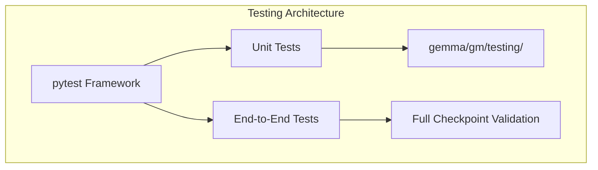
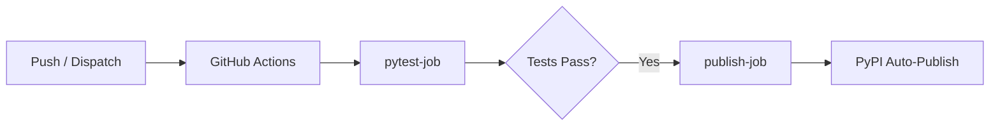
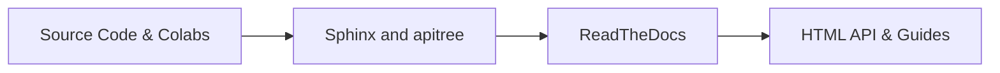
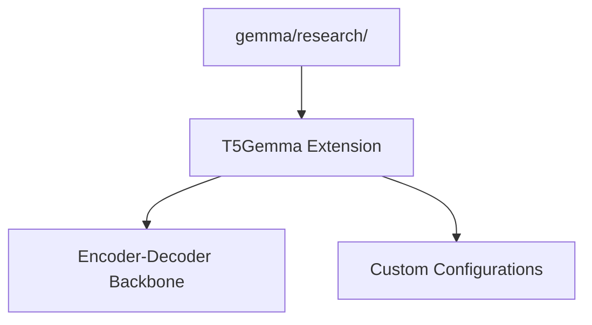

<!-- source: DeepWiki mcp.deepwiki.com · repo google-deepmind/gemma · page 8 Development · fetched 2026-10-26 -->

# Development

Relevant source files

The following files were used as context for generating this wiki page:

- [.github/workflows/pytest_and_autopublish.yml](.github/workflows/pytest_and_autopublish.yml)
- [.gitignore](.gitignore)
- [.pylintrc](.pylintrc)
- [.vscode/extensions.json](.vscode/extensions.json)
- [.vscode/settings.json](.vscode/settings.json)

This page provides information for contributors and developers working on the Gemma codebase [.github/workflows/pytest_and_autopublish.yml:1-68](). As a parent overview, it introduces the core development domains and links to child pages for testing, CI/CD, documentation, and research extensions.

Sources: [.github/workflows/pytest_and_autopublish.yml:1-68]()

## 8.1 Testing

The testing framework utilizes `pytest` [.github/workflows/pytest_and_autopublish.yml:42]() alongside mock fixtures and test utilities located in `gemma/gm/testing/` to validate core components like prefill logic [gemma/gm/text/_prefill_test.py:53-74]() and sampling states without requiring full model parameter downloads. End-to-end tests validate complete generation workflows against real model checkpoints [gemma/gm/tests/sampler_e2e_test.py:21-37]().

For details, see [Testing](#8.1).

Sources: [.github/workflows/pytest_and_autopublish.yml:41-46](), [gemma/gm/text/_prefill_test.py:53-74](), [gemma/gm/tests/sampler_e2e_test.py:21-37]()

## 8.2 CI/CD Pipeline

Continuous integration and automated publishing are managed via GitHub Actions workflows [.github/workflows/pytest_and_autopublish.yml:1-68](). The pipeline executes parallel unit test suites [.github/workflows/pytest_and_autopublish.yml:41-46]() and automatically publishes releases to PyPI when the package version `__version__` is incremented on the `main` branch [.github/workflows/pytest_and_autopublish.yml:53-64]().

For details, see [CI/CD Pipeline](#8.2).

Sources: [.github/workflows/pytest_and_autopublish.yml:1-68]()

## 8.3 Documentation System

The documentation system is built using Sphinx and the `apitree` extension to generate structured API references from source code [docs/conf.py:43-59](). ReadTheDocs manages deployments from the `docs/` directory structure, integrating interactive Jupyter notebooks from `colabs/` [docs/conf.py:29-40]().

For details, see [Documentation System](#8.3).

Sources: [docs/conf.py:43-59](), [docs/index.md:1-33]()

## 8.4 Research Extensions

Research extensions under `gemma/research/` house experimental features and alternative model architectures. This includes projects like T5Gemma, which adapts the Gemma 2 transformer backbone into an encoder-decoder framework with specialized modules, configurations, and sampling interfaces.

For details, see [Research Extensions](#8.4).

Sources: [docs/conf.py:43-59]()

---

