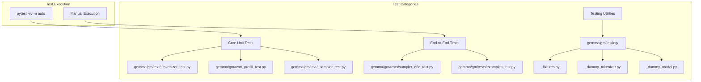
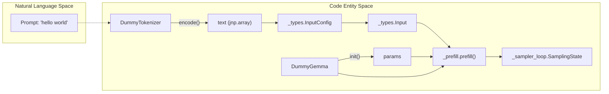
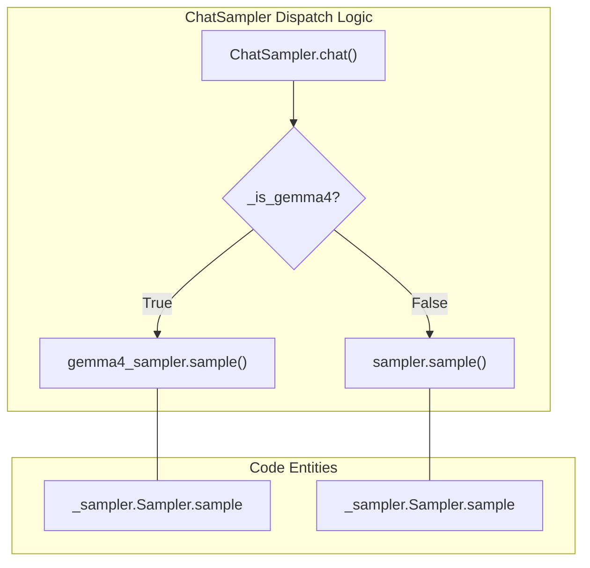

<!-- source: DeepWiki mcp.deepwiki.com · repo google-deepmind/gemma · page 8.1 Testing · fetched 2026-10-26 -->

# Testing

Relevant source files

The following files were used as context for generating this wiki page:

- [docs/research.md](docs/research.md)
- [gemma/gm/nn/_experimental.py](gemma/gm/nn/_experimental.py)
- [gemma/gm/nn/_transformer_test.py](gemma/gm/nn/_transformer_test.py)
- [gemma/gm/nn/gemma4/audio/_model_test.py](gemma/gm/nn/gemma4/audio/_model_test.py)
- [gemma/gm/nn/gemma4/vision/_transformer.py](gemma/gm/nn/gemma4/vision/_transformer.py)
- [gemma/gm/testing/__init__.py](gemma/gm/testing/__init__.py)
- [gemma/gm/testing/_dummy_model.py](gemma/gm/testing/_dummy_model.py)
- [gemma/gm/testing/_dummy_tokenizer.py](gemma/gm/testing/_dummy_tokenizer.py)
- [gemma/gm/tests/examples_test.py](gemma/gm/tests/examples_test.py)
- [gemma/gm/tests/sampler_e2e_test.py](gemma/gm/tests/sampler_e2e_test.py)
- [gemma/gm/text/_tokenizer_test.py](gemma/gm/text/_tokenizer_test.py)
- [gemma/gm/utils/_dtype_params.py](gemma/gm/utils/_dtype_params.py)
- [gemma/gm/utils/_py.py](gemma/gm/utils/_py.py)

The Gemma testing framework provides comprehensive unit testing, end-to-end testing, and continuous integration capabilities. It includes hermetic testing utilities, dummy model fixtures, and specialized test utilities in `gemma/gm/testing/` to ensure reliable development without external dependencies or hardware constraints.

## Test Organization and Infrastructure

The testing framework is organized into core unit tests, end-to-end (E2E) tests, and testing utilities. The `gemma/gm/testing/` module provides standardized fixtures for the entire library.

### Test Structure

Sources: [gemma/gm/testing/__init__.py:24-28](), [gemma/gm/tests/sampler_e2e_test.py:15-18]()

---

## Testing Utilities (`gemma/gm/testing/`)

To facilitate fast, hermetic testing, the library provides dummy implementations of core components that do not require GPU/TPU hardware or external network access.

### Dummy Model and Tokenizer

The `DummyGemma` class provides a minimal `Transformer` architecture with reduced dimensions (e.g., `embed_dim=32`, `num_heads=2`) to allow for instant initialization and CPU-based testing. It uses a vocab size of 13 to match the `DummyTokenizer` [gemma/gm/testing/_dummy_model.py:21-36]().

| Component | Class | Purpose |
| :--- | :--- | :--- |
| **Model** | `DummyGemma` | Minimal Transformer with 13-token vocab size. [gemma/gm/testing/_dummy_model.py:21-36]() |
| **Tokenizer** | `DummyTokenizer` | Mock tokenizer with hardcoded mapping for words like "hello", "world", and "Morgane". [gemma/gm/testing/_dummy_tokenizer.py:80-90]() |
| **Processor** | `_DummySentencePieceProcessor` | Simulates `sentencepiece` behavior for `DummyTokenizer`. [gemma/gm/testing/_dummy_tokenizer.py:35-79]() |

### Hermetic Test Fixtures

The `use_hermetic_tokenizer` fixture is a critical utility that prevents tests from making calls to TFHub or Kaggle. It mocks the `Gemma3Tokenizer.__init__` method to redirect the model path to a local resource within the repository: `gemma/testdata/tokenizer_gemma3.model` [gemma/gm/testing/_fixtures.py:25-43]().

Sources: [gemma/gm/testing/_fixtures.py:25-43](), [gemma/gm/testing/_dummy_model.py:21-36](), [gemma/gm/testing/_dummy_tokenizer.py:35-90]()

---

## End-to-End Testing

End-to-end tests validate the integration between the model, parameters, and sampling logic using real (or mocked) model checkpoints.

### Sampler E2E Tests
The `sampler_e2e_test.py` validates that `ChatSampler` can perform multi-turn conversations and correctly handle stop tokens using `Gemma3_4B` configurations.

*   **Multi-turn Logic:** `test_sampler` checks if the model maintains context across turns [gemma/gm/tests/sampler_e2e_test.py:21-37]().
*   **Stop Tokens:** `test_sampler_stop_token` ensures the generation terminates exactly when a specific string (e.g., "laughter") is produced by configuring `stop_tokens` in the `ChatSampler` [gemma/gm/tests/sampler_e2e_test.py:58-74]().

### Examples Testing
The `examples_test.py` ensures that training configurations (like `seq2seq.py`) can be resolved and initialized. It uses `konfig.mock_modules()` to inject `DummyGemma` and `tfds.testing.mock_data` to simulate a training environment without actual datasets [gemma/gm/tests/examples_test.py:24-37]().

Sources: [gemma/gm/tests/sampler_e2e_test.py:21-74](), [gemma/gm/tests/examples_test.py:24-37]()

---

## Unit Test Implementation Details

### Prefill and Attention Mask Testing
Tests in `_prefill_test.py` verify the complex logic of KV cache management and attention masking during the prefill phase, specifically handling the transition between turns.

Sources: [gemma/gm/text/_prefill_test.py:27-74](), [gemma/gm/text/_prefill_test.py:76-160]()

The `test_full_attention_mask` function validates:
1.  `_make_full_attention_mask`: Creates initial masks for prompt tokens [gemma/gm/text/_prefill_test.py:93-97]().
2.  `_mask_full_attention_mask_prefix_for_next_turn`: Post-processes the mask after a turn to zero out tokens following an EOS/stop token [gemma/gm/text/_prefill_test.py:128-132]().

Sources: [gemma/gm/text/_prefill_test.py:27-74](), [gemma/gm/text/_prefill_test.py:76-160]()

### Sampler and Dispatch Testing
The `_sampler_test.py` verifies sampling mechanics and dispatch logic.

*   **Token Masking:** `test_end_tokens_mask` verifies `_mask_tokens_after_end_tokens` which zeros out indices in a sequence following specified `end_tokens` [gemma/gm/text/_sampler_test.py:24-38]().
*   **Gemma4 Dispatch:** `test_chat_sampler_gemma4_dispatch` uses `unittest.mock` to verify that `ChatSampler` correctly routes requests to `gemma4_sampler` when the model is identified as a Gemma4 variant [gemma/gm/text/_sampler_test.py:60-104]().

Sources: [gemma/gm/text/_sampler_test.py:24-38](), [gemma/gm/text/_sampler_test.py:60-147]()

---

## Summary of Test Utilities

| File | Primary Code Entities | Role |
| :--- | :--- | :--- |
| `gemma/gm/testing/_dummy_model.py` | `DummyGemma` | Provides a tiny `Transformer` config for unit tests [gemma/gm/testing/_dummy_model.py:21-36](). |
| `gemma/gm/testing/_dummy_tokenizer.py` | `DummyTokenizer` | Provides a deterministic tokenizer for string-to-ID testing [gemma/gm/testing/_dummy_tokenizer.py:80-90](). |
| `gemma/gm/testing/_fixtures.py` | `use_hermetic_tokenizer` | Pytest fixture to force local model loading [gemma/gm/testing/_fixtures.py:25-43](). |
| `gemma/gm/text/_prefill_test.py` | `test_prefill`, `test_full_attention_mask` | Validates KV cache and attention mask transitions [gemma/gm/text/_prefill_test.py:27-160](). |
| `gemma/gm/tests/sampler_e2e_test.py` | `test_sampler`, `test_sampler_stop_token` | Validates high-level `ChatSampler` behavior [gemma/gm/tests/sampler_e2e_test.py:21-74](). |

Sources: [gemma/gm/testing/__init__.py:24-28](), [gemma/gm/text/_prefill_test.py:17-21](), [gemma/gm/text/_sampler_test.py:15-18]()

---

