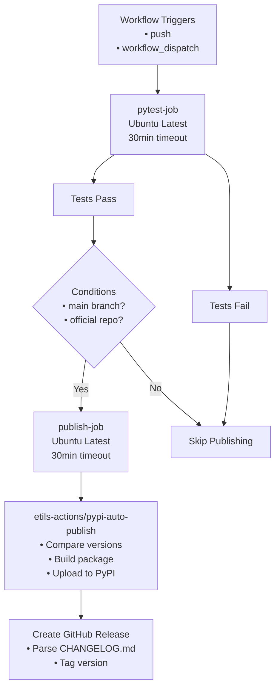
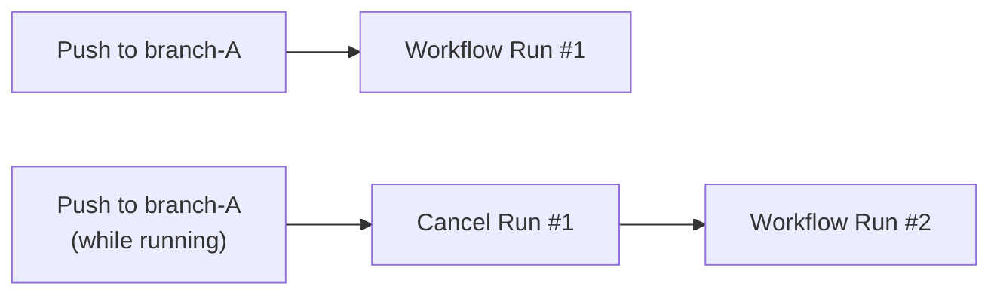
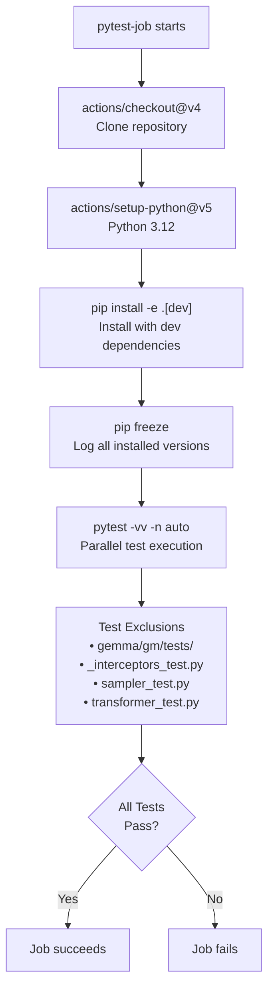
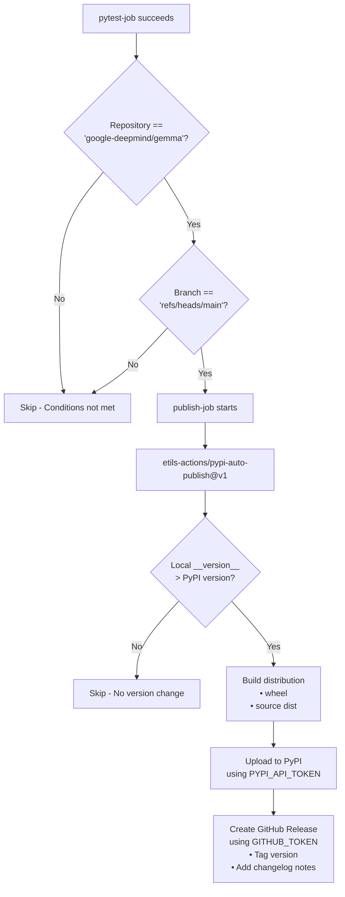
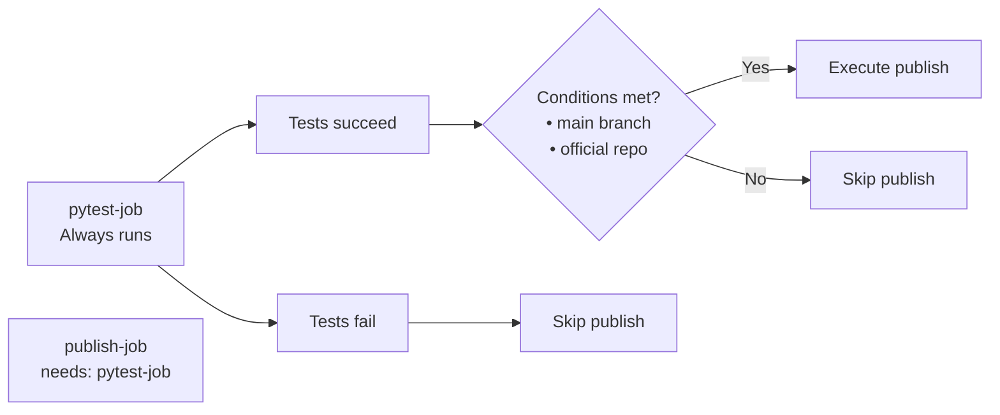

<!-- source: DeepWiki mcp.deepwiki.com · repo google-deepmind/gemma · page 8.2 CI/CD Pipeline · fetched 2026-10-26 -->

# CI/CD Pipeline

<details>
<summary>Relevant source files</summary>

The following files were used as context for generating this wiki page:

- [.github/workflows/pytest_and_autopublish.yml](.github/workflows/pytest_and_autopublish.yml)
- [CHANGELOG.md](CHANGELOG.md)
- [gemma/__init__.py](gemma/__init__.py)

</details>


## Purpose and Scope

This document describes the automated continuous integration and continuous deployment (CI/CD) infrastructure for the Gemma repository. The pipeline is implemented using GitHub Actions and handles two primary responsibilities: running automated tests on every code change and automatically publishing new versions to PyPI when the package version is incremented.

The pipeline ensures that code quality is maintained through parallelized testing and that releases are streamlined via automated publishing workflows.

## Workflow Overview

The CI/CD pipeline is defined in a single GitHub Actions workflow file that orchestrates both testing and publishing operations.

### High-Level Workflow Logic

Title: CI/CD Execution Flow


**Sources:** [.github/workflows/pytest_and_autopublish.yml:1-68]()

### Workflow Triggers

The workflow activates on two event types defined at [.github/workflows/pytest_and_autopublish.yml:4]():

| Trigger | Purpose |
|---------|---------|
| `push` | Automatically runs on every push to any branch |
| `workflow_dispatch` | Allows manual triggering from GitHub UI (useful when dependencies change) |

### Concurrency Control

The workflow implements concurrency management to prevent resource waste:

Title: Concurrency Management


The concurrency group is defined per workflow and git ref at [.github/workflows/pytest_and_autopublish.yml:11-13](), ensuring that new pushes to the same branch cancel in-progress runs.

**Sources:** [.github/workflows/pytest_and_autopublish.yml:11-13]()

## Testing Job (pytest-job)

The `pytest-job` is the first stage of the pipeline and must succeed before any publishing can occur.

Title: Pytest Job Execution Detail


**Sources:** [.github/workflows/pytest_and_autopublish.yml:7-47]()

### Environment Configuration

The testing environment is configured with the following specifications:

| Configuration | Value | Line Reference |
|---------------|-------|----------------|
| Operating System | `ubuntu-latest` | [.github/workflows/pytest_and_autopublish.yml:8]() |
| Python Version | `3.12` | [.github/workflows/pytest_and_autopublish.yml:21]() |
| Timeout | 30 minutes | [.github/workflows/pytest_and_autopublish.yml:9]() |
| Installation Mode | Editable (`-e`) | [.github/workflows/pytest_and_autopublish.yml:33]() |

### Test Execution Strategy

The test execution uses `pytest` with specific flags and exclusions at [.github/workflows/pytest_and_autopublish.yml:42-46]():

```bash
pytest -vv -n auto \
  --ignore=gemma/gm/tests/ \
  --ignore=gemma/peft/_interceptors_test.py \
  --ignore=gemma/sampler_test.py \
  --ignore=gemma/transformer_test.py
```

| Flag/Option | Purpose |
|-------------|---------|
| `-vv` | Very verbose output for detailed test results |
| `-n auto` | Parallel execution using all available CPU cores via `pytest-xdist` |
| `--ignore=gemma/gm/tests/` | Excludes end-to-end tests (too resource-intensive for CI) |
| `--ignore=gemma/peft/_interceptors_test.py` | Temporarily disabled (see TODO at [.github/workflows/pytest_and_autopublish.yml:39]()) |
| `--ignore=gemma/sampler_test.py` | Legacy API tests excluded |
| `--ignore=gemma/transformer_test.py` | Legacy API tests excluded |

**Sources:** [.github/workflows/pytest_and_autopublish.yml:36-47]()

### Dependency Management

The workflow installs the package with development dependencies. Notably, it also installs unreleased versions of internal dependencies to ensure compatibility with the latest features:

1.  **Bleeding Edge Deps**: Installs `etils`, `kauldron`, and `dialog` directly from GitHub at [.github/workflows/pytest_and_autopublish.yml:28-32]().
2.  **Editable Install**: Runs `pip install -e .[dev]` at [.github/workflows/pytest_and_autopublish.yml:33]().

The workflow includes a commented-out pip caching option at [.github/workflows/pytest_and_autopublish.yml:22-24]() that can be enabled if test execution becomes slow.

**Sources:** [.github/workflows/pytest_and_autopublish.yml:28-34]()

## Publishing Job (publish-job)

The `publish-job` automates package releases to PyPI and GitHub when the version number in the codebase is incremented.

Title: Automated Publishing Logic


**Sources:** [.github/workflows/pytest_and_autopublish.yml:49-68]()

### Publishing Conditions

The publishing job only executes when all conditions are met, as defined at [.github/workflows/pytest_and_autopublish.yml:53-56]():

| Condition | Requirement | Purpose |
|-----------|-------------|---------|
| Repository | Must be `'google-deepmind/gemma'` | Prevents forks from attempting to publish |
| Branch | Must be `'refs/heads/main'` | Ensures only main branch releases are published |
| Dependencies | `needs: pytest-job` | Guarantees tests pass before publishing |

### Auto-Publish Mechanism

The publishing is handled by the `etils-actions/pypi-auto-publish@v1` action configured at [.github/workflows/pytest_and_autopublish.yml:64-68]():

```yaml
- uses: etils-actions/pypi-auto-publish@v1
  with:
    pypi-token: ${{ secrets.PYPI_API_TOKEN }}
    gh-token: ${{ secrets.GITHUB_TOKEN }}
    parse-changelog: true
```

The action performs version comparison automatically:
1.  Reads `__version__` from the local package (`gemma/__init__.py:19`()).
2.  Queries PyPI for the currently published version.
3.  If the local version is greater, it builds and uploads the package.
4.  If `parse-changelog` is true, it extracts release notes from the project's changelog (`CHANGELOG.md:1-47]`) to populate the GitHub release.

**Sources:** [gemma/__init__.py:19](), [.github/workflows/pytest_and_autopublish.yml:63-68](), [CHANGELOG.md:1-46]()

### Version Increment & CHANGELOG Convention

Releases are coupled with updates to `gemma/__init__.py` where `__version__` is defined [gemma/__init__.py:17-19]():

```python
# A new PyPI release will be pushed every time `__version__` is increased.
# When changing this, also update the CHANGELOG.md.
__version__ = '4.1.0'
```

Conventions for releasing new versions are governed by the Keep a Changelog standard (`CHANGELOG.md:1-47]`):
1. Create a new `# [X.Y.Z] - YYYY-MM-DD` header in `CHANGELOG.md` and populate the release notes from the `[Unreleased]` section.
2. Update the comparison links at the bottom of `CHANGELOG.md` to map version tags correctly (e.g., `[4.1.0]: https://github.com/google-deepmind/gemma/compare/v4.0.1...v4.1.0`).

**Sources:** [gemma/__init__.py:17-19](), [CHANGELOG.md:1-46]()

### Permissions

The `publish-job` requires specific GitHub permissions defined at [.github/workflows/pytest_and_autopublish.yml:58-59]():

```yaml
permissions:
  contents: write
```

This `contents: write` permission allows the action to create Git tags and GitHub release objects.

**Sources:** [.github/workflows/pytest_and_autopublish.yml:58-59]()

## Workflow Job Orchestration

The relationship between jobs ensures safe, ordered execution. The `needs: pytest-job` dependency at [.github/workflows/pytest_and_autopublish.yml:56]() creates a directed acyclic graph where `pytest-job` must complete successfully before `publish-job` starts.

Title: Job Dependency Graph


**Sources:** [.github/workflows/pytest_and_autopublish.yml:50-56]()

---

