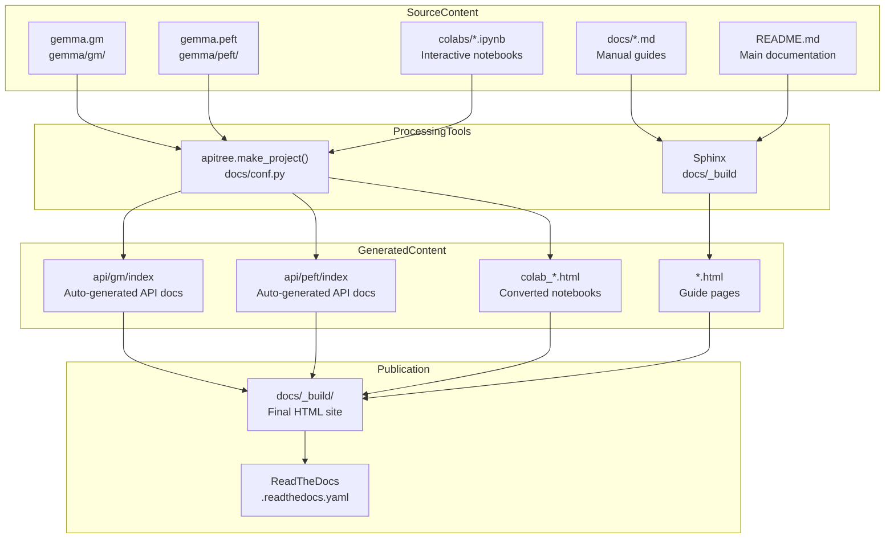
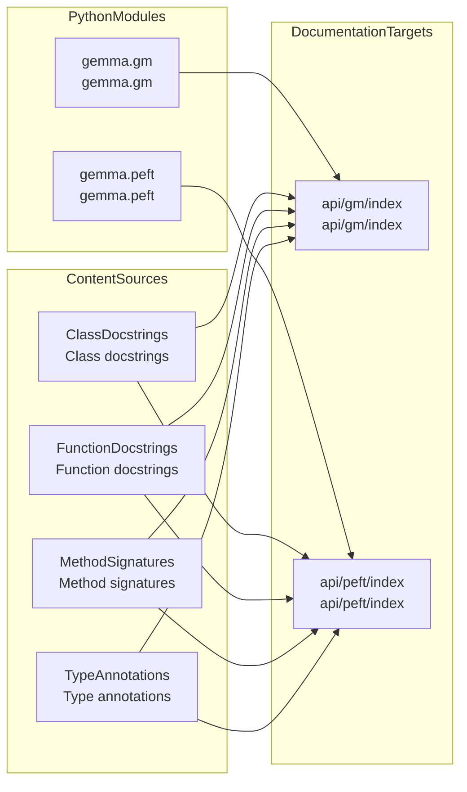
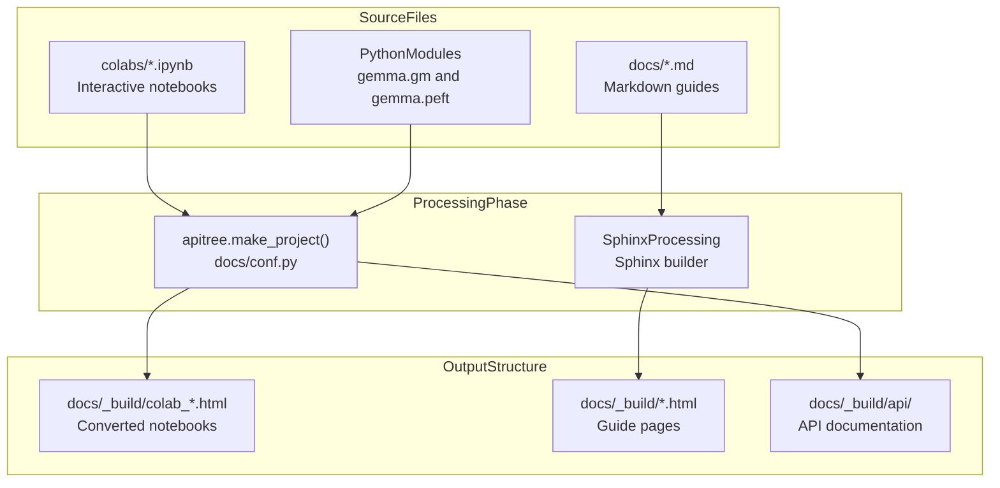

<!-- source: DeepWiki mcp.deepwiki.com · repo google-deepmind/gemma · page 8.3 Documentation System · fetched 2026-10-26 -->

# Documentation System

<details>
<summary>Relevant source files</summary>

The following files were used as context for generating this wiki page:

- [.readthedocs.yaml](.readthedocs.yaml)
- [docs/conf.py](docs/conf.py)
- [docs/finetuning.md](docs/finetuning.md)
- [docs/images/icon.svg](docs/images/icon.svg)
- [docs/index.md](docs/index.md)
- [docs/overview.md](docs/overview.md)
- [docs/requirements.txt](docs/requirements.txt)
- [docs/sampling.md](docs/sampling.md)
- [docs/tokenizer.md](docs/tokenizer.md)

</details>


## Purpose and Scope

The documentation system provides automated API reference generation, interactive tutorial integration, and comprehensive user guides for the Gemma library. This system combines Sphinx documentation generation with the `sphinx-apitree` extension to create a unified documentation experience that spans from low-level API references to hands-on Colab tutorials.

Sources: [docs/conf.py:15-24](), [docs/index.md:1-36]()

## Architecture Overview

The documentation system is built on Sphinx with custom tooling for automated content generation and Colab notebook integration. It leverages `apitree` to bridge the gap between Python source code and static documentation.

### Documentation Generation Pipeline

The following diagram bridges natural language documentation spaces with code entities like `apitree.make_project()` and module mappings in `docs/conf.py`.

Title: "Documentation Generation Pipeline"


Sources: [docs/conf.py:43-59](), [docs/index.md:1-36]()

### Content Organization Structure

The `docs/index.md` file defines the navigation structure via `toctree` directives, organizing content into Guides, Links, and API References [docs/index.md:3-33]().

Title: "Content Organization Structure"

```mermaid
graph TD
    subgraph "DocumentationRoot"
        A["docs/index.md<br/>docs/index.md"]
    end
    
    subgraph "InteractiveGuides"
        B["colab_sampling<br/>colab_sampling"]
        C["colab_multimodal<br/>colab_multimodal"]
        D["colab_finetuning<br/>colab_finetuning"]
        E["colab_tool_use<br/>colab_tool_use"]
        F["colab_sharding<br/>colab_sharding"]
        G["colab_tokenizer<br/>colab_tokenizer"]
        H["colab_lora_sampling<br/>colab_lora_sampling"]
        I["colab_lora_finetuning<br/>colab_lora_finetuning"]
    end
    
    subgraph "ReferenceGuides"
        J["peft.md<br/>gemma/peft/README.md"]
        K["checkpoints.md<br/>checkpoints"]
        L["research.md<br/>research"]
        S["sampling.md<br/>sampling"]
        FT["finetuning.md<br/>finetuning"]
        TK["tokenizer.md<br/>tokenizer"]
    end
    
    subgraph "APIReference"
        M["api/gm/index<br/>gemma.gm API"]
        N["api/peft/index<br/>gemma.peft API"]
    end
    
    subgraph "ExternalLinks"
        O["GitHubRepository<br/>GitHub"]
        P["IssueTracker<br/>Issues"]
        Q["GemmaEcosystem<br/>Ecosystem"]
    end
    
    A --> B
    A --> C
    A --> D
    A --> E
    A --> F
    A --> G
    A --> H
    A --> I
    A --> J
    A --> K
    A --> L
    A --> S
    A --> FT
    A --> TK
    A --> M
    A --> N
    A --> O
    A --> P
    A --> Q
```


Sources: [docs/index.md:3-33](), [docs/sampling.md:1](), [docs/finetuning.md:1](), [docs/tokenizer.md:1]()

Sources: [docs/index.md:1-36]()

## Sphinx Configuration

The documentation generation is orchestrated through the `docs/conf.py` file, which uses the `apitree` library to automatically generate comprehensive API documentation.

### Core Configuration Elements

| Component | Purpose | Implementation |
|-----------|---------|----------------|
| `apitree.make_project()` | Main documentation generator | [docs/conf.py:43-59]() |
| `modules` mapping | Defines documented Python modules | [docs/conf.py:44-47]() |
| `includes_paths` | Maps source files to documentation | [docs/conf.py:50-55]() |
| `redirects` | Creates URL redirects for notebooks | [docs/conf.py:57]() |

The system documents two primary modules:
- `gm`: Mapped to `gemma.gm` [docs/conf.py:45]()
- `peft`: Mapped to `gemma.peft` [docs/conf.py:46]()

Sources: [docs/conf.py:43-59]()

## API Documentation Generation

The API documentation is automatically generated from Python docstrings using the `apitree` library, which creates comprehensive reference materials without manual maintenance.

### Module Documentation Mapping

Title: "Module Documentation Mapping"


Sources: [docs/conf.py:44-47]()

## Colab Integration System

The documentation system seamlessly integrates Jupyter notebooks from the `colabs/` directory, converting them into web-accessible tutorials while maintaining their interactive nature.

### Notebook Processing Pipeline

Ten Colab notebooks defined in `_COLABS_NAMES` [docs/conf.py:29-40]() are automatically processed and integrated into the documentation:

| Notebook | Documentation Page | Purpose |
|----------|-------------------|---------|
| `tool_use.ipynb` | `colab_tool_use.html` | External function integration |
| `finetuning.ipynb` | `colab_finetuning.html` | Standard model training |
| `lora_sampling.ipynb` | `colab_lora_sampling.html` | Efficient inference methods |
| `lora_finetuning.ipynb` | `colab_lora_finetuning.html` | Parameter-efficient training |
| `multimodal.ipynb` | `colab_multimodal.html` | Vision-language model usage |
| `quantization_aware_training.ipynb` | `colab_quantization_aware_training.html` | Quantized model training |
| `quantization_sampling.ipynb` | `colab_quantization_sampling.html` | Quantized model inference |
| `sampling.ipynb` | `colab_sampling.html` | Basic text generation |
| `sharding.ipynb` | `colab_sharding.html` | Multi-device model distribution |
| `tokenizer.ipynb` | `colab_tokenizer.html` | Text preprocessing utilities |

### Redirect System

The system implements automatic redirects from simple names to prefixed notebook pages, allowing clean URLs while maintaining the `colab_` prefix convention for generated content. This is configured via the `redirects` argument in `apitree.make_project` [docs/conf.py:57]().

Sources: [docs/conf.py:29-40](), [docs/conf.py:50-57]()

## ReadTheDocs Configuration

The project uses ReadTheDocs for hosting. The configuration is managed via `.readthedocs.yaml` [.readthedocs.yaml:1-21]().

### Build Environment
- **OS**: Ubuntu 22.04 [.readthedocs.yaml:7]()
- **Python**: 3.13 [.readthedocs.yaml:9]()
- **Sphinx Config**: `docs/conf.py` [.readthedocs.yaml:13]()

### Dependency Management
Due to issues with `pip install .[docs]` in certain environments [.readthedocs.yaml:17](), dependencies are installed via a dedicated requirements file:
- `docs/requirements.txt`: Includes `sphinx-apitree[ext]` and `pytest` (required for fixtures in documentation) [docs/requirements.txt:1-2]().

Sources: [.readthedocs.yaml:1-21](), [docs/requirements.txt:1-2]()

## Build Process

The documentation build process transforms source content into publishable HTML documentation through a standardized workflow.

### Build Commands

To build locally, the following commands are used from the root directory:
```bash
pip install -e .[docs]
sphinx-build -b html docs/ docs/_build
```
Sources: [docs/conf.py:19-22]()

### File Processing Flow

Title: "File Processing Flow"


The build system automatically handles:
- Notebook conversion to HTML format via `includes_paths` [docs/conf.py:50-53]().
- API documentation extraction from docstrings.
- Mapping `gemma/peft/README.md` to `peft.md` [docs/conf.py:54]().
- Static asset processing (e.g., `docs/images/icon.svg`).

Sources: [docs/conf.py:17-24](), [docs/conf.py:43-59](), [docs/images/icon.svg:1-15]()

---

