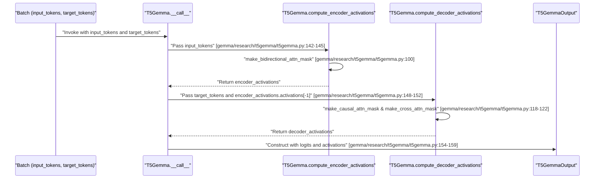
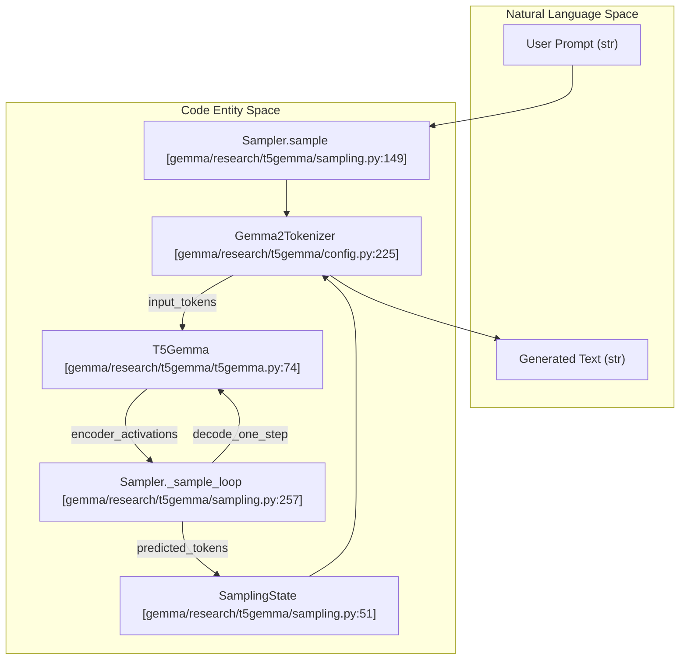
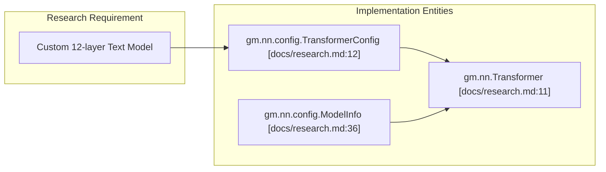

<!-- source: DeepWiki mcp.deepwiki.com · repo google-deepmind/gemma · page 8.4 Research Extensions · fetched 2026-10-26 -->

# Research Extensions

Relevant source files

The following files were used as context for generating this wiki page:

- [docs/research.md](docs/research.md)
- [gemma/gm/nn/_experimental.py](gemma/gm/nn/_experimental.py)
- [gemma/gm/testing/_dummy_model.py](gemma/gm/testing/_dummy_model.py)
- [gemma/gm/testing/_dummy_tokenizer.py](gemma/gm/testing/_dummy_tokenizer.py)
- [gemma/research/t5gemma/README.md](gemma/research/t5gemma/README.md)
- [gemma/research/t5gemma/__init__.py](gemma/research/t5gemma/__init__.py)
- [gemma/research/t5gemma/config.py](gemma/research/t5gemma/config.py)
- [gemma/research/t5gemma/modules.py](gemma/research/t5gemma/modules.py)
- [gemma/research/t5gemma/sampling.py](gemma/research/t5gemma/sampling.py)
- [gemma/research/t5gemma/t5gemma.py](gemma/research/t5gemma/t5gemma.py)

The `gemma/research/` directory contains non-official research projects and experimental architectures built on top of the Gemma framework. These extensions allow for exploring alternative model designs, such as encoder-decoder configurations, or creating custom transformer variants for specific research use cases [docs/research.md:41-47]().

## T5Gemma (Encoder-Decoder Gemma)

T5Gemma (aka encoder-decoder Gemma) is a family of large language models developed by adapting pretrained decoder-only models into an encoder-decoder framework [gemma/research/t5gemma/README.md:3-9](). The architecture is based on the T5 design but incorporates Gemma 2 advancements, including Grouped Query Attention (GQA), Rotary Positional Embeddings (RoPE), GeGLU activation, RMSNorm, and interleaved local/global attention [gemma/research/t5gemma/README.md:7-9]().

### Architecture Overview

The T5Gemma architecture consists of two distinct transformer stacks managed by `T5GemmaConfig` [gemma/research/t5gemma/t5gemma.py:45-50]():
1.  **Encoder**: A Gemma-based stack configured for bidirectional attention (`bidirectional=True`) [gemma/research/t5gemma/config.py:201-204]().
2.  **Decoder**: A Gemma-based stack configured for causal self-attention and cross-attention (`enable_cross_attention=True`) to attend to the encoder's final activations [gemma/research/t5gemma/config.py:205-208]().

For imbalanced configurations, such as the `GEMMA2_9B_2B` variant (9B encoder, 2B decoder), the decoder's `kv_embed_dim` is explicitly set to match the encoder's `embed_dim` to enable cross-attention [gemma/research/t5gemma/config.py:214-220]().

Sources: [gemma/research/t5gemma/README.md:3-9](), [gemma/research/t5gemma/t5gemma.py:45-50](), [gemma/research/t5gemma/config.py:201-220]()

### Data Flow and Model Logic

The `T5Gemma` class (an `nn.Module`) coordinates the interaction between the encoder and decoder during the forward pass [gemma/research/t5gemma/t5gemma.py:74-85]().

#### T5Gemma Call Sequence
The following diagram illustrates the token flow through the encoder and decoder components within the `T5Gemma.__call__` method.

**Sequence Diagram: T5Gemma Execution Flow**

Sources: [gemma/research/t5gemma/t5gemma.py:133-160](), [gemma/research/t5gemma/t5gemma.py:95-107](), [gemma/research/t5gemma/t5gemma.py:110-130]()

### Key Classes and Modules

| Class / Function | File Path | Description |
| :--- | :--- | :--- |
| `T5Gemma` | [gemma/research/t5gemma/t5gemma.py:74]() | Main Flax module composing the encoder and decoder. |
| `T5GemmaConfig` | [gemma/research/t5gemma/t5gemma.py:45]() | Configuration container for encoder and decoder `TransformerConfig`. |
| `Attention` | [gemma/research/t5gemma/modules.py:75]() | Specialized attention module supporting both self-attention and cross-attention. |
| `T5GemmaPreset` | [gemma/research/t5gemma/config.py:181]() | Enum defining standard model sizes and preset configurations. |
| `Sampler` | [gemma/research/t5gemma/sampling.py:104]() | Specialized sampler for T5Gemma's encoder-decoder inference loop. |

Sources: [gemma/research/t5gemma/t5gemma.py:45-85](), [gemma/research/t5gemma/modules.py:75-132](), [gemma/research/t5gemma/config.py:181-221]()

## Research Sampling Interface

The T5Gemma research extension includes a standalone `Sampler` class [gemma/research/t5gemma/sampling.py:104](). This sampler is designed for the encoder-decoder workflow: the encoder processes the input prompt once, and the decoder generates tokens autoregressively using cross-attention and a `decode_one_step` method [gemma/research/t5gemma/t5gemma.py:162-184]().

**Component Interaction: T5Gemma Sampling**

Sources: [gemma/research/t5gemma/sampling.py:149-219](), [gemma/research/t5gemma/sampling.py:257-270](), [gemma/research/t5gemma/t5gemma.py:162-184]()

## Custom Transformer Development

Researchers can define custom transformer architectures by inheriting from `gm.nn.Transformer` and providing a tailored `TransformerConfig` [docs/research.md:3-11]().

### Experimental Models
The codebase includes pre-defined experimental models such as `Gemma3_500m`:
*   **Architecture**: Uses 22 layers with 896 embedding dimensions [gemma/gm/nn/_experimental.py:22-38]().
*   **Normalization**: Implements `use_post_attn_norm`, `use_post_ffw_norm`, and `use_qk_norm` [gemma/gm/nn/_experimental.py:33-35]().
*   **Attention**: Utilizes interleaved global and sliding window attention via the `GEMMA3_ATTENTION_PATTERN` [gemma/gm/nn/_experimental.py:36-39]().

**Entity Mapping: Custom Transformer Definition**

Sources: [docs/research.md:3-39](), [gemma/gm/nn/_experimental.py:22-51]()

---

