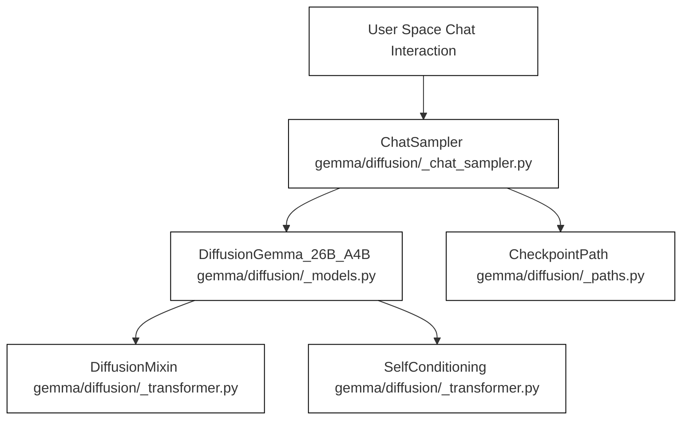
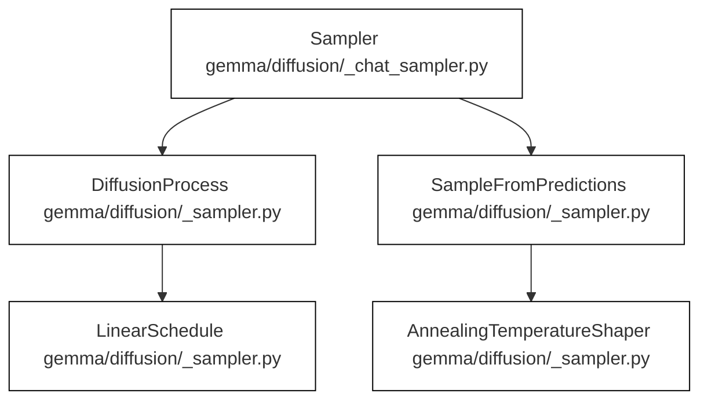

<!-- source: DeepWiki mcp.deepwiki.com · repo google-deepmind/gemma · page 9 Diffusion Gemma · fetched 2026-10-26 -->

# Diffusion Gemma

Relevant source files

The following files were used as context for generating this wiki page:

- [gemma/diffusion/__init__.py](gemma/diffusion/__init__.py)
- [gemma/diffusion/_chat_sampler_test.py](gemma/diffusion/_chat_sampler_test.py)
- [gemma/diffusion/_models.py](gemma/diffusion/_models.py)
- [gemma/diffusion/_paths.py](gemma/diffusion/_paths.py)

The `gemma/diffusion` package provides support for diffusion-based (non-autoregressive) text generation within the Gemma ecosystem. Unlike standard autoregressive sampling, Diffusion Gemma utilizes iterative denoising processes over a fixed-length text canvas, managed via specialized classes like `DiffusionGemma_26B_A4B` [gemma/diffusion/_models.py:21-23]() and exposed through a clean public API in `gemma/diffusion/__init__.py` [gemma/diffusion/__init__.py:15-52]().

This page serves as a high-level parent overview of the diffusion package, linking to detailed child pages for sampling internals, early stopping strategies, and fine-tuning adapters.

---

## 9.1. Public API and Model Definitions

The public-facing entry points for the diffusion package are centralized in `gemma/diffusion/__init__.py` [gemma/diffusion/__init__.py:22-52](). Users interact with Diffusion Gemma primarily through the model class `DiffusionGemma_26B_A4B` [gemma/diffusion/_models.py:21-23](), checkpoint enum registries `CheckpointPath` [gemma/diffusion/_paths.py:20-25](), and generation wrappers like `ChatSampler` [gemma/diffusion/__init__.py:30-31]().

The model architecture extends `Gemma4_26B_A4B` via `DiffusionMixin` [gemma/diffusion/_models.py:21-23]() and integrates a self-conditioning conditioner module during setup [gemma/diffusion/_models.py:33-42]().

Sources: [gemma/diffusion/__init__.py:1-52](), [gemma/diffusion/_models.py:15-42](), [gemma/diffusion/_paths.py:15-25]()

---

## 9.2. Diffusion Sampling

Diffusion sampling handles the non-autoregressive generation loop, transforming noise or partial tokens into coherent text sequences over a predefined canvas length.

Key components involved in diffusion sampling include:
- **`DiffusionProcess` and `LinearSchedule`**: Manage the noise schedules and forward/reverse diffusion steps [gemma/diffusion/__init__.py:34-35]().
- **`SampleFromPredictions`**: Performs confidence-based token selection and filtering using entropy bounds [gemma/diffusion/_chat_sampler_test.py:76-80]().
- **`AnnealingTemperatureShaper`**: Dynamically adjusts logits temperatures across denoising steps [gemma/diffusion/__init__.py:39-40]().
- **`DiffusionMixin` and `SelfConditioning`**: Transformer modifications that support iterative refinement given previous network predictions [gemma/diffusion/__init__.py:43-45]().

For deep technical details, implementation specifics, and execution flows, see [Diffusion Sampling](#9.1).

Sources: [gemma/diffusion/__init__.py:33-46](), [gemma/diffusion/_chat_sampler_test.py:45-97]()

---

## 9.3. Early Stopping Strategies

To optimize denoising compute and avoid unnecessary steps once token stability has been reached, the diffusion framework implements configurable early stopping criteria. 

The strategy interface is defined by `EarlyStopFn` [gemma/diffusion/__init__.py:48](), with concrete implementations including:
- **`NoEarlyStop`**: Runs all configured denoising steps without truncation [gemma/diffusion/__init__.py:49]().
- **`TokenStabilityEarlyStop`**: Halts iteration when generated token assignments remain stable across successive steps [gemma/diffusion/__init__.py:50]().
- **`EntropyEarlyStop`**: Terminates denoising when the predictive entropy drops below a specific threshold [gemma/diffusion/__init__.py:51]().
- **`ChainedEarlyStop`**: Combines multiple stopping conditions sequentially (e.g., stability combined with entropy boundaries) [gemma/diffusion/__init__.py:52](), [gemma/diffusion/_chat_sampler_test.py:82-96]().

For detailed configuration parameters and custom early stop definitions, see [Early Stopping Strategies](#9.2).

Sources: [gemma/diffusion/__init__.py:47-52](), [gemma/diffusion/_chat_sampler_test.py:82-96]()

---

## 9.4. Hackable Diffusion Adapter

The `gemma/diffusion/hackable_diffusion_adapter` directory contains specialized wrappers, dataset handlers, and configuration pipelines designed for fine-tuning Diffusion Gemma models on downstream tasks (such as PubMedQA and Sudoku generation). 

The module covers:
- The Hackable Diffusion (HD) network wrapper and SFT model configurations.
- Autoregressive (AR) state handlers for hybrid training scenarios.
- Kauldron-based training and evaluation configs, along with data preparation scripts and text evaluation metric frameworks.

For exhaustive documentation on datasets, task evaluators, and fine-tuning execution commands, see [Hackable Diffusion Adapter](#9.3).

Sources: [gemma/diffusion/__init__.py:1-52]()

---

