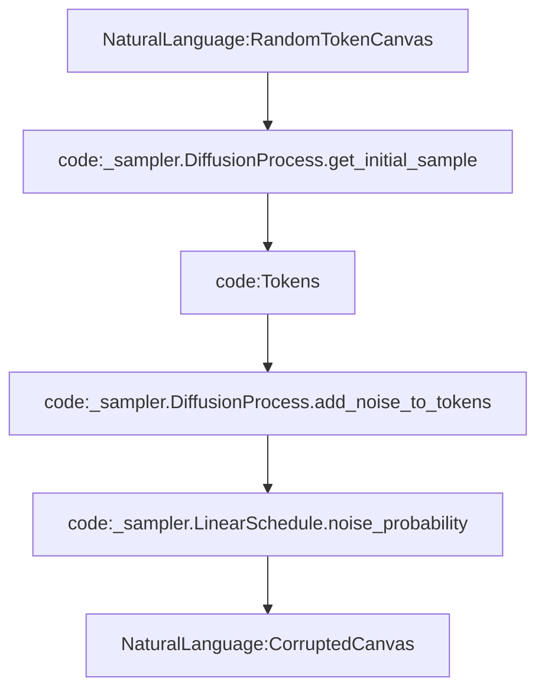
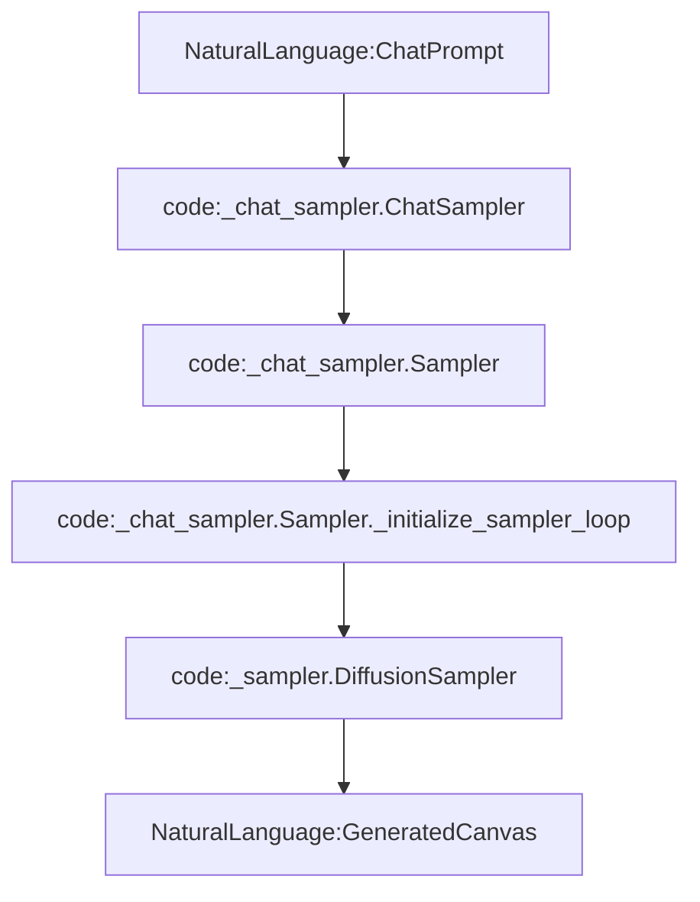
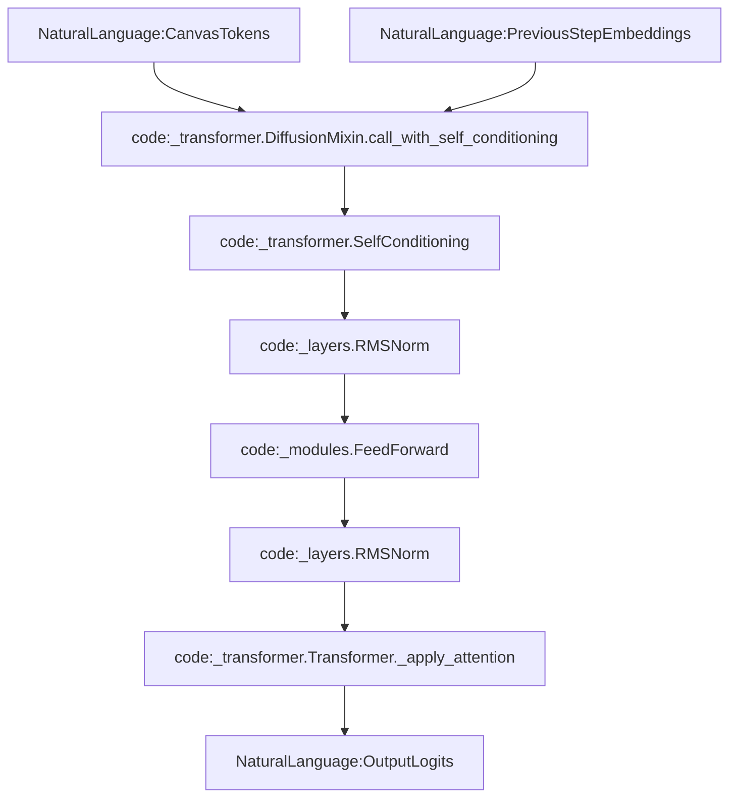

<!-- source: DeepWiki mcp.deepwiki.com · repo google-deepmind/gemma · page 9.1 Diffusion Sampling · fetched 2026-10-26 -->

# Diffusion Sampling

Relevant source files

The following files were used as context for generating this wiki page:

- [gemma/diffusion/_chat_sampler.py](gemma/diffusion/_chat_sampler.py)
- [gemma/diffusion/_early_stopping.py](gemma/diffusion/_early_stopping.py)
- [gemma/diffusion/_sampler.py](gemma/diffusion/_sampler.py)
- [gemma/diffusion/_sampler_test.py](gemma/diffusion/_sampler_test.py)
- [gemma/diffusion/_transformer.py](gemma/diffusion/_transformer.py)
- [gemma/diffusion/hackable_diffusion_adapter/checkpointed_evaluator.py](gemma/diffusion/hackable_diffusion_adapter/checkpointed_evaluator.py)
- [gemma/diffusion/hackable_diffusion_adapter/eval_main.py](gemma/diffusion/hackable_diffusion_adapter/eval_main.py)

## Purpose and Scope

This document details the non-autoregressive text generation system implemented in `gemma/diffusion/`. It covers the core mathematical and probabilistic components (`LinearSchedule`, `DiffusionProcess`, `SampleFromPredictions`), temperature shaping (`AnnealingTemperatureShaper`), the execution loops (`Sampler` and `ChatSampler`), and the underlying neural network integration (`DiffusionMixin` and `SelfConditioning`).

---

## 1. Noise Schedules and Diffusion Processes

The diffusion sampling pipeline replaces autoregressive token-by-token decoding with iterative refinement over a fixed-length token canvas. The noise schedule and corruption dynamics are managed by `LinearSchedule` and `DiffusionProcess`.

`LinearSchedule` defines a linear noise probability function and its analytical derivative with respect to noise proportion `[gemma/diffusion/_sampler.py:43-52]()`. `DiffusionProcess` applies this schedule to initialize random token canvases or add noise during training and inference `[gemma/diffusion/_sampler.py:55-103]()`.

*Figure 1: Diffusion process initialization and noise application.*

Sources: `[gemma/diffusion/_sampler.py:43-103]()`

---

## 2. Prediction Sampling and Confidence-Based Filtering

Once the denoiser model outputs logits for a given canvas, `SampleFromPredictions` selects high-confidence tokens and renoises uncertain positions `[gemma/diffusion/_sampler.py:105-187]()`.

`SampleFromPredictions` calculates per-token entropy from the predicted log probabilities, sorts the sequence by entropy in ascending order, and computes cumulative entropy to determine an acceptance mask based on `entropy_bound` `[gemma/diffusion/_sampler.py:151-166]()`. Non-selected positions are re-seeded with uniform random tokens up to `text_vocab_size` `[gemma/diffusion/_sampler.py:176-184]()`.

Sources: `[gemma/diffusion/_sampler.py:105-187]()`

---

## 3. Temperature Shaping and Annealing

Logits produced by the denoiser are modulated during the denoising trajectory using temperature shaping adapters. `AnnealingTemperatureShaper` (configured via `AnnealingTemperatureShaperConfig`) adjusts sampling randomness across denoising steps, ensuring high exploration early in the trajectory and precise convergence near the final step `[gemma/diffusion/_chat_sampler.py:51-55](), [gemma/diffusion/_sampler_test.py:224]()`.

Sources: `[gemma/diffusion/_chat_sampler.py:51-55](), [gemma/diffusion/_sampler_test.py:224]()`

---

## 4. Diffusion Sampler and ChatSampler APIs

The diffusion interface mirrors the standard autoregressive text generation architecture while introducing block-wise diffusion loops. 

`Sampler` overrides `_initialize_sampler_loop` to instantiate a `DiffusionSampler` equipped with stop tokens, forbidden tokens, diffusion processes, and early stopping rules `[gemma/diffusion/_chat_sampler.py:27-107]()`. `ChatSampler` provides the conversational wrapper, translating multi-turn dialogue histories into canvas-based inputs processed by the underlying diffusion sampler `[gemma/diffusion/_chat_sampler.py:109-176]()`.

*Figure 2: ChatSampler and Sampler dispatch hierarchy bridging natural language prompts to diffusion execution loops.*

Sources: `[gemma/diffusion/_chat_sampler.py:27-176]()`

---

## 5. Transformer Integration: DiffusionMixin and SelfConditioning

To condition each denoising step on the outputs of the previous iteration, `DiffusionMixin` and `SelfConditioning` modify the standard transformer forward pass `[gemma/diffusion/_transformer.py:34-190]()`.

`SelfConditioning` uses a pre-norm, a feed-forward block (`FeedForward`), and a scale-free post-norm to merge canvas embeddings with the previous step's self-conditioning signal (`sc_embeddings`) `[gemma/diffusion/_transformer.py:53-79]()`. `DiffusionMixin` provides `call_with_self_conditioning`, which intercepts token embedding lookups, applies dtype restrictions (preserving multi-modal parameters in `float32`), injects zero-initialized or cached self-conditioning signals, executes attention layers, and applies final logit soft-capping `[gemma/diffusion/_transformer.py:81-190]()`.

*Figure 3: Transformer forward pass execution flow with self-conditioning integration.*

Sources: `[gemma/diffusion/_transformer.py:34-190]()`

---

