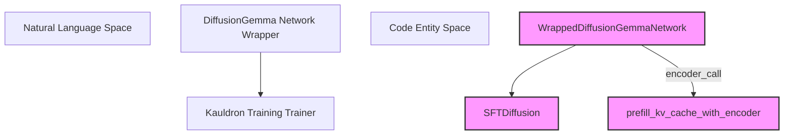
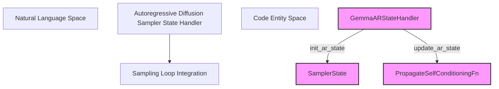

<!-- source: DeepWiki mcp.deepwiki.com · repo google-deepmind/gemma · page 9.3 Hackable Diffusion Adapter · fetched 2026-10-26 -->

# Hackable Diffusion Adapter

<details>
<summary>Relevant source files</summary>

The following files were used as context for generating this wiki page:

- [gemma/diffusion/hackable_diffusion_adapter/README.md](gemma/diffusion/hackable_diffusion_adapter/README.md)
- [gemma/diffusion/hackable_diffusion_adapter/configs/sft_pubmedqa.py](gemma/diffusion/hackable_diffusion_adapter/configs/sft_pubmedqa.py)
- [gemma/diffusion/hackable_diffusion_adapter/configs/sft_sudoku.py](gemma/diffusion/hackable_diffusion_adapter/configs/sft_sudoku.py)
- [gemma/diffusion/hackable_diffusion_adapter/configs/sft_sudoku_full.py](gemma/diffusion/hackable_diffusion_adapter/configs/sft_sudoku_full.py)
- [gemma/diffusion/hackable_diffusion_adapter/hd/hd_gemma_ar_state_handler.py](gemma/diffusion/hackable_diffusion_adapter/hd/hd_gemma_ar_state_handler.py)
- [gemma/diffusion/hackable_diffusion_adapter/hd/hd_gemma_network.py](gemma/diffusion/hackable_diffusion_adapter/hd/hd_gemma_network.py)
- [gemma/diffusion/hackable_diffusion_adapter/hd/sft_model.py](gemma/diffusion/hackable_diffusion_adapter/hd/sft_model.py)
- [gemma/diffusion/hackable_diffusion_adapter/hd/sft_model_test.py](gemma/diffusion/hackable_diffusion_adapter/hd/sft_model_test.py)

</details>


## Purpose and Scope

The `gemma/diffusion/hackable_diffusion_adapter` package provides integration between the `DiffusionGemma` architecture and the external `Hackable Diffusion` (HD) library. It enables supervised fine-tuning (SFT) and autoregressive diffusion sampling using Kauldron-based training pipelines. 

This page serves as a high-level overview of the adapter's core architectural components, configuration management, and execution commands. For details on dataset preparation pipelines, see [Adapter Datasets](#9.3.1). For evaluation metrics and execution scripts, see [Adapter Evaluation](#9.3.2).

Sources: `gemma/diffusion/hackable_diffusion_adapter/README.md:1-5`()

---

## Core Architecture and Components

The adapter architecture bridges Gemma transformer models with discrete diffusion processes by wrapping models into HD-compatible interfaces, managing autoregressive canvas states, and structuring training losses.

### HD Network Wrapper

The `WrappedDiffusionGemmaNetwork` class wraps a `DiffusionGemma` model to conform to the Hackable Diffusion `DiffusionNetwork` protocol [gemma/diffusion/hackable_diffusion_adapter/hd/hd_gemma_network.py:115-126](). It initializes the KV cache (`init_cache`), runs encoder prefill passes (`encoder_call`), and executes denoiser forward passes (`__call__`) with optional self-conditioning.


*Figure 1: Bridging Diffusion Gemma network definitions to code entities.*

Sources: `gemma/diffusion/hackable_diffusion_adapter/hd/hd_gemma_network.py:115-206`()

### SFT Model and Losses

The supervised fine-tuning model is defined by `SFTDiffusion` in `sft_model.py`, supporting prompt prefill and multi-canvas denoising [gemma/diffusion/hackable_diffusion_adapter/hd/sft_model.py:40-156](). Training combines discrete diffusion losses (`NoWeightDiscreteLoss`) for the decoder canvases with autoregressive sequence losses (`EncoderARLoss`) for the encoder output [gemma/diffusion/hackable_diffusion_adapter/configs/sft_sudoku.py:113-127]().

Sources: `gemma/diffusion/hackable_diffusion_adapter/hd/sft_model.py:40-140()`, `gemma/diffusion/hackable_diffusion_adapter/configs/sft_sudoku.py:113-127()`

### AR State Handler

`GemmaARStateHandler` implements the autoregressive diffusion sampling lifecycle using Gemma's right-pad convention [gemma/diffusion/hackable_diffusion_adapter/hd/hd_gemma_ar_state_handler.py:73-122](). It manages state initialization, cache prefill, canvas token generation, stop-token truncation, and late-binding parameter updates from Kauldron contexts via `update_from_context`.


*Figure 2: AR State handler mapping to code structures.*

Sources: `gemma/diffusion/hackable_diffusion_adapter/hd/hd_gemma_ar_state_handler.py:73-122()`

---

## Kauldron Configurations

The package provides flat Kauldron configuration files that encapsulate model definitions, optimizers, FSDP sharding strategies, data loaders, and evaluation routines.

| Config File | Target Dataset | Optimization Strategy | Key Hyperparameters |
| :--- | :--- | :--- | :--- |
| `sft_sudoku.py` [gemma/diffusion/hackable_diffusion_adapter/configs/sft_sudoku.py]() | Sudoku | LoRA (Rank 8) | Peak LR: `1.5e-4`, Prompt Len: `256`, Canvas: `1x256` |
| `sft_sudoku_full.py` [gemma/diffusion/hackable_diffusion_adapter/configs/sft_sudoku_full.py]() | Sudoku | Full Weight Updates | Peak LR: `1.5e-4`, Prompt Len: `256`, Canvas: `1x256` |
| `sft_pubmedqa.py` [gemma/diffusion/hackable_diffusion_adapter/configs/sft_pubmedqa.py]() | PubMedQA | LoRA (Rank 4) | Peak LR: `1.0e-4`, Prompt Len: `1024`, Canvas: `2x128` |

Sources: `gemma/diffusion/hackable_diffusion_adapter/configs/sft_sudoku.py:45-190()`, `gemma/diffusion/hackable_diffusion_adapter/configs/sft_pubmedqa.py:64-192()`, `gemma/diffusion/hackable_diffusion_adapter/configs/sft_sudoku_full.py:104-195()`

---

## Setup, Training, and Evaluation Commands

### Environment and Installation

We recommend Python 3.12 and CUDA 13. Install the library and compatible JAX dependencies:

```bash
pip install .
pip install -U jax[cuda13]
```

Sources: `gemma/diffusion/hackable_diffusion_adapter/README.md:8-38`()

### Training Command Examples

To run training workflows using Kauldron, execute with environment flags to avoid compilation hangs:

```bash
env XLA_FLAGS="--xla_disable_hlo_passes=constant_folding" \
    NCCL_ALGO="Ring" \
    NCCL_PROTO="LL128" \
    NCCL_NVLS_ENABLE="0" \
    NCCL_CUMEM_ENABLE="0" \
    python3 -m kauldron.main \
  --cfg=gemma/diffusion/hackable_diffusion_adapter/configs/sft_sudoku.py \
  --cfg.workdir=$(pwd)/xp_dir
```

Sources: `gemma/diffusion/hackable_diffusion_adapter/README.md:106-115`()

### Evaluation Command Example

Evaluation runs offline as a separate step using `eval_main.py`:

```bash
env XLA_FLAGS="--xla_disable_hlo_passes=constant_folding" \
    XLA_PYTHON_CLIENT_PREALLOCATE="false" \
    TF_FORCE_GPU_ALLOW_GROWTH="true" \
    python3 -m gemma.diffusion.hackable_diffusion_adapter.eval_main \
    --cfg=gemma/diffusion/hackable_diffusion_adapter/configs/sft_sudoku.py \
    --task=sudoku \
    --step=1000 \
    --eval_names=sample_ar_steps64 \
    --cfg.workdir=$(pwd)/xp_dir_sudoku_lora
```

Sources: `gemma/diffusion/hackable_diffusion_adapter/README.md:146-154`()

---

## Related Child Pages

- [Adapter Datasets](#9.3.1) — Details on dataset preparation scripts, JSONL converters, and Sudoku/PubMedQA data pipelines under `hackable_diffusion_adapter/data/`.
- [Adapter Evaluation](#9.3.2) — Documentation for `eval_main.py`, evaluator naming conventions, metrics, and task-specific evaluation modules.

---

