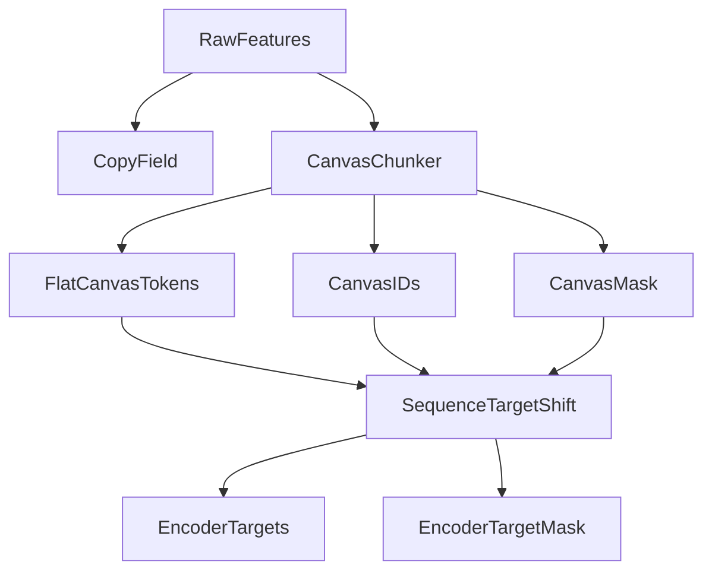
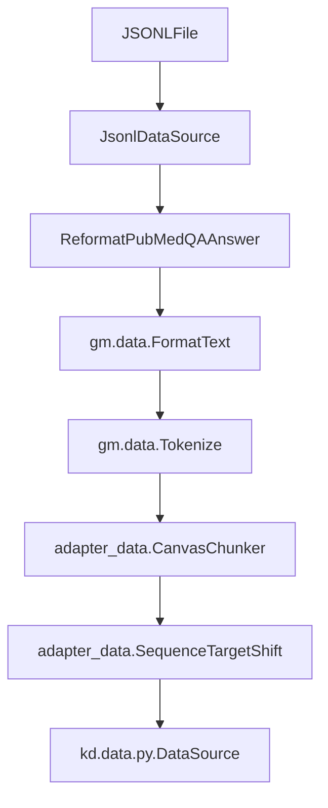
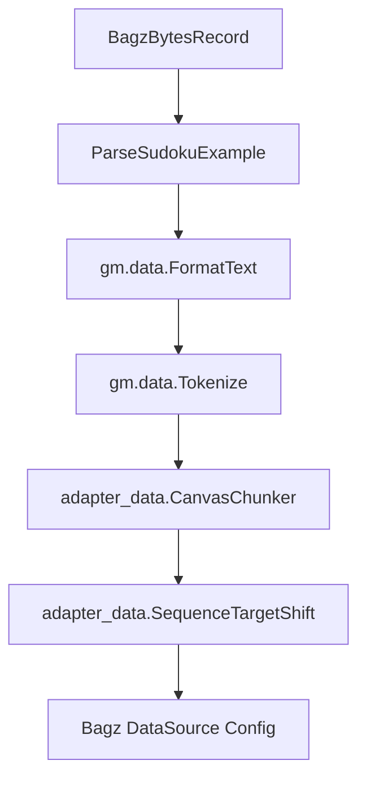

<!-- source: DeepWiki mcp.deepwiki.com · repo google-deepmind/gemma · extra page Adapter Datasets · fetched 2026-10-26 -->

# Adapter Datasets

Relevant source files

The following files were used as context for generating this wiki page:

- [gemma/diffusion/hackable_diffusion_adapter/data/README.md](gemma/diffusion/hackable_diffusion_adapter/data/README.md)
- [gemma/diffusion/hackable_diffusion_adapter/data/data.py](gemma/diffusion/hackable_diffusion_adapter/data/data.py)
- [gemma/diffusion/hackable_diffusion_adapter/data/pubmedqa/pubmedqa_data.py](gemma/diffusion/hackable_diffusion_adapter/data/pubmedqa/pubmedqa_data.py)
- [gemma/diffusion/hackable_diffusion_adapter/data/sudoku/sudoku_data.py](gemma/diffusion/hackable_diffusion_adapter/data/sudoku/sudoku_data.py)

## Purpose and Scope

The `gemma/diffusion/hackable_diffusion_adapter/data/` package contains data loading, preprocessing pipelines, custom data sources, and feature transforms for the Hackable Diffusion (HD) text fine-tuning framework. Because diffusion-based (non-autoregressive) generation operates on localized token blocks called "canvases", standard autoregressive text pipelines are insufficient. This package bridges standard datasets (such as PubMedQA and Sudoku) into the tensor structures required by the HD model, including canvas chunking, sequence target shifting, and instruction prompt formatting.

Sources:
- `gemma/diffusion/hackable_diffusion_adapter/data/README.md:1-33`()

---

## Shared Data Transforms

The core data manipulation primitives reside in `gemma/diffusion/hackable_diffusion_adapter/data/data.py`. These map classes inherit from `grain.MapTransform` and handle sequence reorganization, canvas tokenization formatting, and target shifts.

### Key Transform Classes

- **`CopyField`**: Copies an existing field in the feature dictionary to a new key. Useful for preserving raw strings before tokenization or mutation `[gemma/diffusion/hackable_diffusion_adapter/data/data.py:25-34]()`.
- **`CanvasChunker`**: Splits variable-length response token sequences into fixed-size canvas chunks. It generates flat canvas tokens, per-token canvas IDs, and a boolean canvas mask indicating valid versus padding canvases `[gemma/diffusion/hackable_diffusion_adapter/data/data.py:38-103]()`.
- **`SequenceTargetShift`**: Concatenates prompt and canvas token arrays, shifts the sequence forward by one position to generate `encoder_target`, and constructs a valid position mask (`encoder_target_mask`) avoiding cross-boundary pad leakage `[gemma/diffusion/hackable_diffusion_adapter/data/data.py:105-153]()`.
- **`ReformatPubMedQAAnswer`**: Appends structural answer markers (e.g., `"The answer is: {yes|no|maybe}"`) to PubMedQA response texts `[gemma/diffusion/hackable_diffusion_adapter/data/data.py:155-179]()`.

*Figure 1: Shared Data Transformation Pipeline*

Sources:
- `gemma/diffusion/hackable_diffusion_adapter/data/data.py:25-180`()

---

## PubMedQA Dataset Pipeline

The PubMedQA dataset pipeline (`gemma/diffusion/hackable_diffusion_adapter/data/pubmedqa/pubmedqa_data.py`) handles medical research abstracts, formatting questions, contexts, and answers for the HD text architecture.

### Implementation Details

- **`JsonlDataSource`**: Implements a standalone random-access data source adhering to the `grain.RandomAccessDataSource` protocol via structural typing (`__len__` and `__getitem__`). It reads JSONL files while safely splitting lines by `\n` to prevent scientific abstract vertical tabs (`\x0b`) or form feeds (`\x0c`) from breaking record boundaries `[gemma/diffusion/hackable_diffusion_adapter/data/pubmedqa/pubmedqa_data.py:27-54]()`.
- **`make_pubmedqa_ds`**: Constructs the Kauldron dataset pipeline using `Gemma4Tokenizer`. It renames fields, applies `ReformatPubMedQAAnswer`, formats prompt templates with system turns, tokenizes sequences, pads prompts, applies `CanvasChunker`, and computes `SequenceTargetShift` `[gemma/diffusion/hackable_diffusion_adapter/data/pubmedqa/pubmedqa_data.py:56-181]()`.

*Figure 2: PubMedQA Natural Language Space to Code Entity Space Pipeline*

Sources:
- `gemma/diffusion/hackable_diffusion_adapter/data/pubmedqa/pubmedqa_data.py:27-181`()

---

## Sudoku Dataset Pipeline

The Sudoku puzzle solving pipeline (`gemma/diffusion/hackable_diffusion_adapter/data/sudoku/sudoku_data.py`) processes grid-based sequence puzzles serialized via `bagz` and `tf.train.Example`.

### Implementation Details

- **`PicklableBagzReader`**: Wraps `bagz.Reader` in a picklable interface, clearing the underlying reader reference during `__getstate__` serialization to support multi-process data loading workers `[gemma/diffusion/hackable_diffusion_adapter/data/sudoku/sudoku_data.py:33-59]()`.
- **`Bagz`**: Extends `kd_base.DataSourceBase` to integrate `PicklableBagzReader` into Kauldron data configs, handling process sharding and global shuffling `[gemma/diffusion/hackable_diffusion_adapter/data/sudoku/sudoku_data.py:61-93]()`.
- **`ParseSudokuExample`**: Parses raw `tf.train.Example` bytes into puzzle and solution string pairs `[gemma/diffusion/hackable_diffusion_adapter/data/sudoku/sudoku_data.py:95-108]()`.
- **`make_sudoku_ds`**: Builds the complete Sudoku dataset pipeline, configuring prompt templates that instruct the model to output a 9x9 space-separated grid without chain-of-thought tokens, applying tokenization, padding, and canvas chunking `[gemma/diffusion/hackable_diffusion_adapter/data/sudoku/sudoku_data.py:119-208]()`.

*Figure 3: Sudoku Data Processing Mapping to Code Entities*

Sources:
- `gemma/diffusion/hackable_diffusion_adapter/data/sudoku/sudoku_data.py:33-208`()

---

