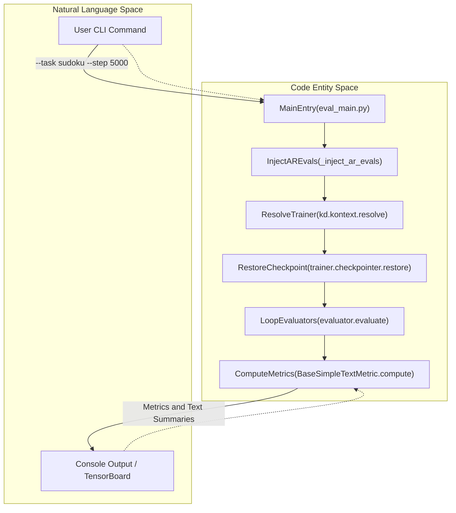
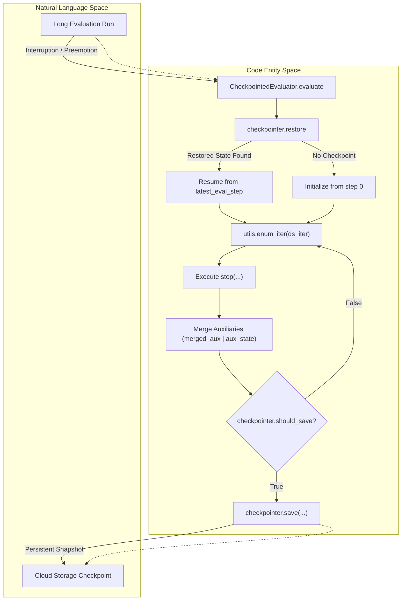

<!-- source: DeepWiki mcp.deepwiki.com · repo google-deepmind/gemma · extra page Adapter Evaluation · fetched 2026-10-26 -->

# Adapter Evaluation

Relevant source files

The following files were used as context for generating this wiki page:

- [gemma/diffusion/_chat_sampler.py](gemma/diffusion/_chat_sampler.py)
- [gemma/diffusion/_early_stopping.py](gemma/diffusion/_early_stopping.py)
- [gemma/diffusion/_sampler.py](gemma/diffusion/_sampler.py)
- [gemma/diffusion/_transformer.py](gemma/diffusion/_transformer.py)
- [gemma/diffusion/hackable_diffusion_adapter/checkpointed_evaluator.py](gemma/diffusion/hackable_diffusion_adapter/checkpointed_evaluator.py)
- [gemma/diffusion/hackable_diffusion_adapter/eval/ar_eval.py](gemma/diffusion/hackable_diffusion_adapter/eval/ar_eval.py)
- [gemma/diffusion/hackable_diffusion_adapter/eval/base_metric.py](gemma/diffusion/hackable_diffusion_adapter/eval/base_metric.py)
- [gemma/diffusion/hackable_diffusion_adapter/eval/pubmedqa_eval.py](gemma/diffusion/hackable_diffusion_adapter/eval/pubmedqa_eval.py)
- [gemma/diffusion/hackable_diffusion_adapter/eval/sudoku_eval.py](gemma/diffusion/hackable_diffusion_adapter/eval/sudoku_eval.py)
- [gemma/diffusion/hackable_diffusion_adapter/eval_main.py](gemma/diffusion/hackable_diffusion_adapter/eval_main.py)

This page documents the evaluation architecture for the Hackable Diffusion adapter within the Gemma codebase (`gemma/diffusion/hackable_diffusion_adapter/`). It covers the evaluation binary (`eval_main.py`), persistent state management via `CheckpointedEvaluator`, the metric framework (`base_metric.py`), autoregressive diffusion evaluation harness (`ar_eval.py`), and task-specific evaluators for Sudoku (`sudoku_eval.py`) and PubMedQA (`pubmedqa_eval.py`).

---

## 1. Evaluation Binary (`eval_main.py`)

The evaluation entry point `eval_main.py` runs autoregressive (AR) diffusion evaluations on a single saved checkpoint and reports task-specific metrics alongside text sample summaries.

### Command-Line Flags
The binary exposes several `absl` flags for configuration:
* `cfg`: Config file defining the training and evaluation environment `[gemma/diffusion/hackable_diffusion_adapter/eval_main.py:42-47]()`.
* `task`: Enum flag (`"sudoku"` or `"pubmedqa"`) determining task metrics `[gemma/diffusion/hackable_diffusion_adapter/eval_main.py:49-54]()`.
* `eval_names`: List of specific evaluations to run. Defaults to running all registered evaluators `[gemma/diffusion/hackable_diffusion_adapter/eval_main.py:56-60]()`.
* `step`: Checkpoint step integer to evaluate. If omitted, the latest checkpoint is restored `[gemma/diffusion/hackable_diffusion_adapter/eval_main.py:62-67]()`.

### Evaluation Injection and Execution Flow
The `main` routine initializes JAX devices, hides GPUs from TensorFlow to avoid memory contention, injects task-specific AR evaluators into the trainer configuration, and executes the evaluation loop `[gemma/diffusion/hackable_diffusion_adapter/eval_main.py:164-210]`.

*Sources: [gemma/diffusion/hackable_diffusion_adapter/eval_main.py:42-210]()*

---

## 2. Checkpointed Evaluator (`checkpointed_evaluator.py`)

To prevent loss of progress during long-running evaluations, `CheckpointedEvaluator` wraps Kauldron's base evaluator (`evaluators.Evaluator`) with checkpoint saving and restoration capabilities `[gemma/diffusion/hackable_diffusion_adapter/checkpointed_evaluator.py:94-98]()`.

### State Management Classes
* `EvalState`: Flax dataclass tracking merged auxiliary metrics and the current evaluation step number `[gemma/diffusion/hackable_diffusion_adapter/checkpointed_evaluator.py:68-74]()`.
* `EvalCheckpointerState`: Named tuple combined with `TopLevelCheckpointItem` holding both `EvalState` and the dataset iterator `[gemma/diffusion/hackable_diffusion_adapter/checkpointed_evaluator.py:76-91]()`.

### Stability Patches
`checkpointed_evaluator.py` includes monkey-patches for Orbax and JAX asynchronous execution to prevent NCCL deadlocks on NVLink during host transfers:
1. Wraps `orbax.checkpoint._src.serialization.replica_slices.transfer_arrays_to_host` to disable pinned host transfers (`enable_pinned_host_transfer = False`) `[gemma/diffusion/hackable_diffusion_adapter/checkpointed_evaluator.py:48-58]()`.
2. Finalizes GCS checkpoint paths cleanly by stubbing `ocp._src.path.step.is_path_finalized` `[gemma/diffusion/hackable_diffusion_adapter/checkpointed_evaluator.py:60-65]()`.

*Sources: [gemma/diffusion/hackable_diffusion_adapter/checkpointed_evaluator.py:68-198]()*

---

## 3. Metric Framework (`base_metric.py`, `text_metric`)

The metric framework handles deferred host-side detokenization and scoring for generative tasks.

### Base Metric Classes
* `BaseTokenizerMetric`: Abstract base class providing a cached SentencePiece vocabulary loader pointing to `gs://gemma-data/tokenizers/tokenizer_gemma4.model` and batch decoding utilities `[gemma/diffusion/hackable_diffusion_adapter/eval/base_metric.py:33-53]()`.
* `BaseTextMetric`: Inherits from `BaseTokenizerMetric` and defines required `tokens` and `ground_truth` context keys `[gemma/diffusion/hackable_diffusion_adapter/eval/base_metric.py:55-61]()`.
* `BaseSimpleTextMetric`: Collects raw token arrays across batches using `kd.metrics.concat_field()`. All scoring and detokenization are deferred to host-side execution in `compute()` `[gemma/diffusion/hackable_diffusion_adapter/eval/base_metric.py:63-94]`.

| Class / Component | Role / Responsibility | Key Methods |
| :--- | :--- | :--- |
| `BaseTokenizerMetric` | SentencePiece vocabulary management & host decoding | `decode_batch()`, `_squeeze_3d()` |
| `BaseTextMetric` | Binds token and ground truth context keys | Inherits from `BaseTokenizerMetric` |
| `BaseSimpleTextMetric` | Accumulates token arrays in `State` and defers scoring | `score_example()`, `get_state()` |
| `BaseSimpleTextMetric.State` | Concatenates accelerator states across batches | `compute()` |

*Sources: [gemma/diffusion/hackable_diffusion_adapter/eval/base_metric.py:33-112]()*

---

## 4. Task Evaluators (`ar_eval.py`, `sudoku_eval.py`, `pubmedqa_eval.py`)

### Autoregressive Diffusion Evaluation (`ar_eval.py`)
`make_ar_evals` constructs Kauldron `GemmaSamplingEvaluator` instances across defined denoising step counts (`AR_DENOISING_STEPS = [32, 64, 96]`) `[gemma/diffusion/hackable_diffusion_adapter/eval/ar_eval.py:31-44]`. It supports two execution modes:
* Standard DDIM sampling (`hd.sampling.DiffusionSampler`) `[gemma/diffusion/hackable_diffusion_adapter/eval/ar_eval.py:80-90]`
* Entropy-based early stopping (`hd.sampling.DiffusionSamplerWithEarlyStopping` with `hd.sampling.DiffusionEntropyEarlyStopFn`) `[gemma/diffusion/hackable_diffusion_adapter/eval/ar_eval.py:67-78]`

It also includes text sampling summaries via `text_metric.DetokenizePromptAndResponse` `[gemma/diffusion/hackable_diffusion_adapter/eval/ar_eval.py:115-121]`.

*Sources: [gemma/diffusion/hackable_diffusion_adapter/eval/ar_eval.py:31-130]()*

### Sudoku Evaluation (`sudoku_eval.py`)
Evaluates model-generated 81-digit Sudoku puzzles against ground-truth solutions.
* `ExtractionMode`: Supports `ExtractionMode.SFT` (searches for `"the answer is"` delimiter, falls back to last 81 digits) and `ExtractionMode.THINKING` (always extracts the last 81 digits) `[gemma/diffusion/hackable_diffusion_adapter/eval/sudoku_eval.py:36-48]`.
* `HardnessCategory`: Stratifies puzzles by unmasked clue counts into `ALL`, `EASY` ($\ge 40$), `MEDIUM` ($30 \le n < 40$), and `HARD` ($< 30$) `[gemma/diffusion/hackable_diffusion_adapter/eval/sudoku_eval.py:51-67]`.
* Scoring Functions: `exact_accuracy` and `partial_accuracy` (fraction of correctly infilled masked digits) `[gemma/diffusion/hackable_diffusion_adapter/eval/sudoku_eval.py:154-204]`.

*Sources: [gemma/diffusion/hackable_diffusion_adapter/eval/sudoku_eval.py:36-208]()*

### PubMedQA Evaluation (`pubmedqa_eval.py`)
Evaluates biomedical question answering extraction, accuracy, and BLEU scores.
* `extract_pubmedqa_answer`: Extracts `'yes'`, `'no'`, or `'maybe'` strictly matching the `"The answer is: {answer}"` structural marker to prevent false positives from conversational filler `[gemma/diffusion/hackable_diffusion_adapter/eval/pubmedqa_eval.py:26-53]`.
* `PubMedQAAccuracy`: Subclasses `BaseSimpleTextMetric` to compute exact match accuracy for short answers `[gemma/diffusion/hackable_diffusion_adapter/eval/pubmedqa_eval.py:73-84]`.
* `BLEUScore`: Computes smoothed sentence-level BLEU against long-answer reference text using `sacrebleu` `[gemma/diffusion/hackable_diffusion_adapter/eval/pubmedqa_eval.py:111-121]`.

*Sources: [gemma/diffusion/hackable_diffusion_adapter/eval/pubmedqa_eval.py:26-121]()*

---

