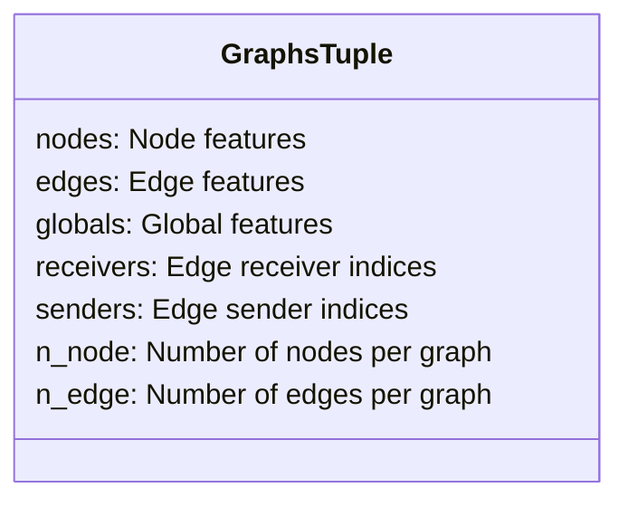
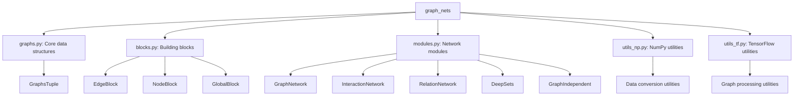
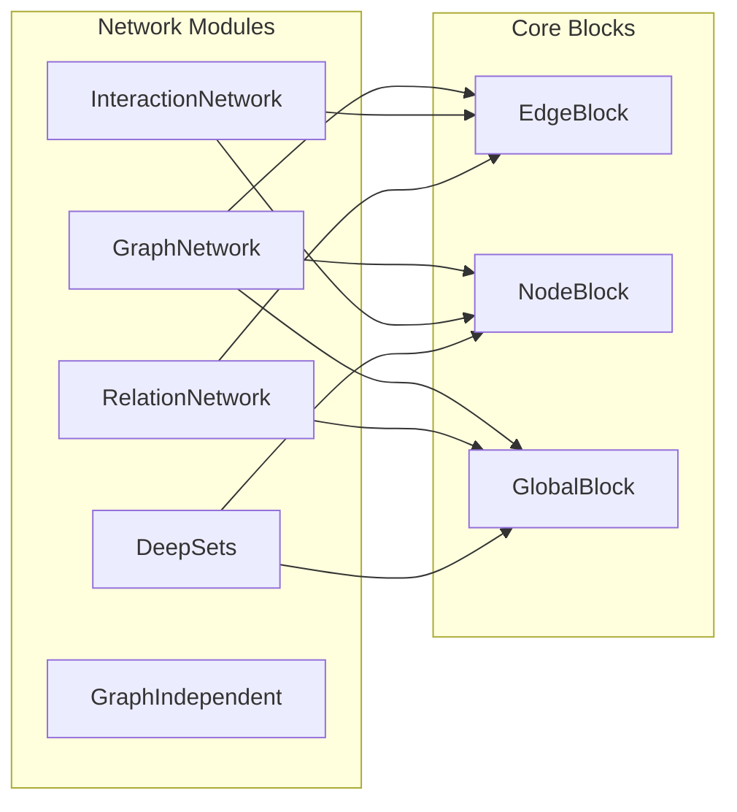
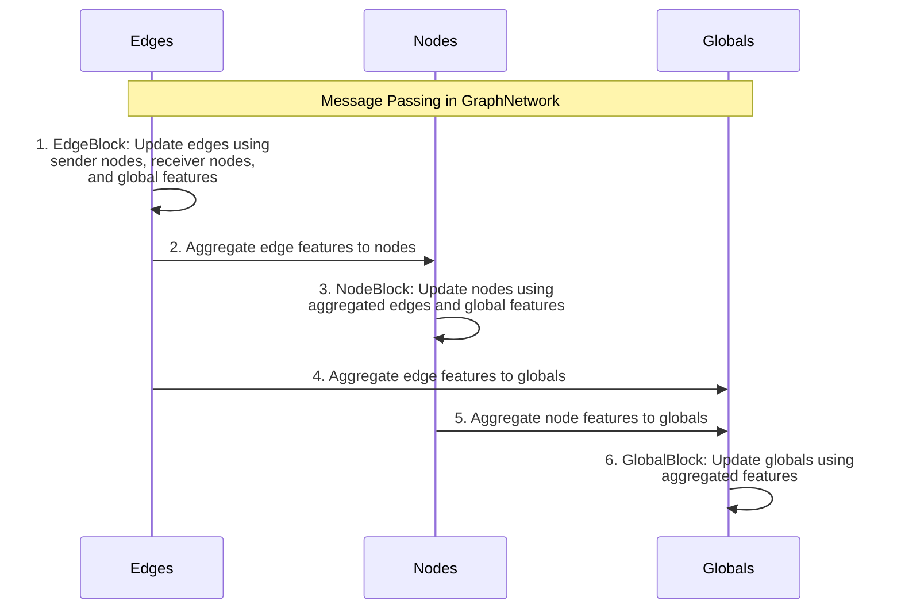
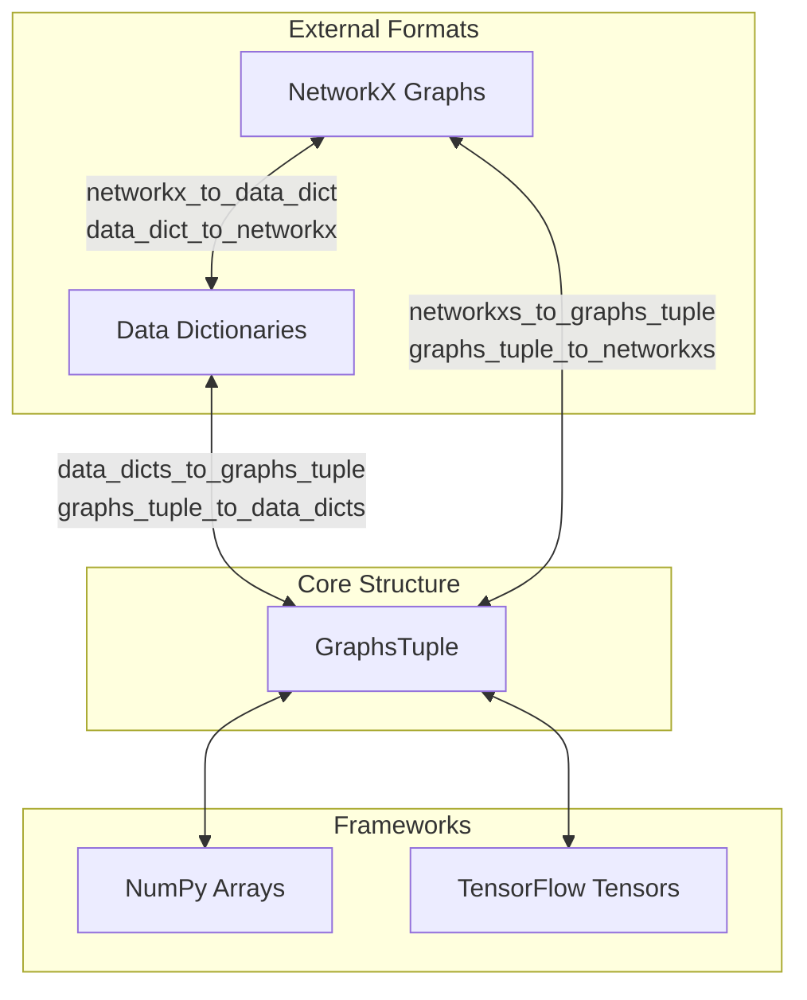
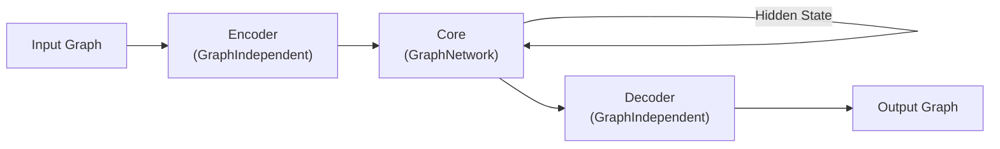

<!-- source: DeepWiki mcp.deepwiki.com · repo google-deepmind/graph_nets · page 1 Overview · fetched 2026-10-26 -->

# Overview

<details>
<summary>Relevant source files</summary>

The following files were used as context for generating this wiki page:

- [README.md](README.md)
- [docs/graph_nets.md](docs/graph_nets.md)
- [graph_nets/graphs.py](graph_nets/graphs.py)
- [graph_nets/utils_np.py](graph_nets/utils_np.py)
- [setup.py](setup.py)

</details>


Graph Nets is DeepMind's library for building graph networks in TensorFlow and Sonnet. This document provides a high-level introduction to the library's purpose, architecture, and core components.

## Purpose and Scope

The Graph Nets library enables the construction and training of Graph Neural Networks (GNNs), which are neural networks that operate on graph-structured data. The library is designed to:

1. Provide a flexible framework for implementing various types of graph neural networks
2. Support batched processing of multiple graphs with different shapes and sizes
3. Offer implementations for both NumPy and TensorFlow
4. Enable applications like shortest path finding, sorting, and physical simulation

Sources: [setup.py:24-27](), [README.md:5-6]()

## Core Concepts

A graph network takes a graph as input and returns a graph as output. The input graph has edge, node, and global attributes, while the output graph has the same structure but with updated attributes. Graph networks are part of the broader family of "graph neural networks."

```mermaid
flowchart LR
    subgraph "Graph Network"
        direction LR
        Input["Input Graph"] --> GN[["Graph Network Module"]]
        GN --> Output["Output Graph (same structure, updated features)"]
    end
    
    subgraph "Graph Structure"
        direction TB
        Nodes["Nodes (V)"]
        Edges["Edges (E)"]
        Globals["Globals (u)"]
    end
    
    Input -.-> Graph Structure
    Output -.-> Graph Structure
```

Sources: [README.md:10-15]()

## Core Data Structure: GraphsTuple

The central data structure of the library is the `GraphsTuple`, which represents batches of graphs with potentially different shapes and sizes. It contains the following fields:



- **nodes**: Features for each node across all graphs in the batch
- **edges**: Features for each edge across all graphs in the batch
- **globals**: Features for each graph in the batch
- **receivers**: Indices of receiver nodes for each edge
- **senders**: Indices of sender nodes for each edge
- **n_node**: Number of nodes in each graph
- **n_edge**: Number of edges in each graph

The `GraphsTuple` is implemented as a named tuple, making it compatible with TensorFlow operations and capable of being passed directly to and from `tensorflow.Session.run()` calls.

Sources: [graph_nets/graphs.py:16-102](), [graph_nets/graphs.py:125-147]()

## Library Architecture

The Graph Nets library is organized into several core modules:



Sources: [setup.py:28-36](), [README.md:62-76]()

## Building Blocks

The library follows a modular design with three primary building blocks:

1. **EdgeBlock**: Updates edge features based on edge, adjacent node, and global features
2. **NodeBlock**: Updates node features based on node, aggregated edge, and global features
3. **GlobalBlock**: Updates global features based on global, aggregated node, and aggregated edge features

These blocks are combined to create higher-level network modules, each implementing different message-passing approaches.



Sources: [docs/graph_nets.md:10-1063]()

## Message Passing

The core operation in graph neural networks is message passing between different components of the graph. In a typical GraphNetwork, the information flows as follows:



This message-passing approach allows information to flow between all components of the graph, enabling the model to learn complex patterns and relationships in graph-structured data.

Sources: [docs/graph_nets.md:10-1063]()

## Data Conversion Utilities

The library provides utilities for converting between different graph representations:



These conversion utilities make it easy to work with graphs from different sources and in different formats, providing a seamless interface between NetworkX graphs, data dictionaries, and the core GraphsTuple structure.

Sources: [graph_nets/utils_np.py:15-35](), [graph_nets/utils_np.py:117-568]()

## Encode-Process-Decode Architecture

A common pattern used in the library's demos is the Encode-Process-Decode architecture:



1. **Encoder**: Transforms the input graph into a latent representation using a GraphIndependent module
2. **Processor**: Iteratively refines this representation through multiple iterations of a GraphNetwork module
3. **Decoder**: Produces the final output graph

This architecture has been successfully applied to various tasks including shortest path finding, sorting lists, and simulating physical systems, demonstrating the versatility of graph neural networks.

Sources: [README.md:91-126]()

## Demonstration Applications

The library includes several demonstration applications that showcase its capabilities:

| Demo | Description | Application |
|------|-------------|-------------|
| Shortest Path | Predicts the shortest path between two nodes in a graph | Route planning, network optimization |
| Sort | Learns to sort a list of numbers | Algorithm learning |
| Physics | Predicts the state of a mass-spring physical system over time | Physical simulation |
| Graph Nets Basics | Tutorial on creating and manipulating graphs | Learning the library |

These demos illustrate how the same graph network architecture can be applied to diverse problems by changing the data representation and training objectives.

Sources: [README.md:79-152]()

## System Requirements and Installation

The Graph Nets library can be installed via pip and is compatible with:
- Linux/Mac OS X
- Python 2.7 and 3.4+
- TensorFlow 1.15+ or TensorFlow 2.1.0+
- Sonnet 1 or 2

For TensorFlow 1 and Sonnet 1:
```
pip install graph_nets "tensorflow>=1.15,<2" "dm-sonnet<2" "tensorflow_probability<0.9"
```

For TensorFlow 2 and Sonnet 2:
```
pip install graph_nets "tensorflow>=2.1.0-rc1" "dm-sonnet>=2.0.0b0" tensorflow_probability
```

Sources: [README.md:22-56](), [setup.py:27-62]()

---

