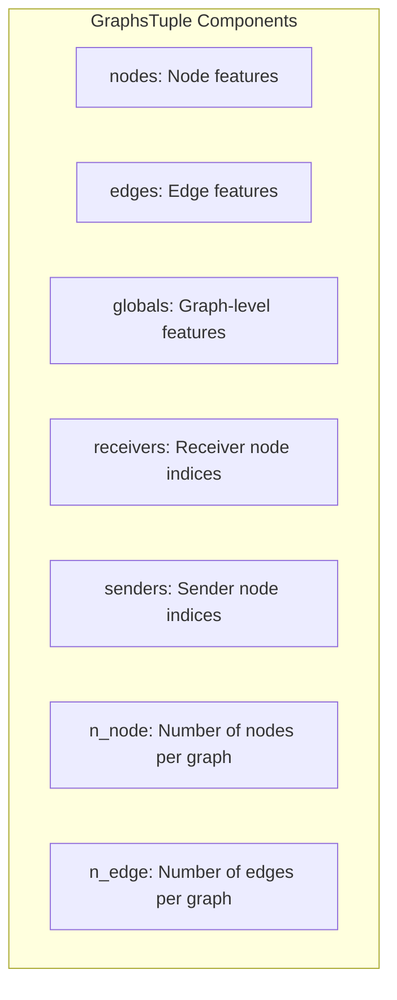
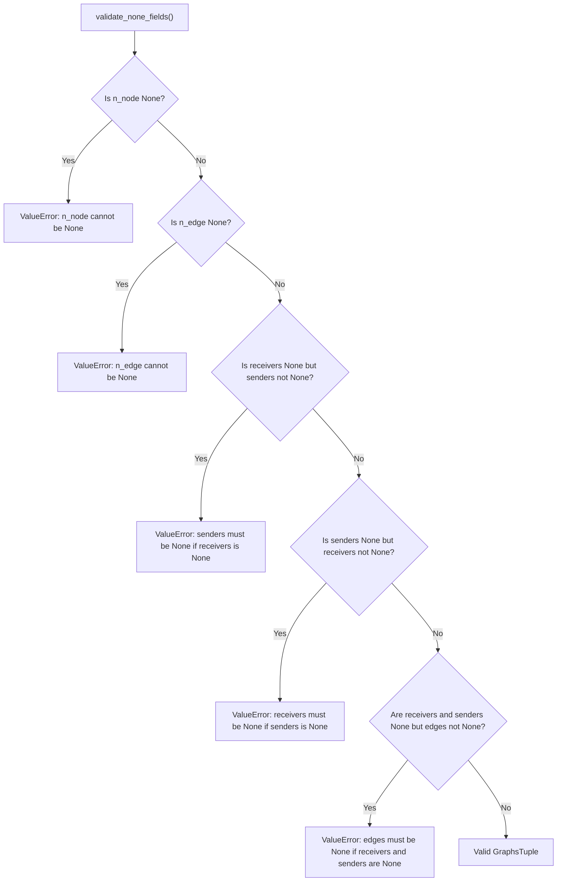
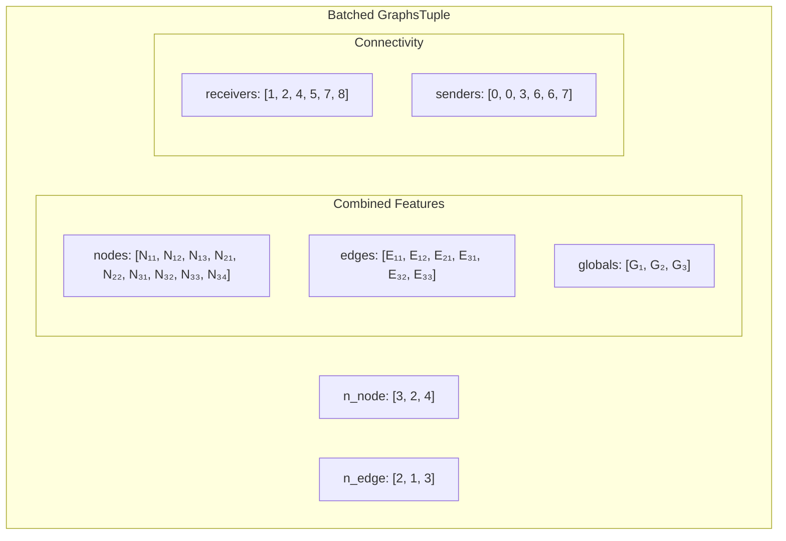
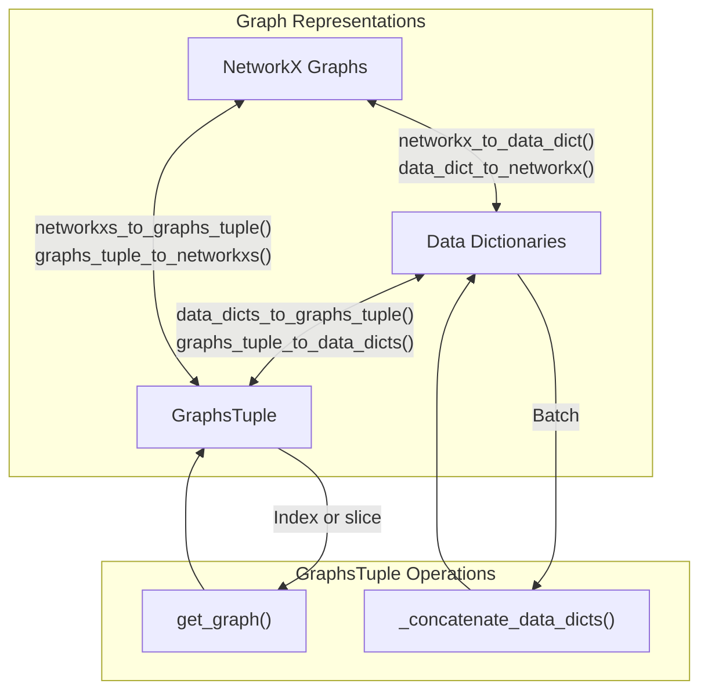

<!-- source: DeepWiki mcp.deepwiki.com · repo google-deepmind/graph_nets · page 2 Core Data Structure: GraphsTuple · fetched 2026-10-26 -->

# Core Data Structure: GraphsTuple

<details>
<summary>Relevant source files</summary>

The following files were used as context for generating this wiki page:

- [docs/graph_nets.md](docs/graph_nets.md)
- [graph_nets/graphs.py](graph_nets/graphs.py)
- [graph_nets/utils_np.py](graph_nets/utils_np.py)
- [setup.py](setup.py)

</details>


This document details the `GraphsTuple` data structure, which forms the foundation of the Graph Nets library. The `GraphsTuple` is designed to efficiently represent batches of graphs with varying shapes and sizes in a way that supports batched processing for machine learning applications.

## Overview

The `GraphsTuple` is a specialized `namedtuple` that stores all necessary information to represent graphs for deep learning, including node features, edge features, global graph features, and graph connectivity information.



Sources: [graph_nets/graphs.py:125-127](), [graph_nets/graphs.py:128-147]()

## Definition and Structure

The `GraphsTuple` is defined as a `collections.namedtuple` with seven fields that together represent one or more graphs:

| Field | Description | Can be `None`? |
|-------|-------------|----------------|
| `nodes` | Features for each node | Yes |
| `edges` | Features for each edge | Yes |
| `globals` | Global features for each graph | Yes |
| `receivers` | Indices of receiver nodes for each edge | Yes* |
| `senders` | Indices of sender nodes for each edge | Yes* |
| `n_node` | Number of nodes per graph | No |
| `n_edge` | Number of edges per graph | No |

\* *Note: If `receivers` is `None`, then `senders` must also be `None` (and vice versa). If both are `None`, then `edges` must also be `None`.*

Sources: [graph_nets/graphs.py:15-102](), [graph_nets/graphs.py:149-165]()

The `GraphsTuple` class enforces these constraints through validation methods to ensure the data structure remains consistent:



Sources: [graph_nets/graphs.py:149-165]()

## Representing Batched Graphs

One of the key features of `GraphsTuple` is its ability to store multiple graphs of different sizes in a batched format. This facilitates efficient processing of graph data in machine learning pipelines.



In this diagram:
- `n_node: [3, 2, 4]` indicates there are 3 graphs with 3, 2, and 4 nodes respectively
- `n_edge: [2, 1, 3]` indicates these graphs have 2, 1, and 3 edges respectively
- The node and edge features are concatenated in the respective arrays
- The `receivers` and `senders` arrays use absolute indices into the concatenated nodes array

Sources: [graph_nets/graphs.py:25-82](), [graph_nets/utils_np.py:89-103]()

## Understanding Indexing in GraphsTuple

When multiple graphs are batched into a single `GraphsTuple`, the indices in `senders` and `receivers` become absolute indices into the concatenated `nodes` array. This requires careful handling of offsets when working with batched graphs.

For example, if we have 3 graphs with 3, 2, and 4 nodes respectively:

```
Graph 1: Nodes 0, 1, 2
Graph 2: Nodes 3, 4
Graph 3: Nodes 5, 6, 7, 8
```

Then an edge from node 1 to node 2 in Graph 3 would be represented as:
- `senders[i] = 6` (node 1 of Graph 3 has absolute index 6)
- `receivers[i] = 7` (node 2 of Graph 3 has absolute index 7)

The library includes utilities to compute these offsets when batching graphs and to adjust indices when unbatching.

Sources: [graph_nets/utils_np.py:89-103](), [graph_nets/utils_np.py:502-536]()

## Methods and Operations

The `GraphsTuple` class provides two key methods for working with graph data:

### 1. `replace(**kwargs)`

This method creates a new `GraphsTuple` with some fields replaced by the values in `kwargs`.

```python
# Example: Replace nodes in a GraphsTuple
new_graphs = original_graphs.replace(nodes=new_nodes)
```

Sources: [graph_nets/graphs.py:173-176]()

### 2. `map(field_fn, fields=GRAPH_FEATURE_FIELDS)`

This method applies a function `field_fn` to specified fields of the `GraphsTuple` and returns a new instance.

```python
# Example: Apply a function to all feature fields
def add_offset(x):
    return x + 1.0 if x is not None else None

new_graphs = original_graphs.map(add_offset)
```

Sources: [graph_nets/graphs.py:178-195]()

## Conversion Utilities

The Graph Nets library provides utilities for converting between `GraphsTuple` and other graph representations.



Key conversion functions include:

1. `networkx_to_data_dict` / `data_dict_to_networkx`: Convert between NetworkX graphs and data dictionaries
2. `data_dicts_to_graphs_tuple` / `graphs_tuple_to_data_dicts`: Convert between data dictionaries and `GraphsTuple`
3. `networkxs_to_graphs_tuple` / `graphs_tuple_to_networkxs`: Direct conversion between NetworkX graphs and `GraphsTuple`
4. `get_graph`: Extract a single graph or a slice of graphs from a batched `GraphsTuple`

Sources: [graph_nets/utils_np.py:117-236](), [graph_nets/utils_np.py:245-307](), [graph_nets/utils_np.py:380-446](), [graph_nets/utils_np.py:541-568]()

## Validation and Constraints

The `GraphsTuple` enforces certain constraints to maintain data consistency:

1. The `n_node` and `n_edge` fields cannot be `None`
2. If `receivers` is `None`, then `senders` must also be `None` (and vice versa)
3. If both `receivers` and `senders` are `None`, then `edges` must also be `None`

These constraints ensure that the graph structure remains valid and are checked both during initialization and when fields are replaced.

Sources: [graph_nets/graphs.py:149-165](), [graph_nets/graphs.py:173-176]()

## Use in Graph Neural Networks

The `GraphsTuple` is the primary data structure used throughout the Graph Nets library for representing graph-structured data in neural network models. It provides a consistent interface for all graph neural network components while allowing for efficient batched processing.

In the broader architecture of the library, `GraphsTuple` connects with various graph neural network modules such as `EdgeBlock`, `NodeBlock`, and `GlobalBlock` which operate on different components of the graph structure.

Sources: [setup.py:24-26]()

## Summary

The `GraphsTuple` data structure provides a flexible and efficient way to represent graphs for machine learning. Its key features include:

- Support for batched processing of multiple graphs
- Ability to handle graphs of varying shapes and sizes
- Consistent representation of node features, edge features, and global features
- Utilities for conversion between different graph representations
- Validation to ensure data consistency

Understanding the `GraphsTuple` is essential for effectively using the Graph Nets library, as it serves as the primary interface for all graph operations and neural network components.

---

