<!-- source: DeepWiki mcp.deepwiki.com · repo google-deepmind/graph_nets · page 3 Graph Neural Network Components · fetched 2026-10-26 -->

# Graph Neural Network Components

Relevant source files

The following files were used as context for generating this wiki page:

- [docs/graph_nets.md](docs/graph_nets.md)
- [graph_nets/blocks.py](graph_nets/blocks.py)
- [graph_nets/modules.py](graph_nets/modules.py)

This page provides an overview of the core components used to build Graph Neural Networks in the graph_nets library. These components form the foundation for creating various graph neural network architectures by manipulating and transforming graph-structured data. For information about the core data structure used by these components, see [Core Data Structure: GraphsTuple](#2).

## Core Building Blocks

The graph_nets library is built around three fundamental building blocks that enable message passing between different elements of graphs. These blocks are implemented as Sonnet modules that update specific parts of a graph while leaving other parts unchanged.

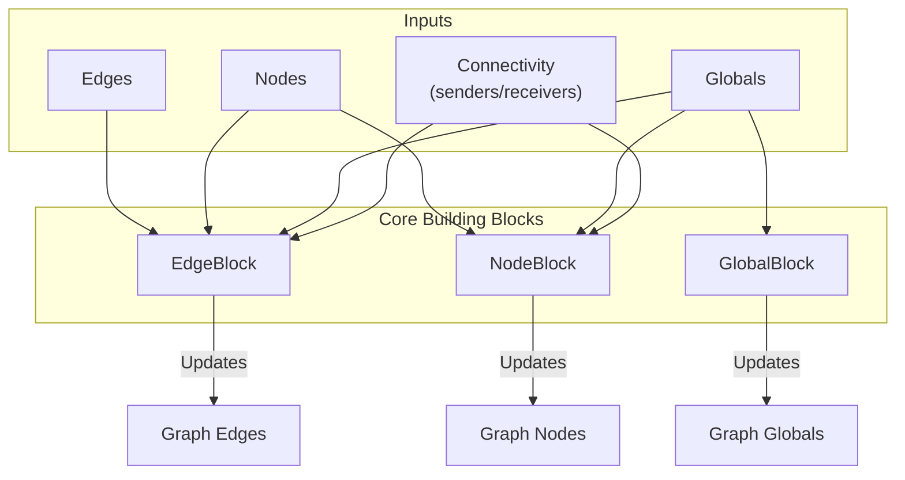

Sources: [graph_nets/blocks.py:386-484](), [graph_nets/blocks.py:487-602](), [graph_nets/blocks.py:605-707]()

### EdgeBlock

The EdgeBlock updates the features of each edge in a graph based on:
- The edge's previous features
- Features of the nodes connected to the edge (sender and receiver nodes)
- Global features of the graph

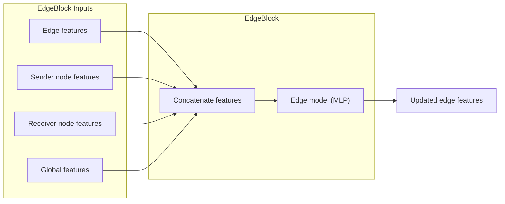

Sources: [graph_nets/blocks.py:386-484]()

### NodeBlock

The NodeBlock updates the features of each node based on:
- The node's previous features
- Aggregated features from connected edges (sent and/or received)
- Global features of the graph

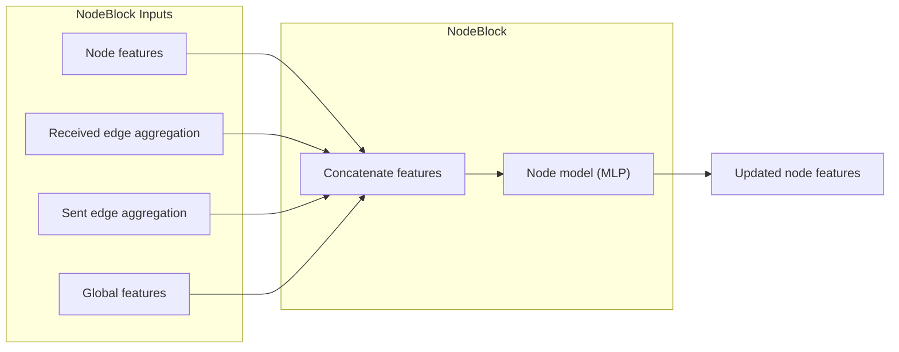

Sources: [graph_nets/blocks.py:487-602]()

### GlobalBlock

The GlobalBlock updates the global features of a graph based on:
- Previous global features
- Aggregated features from all nodes in the graph
- Aggregated features from all edges in the graph

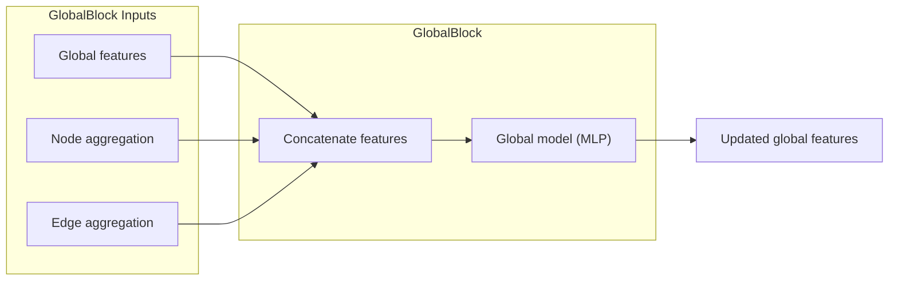

Sources: [graph_nets/blocks.py:605-707]()

## Aggregation and Broadcasting Operations

To enable information flow between different parts of the graph, the library provides two types of operations:

1. **Aggregation operations**: Combine features from multiple graph elements into one
2. **Broadcasting operations**: Distribute features from one element to multiple elements

### Aggregation Operations

Aggregation operations reduce features from multiple elements into a single representation using a reduction function (e.g., sum, mean, max).

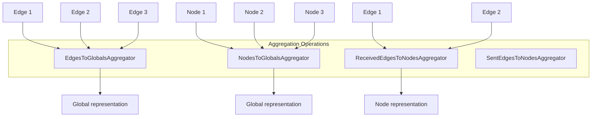

Sources: [graph_nets/blocks.py:176-213](), [graph_nets/blocks.py:213-248](), [graph_nets/blocks.py:302-327](), [graph_nets/blocks.py:272-300]()

### Broadcasting Operations

Broadcasting operations distribute features from one element to multiple related elements.

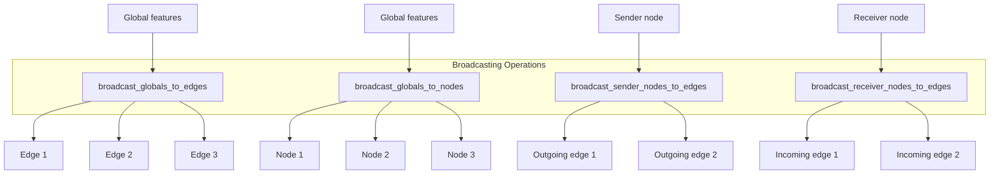

Sources: [graph_nets/blocks.py:77-129](), [graph_nets/blocks.py:131-173]()

## Network Modules

The library provides several pre-built graph neural network architectures that compose the fundamental blocks in different ways to handle various types of graph-based tasks.

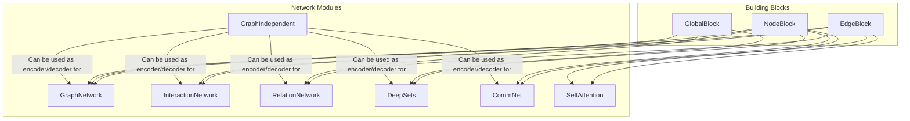

Sources: [graph_nets/modules.py:78-145](), [graph_nets/modules.py:148-216](), [graph_nets/modules.py:247-329](), [graph_nets/modules.py:332-411](), [graph_nets/modules.py:414-498](), [graph_nets/modules.py:501-597](), [graph_nets/modules.py:657-753]()

### GraphNetwork

The most general architecture that can update all three components (edges, nodes, and globals) of a graph.

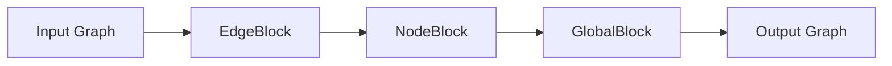

Sources: [graph_nets/modules.py:247-329]()

### InteractionNetwork

Updates edges based on connected nodes, then updates nodes based on the new edges.

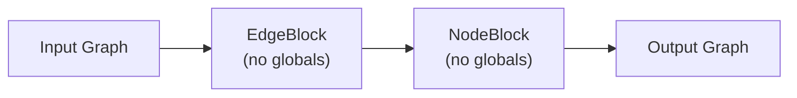

Sources: [graph_nets/modules.py:78-145]()

### RelationNetwork

Updates edges based on connected nodes, then updates only the global features based on the edges.

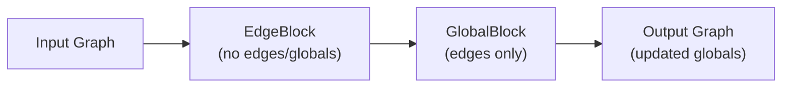

Sources: [graph_nets/modules.py:148-216]()

### DeepSets

Works on sets (graphs without edges), updating nodes based on their features and globals, then updating globals based on the nodes.

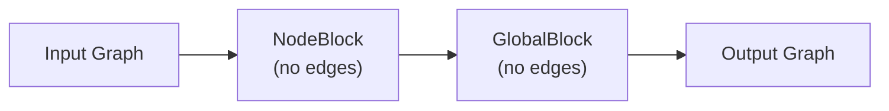

Sources: [graph_nets/modules.py:414-498]()

### GraphIndependent

A simple module that independently applies transformations to each graph element type without message passing.

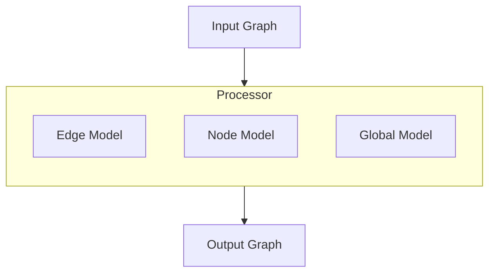

Sources: [graph_nets/modules.py:332-411]()

## Message Passing Flow

The core functionality of these components is to enable message passing between different parts of a graph. The following diagram illustrates the overall message passing process in a typical GraphNetwork module:

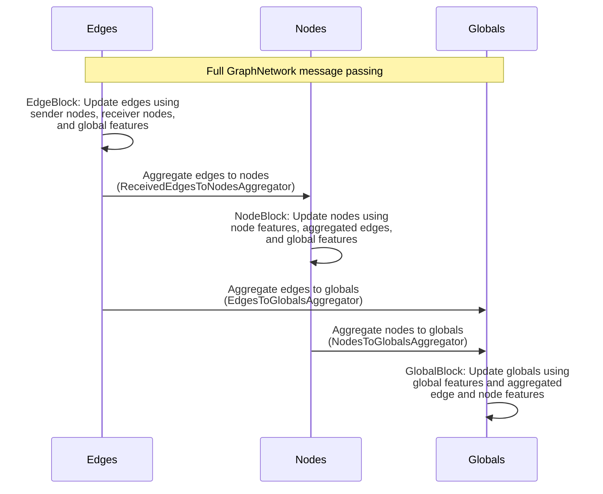

Sources: [graph_nets/modules.py:247-329](), [graph_nets/blocks.py:386-484](), [graph_nets/blocks.py:487-602](), [graph_nets/blocks.py:605-707]()

## Implementation Details

The building blocks and network modules are implemented as Sonnet modules, which provides a clean and modular interface for constructing neural networks. Each building block takes a model function as input, which should return a neural network module (typically an MLP) that will be applied to the concatenated features.

| Component | Required model_fn | Input features | Output |
|-----------|------------------|----------------|--------|
| EdgeBlock | edge_model_fn | Concatenated edge, sender node, receiver node, and global features | Updated edge features |
| NodeBlock | node_model_fn | Concatenated node, aggregated edge, and global features | Updated node features |
| GlobalBlock | global_model_fn | Concatenated global, aggregated node, and aggregated edge features | Updated global features |
| GraphNetwork | edge_model_fn, node_model_fn, global_model_fn | Features from respective blocks | Updated graph with all components updated |

Sources: [graph_nets/blocks.py:386-484](), [graph_nets/blocks.py:487-602](), [graph_nets/blocks.py:605-707](), [graph_nets/modules.py:247-329]()

## Usage Patterns

The components are typically combined in an encode-process-decode pattern:

1. **Encode**: Transform input features using a GraphIndependent module
2. **Process**: Apply message passing using one of the network modules
3. **Decode**: Transform output features using another GraphIndependent module

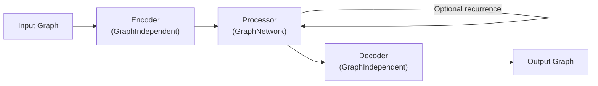

Sources: [graph_nets/modules.py:332-411](), [graph_nets/modules.py:247-329]()

## Reducers

Many components require a reducer function to aggregate features. The library supports various reduction operations:

| Reducer | Operation | Description |
|---------|-----------|-------------|
| tf.math.unsorted_segment_sum | Sum | Sums features within each segment |
| tf.math.unsorted_segment_mean | Mean | Averages features within each segment |
| tf.math.unsorted_segment_prod | Product | Multiplies features within each segment |
| unsorted_segment_max_or_zero | Max | Maximum value within each segment (or zero) |
| unsorted_segment_min_or_zero | Min | Minimum value within each segment (or zero) |

Sources: [graph_nets/blocks.py:330-383]()

---

