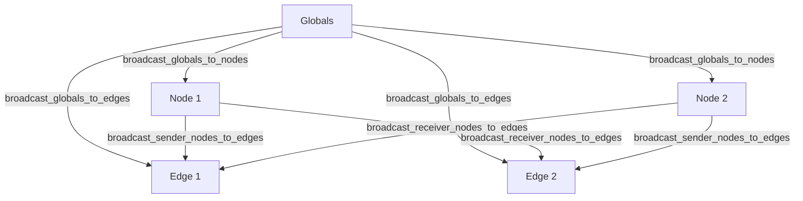
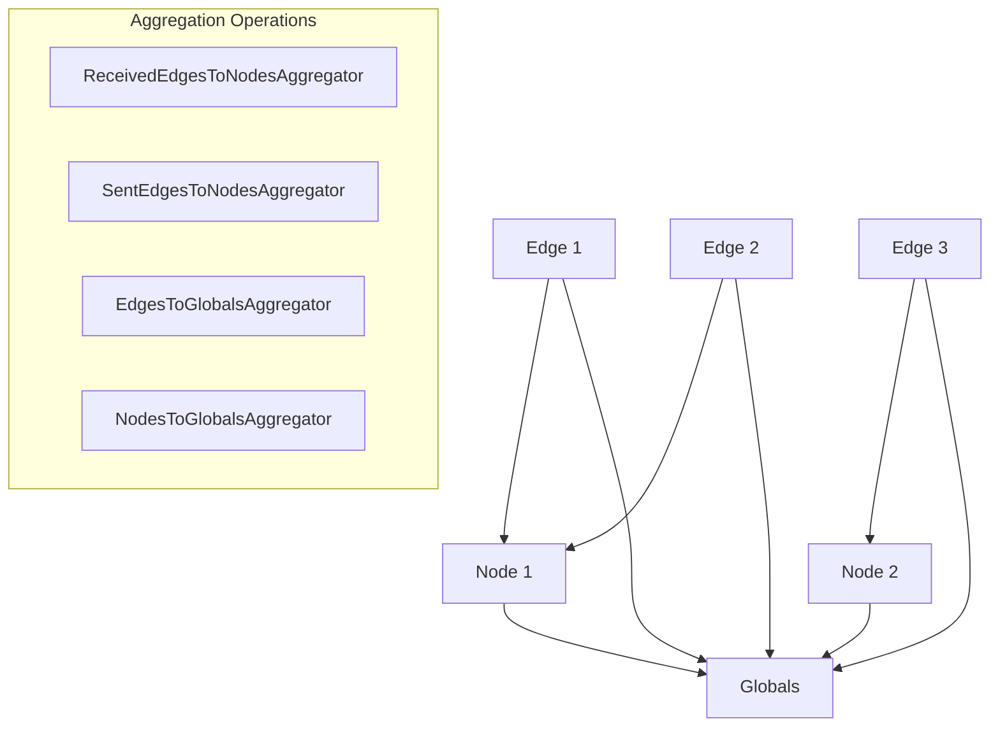
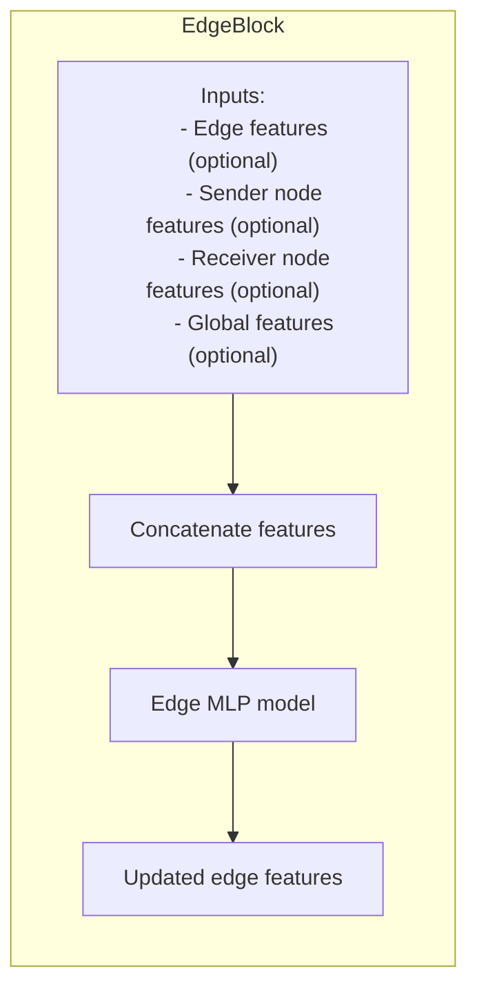
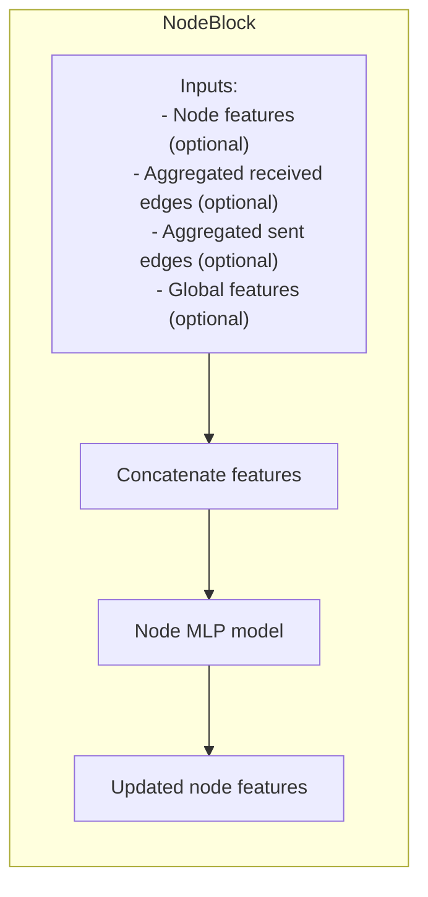
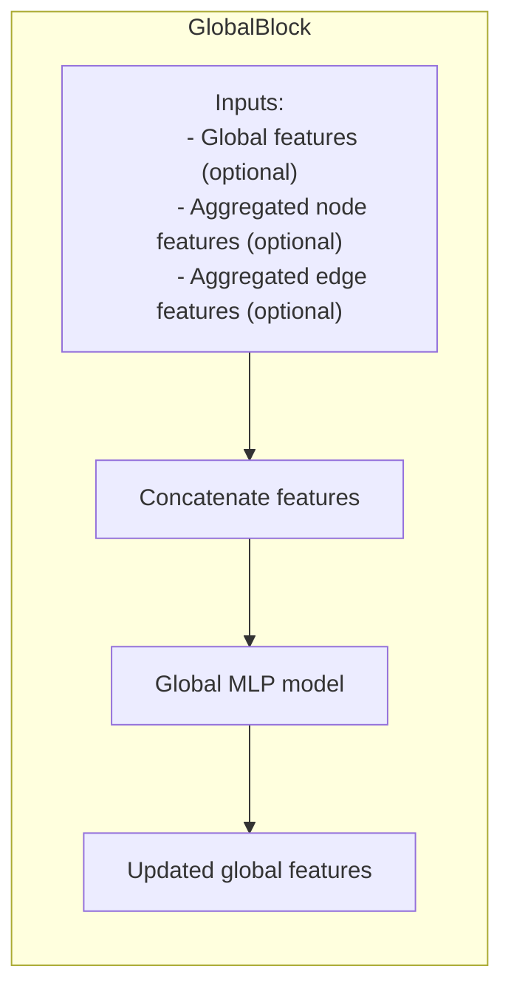
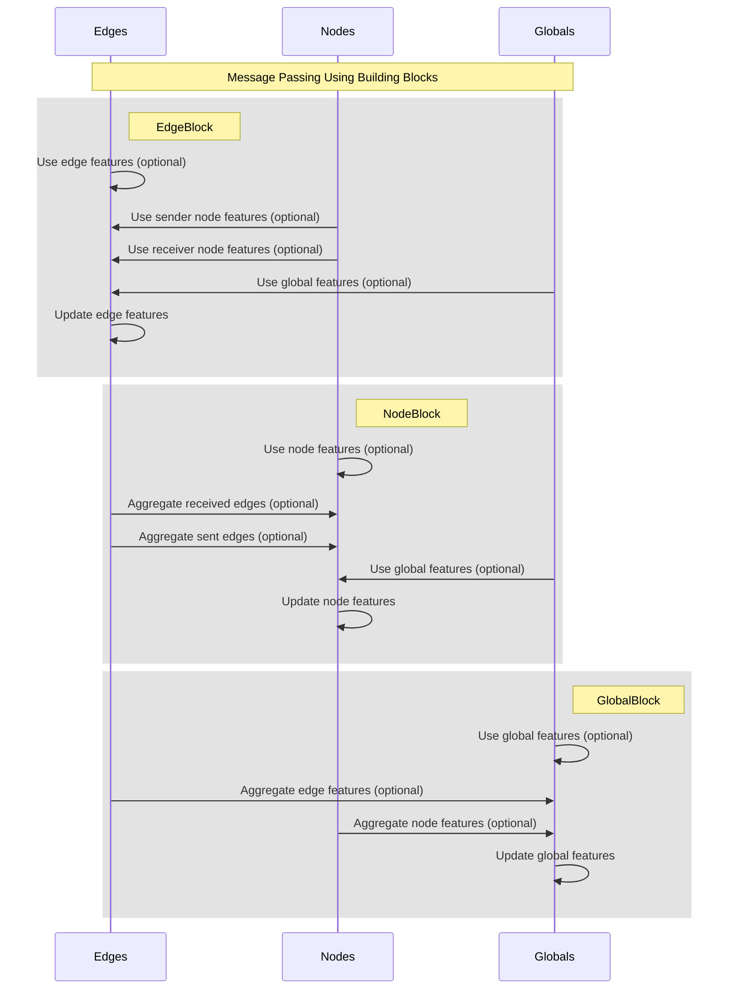

<!-- source: DeepWiki mcp.deepwiki.com · repo google-deepmind/graph_nets · page 3.1 Building Blocks · fetched 2026-10-26 -->

# Building Blocks

<details>
<summary>Relevant source files</summary>

The following files were used as context for generating this wiki page:

- [docs/graph_nets.md](docs/graph_nets.md)
- [graph_nets/blocks.py](graph_nets/blocks.py)
- [graph_nets/tests_tf2/blocks_test.py](graph_nets/tests_tf2/blocks_test.py)

</details>


This document explains the fundamental building blocks of the Graph Nets library, which form the core components for creating graph neural networks. These building blocks provide mechanisms for manipulating and transforming graph-structured data by propagating, aggregating, and updating features across different elements of a graph. For higher-level network modules built using these blocks, see [Network Modules](#3.2).

## Overview of Building Blocks

The Graph Nets library provides three primary building blocks that can be composed to create a variety of graph neural networks:

1. **EdgeBlock** - Updates edge features based on edge, node, and global features
2. **NodeBlock** - Updates node features based on node, aggregated edge, and global features
3. **GlobalBlock** - Updates global features based on global, aggregated node, and aggregated edge features

These blocks are supported by broadcaster functions and aggregator classes that enable information flow between different components of a graph.

```mermaid
graph TB
    subgraph "Building Block Components"
        direction LR
        
        subgraph "Broadcasters"
            BcastGE["broadcast_globals_to_edges"]
            BcastGN["broadcast_globals_to_nodes"]
            BcastSE["broadcast_sender_nodes_to_edges"]
            BcastRE["broadcast_receiver_nodes_to_edges"]
        end
        
        subgraph "Aggregators"
            EG["EdgesToGlobalsAggregator"]
            NG["NodesToGlobalsAggregator"]
            SEN["SentEdgesToNodesAggregator"]
            REN["ReceivedEdgesToNodesAggregator"]
        end
        
        subgraph "Core Blocks"
            EB["EdgeBlock"]
            NB["NodeBlock"]
            GB["GlobalBlock"]
        end
        
        Broadcasters --> "Core Blocks"
        Aggregators --> "Core Blocks"
    end
```

Sources: [graph_nets/blocks.py:16-29](), [graph_nets/blocks.py:387-708]()

## Broadcasters

Broadcasters are functions that propagate features from one part of the graph to another, providing inputs for the update functions in the core blocks.



The library provides four main broadcaster functions:

| Broadcaster | Description |
|-------------|-------------|
| `broadcast_globals_to_edges` | Broadcasts global features to each edge in the graph |
| `broadcast_globals_to_nodes` | Broadcasts global features to each node in the graph |
| `broadcast_sender_nodes_to_edges` | Broadcasts node features to the edges they are sending into |
| `broadcast_receiver_nodes_to_edges` | Broadcasts node features to the edges they are receiving from |

These broadcasters take a `GraphsTuple` as input and return a tensor with the appropriate broadcasted features.

Example usage:
```python
# Broadcast global features to all edges
edges_with_globals = broadcast_globals_to_edges(graph)

# Broadcast sender node features to edges
edges_with_sender_info = broadcast_sender_nodes_to_edges(graph)
```

Sources: [graph_nets/blocks.py:77-173]()

## Aggregators

Aggregators collect information from multiple elements (e.g., edges or nodes) and reduce them to a single output per destination element using a specified reduction operation.



The library provides four main aggregator classes:

| Aggregator | Description |
|------------|-------------|
| `EdgesToGlobalsAggregator` | Aggregates all edges into globals |
| `NodesToGlobalsAggregator` | Aggregates all nodes into globals |
| `SentEdgesToNodesAggregator` | Aggregates sent edges into their sender nodes |
| `ReceivedEdgesToNodesAggregator` | Aggregates received edges into their receiver nodes |

Each aggregator takes a reducer function to perform the aggregation. Common reducers include:
- `tf.math.unsorted_segment_sum`
- `tf.math.unsorted_segment_mean`
- `tf.math.unsorted_segment_prod`
- `unsorted_segment_min_or_zero`
- `unsorted_segment_max_or_zero`

Example usage:
```python
# Create an aggregator to sum all edges into globals
edge_to_global_aggregator = EdgesToGlobalsAggregator(tf.math.unsorted_segment_sum)

# Apply the aggregator to a graph
global_edge_features = edge_to_global_aggregator(graph)
```

Sources: [graph_nets/blocks.py:176-327]()

## Core Blocks

The three core blocks (EdgeBlock, NodeBlock, and GlobalBlock) use the broadcasters and aggregators to update the features of edges, nodes, and globals in a graph.

### EdgeBlock

EdgeBlock updates the features of each edge based on the edge's previous features, features of adjacent nodes, and global features.



**Key Parameters**:
- `edge_model_fn`: Function that returns a neural network module for updating edge features
- `use_edges`: Whether to include previous edge features in the update
- `use_receiver_nodes`: Whether to include receiver node features in the update
- `use_sender_nodes`: Whether to include sender node features in the update
- `use_globals`: Whether to include global features in the update

Sources: [graph_nets/blocks.py:386-484]()

### NodeBlock

NodeBlock updates the features of each node based on the node's previous features, aggregated features from connected edges, and global features.



**Key Parameters**:
- `node_model_fn`: Function that returns a neural network module for updating node features
- `use_received_edges`: Whether to include aggregated received edge features
- `use_sent_edges`: Whether to include aggregated sent edge features
- `use_nodes`: Whether to include previous node features
- `use_globals`: Whether to include global features
- `received_edges_reducer`: Function to reduce multiple received edges per node
- `sent_edges_reducer`: Function to reduce multiple sent edges per node

Sources: [graph_nets/blocks.py:487-602]()

### GlobalBlock

GlobalBlock updates the global features based on the previous global features, aggregated features from all nodes, and aggregated features from all edges.



**Key Parameters**:
- `global_model_fn`: Function that returns a neural network module for updating global features
- `use_edges`: Whether to include aggregated edge features
- `use_nodes`: Whether to include aggregated node features
- `use_globals`: Whether to include previous global features
- `nodes_reducer`: Function to reduce features from all nodes
- `edges_reducer`: Function to reduce features from all edges

Sources: [graph_nets/blocks.py:605-707]()

## Message Passing Flow

The building blocks enable the implementation of message-passing neural networks where information flows between different components of the graph. The standard message passing flow involves updates in this order: edges → nodes → globals.



By chaining these blocks together, the Graph Nets library enables the construction of sophisticated graph neural networks that can pass information between all parts of the graph.

Sources: [graph_nets/blocks.py:386-707]()

## Implementation Example

Here's a simplified example of how the building blocks can be used together:

```python
# Create the edge, node, and global blocks
edge_block = EdgeBlock(
    edge_model_fn=lambda: snt.nets.MLP([32, 32]),
    use_edges=True,
    use_receiver_nodes=True,
    use_sender_nodes=True,
    use_globals=True
)

node_block = NodeBlock(
    node_model_fn=lambda: snt.nets.MLP([32, 32]),
    use_received_edges=True,
    use_sent_edges=False,
    use_nodes=True,
    use_globals=True
)

global_block = GlobalBlock(
    global_model_fn=lambda: snt.nets.MLP([32, 32]),
    use_edges=True,
    use_nodes=True,
    use_globals=True
)

# Apply the blocks in sequence to a graph
graph_1 = edge_block(input_graph)
graph_2 = node_block(graph_1)
output_graph = global_block(graph_2)
```

This creates a simple message-passing graph neural network that:
1. First updates all edge features based on connected nodes and globals
2. Then updates all node features based on the updated edges and globals
3. Finally updates the global features based on all updated edges and nodes

Sources: [graph_nets/tests_tf2/blocks_test.py:362-1123]()

## Reducers and Special Aggregation Functions

The library provides two special reducer functions that handle cases where segments have no elements:

1. `unsorted_segment_min_or_zero`: Returns zero instead of the highest value for empty segments
2. `unsorted_segment_max_or_zero`: Returns zero instead of the lowest value for empty segments

These are particularly useful when working with graphs of varying sizes and connectivities.

```python
# Example usage:
aggregator = NodesToGlobalsAggregator(blocks.unsorted_segment_max_or_zero)
```

Sources: [graph_nets/blocks.py:330-383]()

## Summary

The building blocks in the Graph Nets library provide a flexible foundation for constructing graph neural networks:

1. **Broadcasters** spread information from one part of the graph to another
2. **Aggregators** combine information from multiple sources
3. **Core blocks** (EdgeBlock, NodeBlock, GlobalBlock) update features using a neural network

These components can be composed in various ways to implement different types of graph neural network architectures, allowing for information to flow between all parts of a graph in a learnable manner.

---

