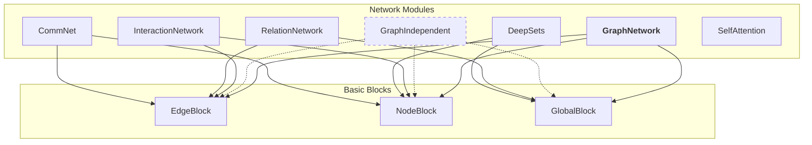
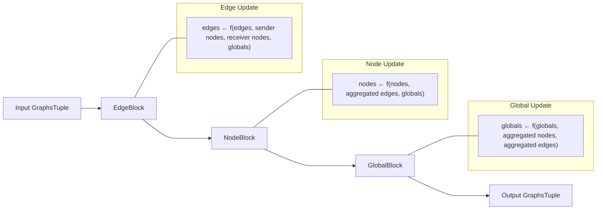
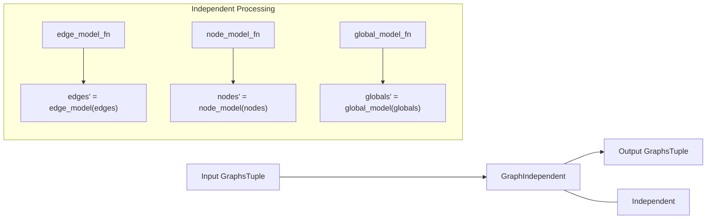
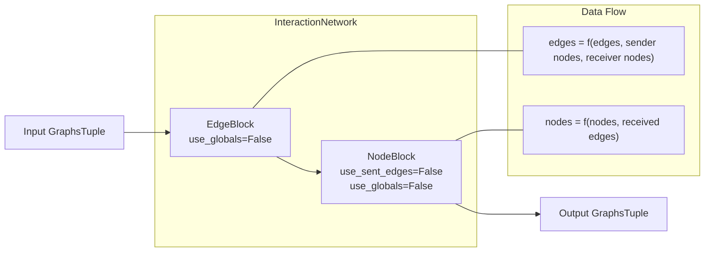
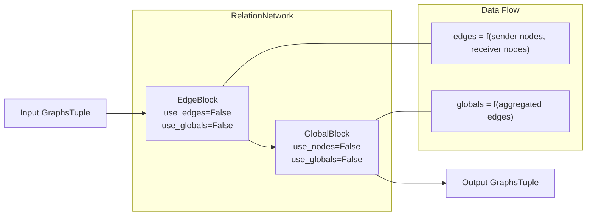
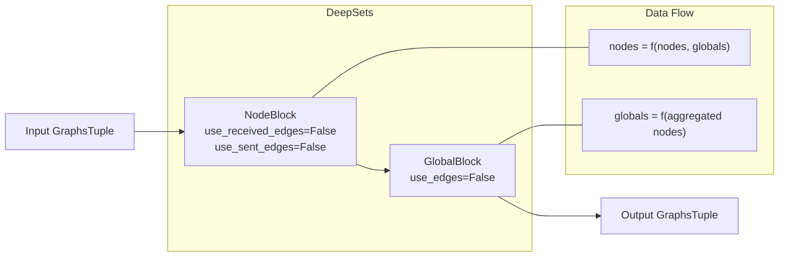
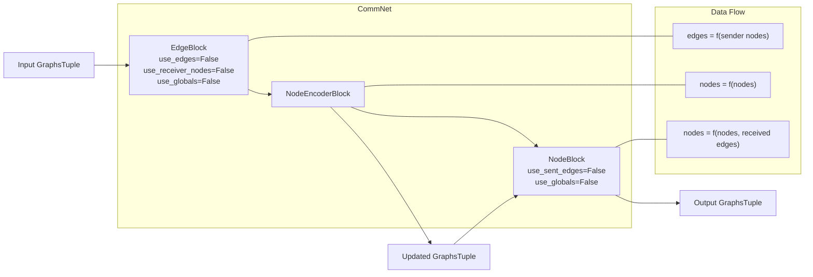
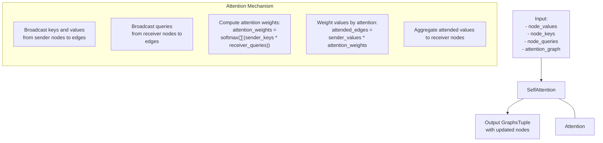
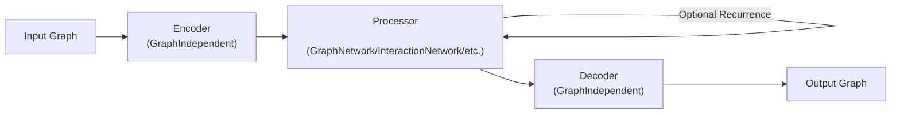

<!-- source: DeepWiki mcp.deepwiki.com · repo google-deepmind/graph_nets · page 3.2 Network Modules · fetched 2026-10-26 -->

# Network Modules

<details>
<summary>Relevant source files</summary>

The following files were used as context for generating this wiki page:

- [docs/graph_nets.md](docs/graph_nets.md)
- [graph_nets/modules.py](graph_nets/modules.py)
- [graph_nets/tests_tf2/modules_test.py](graph_nets/tests_tf2/modules_test.py)

</details>


This document describes the higher-level network modules provided by the Graph Nets library. These modules implement different types of graph neural networks by combining the fundamental building blocks (EdgeBlock, NodeBlock, GlobalBlock) covered in [Building Blocks](#3.1) in various ways.

The network modules are ready-to-use implementations of popular graph neural network architectures from the literature. They process GraphsTuple objects and provide different message-passing patterns for various learning tasks.

## Network Module Hierarchy



Sources: [graph_nets/modules.py:78-597](). [graph_nets/modules.py:247-329]().

## GraphNetwork

The GraphNetwork is the most general and comprehensive module that implements the full Graph Network framework as described in [Relational inductive biases, deep learning, and graph networks](https://arxiv.org/abs/1806.01261).



Sources: [graph_nets/modules.py:247-329]().

### Key Characteristics

- Updates all components of the graph (edges, nodes, and globals) in sequence
- Provides full control over update functions and message-passing patterns
- Supports customization via different reducer functions and block options

### Usage

A GraphNetwork is constructed by providing model functions for each block:

```python
graph_net = modules.GraphNetwork(
    edge_model_fn=edge_model_fn,   # Function returning model for edge updates
    node_model_fn=node_model_fn,   # Function returning model for node updates
    global_model_fn=global_model_fn,  # Function returning model for global updates
    reducer=tf.math.unsorted_segment_sum  # Reducer for aggregation
)
```

The GraphNetwork can then be applied to a GraphsTuple:

```python
output_graph = graph_net(input_graph)
```

Sources: [graph_nets/modules.py:247-329](). [graph_nets/tests_tf2/modules_test.py:259-698]().

### Customization Options

The GraphNetwork allows customization of how each block processes the graph:

| Block Type | Customizable Options |
|------------|----------------------|
| EdgeBlock  | `use_edges`, `use_receiver_nodes`, `use_sender_nodes`, `use_globals` |
| NodeBlock  | `use_received_edges`, `use_sent_edges`, `use_nodes`, `use_globals`, `received_edges_reducer`, `sent_edges_reducer` |
| GlobalBlock | `use_edges`, `use_nodes`, `use_globals`, `edges_reducer`, `nodes_reducer` |

Sources: [graph_nets/modules.py:57-244]().

## GraphIndependent

The GraphIndependent module processes each part of the graph (edges, nodes, and globals) independently, without message passing between them.



Sources: [graph_nets/modules.py:332-411]().

### Key Characteristics

- No message passing between different components of the graph
- Each component (edges, nodes, globals) is processed independently
- Often used as an encoder or decoder in conjunction with other modules
- Can use identity functions to leave some components unchanged

### Usage

GraphIndependent is commonly used to:
1. Encode raw features before passing them to a message-passing module
2. Decode processed features into the final output format
3. Apply the same transformation to all nodes/edges/globals independently

Sources: [graph_nets/modules.py:332-411](). [graph_nets/tests_tf2/modules_test.py:114-257]().

## InteractionNetwork

The InteractionNetwork implements the architecture described in [Interaction Networks for Learning about Objects, Relations and Physics](https://arxiv.org/abs/1612.00222).



Sources: [graph_nets/modules.py:78-146]().

### Key Characteristics

- Does not use or update global features
- Edge features are updated based on the connected nodes
- Node features are updated based on the aggregated incoming edge features
- Focuses on modeling interactions between objects (nodes) connected by relations (edges)

Sources: [graph_nets/modules.py:78-146](). [graph_nets/tests_tf2/modules_test.py:700-854]().

## RelationNetwork

The RelationNetwork implements the architecture described in [A simple neural network module for relational reasoning](https://arxiv.org/abs/1706.01427).



Sources: [graph_nets/modules.py:148-216]().

### Key Characteristics

- Focuses on computing global features based on pairwise relations
- Does not use or update node features after computing relations
- Edge features represent relations between pairs of nodes
- Global features aggregate information from all relations
- Original edge features are not used (new edge features are computed)

Sources: [graph_nets/modules.py:148-216](). [graph_nets/tests_tf2/modules_test.py:856-991]().

## DeepSets

The DeepSets module implements the architecture described in [Deep Sets](https://arxiv.org/abs/1703.06114).



Sources: [graph_nets/modules.py:414-498]().

### Key Characteristics

- Operates on sets, which can be thought of as graphs without edges
- Nodes are updated based on their features and global features
- Global features are computed by aggregating updated node features
- Edge information is ignored (can be None in the input)
- Useful for processing unordered collections of objects

Sources: [graph_nets/modules.py:414-498](). [graph_nets/tests_tf2/modules_test.py:993-1152]().

## CommNet

The CommNet module implements the architecture described in [Learning Multiagent Communication with Backpropagation](https://arxiv.org/abs/1605.07736).



Sources: [graph_nets/modules.py:501-597]().

### Key Characteristics

- Designed for multi-agent communication systems
- Nodes (agents) send messages to connected nodes
- Messages are created from the sender node features
- Each node independently learns an embedding of its features
- Nodes update their state based on received messages and their current state
- Global features are not used or updated

Sources: [graph_nets/modules.py:501-597](). [graph_nets/tests_tf2/modules_test.py:1155-1315]().

## SelfAttention

The SelfAttention module implements a multi-head self-attention mechanism for graphs.



Sources: [graph_nets/modules.py:657-753]().

### Key Characteristics

- Uses the attention mechanism similar to the one in Transformers
- Computes attention weights between connected nodes
- Supports multiple attention heads for different relationship types
- Can be used to implement graph attention networks
- Node A will only attend to Node B if there's an edge from B to A
- Returns a graph with updated node features based on attention-weighted aggregation

Sources: [graph_nets/modules.py:657-753](). [graph_nets/tests_tf2/modules_test.py:1317-1432]().

## Comparison of Network Modules

The following table summarizes the key differences between the network modules:

| Module | Updates Edges | Updates Nodes | Updates Globals | Main Use Case |
|--------|--------------|--------------|----------------|--------------|
| GraphNetwork | Yes | Yes | Yes | General-purpose graph processing |
| GraphIndependent | Yes | Yes | Yes | Independent processing of each component |
| InteractionNetwork | Yes | Yes | No | Object interactions in physical systems |
| RelationNetwork | Yes (new) | No | Yes | Relational reasoning between pairs |
| DeepSets | No | Yes | Yes | Processing sets (no edge information) |
| CommNet | Yes (messages) | Yes | No | Multi-agent communication |
| SelfAttention | No | Yes | No | Attention-based node updates |

Sources: [graph_nets/modules.py:78-753]().

## Integration with the Encode-Process-Decode Pattern

Network modules are often used in an Encode-Process-Decode pattern:



- **Encoder**: Usually a GraphIndependent that transforms raw features into latent representations
- **Processor**: A message-passing network module that updates the graph representations
- **Decoder**: Usually a GraphIndependent that transforms processed features into the desired output format

This pattern allows for flexible combination of different network modules and enables recurrent processing of graphs for more complex tasks.

Sources: [graph_nets/modules.py:332-411](). [graph_nets/modules.py:247-329]().

---

