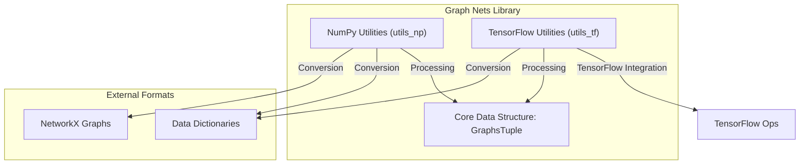
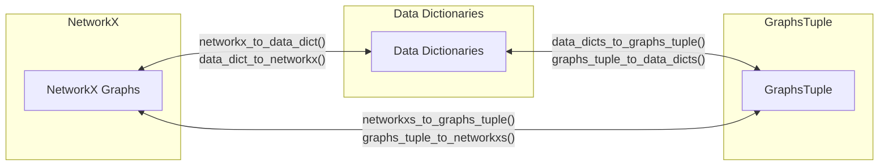
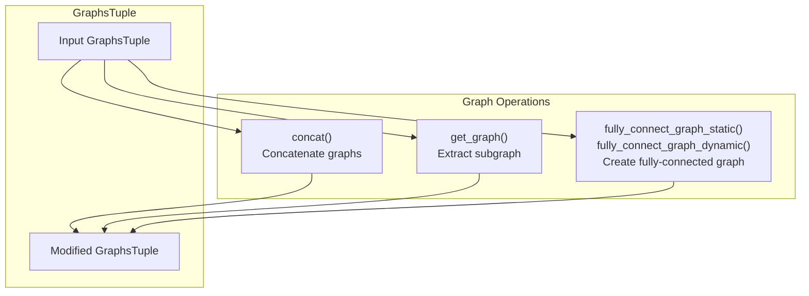
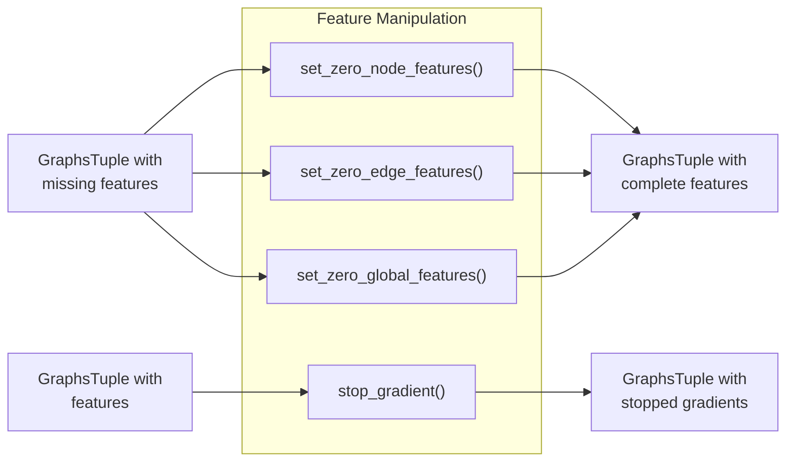

<!-- source: DeepWiki mcp.deepwiki.com · repo google-deepmind/graph_nets · page 4 Utilities · fetched 2026-10-26 -->

# Utilities

<details>
<summary>Relevant source files</summary>

The following files were used as context for generating this wiki page:

- [docs/contents.md](docs/contents.md)
- [graph_nets/graphs.py](graph_nets/graphs.py)
- [graph_nets/utils_np.py](graph_nets/utils_np.py)
- [graph_nets/utils_tf.py](graph_nets/utils_tf.py)
- [setup.py](setup.py)

</details>


The Graph Nets library provides a comprehensive suite of utility functions for manipulating, converting, and processing graph-structured data. These utilities enable seamless transitions between different graph representations, simplify graph operations, and facilitate integration with TensorFlow and NumPy workflows.

The utilities are divided into two main modules:
- `utils_np`: NumPy-based utilities for graph manipulation outside of TensorFlow execution
- `utils_tf`: TensorFlow-based utilities for graph manipulation within TensorFlow's computational graph

These modules are essential companions to the core graph data structure (`GraphsTuple`) and the graph neural network components described in [Graph Neural Network Components](#3).

## Overview of Utility Modules



Sources: [graph_nets/utils_np.py:15-34](), [graph_nets/utils_tf.py:16-57]()

## Data Conversion Utilities

The Graph Nets library provides utilities for converting between different graph representations:



### NetworkX Conversion

Functions for converting between NetworkX graphs and other representations:

- `networkx_to_data_dict`: Converts a NetworkX graph to a data dictionary
- `data_dict_to_networkx`: Converts a data dictionary to a NetworkX graph
- `networkxs_to_graphs_tuple`: Converts multiple NetworkX graphs to a GraphsTuple
- `graphs_tuple_to_networkxs`: Converts a GraphsTuple to multiple NetworkX graphs

#### Example NetworkX graph requirements:

NetworkX graphs should be structured such that:
- Node features are stored in `graph_nx.nodes(data=True)[i][-1]["features"]`
- Edge features are stored in `graph_nx.edges(data=True)[i][-1]["features"]`
- Global features are stored in `graph_nx.graph["features"]`

Sources: [graph_nets/utils_np.py:117-186](), [graph_nets/utils_np.py:245-306](), [graph_nets/utils_np.py:310-362](), [graph_nets/utils_np.py:365-377]()

### Data Dictionary Conversion

Functions for converting between data dictionaries and GraphsTuple:

- `data_dicts_to_graphs_tuple`: Converts multiple data dictionaries to a GraphsTuple
- `graphs_tuple_to_data_dicts`: Converts a GraphsTuple to multiple data dictionaries

A data dictionary contains the following fields:
- `nodes`: Node features
- `edges`: Edge features
- `globals`: Global features
- `receivers`: Receiver node indices for each edge
- `senders`: Sender node indices for each edge
- `n_node`: Number of nodes per graph
- `n_edge`: Number of edges per graph

Sources: [graph_nets/utils_np.py:380-404]()), [graph_nets/utils_np.py:407-446]()), [graph_nets/utils_tf.py:938-967]()

## Graph Manipulation Utilities

The library provides several functions for manipulating graphs:



### Concatenation and Extraction

- `concat`: Concatenates multiple GraphsTuples along a given axis
- `get_graph`: Extracts a specific graph or batch of graphs from a GraphsTuple
- `get_num_graphs`: Returns the number of graphs in a GraphsTuple

Sources: [graph_nets/utils_tf.py:327-387]()), [graph_nets/utils_tf.py:993-1071]()), [graph_nets/utils_tf.py:1074-1086](), [graph_nets/utils_np.py:541-568]()

### Creating Fully Connected Graphs

- `fully_connect_graph_static`: Creates a fully connected graph when the number of nodes is known at graph building time
- `fully_connect_graph_dynamic`: Creates a fully connected graph when the number of nodes is only known at runtime

These functions take a GraphsTuple with no edges and add edges to make it fully connected, with an option to exclude self-connections.

Sources: [graph_nets/utils_tf.py:710-832]()

## Feature Manipulation Utilities

The library provides utilities for manipulating graph features:



### Setting Zero Features

- `set_zero_node_features`: Sets node features to zeros with specified size and type
- `set_zero_edge_features`: Sets edge features to zeros with specified size and type
- `set_zero_global_features`: Sets global features to zeros with specified size and type

These functions are useful when you need to ensure all features are available, even if some were originally missing.

### Gradient Control and Processing

- `stop_gradient`: Prevents gradients from flowing through specified parts of a graph
- `identity`: Applies `tf.identity` to every field of a graph
- `make_runnable_in_session`: Allows a graph with `None` fields to be run in a TensorFlow session

Sources: [graph_nets/utils_tf.py:835-935]()), [graph_nets/utils_tf.py:390-457]()), [graph_nets/utils_tf.py:460-479]()

## Placeholder and TensorFlow Integration Utilities

The library includes utilities to create placeholders and integrate with TensorFlow:

### Placeholder Creation

- `placeholders_from_data_dicts`: Creates placeholders compatible with a list of data dictionaries
- `placeholders_from_networkxs`: Creates placeholders compatible with a list of NetworkX graphs

### TensorFlow Session Integration

- `get_feed_dict`: Creates a feed dictionary from a GraphsTuple for TensorFlow sessions
- `nest_to_numpy`: Converts a nest of eager tensors to a nest of NumPy arrays
- `specs_from_graphs_tuple`: Returns TensorSpec specifications for a given GraphsTuple, useful with `tf.function`

These utilities simplify the process of using GraphsTuple objects with TensorFlow sessions and functions.

Sources: [graph_nets/utils_tf.py:179-219]()), [graph_nets/utils_tf.py:223-290]()), [graph_nets/utils_tf.py:1089-1107]()), [graph_nets/utils_tf.py:1110-1169]()

## Utility Function Summary Table

| Function Type | NumPy (`utils_np`) | TensorFlow (`utils_tf`) |
|---------------|-------------------|------------------------|
| NetworkX Conversion | `networkx_to_data_dict`<br>`data_dict_to_networkx`<br>`networkxs_to_graphs_tuple`<br>`graphs_tuple_to_networkxs` | `placeholders_from_networkxs` |
| Data Dictionary Conversion | `data_dicts_to_graphs_tuple`<br>`graphs_tuple_to_data_dicts` | `data_dicts_to_graphs_tuple`<br>`placeholders_from_data_dicts` |
| Graph Manipulation | `get_graph` | `concat`<br>`get_graph`<br>`get_num_graphs`<br>`fully_connect_graph_static`<br>`fully_connect_graph_dynamic` |
| Feature Manipulation | - | `set_zero_node_features`<br>`set_zero_edge_features`<br>`set_zero_global_features`<br>`stop_gradient`<br>`identity`<br>`repeat` |
| TensorFlow Integration | - | `get_feed_dict`<br>`make_runnable_in_session`<br>`nest_to_numpy`<br>`specs_from_graphs_tuple` |

Sources: [graph_nets/utils_np.py:15-34]()), [graph_nets/utils_tf.py:16-57]()

## Key Implementation Patterns

### Data Dictionary Structure

Data dictionaries serve as an intermediate representation between various graph formats and are structured as follows:

```python
{
    'nodes': np.array,      # Node features, shape [n_nodes, node_feat_size]
    'edges': np.array,      # Edge features, shape [n_edges, edge_feat_size]
    'globals': np.array,    # Global features, shape [global_feat_size]
    'receivers': np.array,  # Receiver indices, shape [n_edges]
    'senders': np.array,    # Sender indices, shape [n_edges]
    'n_node': np.array,     # Number of nodes, scalar
    'n_edge': np.array      # Number of edges, scalar
}
```

This structure accommodates both single graphs and batches of graphs, with the latter implementing special indexing for the `receivers` and `senders` fields to maintain correct connectivity.

Sources: [graph_nets/graphs.py:18-102]()), [graph_nets/utils_np.py:499-537]()

### Handling of None Fields

The utilities are designed to gracefully handle `None` fields in GraphsTuple objects, following these rules:

1. `n_node` and `n_edge` cannot be `None`
2. If `receivers` is `None`, then `senders` must also be `None` (and vice versa)
3. If `receivers` and `senders` are `None`, then `edges` must also be `None`

These constraints ensure that the graph representation remains valid even with missing fields.

Sources: [graph_nets/graphs.py:149-165]()), [graph_nets/utils_tf.py:177-219]()

## Conclusion

The utility functions in Graph Nets provide essential tools for working with graph-structured data in both NumPy and TensorFlow contexts. They enable seamless conversion between different graph representations, manipulation of graph structure and features, and integration with TensorFlow's computational framework.

The comprehensive set of utilities addresses common tasks in graph neural network implementations, from data preprocessing to model execution, making it easier to build and run graph-based machine learning models.

---

